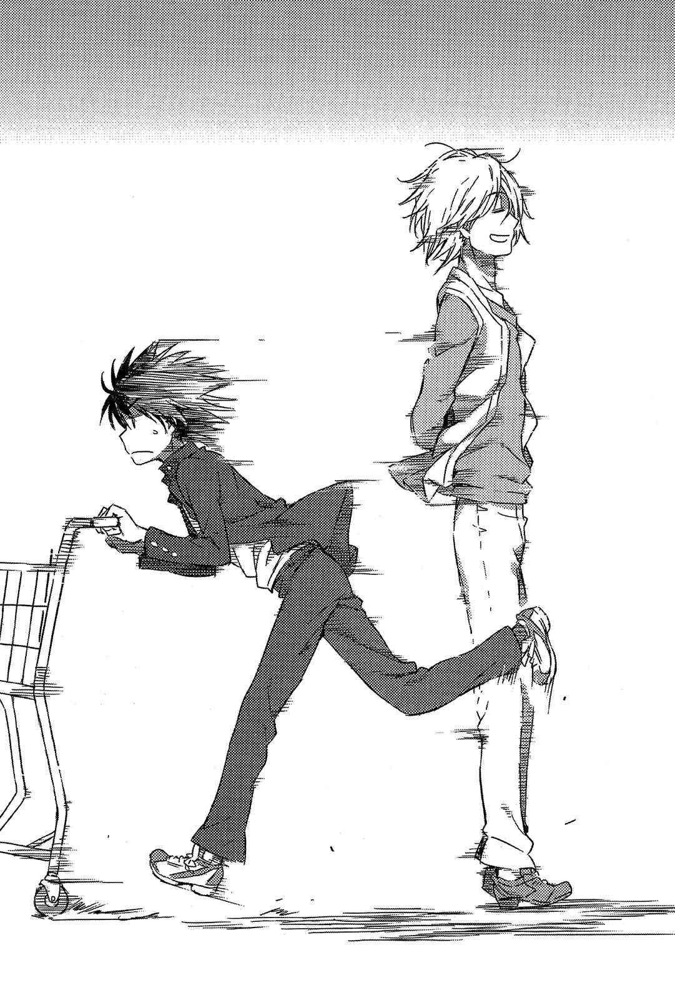

# 第一章 回神时已经开幕

> Open_the_Festival.

## 1

上条当麻在车站前的长椅上醒来。

「？」

透过十一月清澈空气传来的电车声使他皱起眉头，接着起身看了看四周。熟悉的学园都市车站前景象出现在眼前，来往的行人也毫不在意上条。他是学园都市整体景色的一部分，同时也眺望着学园都市的景色。

接着——

对于自己身处平时惯见之处以及个中理由，上条当麻毫无头绪。

（……咦？我记得自己在解决夏威夷群岛的事件之后，就直接前往东欧的巴格吉城，后来发生了什么事……？）

虽然直到疑似「格雷姆林」首领的眼罩少女，粉碎掉自己右手的这部分还记得，但后来是怎么了？即使努力回想，记忆却深埋在剧痛及恐怖的杂讯中。毕竟当时意识朦胧，可能根本没正常留下记忆。

不过对于这种状况的异样感还是逐渐涌现。

这种不协调感，仿佛跟微凉的空气一起刺进、潜入肌肤深处。

&nbsp;

是某人把自己从巴格吉城送回这里。

&nbsp;

如此判断还算合宜吧。但反过来看，这想必会极为困难。毕竟东欧的巴格吉城与远东的日本之间，几乎隔了半个地球的距离，而且光是要带着一个昏迷不醒，怎么看都跟事件有关的少年越过数道国境，应该就得花上不少功夫。

再加上——

上条所在的学园都市，是由完全独立于日本这个国家之外的警备体系来守护。虽然到目前为止，依然曾让几组魔法师偷偷闯入，但此处应该不是带着昏迷少年这个累赘，还能简单进出的地方吧？

有某人实际做到了这点。

某个从地球另一头运送上条当麻进来，又不留一丝痕迹地消失的人物。

「……」

他稍作思考后——

（……右方之火跟欧雷尔斯？是那两个家伙……？）

他连忙环顾四周，但是只见熟悉的学园都市景象，和理所当然地往来交错的少年少女们。丝毫不见过去引发第三次世界大战，震撼全地球人类的魔法师，以及似乎比他更进一步的男子踪影。

就在此时。

一阵脚步声传来。

身处如此纷乱的人潮中，四处充斥着人体所制造的日常生活声响，这脚步声却如同听着洞窟顶端滴下来的水声般，确切地滑入上条耳中刺激他的大脑。背后有股寒意窜过，声音来自自己身后。某人正从自己原本躺着的长椅后方不断接近。

是谁？

右方之火？

还是名为欧雷尔斯的男子？

正如前述，要把上条当麻送来学园都市相当费事，但他们选择这么做，就表示会收取价值相当的报酬。然而这报酬为何，就不一定是能平稳解决的事了。

上条无言地在右拳上加重了力道。

当完全握紧拳头后，他缓慢地转过身去。

站在那里的……

「咦？是吹寄？」

是顶着能清楚看见额头的黑长发同班同学（而且是巨乳）吹寄制理。这名身穿学校冬季制服长袖水手服的女高中生，不知为何双手各提着一个大塑料袋，里头装的不是超市或便利店的食物，而是文具和工具等工艺用品。

上条蹙着眉：

「你怎么会在这里？应该说你到底在做什么啊？」

「还敢问我在做什么……」

吹寄先是一阵低语，之后——

「真、正、该、被、问、的！应该是丢下『一端览祭』准备工作开小差的你吧，上条当麻————————————————————————————！」

「噗？」

视野染上一片白。上条被吹寄挥过来的塑料袋直接打中，而且触感相当坚硬沉重。不过这也算正常，毕竟里面可是塞满了一捆捆的宽电工胶带。

「等、等等……吹寄，那玩意变成跟监狱里的犯人凑合出来的武器一样了！噗？我的头要裂开啦！」

「啰嗦！对你这种家伙就是得这样！」

吹寄从塑料袋内拿出化为具体凶器的捆装电工胶带，并拉了一大条宽宽的胶带将上条的双手绑在他背后。

「我要直接把你带去学校！现在正在制作班上的活动摊位，但是人手极度不足啦！」

「直接……直接？不，呃……好歹让我回宿舍一趟比较好吧？对了，我还想确认茵蒂克丝的现状啊！」

最强的义警吹寄制理罔顾上条的呐喊，就此将犯人带走。

## 2

那里是个充满消毒用酒精的味道，而且干净到令人发毛的房间。房内有张靠电力调整椅背的特殊躺椅，而且椅子左右两侧的工作桌上，还排列着各种器具。器具的尺寸大约与圆珠笔相当，但是那些闪耀着银光的金属工具，绝不会摆在便利店等场所。它们的前端要不是相当尖锐，就是连着小小的镜子，甚至还有些装了电机驱动削去硬物的回转式锉刀工具。

全都是能让任何人在知道真面目之后，会吓得发抖的专业器具。

是询问过一百个人，也不见得能找出有谁会回答「我受得了」，赋予极限痛苦的器具。

「我有言在先。」

一名身着以类似雨衣那种能把水气完全弹开的素材制成，不同于白袍的独特服装男子低声表示。他的头发也用塑胶制帽子完全包裹，脸上更戴着巨大口罩让人看不清相貌。然而这种完全隐蔽身体的方式，却比脸部表情更为清楚地传达出他的个性与意志。

「就算忍耐也没意义，这不是靠努力与毅力就能撑过去的。听着，你是因为自作自受才被送到这里来，谁叫你不理会我们的警告。很可惜，对我来说，这情况已经是忍无可忍了。」

男子露出比监视摄像头更无情的眼神说道：

「你要了解，就算挣扎也没用，抵抗只会让痛苦的时间拉长。对你来说最好的选择，就是乖乖接受，这么一来，我至少能给你个痛快的结束。」

坐在特殊电动躺椅上的，是一名八岁左右的金发少女，另外有两三名跟男子相同打扮的男女，以围在她四周的形式站在一旁。他们全都面无表情，俯视着可说是「被迫躺在」能如床铺般完全放倒的椅子上的少女脸庞。

「啊、啊……」

即使少女发出呻吟声，也没有任何人皱一下眉头。

他们是专业人士。

因此，就算知道自己的工作将带来多大的痛苦，也绝不会手下留情。他们知道，若是因一时心软而在工作上留一手，只会造成糟糕的结果。

「你明白吗，芙蕾梅亚·塞维伦。如果明白我就要动手了，你就好好为自己以往的行动感到后悔吧。」

器材尖锐的前端，往少女硬被扳开的口腔内伸去。

「啊啊啊啊、啊啊啊啊啊啊啊啊啊！」

&nbsp;

&nbsp;

接着在牙医诊所的休息室，那高八度的惨叫声，让滨面仕上将视线从诊所摆着被翻皱的赛车杂志上抬起头来。在他正面的墙上，贴着写了「好孩子要注意牙齿健康，睡前不要忘记刷牙哦！」的手工海报。

坐在他身旁，身穿粉红色运动服的少女泷壶理后悠哉地开口说道：

「能让小女孩大哭到这种地步还会受大家称赞的职业，找遍全日本大概也只有牙医了。」

「……还有别的吧？例如鬼屋或生剥之类的。」[^1]

「咦，那个能赚钱吗？」

或许是因为罔顾滨面和泷壶的警告，顽固地持续「睡前一杯热巧克力」的行为获得相当成效，目前芙蕾梅亚正接受口腔改造手术。虽然她才八岁应该还是乳齿，不过似乎还没到能自然换牙的时间。

总觉得不论是蛀牙或接受治疗，似乎都得背负非必要的疼痛。

## 3

「那、那个啊，对老师来说，像上条你这样经常没通知一声就不来上课，实在是个大问题哦，快要不能靠交作业与补习就能了事啦。」

「素——」

「大前提是，你必须知道高中并不是义务教育哦，虽然的确要好好去想接下来该怎么补救，不过上条，你究竟是有怎样的问题啊？」

「素……」

「应该说最根本的问题是你的脸为什么会肿成这样？你是把头塞进虎头蜂窝里吗？」

在平凡的高中走廊高声喊叫的，是身高一百三十五厘米的迷你女老师月咏小萌。上条当麻则是在双手被电工胶带绑在身后的拘束状态下，遭同班同学吹寄制理处以拉着在市内到处跑的刑罚，还因为被地面不大的高低差绊倒又无法撑住身体，导致脸埋进女同学上半身那丰满柔软的部分，以下省略。

吹寄制理拉开教室的拉门，从背后将上条推了进去。

「喂——我把逃犯抓回来了。」

吹寄发表宣言后，就去做自己的工作了。

教室中完全看不到平时上课的景象。桌子全都塞在教室后方，空出来的宽广空间则排满了好几块巨大三夹板和许多工具。吹寄虽然说在「制作摊位」，不过目前还没有像拼积木一样完全组合起来，仍停留在巨大木板的阶段。

他们打算到「一端览祭」当天再拿出去，然后在现场组装成摊位。原因很简单，若是在之前就把摊位先组好放在外面，难保不会有爱找茬的人在晚上跑来破坏摊位，特别是那种没事就想砸破窗户的家伙，应该也不会放过摊位。在这座两百三十万名居民有八成为学生的城市中，发生这种轻微冲突的频率并不算低。

土御门元春和蓝发耳环，来到几乎成为蚯蚓同类的上条身旁。

他们以一副不打算帮上条解开胶带的样子开口道：

「欸，阿上，你怎么看？讲到文化祭，通常是要做咖啡厅或鬼屋来主动抢攻，才算合乎常识吧？我要说的是那种角色扮装方面的意义啊！章鱼烧摊位就整体来说，太缺乏娱乐的要素了！而就算要穿女仆装做章鱼烧，违和感又太重！风格取向的指针根本是偏到搞笑去了吧！」

「……似乎也没有在这类文化祭常会举办的女学生选美大会啊。连泳装跟羞耻play全都没有。这是怎样？文化祭的『文化』到底是什么？」

虽然上条在脑海中浮现至少不是在追寻女仆或泳衣文化这种率直的感想，不过那两个人根本听不进去。

上条转动着被电工胶带绑起的双手手腕，努力一点一滴地挣脱被黏着的部分，同时开口：

「『一端览祭』是对内活动吧，跟体验入学或校园开放参观活动同类。因为是跟报考率相连接的大规模宣传活动，所以老师们也很在意啊。换言之人家盯得超紧，怎么可能举办那种离谱的活动啊？」

「笨蛋！隔壁的锐利学园高中，就很平常地举办选美大会啊！还有泳装哦！而且因为外人也可以去参加，甚至还有云川学姐也会出场的传闻哦！」

「我们可是高中生啊！在『一端览祭』上的自由度，也比初中时高上许多呢！你难道不想看只有高中生能走的性感路线吗————————————————！」

「是很想啊！结果青春期男生的原动力，还是只有那档事啊！」

犯人上条当麻终于也坦白了。虽然三人瞎扯一堆道理，但要想尽量从别处吸引越多学生造访，就必须秀出他们会感兴趣的东西。若是乖巧地以「大人眼中的文化祭」为基准来举办活动，会场肯定会变得门可罗雀。

蓝发耳环举起食指说道：

「总之现在开始犹未晚矣。我认为应该要让顾摊的女生穿泳装——！」

「就算要人家穿泳装也不该在那里吧，要是被热油喷到会烫伤哦，而且会害小萌老师被一堆悔过书淹没。」

「不然就让不小心烤焦章鱼烧的女生接受处罚，得在脸上涂蛋白跟美乃滋站在店门口，这样如何！」

「肯定不会出现你想象中的那种画面啦。通常只会变得湿答答而且黏糊糊，甚至显得有点恶心。女孩子的脸颊上沾着鲜奶油就会变性感，那只是幻想啦。」

「这个男孩的思考也太负面了啊！幻想有什么不对？你是正处于觉得否定一切就算胜利的叛逆期啊？」

认真想对双手被绑在身后的同班同学开扁的冷血硬汉男蓝发耳环，以及往那名少年冲去，打算咬他侧腹的水泥丛林猛兽上条当麻。而土御门元春已经开始用比再次冲入大气层时更精密的方式，去计算要从哪个角度进入，才能借由被卷入这场争斗的冲击弹到其他女生身上了。

接着，「一端览祭」执行委员吹寄制理再次爆发。

「喂————————————————————————————————————————————————————————————！再干扰工作，我就把你们切碎当成像是幸运饼干的惊喜食材啦啊啊啊啊啊啊啊啊啊啊啊啊啊啊啊啊啊啊啊啊啊啊啊啊啊啊啊啊啊啊啊啊啊啊啊啊啊啊啊！」

若是真发生这种事，不但会立刻被禁止开店，还会变成网络新闻的头条。

## 4

学园都市所举办的超大规模文化祭「一端览祭」。这项规模庞大的活动，同时兼具体验入学和开放校园参观活动的功能，与各学校的报考率有直接关联，因此准备时间相当充裕，还有老师们也会相当好说话的「传统」。

虽然跟跑去夏威夷及巴格吉城的上条无关，不过学校最近都没在上课，要在规定时间内净空的规定也完全撤除。虽然有「禁止连日住校」这项潜规则，但反过来说，只要班级依照轮值表来进行组装工作，就不算违反规定。

与同等地位的超大规模运动会「大霸星祭」之间最大的不同，就在于对内跟对外这点吧。

不同于会从世界各地招待一般客人参加的「大霸星祭」，「一端览祭」的主要目标是生活在这个城市的学生们。

跟为了把最新锐的科学与超能力介绍给世人，在某种程度上必须「小心翼翼」的「大霸星祭」相比，「一端览祭」多少有些松懈的印象。不过毕竟是以生活在这座城市的学生为对象，普通技术根本无法抓住目标的目光。

因此，得将手边的最尖端科学技术全拿出来，非得做到「就连对学园都市的科学与超能力习以为常的学生们都会大吃一惊」这种地步不可。

就这层意义上，这可以算是世界上难度最高的文化祭。

不过是会当成难关，还是会从中找到干劲就因人而异了。

因此——

「总而言之，上条你要住在学校。这是对翘课的人必要的处罚。」

最高法院法官吹寄大人的单方面宣告，让上条发出如同孟克「呐喊」般的叫声。

「咦——？那我到底什么时候才能回宿舍啊？要是人在学园都市却不回家被茵蒂克丝知道，她可是会超级无敌生气啊！」

完全不听辩解的游戏管理人吹寄，自顾自地将事情进行下去。上条脱离胶带的束缚后，最初收到的命令是去准备食物。时间是中午，通常是会利用学生餐厅或食堂，但要在那个几乎化为战场的设施中准备所有同学的食物，几近于不可能。虽然离开学校，去大型超市等地点大量购买便宜便当及泡面是较佳方法，但「安全的绿洲」这种情报也会马上传遍其他学校，结果还是会演变成「虽然没有在学生餐厅或小卖部那么严重，却还是会爆发小规模争夺战」的情况。

「必要条件是一餐在两百日元以内，如果可能最好加上沙拉之类的蔬菜类食物，懂了吗？」

「加码到三百日元倒还能买到完整的中碗牛肉盖饭套餐，这可是没搞什么花样的汉堡，含税价都要卖一百日元以上的时代呢。」

「要计算好营养成分。例如桐田屋特大碗牛肉盖饭一份虽然特价三百八十日元，但是怎么想都有中碗两倍以上的量，只要将价钱除以二来计算，就能合乎预算了……说实在的，大家都有用手机确认附近商店街的网站，若是去找『单看一份很便宜』的商品，势必会跟其他学校起冲突。」

「……如果要大量购买，应该可以事前打电话给店家吧？需求量多，人家应该也愿意给个方便啊。」

「一旦这么做，那每间店都会塞满做好之后等人去取货的食物了。毕竟两百三十万人中的八成，会在同一时间开始觅食啊。」

吹寄在如此说明后眯起眼睛。

「我会把钱给你，伹是我可不准你因为不幸跌倒就把钱弄丢哦。」

「……很遗憾我无法保证。」

「钱会收在防水信封里，还会把我附有GPS的手机也放进去。这样可以吗？」

毕竟要运送数十人份的食物，这已经不是靠双手提塑料袋就能搬运的程度，于是上条推着工作用的手推车走出学校。

虽然还在准备期间，但四周的气氛感觉都有些浮躁。学生会比较多，果然还是因为现在是中午时段吧，跟上条一样负责准备食物的学生正四处奔走。

（……说到一份两百日元以内，还要有蔬菜的餐点，就是三明治了吧。不过一个个装好的便利店就不必了，要去那种以大胃王为对象的奇怪店家吗？那种店家应该是跟买书一样，采取一次购买大量食材来压低单价的手段，单份的量越大，客人的负担越少，应该能让全班的人都吃饱。）

原本因为上条算是自炊派，坦白说一开始他脑中率先浮现的，是自己动手做最便宜这个想法，不过班上同学总共有几十个人，要自己动手煮出这个分量的食物相当困难。

上条毕竟没有能用澡盆般大的锅子，做出不烧焦料理的技术，要用一般厨具做出数十人份的料理，又得花上好几小时。

（……虽然觉得外食的口味很重又贵，不过他们店家也有自己的专业精神吧。）

正当上条想着这些，往巨大三明治专卖店走去时——

&nbsp;

突然，

他发现自己错过了不该看漏的东西。

&nbsp;

「……」

上条停下脚步。周围依旧充满了「一端览祭」准备期间特有的浮躁气氛。那是种独特，换个说法甚至可以算是「异常」的状况。但是上条确信，有某种足以将这种气氛一扫而空的**庞大之物**就在这里。

而真正的问题在于——

那个**某物**并没有跟出鞘的日本刀一样向周围散发杀气，而是完全融入，完美调和在气氛中，所以没有人注意到。明明那是某种极端危险，若是随便靠近甚至会明确把人拉入「死亡」中的**庞大之物**。

夏威夷群岛、巴格吉城。

格雷姆林。

于世界内侧扩散，黑暗之中的黑暗。

而这是与其同等，或者该说在此之上的**某物**。察觉这个威胁的上条停下脚步，缓缓地在原地转过三百六十度。仔细观察周围后，他就找出了那股不协调感的真面目与出处。

短短三十米。

即使在地球另一头也让上条直流冷汗的**某物**，正靠在沿人行道种植的行道树旁看着这里。

严格而论，那不是格雷姆林。

然而——

某种意义上，那应该是个比格雷姆林更「异常」的对手。

&nbsp;

欧雷尔斯。

在巴格吉城遇到的，「差点成为魔神」的男人。

&nbsp;

「嗨。」

男子微微张口打完招呼后，就离开行道树往这里走来。

「我还在跟右方之火讨论你什么时候才会注意到啊。托你的福，我差点得请他吃晚饭了……倒是你还没迟钝得直到最后一刻都没发现嘛。」

魔神。

这个字眼并非指魔物中的神，而是指穷究魔法，以致成功将一只脚踏入神之领域的人。

得到茵蒂克丝脑中那十万三千本魔道书的知识，并能将其完全发挥后才可抵达的领域，众魔法师的金字塔顶端。同时，上条在心中某处也这么想：

那该不会跟绝对能力(Level 6)是类似的东西吧。

虽然理论上可行，谣传可能曾在某个时代，于世界某处出现过，但实际上能体现的人根本不存在。

不论如何，欧雷尔斯触及了那个领域。

虽然是以「差点成为」这种说法伤害了自身评价，但也正因没有夸张渲染，反而显得更真实。

那个怪物。

那个根本无法想象力量到达什么程度的怪物，正面对着上条当麻说出这种事：

「你那边也已经安定下来了吧，差不多该告诉你在巴格吉城没能交代的事了。」

「……」

「对你而言，疑问已经堆积如山了吧？格雷姆林这个组织、管理该组织的少女欧提努斯、她们最后的目的、我和欧提努斯的共通点『魔神』这个字眼，以及最重要的……」

短暂停顿后，欧雷尔斯如此宣告。

很明确地。

&nbsp;

「幻想杀手(Imagine Breaker)力量的秘密……应该说，是它的真面目。」

&nbsp;

这句话直接命中了要害。

足以让努力压抑至今的某物瞬间溃堤，以无人能挡之势奔流而出。

咕噜。

上条却得花数秒钟时间，才注意到那股声音出自自己的喉咙。

怎么偏偏就在这个节骨眼上？

当自己与班上同学共同参与「一端览祭」的准备工作，总算对自己回到原本的世界有了真实感的这个时间点。

烦恼的上条，终于叹出一大口气。

拔腿狂奔。

上条用尽全力，从正准备开始说起麻烦且冗长故事的欧雷尔斯身旁逃走。

&nbsp;

差点成为魔神的男子欧雷尔斯则是一脸惊讶。

「喂、喂！这是很认真的场面吧？而且听到幻想杀手(Imagine Breaker)的真面目，通常应该会上钩吧？咦——没上钩？现在的小孩这么难搞？喂！」

「啰嗦，食物的怨念是很恐怖的！明明没怎样都会得到从准备工作落跑的评价了，要是还敢在出来买午餐时不见人影，我就得等着瞧啦！这可不是被痛扁一顿就能搞定啊！」

这类事情的「专家」讲解起来，肯定都是又臭又长。

自己也还没做好心理准备。

上条迫切地希望，就算爱情喜剧要峰回路转，那好歹也先给个养眼场景再说吧。

身为一个接下来会很忙的人，只能在被拖下水之前先闪人。

## 5

「就是因为这样，所以才把你找来体育馆后面。」

面对因为完成购买午餐任务而大意的上条，欧雷尔斯一脸平静地说道。

上条当麻则已经握紧了右拳。

「……什么事？爱的告白？还是想在没人的地方吵架？若是后者那真是帮了我大忙。」

「日本的学校生活还真是极端啊。说实话，我有点难以理解。」

欧雷尔斯轻轻耸了耸肩。

「我应该提过有事要跟你说吧。」

「什么事？从哪里开始？」

「这就是问题了，要从哪里开始讲呢。」

虽然对方露出烦恼的样子，但上条并不清楚他到底有没有在烦恼。何况连「成为魔神」这种事都垂手可得的人，到底有什么好烦恼的？

不出所料，欧雷尔斯干脆地开了口：

「算了，这样装模作样慢慢讲也没意义，我就直接告诉你重点吧，有不懂的地方再多做说明来解决，这样最快。」

「重点？」

「魔神欧提努斯。」

欧雷尔斯这名男子对她如此评价，对自己则是停留在「差点成为」的阶段。

「她跟我不一样，可以算是完全的魔神。基本上她在这个世界没有办不到的事。因为『格雷姆林』这个组织是受她的力量管束，所以只要知道魔神欧提努斯的想法，自然也能了解『格雷姆林』整体的行动。」

接着——

欧雷尔斯先顿了一下，才看着上条的右手开口：

「有件事你要先知道，虽然右方之火过去曾为了得到你那只右手，不惜引发世界大战，但这次『格雷姆林』和欧提努斯的目标并不是幻想杀手(Imagine Breaker)……**计划中不需要的东西**，**就不必多在意**。所以只要受到阻挠，他们会干脆利落地选择杀了你。你的对手就是这种组织。」

「……」

虽然很容易忘记，不过上条当麻终究只是高中生。

尽管累积了特殊的经验，但他并非受过正统训练的军人或格斗家，装备方面也不会有人提供专业道具。一旦与持续以世界规模活动的「组织」为敌，肯定会陷入压倒性的不利。何况觉得自己可以与之对抗这点，就能证明身为外行人的上条「误判」了双方力量的差距。

再加上——

上条不但跟事情有所关联，还在与「格雷姆林」成员的战斗中获得了某种程度的胜利，已经来到无法回头的阶段。就算上条现在想抽身，「格雷姆林」也会选择一决胜负。

而且。

都已经走到这一步，上条也没有途中抽身的意愿。

因为放弃所造成的损失，恐怕不会只发生在上条身上。

「『格雷姆林』是因为右方之火引发第三次世界大战，所产生的魔法结社。」

欧雷尔斯说道。

那恐怕是连应对这类冲突的专家英国清教，都没能掌握到的情报。

「其思想简而言之，就是『就算战争的胜利者是科学阵营的学园都市，也不要擅自决定啦』。当时在最前线活动的魔法师，的确是右方之火……但是也有一群人主张『**魔法师并非只是如此**』『我们明明还没参战，**不要自称魔法阵营代表又擅自输掉**』。」

所以他们的基础并不是十字教，而是北欧神话吗。

不要只看到十字教的联合势力——罗马、俄罗斯势力擅自败北，就把那场败北硬是推给这个文化圈。

「……这么说来，他们是群相当自以为是的家伙啊。在第三次世界大战开打时，说不想扯上边所以不愿意帮忙，等到输了又意见一大堆？」

「毕竟从利害关系来看，协助右方之火也得不到好处嘛。而且在右方之火上头的那群人也注意到了，就算按照他的方式全都获得成功，恐怕也没办法如他所愿拯救世界。」

无法接受擅自决定的胜负。

这次要亲手决胜负。

他们「格雷姆林」就是靠这种思想来集结战力。

「『格雷姆林』跟具有数百、数千年历史的魔法结社不同，没有统一的思想。许多魔法师在第三次世界大战中嗅出了败北气息，各自因而感到不满、不平，『格雷姆林』就是为了承载这些情绪而结成的。当然了，相对于学园都市这个胜利者，这些魔法师也准备了能代表魔法阵营的『象征』。」

「……就是欧提努斯这个『魔神』」

「这是很容易理解的力量天秤。虽然还不清楚是欧提努斯集结了魔法师，还是魔法师们找上欧提努斯，总之为了对抗学园都市这个过度巨大的秤锤，『格雷姆林』也会想彻底强化欧提努斯吧……讲得简化点，要把格雷姆林视作实现欧提努斯任性愿望的组织也无妨。」

「所谓魔神，应该是无所不能吧？有必要找别人帮忙吗？」

「应该说正因为无所不能，才会有问题啊。」

欧雷尔斯就像在怜悯同类般，露出讽刺的笑容。

「『无限的可能性』这种宣传词的确很好听，但是真正的含义，除了具有正向可能性之外，也同样带有负向可能性啊。」

「？」

「以你的年纪，很难实际相信『无限的可能性』吧？拿掷硬币来举例好了，出现正面跟反面的几率是各占一半。这就是『无限的可能性』的真面目。每个行动中都含有失败与成功两种可能性存在。无论经历过多少锻炼，跟小孩打架时依旧会有五成打输的几率存在，这就是魔神。」

五成可以说相当高。

拿俄罗斯轮盘来举例，就是放进三颗实弹后再展开游戏。

「对于打算向时代的胜利者学园都市，做『某件大事』的『格雷姆林』与欧提努斯来说，肯定会想修正这个混乱的或然率。为了保有并完全施展到手的力量，为了得到百分之百的胜利，他们需要做几项调整。而这些前置作业，就以夏威夷群岛和巴格吉城骚动的形式来呈现。」

「……你是说，那些事件不过是前置作业？」

「因为欧提努斯是北欧神话中主神奥丁的别名啊，所以会跟神话具有一致性吧。**他们要靠准备象征该神祗性质的灵装**，**再次对该神祗的性质本身做调整**……北欧神话是武器的神话，神力是靠武器的力量展现。这么一来，要预测出欧提努斯所追求的东西也不难了。」

欧雷尔斯依然平稳地说道。

他毫不犹豫地，说出直接足以连接世界走向的情报。

「神枪冈格尼尔。主神奥丁身为主神的武力象征灵装。他们恐怕就是为了完美地做出这玩意，才在世界各地引发骚动吧。」

利用夏威夷群岛的活火山能源来建造「炉」。

拥有制作北欧神话传说武器技术的黑侏儒(矮人)。

偷走过去曾成功锻造出部分神枪冈格尼尔的女武神布伦希尔德·爱克特贝尔脑中的设计图。

「……话虽如此，其实只靠现在存在于地球上的技术，无法锻造出完美的神枪冈格尼尔，但是经过巴格吉城事件后，这个条件也得以克服了。」

「？」

「开发整体论的超能力者，**这是不存在于地球上的技术**。假设完成了，自然能伸手触及以往所不存在的可能性。换言之，神枪冈格尼尔最后的拼图就这么凑齐了。」

在那把枪完成同时，「格雷姆林」以及管束该组织的魔神欧提努斯，将对这个世界做出明确的行动。

之前的大规模骚动，都只是为了那「某件事」所做的准备。

而那将以过去随时有五成风险同在，但如今变得可随心所欲运用的力量来实行。

的确，这样一来将会变成大问题。

上条无法正确理解所谓魔神的可怕。虽然欧提努斯捏烂了他的右手，但就算经历过这种事，上条还是没能看透那名魔神。不过就连上条也知道一件事，只要想象一下全世界都充满了在夏威夷群岛和巴格吉城事件中，所看见的「格雷姆林」性质就行了。那肯定是除了「格雷姆林」之外的所有人都不乐见，都会感到绝望的变化。

不过——

在他这样想的同时。

「……」

上条当麻看了看自己的右手。

如果魔神欧提努斯的目标，是重新调整自己那被束缚在五成的可能性，那就算不需要神枪冈格尼尔这种灵装也能实现吧？

没错。

就是这个幻想杀手(Imagine Breaker)。

能将各种魔法消除的右手，要说是将可能性固定在百分之零也不为过。虽然也许跟追求更强大的力量、百分之百可能性的魔神欧提努斯走在相反的道路上，不过既然是「彻底相反」，应该也有它的用法。

例如，如果选择的道路总会出现错误结果。

那么只要一直选择与其相反的道路，就一定能走向成功之路。

若总会失败是能「确定」的事，就会有许多运用方法。因为束缚魔神欧提努斯的是真正的平衡，百分之五十。所以就算出现结果也无法运用，因此只能停滞。

不论成功或失败，若是能大幅偏向其中一方，就能决定今后的方针。

这么一来。

这只右手的存在，对「格雷姆林」来说还是有价值？

「就这点而言并没有任何问题。」

一提出问题，欧雷尔斯就简单地答道：

「因为幻想杀手(Imagine Breaker)跟欧提努斯的思想根本无法相容。就算知道有意义，她也不会想去利用。」

「这是什么意思……？」

「用问题回答问题感觉很吃力呢。」

表情完全没变的欧雷尔斯说道：

「先说最基本的事情行吗？你究竟知不知道自己使用的幻想杀手(Imagine Breaker)的真面目？」

## 6

进入十一月后，因为天气寒冷的关系，露天咖啡厅的生意也变差了。

在正准备着某种祭典，而一片喧嚣的学园都市风景里，有个明确的「异物」混杂其中。位于没有其他人的露天咖啡桌旁，传来不太清楚细部规则者特有的不协调感，不过当事人看来丝毫不在意。

其中一人是玛莉安·史琳格奈亚。

将银色长发编成麻花辫，戴着红框眼镜的褐色肌肤少女。在肌肤上直接穿起吊带工作裤的打扮露出度偏高，跟十一月的天气有些不搭。话说回来，她在东欧北极圈内的巴格吉城阔步时也是这种打扮，如今也没有出现因寒冷而发抖的样子。

另一个是「投掷之锤(妙尔尼尔)」。

是个已经失去身为人类最基本的形态，化为一米多的黑色铁桶模样少女（？）。尽管她绝对无法融入普通街景中，但不幸中的万幸，在于学园都市充满了筒形清扫机器人跟警备机器人，她似乎是被当成那类物体，所以并没引发什么骚动。

还有第三个人。

线条纤细的白人少年。金发长及腰部，看起来有点像女孩子。他身上的服装以黄色和黑色为基调，上衣与裤子颇合身，肩上还挂着披巾，算是三人之中看起来最正常的……实际上却完全相反。

托尔。

拥有雷神等称号，在「格雷姆林」专门负责直接的战斗行为，是纯粹的战争代理人。

即使纯以个人的力量，他也能实现「战争」这种状况，拥有破格的力量。

……虽然如此。

「呜喵……不行，根本毫无干劲……」

玛莉安·史琳格奈亚无力地趴在桌子上。她身旁的黑铁桶状「投掷之锤(妙尔尼尔)」则是摇晃着身子，充分表现出担心与不安。

虽然身为让世界各处陷入混乱的「格雷姆林」正规成员，不过托尔觉得就算有这个身份也没什么了不起。跟组织规模相反，他们出乎意料地不在乎上下关系。真要说起来，在加入组织前这种特性算是个问题。

（……玛莉安状况不好的原因，应该是木原加群的死吧。）

托尔随意地推测。魔神欧提努斯现在似乎把木原加群变成了人偶，不过人偶终究只是人偶，只存在生前的残渣，无法保持生前原本的模样。

话说回来。

可以预想的是，假设没有些许木原加群的「气息」，玛莉安·史琳格奈亚自暴自弃的程度应该不只于此。

说实话，原本就很不安定的玛莉安变成这样，还待在自己身边，这种状况对托尔来说很没意思。因为根本不知道眼前会不会突然染上一片幻觉般的景象。

托尔对战争很拿手。

而且是只要展开直接战斗，就能发展成战争的形式。

然而——

话虽如此，但他并非见血就会兴奋的变态。他不擅长面对恐怖片，也不会想进鬼屋。

所以在开始行动前要先做好警告。

「喂，这次禁止你搞『预防攻击』哦。」

「好啦……」

「我说的是禁止你在战斗前，就为了储存子弹而搞人体改造啊。有没有听到？」

「……好……」

内容相当不得了的问答，在敌方阵地的中央数度上演。

而黑色的铁桶少女（？）则是摇得更用力了。

## 7

幻想杀手(Imagine Breaker)的真面目。

欧雷尔斯会这样说，就表示他已经知道了。

但更重要的是——

难道寄宿于上条当麻右手之物的真面目，并不是属于科学阵营的东西？

「你好歹也知道寄宿于那只手的力量，并非出自学园都市制的能力开发技术吧。」

欧雷尔斯简单地说道：

「当然，学园都市外的确存在一群可说是天然物的特殊能力者，或者该说是所谓的『原石』……不过没有任何根据显示你是其中一员。如果要用某种具备在学园都市外产生『异能之力』的存在来形容，你不觉得自己是站在相当灰色的地带？」

「……」

「只不过是因为以自己的方式来解释你这个存在的集团，正好是属于科学阵营的学园都市罢了。所以你也一直觉得能用科学来解释自己……举个例子假设一下吧，如果小时候收留你的是魔法阵营的英国清教，你应该也会用魔法阵营的常识来解释自己，觉得自己是魔法阵营的一分子吧。」

「结果，**这到底是什么**……？」

上条握紧，然后又放开自己的右手。

他像是在更正说辞般重新质问：

「**我到底是什么**？」

「本来这应该是要靠你自己下结论的事，不过我就**以我所处立场的解释**，来为你说明吧。」

不单是科学，也非纯粹的魔法。

与「格雷姆林」首领，魔神欧提努斯相对的人物。

从差点成为魔神的男人，欧雷尔斯的角度来解释。

「寄宿在你……应该说你右手中的力量，可以算是集所有魔法师的胆怯与愿望而成之物。」

「你在说什么？」

「穷究于魔法者将化为魔神，但是无所不能的魔神也无法消除恐惧。不只是刚刚说的『五成的制约』，根本上，只要是会正常思考的人类，在拥有巨大力量后都会有所恐惧。」

虽然他应该比任何人都能体会这种感觉，不过欧雷尔斯的表情依然不变。

已经进化到那一步的人类，心情并非正常人的想象所能及。

「过去有个名为左方之地的男人。他跟右方之火一样，是属于『神之右席』组织的特殊魔法师。就系统而言，他应该是为了知道幻想杀手(Imagine Breaker)真面目，而最为『接近』的人才吧……可以说比右方之火更甚。因为他在研究『以人类之手处决「神子」』的力量关系后，甚至架构出『光之处刑』这种独特的术式。」

「？」

「而幻想杀手(Imagine Breaker)，也是要在时代或神话的转折点，才能发挥出效果。」

这跟魔神的恐怖有什么关联吗？

欧雷尔斯说道：

「魔神能任意扭曲世界。虽然能扭曲，却不一定能恢复。例如实现了『希望水龙头流出来的水全变成柳橙汁』这种小孩任性愿望的世界。一旦扭曲到了极点，就有造成巨大弊害的危险性。就算想恢复原状，也有可能因为曾扭曲过，而不知道**什么才是原状**的不安。毕竟魔神所治理之地，是个能随意拉长缩短一米长度，也能任意增减一克重量的世界。」

「在那股胆怯下，所产生的愿望是什么？」

「你不觉得那种世界很恐怖？就算能随意耍任性，也会想要某种保险吧？讲白了就是能让世界恢复原状的备份、基准点。你那只右手，就类似国际千克原器吧？就算彻底扭曲世界，即使想不起一米的长度和一千克的重量，也由于你的右手能消除各种魔法，所以不会失去基准点。只要一一测量你右手的长度、重量、温度，所有扭曲过头的人，都能想起原本的世界究竟是什么样子。这会成为安全绳，能让方向性过于扭曲的世界随时恢复原状。」

这就是愿望。

只要有保险，就能尽情乱来。

不需要顾虑或留手，能随意挥洒自己的欲望。

就这层意义上，可说是「能改变的人」单方面的梦想，过于任性的愿望。

「过去，与其类似的力量曾在各个时代出现。以武器形式在英杰之间流传，以壁画形式消除触碰者的恶疾，以洞窟形式成为试炼装置……所以不知道如今存在于你手中的，是从那些东西所延续下来的『单一力量』，还是在那股愿望消散后，以其他形式自然产生的『复数之力』，毕竟虽然假设成立了，但没做过实验。不过我可以确实告诉你，你的右手正发挥『世界基准点』的功能在运作。」

「这么一来，」欧雷尔斯先顿了一下。

接着——

「对于因为科学阵营的学园都市获胜，就想把世界扭曲到极限的魔神欧提努斯而言，这种备份根本没有利用价值，还会是最大的阻碍。就算他们自己改变了时代，只要遗留有能修正这个结果的材料，那玩意儿就不是愿望，而是恐惧了。所以魔神欧提努斯不会想得到幻想杀手(Imagine Breaker)……他们原本就是只想切断安全绳前进的一群人。保险这个字眼，对『格雷姆林』来说只不过是邪恶的诱惑，能将一切全都消除的幻想杀手(Imagine Breaker)，则是其中最麻烦的。」

## 8

黄昏时刻。原本应该已经是放学时间，不过现在是「一端览祭」的准备期间，所以不受限制。上条当麻之所以能暂时离开学校，是因为有了短暂的自由时间让他休息。

「……真糟糕啊。」

茵蒂克丝现在应该在宿舍，不过就当前的状况而言，应该没办法立刻回去。有部分原因是「一端览祭」的准备工作，另外就是上条看穿了欧雷尔斯待在这里的目的，在能确保自己一伙人的安全之前，似乎没有绕路的余地。

这里是戒备森严的学园都市。

虽然至今曾数度被魔法师潜入，不过这种事并不简单吧。若没有背负相对的成本与风险，就无法进入这座城市。那么对欧雷尔斯来说，这么做的好处何在？不可能是为了解答上条的疑问。

刺骨的寒风已经默默地吹来。

不知是否因为远离了班上的尘嚣，上条心中突然有一股不明的失落感。他再次想起差点成为魔神的欧雷尔斯，以及更进一步的魔神欧提努斯，接着就是「格雷姆林」。这种平稳无事的日子究竟能持续多久？会是上条主动去找「格雷姆林」，还是「格雷姆林」攻入学园都市？上条有种感觉，不论如何，现在的这股气氛都不会永远持续下去。

夏威夷群岛的混乱。

巴格吉城的地狱。

这不是发生在世界某处的事情，而是跟学园都市有所关联的事态。更何况，如果「格雷姆林」的目的是与时代的胜利者唱反调，那么这座城市也不是不可能化为世界的纷乱中心。

面对那种暴力的集合体，该保护些什么？又能保护到什么程度？

上条无法明确回答这个问题。另一方面，或许这样才符合一介日本高中生的战力，但很明显他也没有能放弃回答的立场。因为「格雷姆林」和魔神欧提努斯，都觉得寄宿在他右手的幻想杀手(Imagine Breaker)很危险。

激战已经无法避免。

剩下的就只有何时、何地、如何发生了。

「……」

只要想象这座因为准备「一端览祭」而充满欢乐气氛的城市化为巴格吉城般的模样，上条的身体就坦率地颤抖。

明确的败北。

来不及挽回的情况。

不，就算来得及，即使能在结束前抵达，那也是连自己能做什么都想不出的糟糕事态。

不能让这座城市出现那样的结果。

上条当麻强烈、深刻地思考着。

就在这时。

「御坂……？」

突然在人群中看见熟面孔，让上条下意识发出低语。那个身穿名校常盘台中学的制服，一头褐色短发的少女，目前多穿了一件看起来很高级的大衣。她应该也是为了准备她们的「一端览祭」出来买东西吧。

学园都市的第三位。

发电系中的最强人物，别号超电磁炮(Railgun)的少女。

突然，上条与她四目相对。

当美琴也注意到上条后，她立刻往这里接近。

上条举起了一只手——

「御坂，你也在为『一端览祭』做准……」

他没空把话说完。

&nbsp;

砰！

御坂美琴的拳头，毫不留情地往上条的脑袋敲了下去。

&nbsp;

认真的一拳。

上条的视野扎实地闪烁了一瞬间，眼睛忍不住流泪，还差点痛到蹲下来。另一方面，美琴则是喷出一声鼻息后开口：

「……把别人丢在夏威夷跑掉的家伙，竟然还能那样装熟地来搭话啊？」

「啊、啊呜……」

「我是不知道你是基于什——么想法觉得谁都没欠谁，不过我可是很生气啊，气到想把你痛打一顿，再塞进旁边垃圾桶的程度啊。」

「……对、对不起。」

「不够！完全不够！」

「不，我也觉得这次的事情都是自己的错啦。」

「说是这么说，反正你心里一定觉得『不过之后的事件，还是不要让这家伙看到比较好』，然后在那边逞英雄地接受这个理由吧？」

「……」

「快给我否定啊！认错啊！何况单纯考虑战力，我还比你厉害吧！拜托我啊！我会把力量借你，所以让我帮忙啊！」

看着大吼大叫的美琴，上条在脑中思考着。

如果「格雷姆林」真的侵略学园都市，到时就请美琴帮忙吧。

在夏威夷群岛时，成功化解了危机。

但在巴格吉城，却遇到了无可救药的重大打击。

是该「因此」找人帮忙，还是「因此」别把他人牵扯进来。

他心想，在这个问题上头，或许该明确决定自己的立场。

「御坂。」

「什么？」

「你还记得夏威夷群岛的事吧？」

「……突然被你丢下那时的事情？而且还在国外。」

「我是认真的。那时候明明把事情搞得这么大，却觉得『那只是开端』的组织若是攻入学园都市，你觉得让自己的朋友去面对危险是对的吗？」

「唔……」

「说实话，我现在很矛盾。虽然想拜托所有能帮忙的战力，不过面对的若是那样的怪物，说不定全部一个人扛下来会比较轻松。」

「好狡猾的问题啊。」

美琴给了这样的评价。

这是没过多久发生的事。

&nbsp;

「**不过现在才来烦恼这种事**，**已经是致命性的为时已晚吧**？」

&nbsp;

眼前少女的说话音调突然一变。

接着，美琴右手的前端发出炫目光芒。到了这一步，上条才注意到刚刚发生的事情中，混杂着微妙的异样感。

一开始的拳头。

**会反射性地先从刘海发出高压电流的御坂美琴**，**为什么会不使用能力而靠力气**？

「这……家伙……？」

「你还没搞清楚？脑袋动得太慢啦。」

轰的一声巨响传来。那就像是全力挥击球棒压缩空气时的声响，不过真正的威胁不在那里。而是在美琴（？）右手闪耀的炫目闪光。

（……电弧？用来焊接与焊断的焊枪？）

上条的视野强烈地晃动。

挥过来的电弧刀，从上方通过弯腰压低身子的上条头上，如相机闪光灯的光芒一闪，背后的风力发电螺旋桨无情地遭到切断。

「很厉害嘛，你什么时候开始可以从容到做出拼命防御以外的选择了？可惜要是你选择用右手挡下，我就能趁你停下动作了结你。」

断面不止一处。

高大的柱子，仿佛被不会做菜的人切开的白萝卜般被砍成好几块，理由很单纯，因为美琴右手的五根指头上，都伸出了数米长的电弧刀。

靠她的能力，的确有可能做到。

不过，她的格斗战应该是靠「铁砂剑」。这不是能否办得到的问题，而是有种立场与兴趣搭不起来的感觉。

「你……！」

有张御坂美琴面孔的某人，往愤怒的上条面前伸出左手。这只手上也伸出了五把电弧刀。手臂本身似乎化为了冲击锥，放射和伸出都是一个动作就能实行。

上条偏过头躲开刀锋，接着往对方的左腕挥出右拳。

受到由下往上的攻击，御坂美琴左臂向上弹开。仿佛要挤进拉开的空间般，上条往前踏出一步，接着用右手抓住美琴的脖子，让她背朝旁边的长椅撞下去。

上条保持压制对方的姿势大声叫道：

「**你不是美琴**！**你是谁**？」

传来「啪啦」一声。

伪装成御坂美琴的某人，皮肤突然以被握住的脖子为中心裂开，裂痕就在上条面前不断扩大，接着那个人全身……这种形容不太对，应该说包含身上穿的外套与发夹在内，「具有御坂美琴外形的某物」整体都出现了裂痕。

「应该知道的吧。」

无数的龟裂产生，某人动着缺了一部分的嘴唇说道。

随后，崩坏的容许量到达极限。

御坂美琴的外表彻底粉碎，从中露出了一头金色长发和白色肌肤，看起来像女性的少年。

他在被掐住咽喉的情况下，露出微笑如此说道：

&nbsp;

「请容我自我介绍，我是『格雷姆林』中负责直接战斗的雷神托尔……正如你所料，**我们**已经潜入这座城市了。」

[^1]: 译注：生剥，是日本秋田县男鹿市的传统民俗行事，戴着红色的鬼面具，身穿蓑衣的鬼会四处寻找坏孩子抓走。在地方被当成要小孩子乖乖听话的手段，常会把小孩吓哭。
