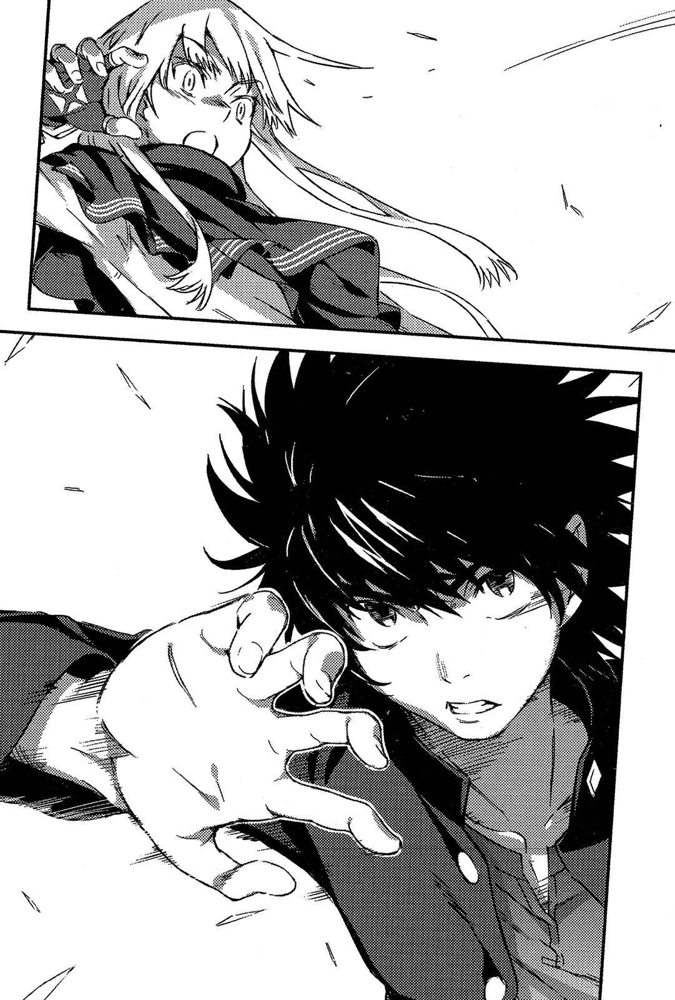

# 第二章 谁是真正的敌人

> Secret_Promise.

## 1

「格雷姆林」战斗部门的雷神托尔，正与上条在附近的汉堡店吃晚餐。

「……这什么啊？」

「什么『这什么啊』，就是新发售的莎莎酱汉堡套餐啊。呜呕，这种太强调独特性的味道真够浓啊，应该说好辣！我这下非常清楚不管怎样，畅销榜的巨大汉堡都不会消失的原因了。」

「我不是在说这个啦，笨蛋！我们是！超、级、死、对、头！像这样面对面悠哉吃饭的情景也未免太奇怪了吧！」

「怎么了怎么了，坐下来好好谈谈有这么奇怪吗？这跟『格雷姆林』无关哦，如果我是娇小却有巨乳，又能刺激他人保护欲的女孩子，你的应对方法就会不同吗？」

「你是在小看我吧？」

「就是为了这个我才做了准备，还特别选了你认识的女生外表呢。」

「啊？这是什么道理？」

「就算详细解释魔法你也无法理解吧。总之就是那个啦，北欧神话中不是有被夺走武器的雷神为了找出犯人，所以化身成美丽女神芙蕾雅的故事吗？这就是以那个传说为基础组合起来的变装法术，所以只能化身成女孩子啊。」

「……为什么你会知道我跟御坂在夏威夷群岛的对话？」

「应该说你们在那边小两口拌嘴时，利用美国国内摄像头的『F.C.E.』监视网还在运作中，所以完全被『格雷姆林』看光啦。我觉得御坂还真是纯情呢。」

「不要啊啊啊啊啊啊啊啊啊啊啊啊啊啊啊啊啊啊啊啊啊啊啊啊啊啊啊啊啊啊啊啊啊啊啊啊啊啊啊！我的青春竟然啊啊啊啊啊啊啊啊啊啊啊啊啊啊啊啊啊啊啊啊啊啊啊啊啊啊啊啊啊啊啊啊啊啊啊啊啊啊啊啊啊啊啊啊啊啊啊啊啊啊啊啊啊啊啊啊啊啊啊啊啊！」

雷神托尔露出爽朗的笑容，看着抱头惨叫的上条开口：

「别在意，你的人生根本不需要为这种程度的事一一感到丢脸吧。」

「这是什么没礼貌的话啊！你想打架吗？」

「的确是啊。」

雷神托尔晃动着垂至腰间的金发轻轻点头：

「不过啊，说实话，我对夏威夷群岛跟巴格吉城**那种类型的架没兴趣**，实在没意思。就以能把任何事都以这种归纳法去判断这点来看，我果然也是坏人啊。」

「……」

「快吃，别保持沉默啊。何况又不是我请客，自己付钱买了又不吃就亏啦。」

雷神托尔似乎不擅长吃辣，每吃一口莎莎酱汉堡，就会喝碳酸饮料或吃沙拉让舌头休息……是明知自己不擅长，却赢不了新发售这个字眼的诱惑？

为了不让红色的酱料沾到手上，上条抓住包住汉堡的包装纸。

「……所以你想说什么？难道是来宣战？」

「真是那样就简单了。事情就算不去管也会自己变得很复杂。总之，在进入主题前得先跟你说清楚。」

「你想说什么？」

「欧雷尔斯。」

雷神托尔提了一个名字。

那个名字对上条而言并非毫无关系。

「他是不是用高高在上的态度，**对你灌输了很多事**？还让你开始想象接下来可能会发生的危机，并为此感到不安。没错吧？」

「……灌输？你是说那家伙在骗人？」

「不过，你也强烈怀疑自己该不会又是在别人的控制下战斗。就像夏威夷群岛的蕾薇妮雅·柏德蔚和巴格吉城的木原加群那样。」

「……」

「别瞪我，我也知道元凶正是我们。不过啊，我们『格雷姆林』虽然是幕后黑手，但你真的觉得与我们敌对的欧雷尔斯，就是完全的善良或正义？应该说，**原本善良或正义的真正意义**，**绝不是用来指那些会以暴力伤人**，**或是想以本身立场来解决事情的人吧**。」

这不单指欧雷尔斯，也否定了上条至今所做过的一切选择。

而且对上条而言，这言论恐怕并没有错。

比如月咏小萌。

比如最后之作(Last Order)。

比如亲船最中。

所谓真正的善人、真正的正义，一定是指就算陷入危机，也会选择「不去战斗」这个选项，并通过这个选项，让敌人也一起获救的人。

对于一旦发生问题就会下意识握紧拳头的上条来说，那是非常遥远的领域。

「那么，我们就来提欧雷尔斯吧。谈谈那个跟我们『格雷姆林』一样，一有事就靠暴力解决的欧雷尔斯。」

拿起鸡块蘸着番茄酱的雷神托尔说道：

「那家伙不是独自跑来学园都市的。」

「你说什么？」

「圣人席薇亚、前『神之右席』实质首领右方之火、女武神布伦希尔德·爱克特贝尔以及魔法结社『黎明晨光』的首领蕾薇妮雅·柏德蔚。算是每一个都不输给『格雷姆林』的怪物集团，**全都超过一介魔法师的等级了**……总之，应该是察觉到我们的动向而聚集，准备阻止我们在学园都市的作战。」

蕾薇妮雅·柏德蔚。

听到这名字时，上条内心感到一阵不快的骚动。

魔法结社「黎明晨光」的首领。那个女孩欺骗了为解决夏威夷群岛事件而行动的上条等人，让学园都市和协助机构的关系产生巨大裂痕，造成巴格吉城骚动的部分原因。

但现在不是拘泥这种事的时候。

「……那又怎样？不就是为了从你们这群家伙手中保护学园都市的人吗？」

「既然这样，**为什么要把战场设定在学园都市里**？」

雷神托尔以一副受不了的语气指出。

他把鸡块放进口中并说道：

「真心要从我们『格雷姆林』手中保护学园都市，应该要在我们潜入学园都市之前解决掉我们才对吧。讲简单点，不该在学园都市中，在外侧或周围拉起防卫线比较妥当。例如进入日本之前的海上、关东一带的山中啊。」

雷神托尔舔着沾上番茄酱跟油脂的指尖，稍微压低音量继续说道：

「……可是，这么强大的战力，却部署在学园都市里头？他们很清楚『格雷姆林』的威胁程度么？或许根本就以『格雷姆林』为前提部署了吧。就我所见，这些人怎么想都是**故意要把学园都市拖下水**啊。你怎么想？这是和平主义者会做的事吗？」

「……」

「就像『格雷姆林』有『格雷姆林』的目的，欧雷尔斯势力那边也有他们的目的。双方都想利用学园都市来达到目的，这才是目前这个构图的真面目。先不提有没有实际上的效果，一旦在市内开战，学园都市的防卫战力会来对付『格雷姆林』。虽然我不觉得自己会被打挂，不过得提防科学阵营和欧雷尔斯势力的多方面同时夹击，也只能持续保持警戒。」

每个隶属于「格雷姆林」的魔法师，都有怪物般的力量。

但是这还不是最糟糕的。

最麻烦的，是他们可以有组织性地发挥那股力量。

「换言之，为了让事态发展脱离『既有模式』，得阻碍『格雷姆林』互相合作……这就是欧雷尔斯势力选择这里的原因吗？」

「虽然只是假设啦。」

上条将吃到一半的汉堡，连包装纸一起放在托盘上。

这些话让他瞬间失去食欲。

为了达成自己的目的，那些人打算让学园都市被战火包围。

如果这是事实，到目前为止的关系图将会有巨大转变。

「……你知道欧雷尔斯的目的吗？」

「谁知道。应该说，这根本就是欧雷尔斯跟欧提努斯之间的对立。两边都是浸淫在『魔神』领域的怪物，**区区普通成员**，还不知道能否理解他们的想法。」

「只说这么一点就要我相信你？这可是由分明是敌营的人所说出的话哦！」

「我没叫你相信我啊，笨蛋。我只是要你别太依赖片面的情报。你既然从欧雷尔斯那边听了不少，那这次就来听听我们这边的主张。在得到各方面的情报后，你再归结出自己的答案就行。不再任人摆布的唯一方法，就是以自己的头脑思考。因此用来下判断的情报当然是越多越好，我说得没错吧？」

「……就算是这样好了，你们的目的又是什么？不论我选择了怎样的路，敌对关系都不会改变啊。」

「就算是成为敌人互相战斗也一样啊，要一决胜负，就该做好一切准备毫无牵挂地打一场。说实话，你的周围实在很悲惨，不管是哪个家伙都想为了自己的利益，利用那只右手的力量而拼命像耍猴戏一样诱导你。在这种状况下开战也太无聊了，**你自己的意见究竟在哪里**？」

雷神托尔以消化比赛的感觉继续与莎莎酱汉堡格斗，接着说道：

「不过啊，欧雷尔斯身上还是有几点很诡异。虽然不知道那是他原本的性质，还是变得近乎魔神之后改变的。」

「……？」

「那家伙基本上很博爱，若是眼前出现遇上麻烦的家伙，不管出多少力他都会帮忙。但也正因为这样，才会看不清周围的状况。讲白一点，他是会为了救一名不认识的孩子，将百万大军杀光的那种人。虽然不清楚欧雷尔斯目前是否自己设定了要拯救的对象，但如果那是『学园都市以外的某物』，也可以判断他会有可能为了帮助对方而利用学园都市。」

这名少年所言，有多少是实话不得而知。

不过上条不了解欧雷尔斯这个人也是事实。虽然在巴格吉城被他所救，然而也不能因此完全认定欧雷尔斯是表里如一的友方。

魔法结社「黎明晨光」。

其首领蕾薇妮雅·柏德蔚看来也是一样。

上条慎重地提出问题。

「……假设『格雷姆林』不是什么善类，与之对抗的欧雷尔斯势力也不是好东西，那么如此得意地说明这件事的你，又是站在什么立场？」

「很简单啊。」

托尔保持一贯的态度——

「『格雷姆林』为了某物来到学园都市，欧雷尔斯则是为了阻止他们才来学园都市……既然这样，当那两个组织在那边拖拖拉拉地做些麻烦得要死的事时，也有方法让他们大吃一惊。你难道不这么想吗？」

「？」

「由我们两个，去救出争夺战的奖品(人质)。」

## 2

芙蕾梅亚·塞维伦的口腔改造手术完成。

「哦、哦哦、哦哦哦哦哦哦哦哦哦……」

不知是治疗的结果还是麻药没有完全退，总之芙蕾梅亚因为口腔内的诡异感发出呻吟。接着她在牙医诊所的出口，对跟着一起过来以防她逃跑的滨面、泷壶两人如此说道：

「说起来我好想吃东西哦！」

「明明刚刚哭成那样，这丫头居然完全没学乖？」

走在人行道上的他们三人周围，也充满了「一端览祭」准备期间所特有的浮躁气氛。因为基本上算是「文化祭」，所以照理说摊位应该都整合在学校的校地内，不过「以准备期间的学生为目标的便宜路边摊」则布满了街头，让人觉得这股祭典的气氛，有往意料之外方向成长的感觉。

身穿粉红色运动服的泷壶理后，用茫然的眼神看着那边开口：

「……滨面，接下来要做什么？」

「没事可做就回家吧。总之先送芙蕾梅亚回宿舍。」

闲扯中的滨面和泷壶其实同住在一个屋檐下。附带一提，麦野沉利和绢旗最爱等前「ITEM」的成员也是。讲好听点是分租，但没有比这个更让滨面觉得不自在的事了。毕竟滨面并没有不要脸到可以在她们俩面前跟泷壶大放闪光，也就是说他只能利用时刻表推理小说般的计算，去接近泷壶理后（偏偏泷壶在这种时候只顾着压气泡纸，根本没空理滨面）。

「滨面，回去前得先买好洗衣粉哦。」

「是啊。」

「所以快去银行领钱。」

「好啊。」

「便利店的提款机要收手续费，得在银行的提款机结束服务前过去。」

「……实在是毫无情趣可言啊。」

「滨面。」

这时，运动服少女抓住滨面的衣角拉了几下。

他皱起眉头——

「？」

「芙蕾梅亚不见了。」

惊慌失措的滨面看了看四周，不过芙蕾梅亚·塞维伦的身影已经完全消失。

不过有一道女高音，自四周的嘈杂声传入耳中。

「喵喵——！上面写的是总共包了大约三十种水果的一口棉花糖呢！我要吃到每种都尝遍为止！」

「那个死小鬼！她完全不怕臼齿又要填洞吗！」

滨面发出咆哮，并为了守护少女口腔的和平而采取行动。

可不能再让拿着道路工程用器材的黑色家伙活跃了。

## 3

在汉堡套餐差不多要吃完时，雷神托尔不知为何追加了热咖啡跟奶酪蛋糕。

「……对了，你觉得快餐店的咖啡如何？能喝吗？」

「那么不满就不要点啊……何况我是连罐装咖啡都能满足的人。」

上条无力地回答。

雷神托尔讲了一堆之后，一脸享受地喝起廉价咖啡——

「刚刚说到哪儿了？」

「魔神欧提努斯率领的『格雷姆林』，跟差点成为魔神的欧雷尔斯率领的怪物集团准备互相争夺的『某物』，由我们两个抢先一步得到手。」

上条以纸巾擦掉手指上的油并开口：

「说得具体一点，那是什么？」

「欧提努斯想要的是『人』。」

雷神托尔简单地答道：

「没有受魔法和科学污染，换言之就是**能转变为任何一边**的『人』。不过啊，因为会给身体带来极重的负荷，所以指的是即使受到会使一般人休克而死的改造也不会出问题，具有极高耐久性的『人』。」

「……那是什么啊？」

「天知道，老实说连我们也不知道啊。似乎是混杂在中世纪最大的骚动——魔女猎杀记录中的人名。是连那群惯于杀光所有可疑分子以及看不顺眼对象的神职人员，都**因为对方太顽强而放弃杀死**的特殊案例。」

「……」

上条看不出雷神托尔所说的事情，跟现在这个情况到底有什么关联。

不管是什么记录，都是几百年前的事情了。

而且上条也不觉得，那会跟日本的科学大本营学园都市有关。

但是才问出口，雷神托尔就很干脆地回答道：

「因为事情还没结束哦。」

「……你说什么？」

「听说那个就算被火烧或遭巨锤重击，依然露出笑容的女人，似乎就算经历岁月的流逝，也不知衰老为何物。换言之是现在进行时。就算是曾在数百年前记录中出现的人，也不表示她已经消失了。甚至还可以推测她依然在某处微笑。」

「她……到现在……还活着……？」

「就是这样。虽然我不觉得她单纯只是个生命力顽强的人类。不论真相如何，**那个人的核心或本质一定在别处**。所以那股顽强也只是她的『部分特性』。」

雷神托尔拿着塑胶制的叉子想切开奶酪蛋糕，却不小心把它压扁了：

「附带一提，她十之八九就在这座学园都市里。」

「为什么？如果有在魔女猎杀中留下记录，应该跟魔法阵营有关吧。」

「那只是正好被卷入袭卷当时社会的魔女猎杀，究竟她的本质是属于哪个阵营依然不明，说不定根本两者都不是。」

他用叉子刺穿被压扁的奶酪蛋糕，但目标在放进口中之前就已掉在盘子上，于是雷神托尔直接用手指抓起蛋糕放进嘴里。

「不过学园都市之所以会保有『她』，想来**不是**为了做科学研究……因为若是那样，应该会出现更浅显易懂的研究成果。」

「不然是为了什么？」

「苦肉计。」

舔着手指的雷神托尔露出微笑。

「无论如何，**先把原因摆一边**，她可是在品位低劣的宗教审判中，印证出不管以任何手段都杀不死的人类。假设她是与学园都市高层『意图』相反的存在，也无法靠暗杀来搞定。她在面带微笑环游世界同时，就会瓦解高层的『意图』了，但我刚刚也讲过，没办法靠杀害来将她排除于世界之外，你觉得烦恼的高层会如何解决这个问题？」

「无法杀她灭口，但是给她自由又会很麻烦。虽然身在学园都市当中，不过没有任何人听说过。」

上条稍作思考——

「……难道是被关在坚固的牢笼里？」

「没错。」

大概是因为吃过了甜的蛋糕吧，喝了一口咖啡的雷神托尔露出严肃的表情。

「想隔离无论如何都杀不死的人，最快的方法就是夺取对方的行动力。恐怕『她』正被隔离在学园都市里最坚固的建筑物当中……正因如此，才让事态变得更加复杂。」

最坚固的地方。

上条皱起眉头稍作思考。

是位于广大地下街的第二十二学区避难所？还是机密最多的第二学区，或是第二十三学区附近……

不过雷神托尔摇了摇头。

他说道：

「有个很简单易懂的地方吧？」

「？」

「**没有窗户的大楼**。」

很干脆地——

雷神托尔道出了学园都市的「心脏」之名。

&nbsp;

「学园都市统括理事长亚雷斯塔的居所，这座城市中最大的要塞。那个女人……芙罗兰·克洛伊杜尼就被幽禁在那里。」

## 4

曾经有个计划，名为「黑暗的五月计划」。

实施该计划的研究机关，隶属于学园都市中最黑暗的部分。整个计划的大致概要，是分析学园都市最强超能力者(Level 5)一方通行(Accelerator)的思考模式，并将一部分「植入能力者之中」来提升其力量。

算得上成功的例子不多。

目前还活着的人就更少。

……话虽如此。

「我说啊——」

「……我现在超火大的，所以不要跟我说话。」

两名少女走在处于「一端览祭」准备期间，因此到了黄昏时分依旧很热闹的学园都市中。她们都是那个噩梦般计划的幸存者，也是能操作空气中氦气的大能力者(Level 4)。

其中一人是绢旗最爱。

她是一名身穿毛茸茸针织连身裙，大约十二岁的少女，发型是褐色的波波头。能力是名为「氮气装甲(Offense Armor)」的专门防御型，能让全身覆盖浓缩成数厘米的氮气的装甲，具备会自动挡下几乎所有攻击的性质，就算被狙击枪等级的武器直接击中也不会有事。

另一个人是黑夜海鸟。

黑皮革制的朋克裤与背心搭上白色大衣，还把大衣兜帽戴在头上的十二岁少女。她虽然有一头黑色长发，不过耳朵旁边的部分挑染成黄色。能力则是名为「氮气爆枪(Bomber Lance)」的专门攻击型，能从掌心放出数米长的氮气长枪……虽然如此，不过她在身为能力者的同时，也是改造人，所以具有能配合「机械臂」这个追加配备，随心所欲增加「长枪数量」的特征。

她们都是学园都市黑暗面的人。

无法单纯当成被害者，包含了凶恶性质的少女。

因此，她们的思考中并不存在「过去都曾被卷入同一个邪恶计划，所以应该成为朋友」这种思维。

不如说，在她们周遭反而随时飘荡着险恶的气氛，仿佛某处的玻璃杯一旦掉落，两人就会当成信号互攻彼此的咽喉。

黑夜扭曲嘴唇开口：

「……由我来说是很奇怪，不过你到底在做什么？我完全不知道你所处的立场呢。如果你只有守护芙蕾梅亚·塞维伦这个任务，那把我杀了埋起来不是比较快？」

「要是有机会早就超杀个彻底了。但我跟滨面不同，若非必要，没打算跟她有超亲近的关系，这点你就放心吧。」

「那个滨面又是怎样？这次的『这个』也是那家伙的命令吧？干嘛不忽略掉啊？我们被移植了那个怪物的思路，不论是谁的命令，都能干脆地不予理会吧。」

「那是超移植了怪物『攻击性』的你才会有的想法，专注于『防御性』的我根本超不管。而且也不是滨面在下令。这对于除了上下关系之外没有其他联系的你来说，超难想象啦。」

「你要去哪里？」

听见黑夜惊讶地询问，绢旗最爱初次露出笑容。

不过她的「笑容」，是跟一般人的那种温柔与贴心完全无缘的表情。或许用黑暗的喜悦来形容会比较好懂吧？

接着她如此回答道：

「跟芙蕾梅亚·塞维伦超同样的地点哦。」

「啊？」

「锵锵锵！第七学区中最恐怖的超牙医，通称『勇者的洞窟』！」

传来哐当的声响。

那是不禁后退的黑夜，被绢旗抓住胸口阻止的声音。

绢旗最爱露出最灿烂的笑容：

「……隐瞒也超没用哦。滨面是那种对自己伙伴的微小变化都超敏感的家伙，所以他早已经知道你超在意臼齿咬合这件事喽。」

「伙伴？所谓的伙伴到底是指什么啦！」

「我也有超会塞食物渣的地方，放心吧。所以我才超特地把你带来给技术最好，最能让附近小孩畏惧的牙医诊断。」

「……！」

「咦——？最强的『新生』代表黑夜海鸟竟然超害怕牙医啊？难道你是那种超听到『会痛就举手哦』，真的会举手的爱哭鬼吗？」

「我、我！我是改造人啦！肉体的零件有什么状况就换成人造物是我的信念！所以根本没有必要选择挖臼齿这种毫无效率的手段！真有什么状况，整组换掉就搞定了，做这种事情根本毫无意义……！」

「好，好，快超进去吧，别担心，我连你的医保卡都超带来了。」

「……别闹了，喂。要是再用那种藐视我的口气说话，别说一颗牙齿，我会把你全身都拆了。」

黑夜海鸟轻吐一口气，准备从手掌放出连钢板都能切断的氮气之枪……

「？」

「什么都超出不来吧？」

「为、为什么？发生什么事了……？」

「嗯，因为你的能力超依赖机械手臂啊，所以滨面就在改造零件内部的某个端子超黏上口香糖，引发接触不良。只要没有『手臂』，你就超无法使用能力了。哈哈哈，这样你就变成区区一个超无害的普通市民啦？」

「这可不能听听就算啦！你们趁我睡觉时做了什么？而且跟蛀牙比起来，体内有异物不是更危险吗！」

「哈哈哈——不管你超说什么，学园都市的黑暗面就是弱肉强食。超所以我们快点去看牙医吧，暂定无能力者(Level 0)，你想抵抗也没用，所以超放弃吧。」

眼眶泛泪的黑夜海鸟，就这样被绢旗最爱拖进了牙医诊所。

## 5

没有窗户的大楼。

学园都市统括理事会理事长亚雷斯塔的居所。

名为芙罗兰·克洛伊杜尼的女人似乎就被幽禁在那里。「格雷姆林」则为了某个目的想得到她，而欧雷尔斯则是有为了阻止格雷姆林不择手段的觉悟。

当然，「没有窗户的大楼」是出名的坚固，不过这个常识是否适用于那些人还很难说。

讲到芙罗兰·克洛伊杜尼，重要的不在于「虽然很难攻下，不过大家都知道她的藏身之处」，而是「根本没人知道她在哪里」。

用说的倒简单。

不过。

这也就表示——

「靠我们自己撬开学园都市中最固若金汤的要塞潜进去，**而且要比谁都快**。」

雷神托尔喝了一口开始冷掉的咖啡接着说：

「这是最好的方法。魔神欧提努斯率领的『格雷姆林』，当然也是以得到芙罗兰·克洛伊杜尼为目的在行动，也知道这样一来就非得到没有窗户的大楼。……不过那群人不会耍小手段，肯定会使出最直接的暴力，将被评为怎样都无法破坏的大楼给毁掉。」

「……」

「为了得到芙罗兰·克洛伊杜尼，『格雷姆林』想必不惜将那幢连核弹都无法毁坏的大楼拦腰折断，而欧雷尔斯只管不让她落入『格雷姆林』手中吧？所以说起来，他们不进入大楼，直接在外面施咒杀她的可能性也不是零。」

「不是说没办法杀死她吗？」

「这只是目前历史的定论，但在欧雷尔斯这种等级的怪物面前，还能通用吗？一旦连我也无法掌握的**芙罗兰·克洛伊杜尼的机制**被曝光，或许真的能算出杀死她的方法啊。总之芙罗兰·克洛伊杜尼的喉头，已经架着两把刀了。」

一方是火力也许强到能把连核武都无法破坏的大楼给破坏掉的「格雷姆林」。

另一方欧雷尔斯势力，则可能具备连顽强到被放弃处刑的女性都能杀死的魔法。

哪边都是怪物。

两者都有破格的实力。

不过。

另一方面——

「……这种事真的办得到吗？」

「你是指什么？」

「没有窗户的大楼。你不是说『固若金汤』吗？那我们能做到什么？」

「这个嘛——毕竟那幢建筑正如其名，根本没有出入口。大楼墙壁的强度足以挡下全方位的核武攻击，各种基础设施也是在内部独立、循环。若有人或物一定要进去，就要借用空间移动(Teleport)系能力者的力量，但我可不觉得他们会随便摆着自己的弱点。」

「这样一来……」

「话虽如此，那终究是人造的系统，人类可是连月球表面都去过的生物。**我是有想到方法**，剩下的就由我跟你做出判断就行了。你要怎么做？」

「……」

「我有言在先，我并不是站在你这边的，所以我当然也会有自己的『想法』。你可不要产生『这家伙说不定会背叛我』这种毫无意义的疑问。废话，我**当然会在最后背叛你**啊，我正是基于这个想法才来找你……所以你也可以在适当的时机抛弃我，**这样才公平**。」

雷神托尔摇晃着纸杯，让杯中的黑色液体出现漩涡说道：

「……而且，不管是谁有怎样的『想法』，芙罗兰·克洛伊杜尼本身并没有罪，这点非常明确。她只是违反了某人的想法，就持续被卷入魔女猎杀这种娱乐般的拷问，或是关进没有出口的幽暗房间；这是不对的。你不这么认为吗？……我会顺从我的『想法』行动，你也一样，只要在确保芙罗兰·克洛伊杜尼的安全时背叛我就行，这很简单吧？」

「……」

「别保持沉默啦，答案是好还是不好？」

雷神托尔保持微笑问道：

「你选哪一边？」

## 6

魔神欧提努斯率领的「格雷姆林」，以及欧雷尔斯率领的怪物集团都进入了学园都市。

他们的目的，都是被幽禁在固若金汤的「没有窗户的大楼」某处的女性，芙罗兰·克洛伊杜尼。

在巴格吉城引发严重骚动的「格雷姆林」，是基于「生命力强」这种理由打算得到芙罗兰·克洛伊杜尼，事成后她究竟会遭到什么待遇？

不过话说回来，如果完全交给认为只要阻止「格雷姆林」的阴谋，一切就算成功的欧雷尔斯势力处理，芙罗兰·克洛伊杜尼或许也得不到什么好下场。

他们很快就会行动。

没有时间了。

「……」

上条靠着有限的情报，拼命地动着脑。

在这种情况下，站在哪一边才是最好的选择？

不论是欧雷尔斯、雷神托尔，或是一直都在隐瞒芙罗兰·克洛伊杜尼情报的「学园都市的常识」……他们恐怕都没有完全说出自己真正的想法与利害关系。上条运用从各方面得来的情报，努力推测贯通事物背景的「真正事实」。

以此为基础。

他做出了结论。

「……不行。」

「什么？」

「没有任何证据可以证明你给我的情报。若是芙罗兰·克洛伊杜尼真的被幽禁在『没有窗户的大楼』，那的确是个问题，不过就连**她是否真的在里面**，都没有任何证据。」

「……」

「何况我也不相信你会背叛『格雷姆林』来帮助芙罗兰·克洛伊杜尼。毕竟，理由是什么？你原本是『格雷姆林』的成员，自然跟组织有共通的利害关系，一旦背叛那种组织，连我都知道会遇上什么严重报复。既然如此，你为什么要背着『格雷姆林』来找我？」

「……」

「如你所言，欧雷尔斯不是单纯的好人这点我也赞成，但就能说你就是自己人吗？凭什么道理？如果想成芙罗兰·克洛伊杜尼和『没有窗户的大楼』会遇袭全是谎言，都是某个我看不见的『算计』想诱导我的行动还更具说服……」

「唉——啊啊啊啊啊啊啊啊啊啊啊啊啊啊啊啊啊啊啊啊啊啊啊啊啊啊啊啊啊啊啊啊啊啊啊啊啊啊啊啊啊啊啊啊啊啊啊啊啊啊啊啊啊啊啊啊啊啊啊啊啊啊啊啊啊啊啊啊啊啊啊啊啊啊啊啊啊啊啊啊啊啊啊啊啊啊啊啊啊啊啊啊啊啊啊啊啊啊啊啊啊啊啊啊啊啊啊啊啊啊啊啊啊啊啊啊啊啊啊啊啊啊啊啊啊啊啊啊啊啊啊啊……」

仿佛要打断上条般。

雷神托尔单手往上推开刘海，叹出了极度又轻又长的一口气。

正当上条皱起眉，雷神托尔像是要补充似的说道：

「……是没错啦，有了夏威夷群岛到巴格吉城的经验，你会这样怀疑别人的意见我也不是不能理解。当然其中也包含了同情跟怜悯的部分啦。」

「不过，」他说道。

喝干冷掉的咖啡，将纸杯轻松地捏扁后——

&nbsp;

「**说起来**，**总觉得我的敌人变渺小了啊**？」

&nbsp;

这是随后发生的事。

上条当麻的视野，瞬间一阵摇晃。

等上条注意到随意丢开纸杯的雷神托尔一把揪住他的头发，将他的脸往塑胶桌面敲下去时，已经是剧痛自鼻子中心往整张脸扩散的事了。

就连「砰！」的那声闷响，也是后来才听见。

上条也听到距离晚餐还有一些时间，打算休息一下才聚集到禁烟区的学生们，下意识地发出了惊叫声。

不过雷神托尔毫不在乎。

他抓着上条的头发站起身来，扭腰增加横向的力道，将因为突如其来的疼痛，而陷入混乱的上条随意丢了出去。

撞开了两三张相同设计的桌子后，上条摔倒在地。

直接被牵连的学生发出惨叫逃开，隔了些距离，换个讲法是身处安全圈的男男女女则是因为饮料差点洒出而正要咂嘴，不过在看到雷神托尔的脸色之后全都吞了回去。

毕竟这些学生最多只接触过街头干架这种程度的暴力，会有这种反应也难怪了。

雷神托尔所使出的暴力，比杀人更进一步。

「算了，既然你这么没用，我就自己处理吧。」

「咳、咳、呜……？」

「我说啊——」

不管周围的人怎么想，对雷神托尔自己而言，他露出「姑且」可以算是冷静的表情，罔顾周围害怕的围观者，慢慢走到上条旁边。

「谎言？算计？谁管那么多啊。有个名叫芙罗兰·克洛伊杜尼的女孩受到幽禁，光是这样就该去救她吧。背后有什么阴谋，还是被谁算计都无所谓吧！既然有个遭受无理待遇，被囚禁在幽暗的房间里的女孩，**那就该去救她啊**！这才是我心目中那个，了不起的敌人，吧？啊？！」

在上条回过神来准备起身前，雷神托尔已经踹往他的腹部。就算知道踢得上条将体内的空气吐了出来，雷神托尔依旧毫不客气地狠狠踢下第二、第三次。

没有任何人出面阻止。

甚至没有任何人逃走。要是谁第一个往出口走去，引起雷神托尔的反感，那么那个人也会被波及，所以不要当第一个。这似乎是在场所有人的想法。

「你在夏威夷群岛和巴格吉城的行动，可能的确是遭到别人的『算计』，但那又怎样？这跟现在正在受苦的芙罗兰·克洛伊杜尼有什么关系？你那惨痛的经验，会是笑着舍弃那个女人的理由吗？要是你真的这么觉得，那你没救了。你以往**在专业世界里能获得原谅**，正是因为不管最后失败或成功，你的行动从头到尾都是为了拯救某人。若是连这点都舍弃，你的拳头就只是单纯的耍任性工具！你到底知不知道？」

踢击陷入体内的闷响传来。

不对。雷神托尔的脚尖并没有刺入上条的腹部。上条在此之前用双臂做了防御。

「……啰……嗦。」

上条当麻用仿佛从地底传上来的声音低语：

「……最大的元凶『格雷姆林』，凭什么用那种高高在上的态度大吼大叫。我要说的不是蕾薇妮雅·柏德蔚的『算计』。说到底，如果不是你们这些『格雷姆林』在那边四处恣意妄为胡搞，就不会有人觉得困扰吧？不管是夏威夷群岛、巴格吉城，还是这次的芙罗兰·克洛伊杜尼！」

「所以说啊……」

雷神托尔轻轻抬起一度被挡下来的右脚。看似为了防止被上条抓住而做了这个动作，不过实际上却是毫不留情地将稍微抬起的脚，往上条的侧腹部踩下。

传出「嘎叽」一声巨响。

「咳……噗？呜哦哦哦哦哦哦哦哦哦哦哦哦哦啊啊啊啊啊啊啊啊啊啊啊啊啊啊啊啊啊啊啊啊啊啊啊啊啊啊啊啊啊啊啊啊啊啊啊啊啊啊啊啊啊啊啊啊啊啊啊啊啊啊啊啊啊啊？」

「我不就是即使要脱离『格雷姆林』，也打算阻止魔神欧提努斯他们的暴乱吗！夏威夷群岛的内乱？巴格吉城的崩毁？你真的以为所有隶属于『格雷姆林』的人，都希望发生那种事？」

「咳、咳……」

「我才在想欧提努斯那家伙，背着别人偷偷摸摸地在那边做什么，结果竟然用尽全力在那边欺负弱小。是啦，我根本没什么太了不起的『算计』啦，不过就是**想干掉看不顺眼的家伙**。所以我才背叛了『格雷姆林』！」

雷神托尔高抬右脚，以能将足球踢往远处的动作干脆地踢向上条的腹部，把他踢了出去。

看着滚出一两米之外的上条，雷神托尔问道：

「说了那么多道理的你又如何？全力否定别人的所有意见、尽全力去怀疑他人，最后你还剩下什么？……我是不知道你究竟是沉溺于悲剧中，还是想假装自己变聪明，但**现在的你黯淡无光**。跟现在相比，以前就算被骗也会对哭泣女孩伸出援手的你要好多了！」

「……你知道在夏威夷群岛时我让多少人遇上危险？在巴格吉城的时候呢？」

上条如此低语。

他抓着倒落的桌子，缓缓地站起身来。

「我也不知道答案，但我把非常多的人给牵扯进来。可能会有人因为我的选择存活或死亡！这不是数字游戏，而是实际活着的生命啊！慎重行事哪里不对了！」

「那种犹豫，真的是为了找出最好的答案？」

啪！锐利的声响迸出。

雷神托尔的指尖，出现青白色的闪光。

正如其名。

是跟能切断厚重钢板的电弧刀类似的灼热雷光。

「如果你只是害怕做选择，」

雷神托尔说道：

「如果你是害怕接受自己的选择所带来的结果，」

雷神托尔慢慢走近。

&nbsp;

「**会因为那种理由舍弃他人的你**，**已经是真正的恶人了**。」

&nbsp;

横扫而来的一击。

膨胀到刀剑大小的青白色闪光，毫不留情地往上条的脖子砍去。那股闪光爆发性地扩张，飞散的光芒将散落倒地的塑胶桌子如奶酪般融化，也烧掉四散的汉堡包装纸。

然而。

就算接下连厚过十厘米的钢板都能像捞金鱼纸网般切开的电弧刀，上条当麻的脖子也没被斩断。

原因就是那只右手。

上条当麻的幻想杀手(Imagine Breaker)，将雷神托尔放出的闪光之刃完全击散。

「别小看我。」

虽然激烈地喘着气，他依然明确宣告：

「……我从一开始，就没有任何『算计』！」

&nbsp;

正当雷神托尔的指尖即将再次放出青白色闪光时，上条已经冲向前硬抓住他的右腕。能斩断钢铁的刀刃也在中途消失。

上条没有停下动作。

他抓住在雷神托尔分心的瞬间，以全力抬起膝盖往托尔的腹部撞去。

「唔……！」

「我没吭声你倒自己吼得很开心嘛。我啊……对于有人在我不知道的地方，把我自己决定要做的事拿来**大肆声张**，觉得超火大啦！！」

雷神托尔的身子以被膝盖撞击的点为中心弯成ㄑ字形，上条则趁这个机会，将自己往后拉开的额头，往雷神托尔头上敲下去。

一阵闷响传来。

「阻止别人干架，拯救哭泣的女孩子。我自己只要做到这点就很满足了，却因为周围的人多说了几句，就想给我导出不同的结果！明明一加一等于二就没人会烦恼啊！结果却不知怎么搞的成了负五或负十！这样真的能拯救芙罗兰·克洛伊杜尼吗？救得了她吗？啊！」

确认到魔法师头昏眼花后，上条放开雷神托尔的右手腕，握紧了拳头往对方的鼻梁揍下去。

但雷神托尔用左臂挡住了这一击。

同时托尔也扫向上条用来当轴心的那只脚，却反被上条用力踩住。

「我！已经！不想再把那种明明打算救人，反而让对方更痛苦的结局强加在任何人身上了！所以我才说在实际行动之前让我先做准备，你懂不懂啊！」

「真敢说啊……」

雷神托尔低声说道。

他以双手用力抓住上条的衣领。

将他全身抬起。

两脚离开地面。

「所以你才没有实际行动？是因为没有漂亮的理由？因为不认识对方？不知道对方长什么样子？还是事不关己？……不对吧，上条当麻。你刚刚已经自己说出答案——**你是为何而烦恼了**，赶快给我注意到啊，混蛋！」

接着他将上条以背后着地的姿势，猛然摔在地上。

不是在开玩笑，上条的呼吸真的停止了一瞬间。

接着，雷神托尔又往上条的脸上招呼了两三拳。

不过上条还是转过身子，辛苦躲开了雷神托尔挥出的不知第几拳。

之后状况一片混乱。

基本上都是以跨坐在另一人身上，封住对方行动为考量，不过，就连这种单纯的目标，也在途中变得暧昧。殴打、遭反击、再殴打。随着这个动作不断地重复，复杂的思考模式也逐渐消失。

不知道契机为何。

总之，上条和雷神托尔到了某个时间点，就突然停止互殴。上条的视野右侧有三分之一变得模糊，雷神托尔的状况则不清楚。不过既然他是「格雷姆林」正式成员，应该能使出一些可以把这间快餐店整个毁掉的魔法。既然没那么做，就表示他的确有什么意图。

雷神托尔喘着气再次询问：

「**你打算救人吗**？」

「**如果对方现在真的正在遭受折磨**。」

上条毫不在意四周群众远远围观的视线，回答道：

「不过如果你跟蕾薇妮雅·柏德蔚或木原加群一样，打算通过操控我自己获利，就给我觉悟吧。就算要破坏你的计划，我也会救出芙罗兰·克洛伊杜尼。」

雷神托尔听到这句话后，露出了微笑。

「那就随便你吧。」

「？」

「我今晚会行动。你自己看着办，尽力找出拯救芙罗兰·克洛伊杜尼最好的方法，不论最后你是合作还是敌对，我都管不着……只要是为了芙罗兰·克洛伊杜尼，过程如何都无所谓。」

雷神托尔将手放在没倒下的桌上，以青白色的闪光在纸巾上写下某些东西。让上条看过一次用「烧焦」形式写下的文字后，雷神托尔就将之随手一扔。接着纸巾以文字为中心窜出火苗并延烧，将信息彻底销毁无踪。

托尔背对着上条静静宣告：

「我会在那里。要合作或敌对都好，希望你能有效利用刚刚那些情报。」
