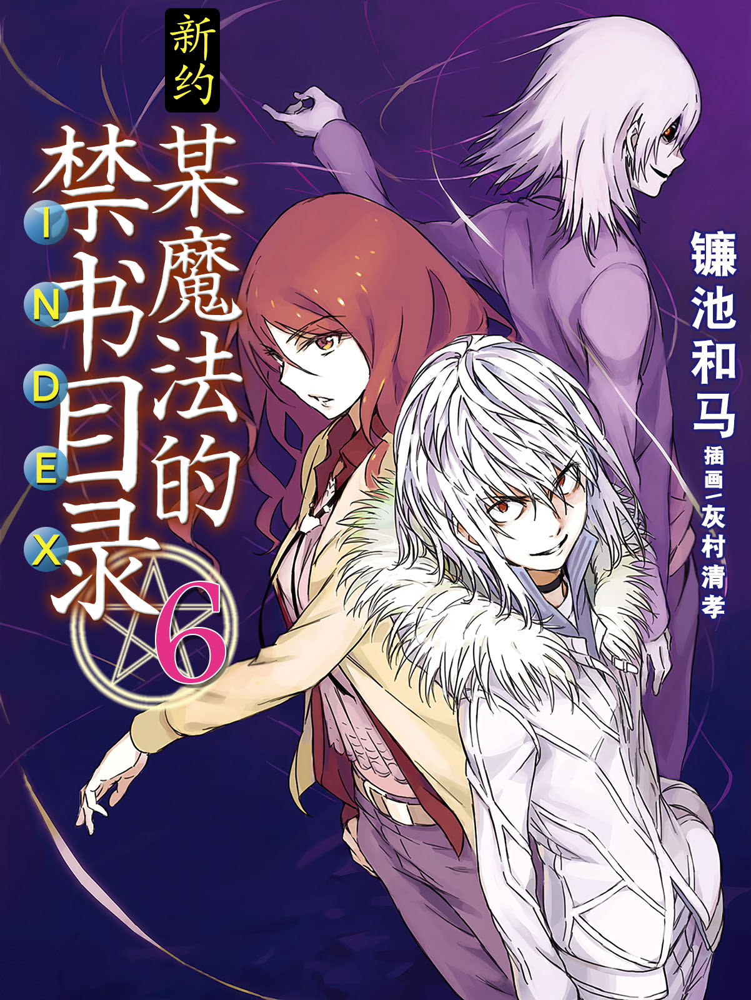

# 简介

**新约·魔法禁书目录6**

作者：镰池和马

## 内容简介

**紧迫的第六卷！**

学园都市迎来了「一端览祭」。

人们欢快的喧嚣声和热闹的踩踏声回荡着。

与此同时，街道背后发生的事件开始了。

亚雷斯塔的大本营「没有窗户的大楼」中，不死少女芙罗兰彷徨而出，怪物们围绕着她集结。

魔法与科学混合组织「格雷姆林」派出灵装制造者玛莉安和雷神托尔。

从魔法阵营出发的是「圣人」布伦希尔德和席薇娅。

来自学园都市的是「超能力者」一方通行(Accelerator)、麦野沉利，还有御坂美琴。此外，已经超越了人类范畴的垣根提督也在其中。

各种「最强」同时爆发决战，怪物们引起的风暴席卷了正在举行「一端览祭」的学园都市。

在这其中，身负重伤的「最弱」上条当麻正追赶着芙罗兰——！

## 制作信息

* 翻译：林星宇
* 台版：轻之国度
* 扫图：linpop
* 录入：zbszsr
* 修图：kaaala
* EPUB制作：鹘鹰⚡
* 网翻：泉川生徒会
* 图源：阿三
* 翻译：阿三、罐子
* 校对：B叔
* Epub制作：黄昏的鸡蛋黄
* 整合：知一一（禁书目录X系列，[index-X](https://github.com/1204244136/index-X)）


**版权声明**

转载时请保留录入信息。

本站内容仅供试看、学习与交流使用，禁止用于商业用途；下载后请在24小时内删除。请支持官方正版。


## 封面与封底

