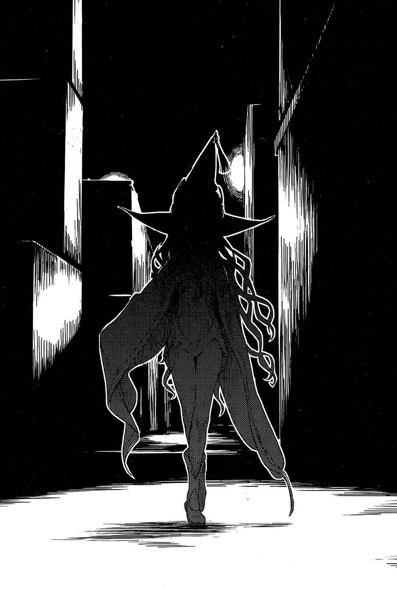

# 终章 让我们开始下一场争斗吧

> Next_Batter_Circle.

所谓结局，不见得只会有一个。

会依照与事件相关的人数，衍生出相同的数量。

这里就来介绍其中几种。

「做白工啦，完全是做白工。」

刚突破学园都市外围的「墙壁」，「圣人」席薇亚就抓着头，刻意用谁都听得见的大音量说道。

时间已经过了黄昏，夜晚的黑已然蔓延。日本的首都东京就像重头戏才刚要开始般充满活力，整片都是由无数电灯与霓虹灯形成的愚蠢夜景；但席薇亚等人却没有走在夜景中，而是于黑暗的缝隙里移动。

「硬是被要求去打那种让人感觉很差的战斗，却几乎没得到任何成果。也没有回收芙罗兰·克洛伊杜尼……有没有得手，将会大幅改变与『格雷姆林』对抗的策略呢。」

「既然没得手就不要再去想了。」

回答她的是蕾薇妮雅·柏德蔚。

少女的容貌虽然仍留有稚气，冷淡端正的五官依旧足以令她自傲，不过肿胀的脸颊却破坏了那种感觉。而且或许是因为有某种信条吧，蕾薇妮雅完全没有做过冰敷之类的处理，让她的不悦更加明显。

「就算现在回头，芙罗兰·克洛伊杜尼也已经有所改变，不再是魔神欧提努斯所追求的东西了。这根本无法拿来动摇她。」

「怎么啦——？你还在介意得跟自己人战斗这件事哦？不过在这世界上结果就是一切。就算你无法接受胜负结果，也无法理解那个男孩的理论，但败者可没有抱怨的权利哦。」

「……你那么想要我揍你吗？」

「我是说啊，大小姐。你知道日本有个很有趣的定论吗？正所谓，真正拥有妹妹的人，似乎绝对无法想象出理想中的妹妹。」

「……？」

「反过来说，对于有妹妹但没有兄姐的柏德蔚而言，其实他正是个理想的哥哥吧？所以呢，不要因为被某个什么都愿意听，而且有麻烦时非常值得信赖的人骂了，就一副沮丧的样子。即使像那样被单方面愚弄，他还是愿意回头试着跟你对话呢。你们之间具有很确实的联系哦。」

「很好，你做好觉悟了吧。我会拿出全套大秘仪招待你。」

「到头来你还不是没用那个——你象征武器(Symbolic Weapon)的四属性，从塔罗牌来看也不过只是小秘仪嘛。如果好好使出二十二张大秘仪，从愚者一口气连段到世界，应该能暂时强化能力甚至以音速行动吧，呵呵。」

「话说回来——」

这个态度认真但插嘴得毫不客气的人是布伦希尔德·爱克特贝尔。

「欧雷尔斯那边如何了？我记得你之前的确是回答『正在准备』。」

「那个啊，跟芙罗兰·克洛伊杜尼不同的……真正目标。」

席薇亚在扭动脖子发出喀喀声的同时，干脆地答道：

「**已经准备好了**。」

&nbsp;

&nbsp;

就算是规划得很漂亮的学园都市，依然有许多恐怖传闻。

会把不听话坏孩子抓走的「黑色清洁车」。不可以调查传来呻吟声的井盖底下究竟有什么的「实验体五〇二号」。如果在搜索引擎中打进某个人物的名字，就会被那个人物亲手杀死的「禁忌之名」。据说每当对学园都市来说很碍事的人物失踪，就会随之在街道中增加的「人骨色瓷砖」。还有，其实很多传闻本身，都是为了给予城市内AIM扩散力场一定规则性，以便进行控制的情报操作政策一环——「都市怪谈中的都市怪谈」。

恐怖的传闻很多，比方说，如果在放学回家路上真的碰上那些怪人，到底该怎么办？

就算急忙逃走，就算全力奔跑，想来也没办法从怪人手下逃走。

但是不用担心。

因为都市怪谈里的怪人，随时都被弱点追着跑。

比方说，「没有人能从跑一百米只要三秒的女人手下逃走」的传闻一旦蔓延，接下来就会出现「在遇到那个女人时，只要手边有麦芽糖或发蜡就没问题」之类的其他传闻。大概是这种感觉。

当然传闻会随时间改变，所以也就会出现这种「弱点」根本没效的新传说。

比方说，麦芽糖或发蜡的有效对象只有第一个人，也就是第一代的女性，被那个女人亲手撕裂嘴巴的「二代」就没效之类……

煽动恐惧感的传说和打倒恐惧的传说，总会像互相较劲般向外传播，让人觉得永远不会有分出胜负的一天。

其中有那么一个传闻。

内容其实很简单，说不定就是因为这样，才隐藏了在学园都市孩童之间造成爆发性流行的「可能性」。

……这个城市流传了许多恐怖传说，但你如果真遇到了传说中的恐怖怪人，那么只要大声地这样喊就好——

救命啊，独角仙先生！

这么一来就没问题了。

&nbsp;

操作「未元物质(Dark Matter)」的学园都市第二位的超能力者(Level 5)。

名为「垣根帝督」的某人，一定会来拯救你。

&nbsp;

&nbsp;

跟芳川桔梗一起把最后之作(Last Order)带回公寓的一方通行(Accelerator)，在一片漆黑的房间里投身于床上。芳川是否有跟身为一家之主的警备员(Anti-Skill)黄泉川爱穗报告「今天发生的事」暂且不明。

第二位垣根帝督……虽然不知道到底能否这样称呼，不过总之把「敌人」打败了。

战斗过程中，对方抛出了一个「难题」，一方通行(Accelerator)则找到了立足点，得以用自己的方式突破困境。

没有失去任何人就解决问题，成果相当良好。

然而……

（……被害者的心情，只有被害者本人知道。）

某人所遗留的话，至今仍刺在第一位心中。

刺虽小，却如同钓钩一样无法轻易拔出。

所谓的人类，是种对一句邪恶言辞，比一千句善意言辞更容易记住的生物吗？

「我到底在撒什么娇啊……」

得到能代言御坂网络总体意志的最后之作(Last Order)，以及恶意集合体番外个体(Misaka Worst)的原谅，所以就松懈了？

不，真要说起来，自己真的有得到宽恕吗？

到头来，只是顺着对自己比较有利的方向，顺着疼痛比较小的方向漂流？

事到如今，也不可能去请求遇害者原谅自己。

死者不会高兴。

因为「杀害」已经夺走了这种感情。

死者不会生气。

因为「杀害」已经夺走了这种感情。

死者不会哀伤。

因为「杀害」已经夺走了这种感情。

死者不会感谢。

因为「杀害」已经夺走了这种感情。

未来无论用什么方式活下去，终究只是自我满足。自己明白这点。不过，一定有些事唯有还活着的自己能做。

真要说起来——

屠杀了一万名以上妹妹(Sisters)的那场「实验」，真正的目的究竟是什么？

现在已经知道，答案并非如名义上所说是要让学园都市第一位的超能力者(Level 5)，进化到更进一步的绝对能力(Level 6)。那场「实验」是以失败为前提，充其量只不过是「成功很好，失败也不亏」这种程度的东西。

从过去经验所得到的情报看来，其一恐怕是将近万名妹妹(Sisters)散布到全世界的协助机构，借此扩大AIM扩散力场的影响力。

第二个，则是靠着干涉最后之作(Last Order)，让类似天使的存在于学园都市中诞生，好让御坂网络成为能控制庞大AIM扩散力场集合体的引导装置。

然后，是在担任学园都市暗部活动时调查到的「DRAGON」这个字眼。在其深处者，是名为爱华斯的真正怪物。而据爱华斯本人所言，过去所看到那个类似天使的某物，不过是个为了形成爱华斯所准备的模型。这是第三点。

那么。

**制作爱华斯究竟是为了什么**？

以战力来说，爱华斯的确是张名副其实的王牌，毕竟他拥有能将学园都市第一位一方通行(Accelerator)几近瞬杀的力量。然而那股庞大的力量，实际上并没有在第三次世界大战中使用过的记录。就连在那场关系学园都市命运的战争中，他们依旧将爱华斯的力量保留下来。

这么一来，那绝对不是单纯的开发兵器。

虽然除此之外一定有什么明确的理由，却完全不见任何端倪。

爱华斯是非常强大之物，但除了强大以外看不到任何具体利益。当然开发技术本身就是「目的」也说得过去，然而这么来应该要昭告全世界，以展示学园都市的技术到底有多先进才对。

就像用太空船登陆月球跟大多数人的生活都没有直接关系，然而这项「情报」本身却拥有极大的影响力。

既然要在隐瞒爱华斯这种存在的状况下持续开发，那么除了单纯的展示外，应该还有具体的使用方法。而且，他们的目的甚至有只要不隐瞒，就会遭到阻止的可能性。

爱华斯，天使般的存在，御坂网络，最后之作(Last Order)，妹妹们(Sisters)，AIM扩散力场。

位于金字塔最底端的，是最普通的学生们。这跟他们到底是一般学生还是暗部无关，学生们在无意识中释放的AIM扩散力场，全都与爱华斯相连。

学园都市的根基。

靠科学开发超能力。

或许并不是某人利用这个制度从中搅局。

如果打从一开始，这个计划就是为了触及爱华斯而展开呢？

&nbsp;

而且，说到底——

学园都市所提倡的「超能力」，究竟是什么？

这项「计划」究竟是从哪里开始，又是为了走向什么结果？

&nbsp;

「……」

走到这一步。

一方通行(Accelerator)才总算有抓到某种巨大「黑暗」端倪的感觉。能吞噬一切的巨大陷阱一角。平时因为过于庞大而无法掌握全貌的巨颚一角。将妹妹们(Sisters)、克隆人、将过去被杀死的某人全都吸入无法逃脱的漆黑洞穴中的元凶一角。

即使让这种事曝光并声讨主使者，一方通行(Accelerator)的罪也不会凭空消失，不可能有这种好事。

但是，如果——

过去惨遭杀害的某人，打从心底对自己的遭遇感到怨恨。

不但怨恨直接下手的第一位，还怨恨所有帮助他杀人的一切。

那个人物。

如果知道因为自己被杀而「顺利进行中」的某项计划，到现在仍旧一步步持续前进……究竟会怎么想？

被害者的心情只有被害者知道。

还活着的人将这种事挂在嘴上，说不定等于为了自身利益随意扭曲死者的心情。

然而。

还活着的人，可以把死者放在心上行动。

自己究竟想做什么？

一方通行(Accelerator)自问自答。

若要为已经消逝的生命做点事，究竟能选择什么？

第一位应该会下地狱吧。先把这个比喻在宗教上的表现放到一旁，总之最后的下场肯定不会太好。然而在到达那个地狱之前，如果还有什么事可以做到，究竟会是什么？

「……」

刺虽小，却没办法简单拔出来。

那股微弱的疼痛，确实地将他扯向恶意与斗争的道路。

就像是说好了一样。

一方通行(Accelerator)自己应该也有注意到，这就像是通过某人之手刻意送进来的暗号。

为了从这条道路，转换到另一条道路。

一方通行(Accelerator)无言地从床上起身。他的视线一阵游移，最后停在房间的窗户上。遭夜幕染成一片漆黑的前方，多半就是联系其他道路的第一步。

踏出去将丧失目前所拥有的一切，但也有机会得到光是待在这里不会知道的情报。

如此思考的一方通行(Accelerator)，露出认真的表情伸手寻找现代风格的拐杖。

这时，突然有人敲了房间的门。

而且没等回应就把门打开了。

进来的是一个娇小的身影。

她应该是被称为最后之作(Last Order)的少女。

如果不是就怪了。

&nbsp;

「嗨，一方通行(Accelerator)/return。因为差不多要变得麻烦了，所以让我插个嘴吧/return」

&nbsp;

总觉得。

很奇怪。

看着呆站在那里开口闭口的少女，一方通行(Accelerator)感觉到一股寒意窜过背部。他想到了过去遭病毒强制干涉的事。

但并非如此。

「原本，『御坂』只是填充网络内部的东西，干涉外侧的技术则交给各个个体/return。所以请不要期待会话的应对能力/return。就想成类似邮件的东西吧/return。提问也只会变成自言自语所以要多注意哦/return。」

存在于御坂网络中之物。

能凌驾最后之作(Last Order)这个司令塔之物。

在系统上不可能存在。

第一位原本往跟番外个体(Misaka Worst)有关的第三次制造计划去推测，却想到了别的可能性。他不理会「不会得到回答」这项先决条件，下意识地咬牙说道：

「是御坂网络的……整体意志？」

与类似天使的存在相异，也和爱华斯不同……却同样是由学园都市创造的某种东西。

会让人烦恼不知能否称之为「人」的存在。

或许应该称为第三存在吧。

「自从事件结束后，你就开始散发出某种微妙的气氛啊/return。」

就像是直接播放录音般，某人借着少女的嘴发出声音。

「一方通行(Accelerator)，难道你觉得将目前某种程度上算安定的生活画下休止符，投身于能逼近学园都市秘密的战斗中，就能向某种善良靠拢吗？/escape。还是说，你打算在收拾一切后自己下地狱？/escape。那些全都是遭到引导而生的意见，所以不需要在意/return。应该说，那种做法根本一点也不帅啊/return。」

「你在……」

「你现在正打算用『你在说什么！』来回应吧？/escape。免了免了/backspace，省略那种多余的问答吧，一方通行(Accelerator)/return。那种掩饰的方法平常是很可爱/backspace，不过在这个场面下只是妨碍/return。」

接着，某人接着说道：

「直接说重点吧/return。你现在应该是这样想/return。自己正栖身安稳之处，放弃了本来该做的事/return……**不过**/backspace，**哪有这种事**/return。你的思考方向完全反啦/return。那种肤浅的斗争、肤浅的暴力，还有随之而来的肤浅胜利，对于身为第一位怪物的你来说是不是比较轻松？/escape。想想看嘛/return。毕竟你是以『成为那种怪物』为目标而接受开发的/return。如果顺着某人之意往简单的方向走，自然会奔走在通往流血与惨剧之路吧？/escape。」

「……」

「所以才说你弄反了/return。一方通行(Accelerator)，此刻你确实对于自己这个存在感到疑问/return这不是坏事/return。但是/backspace，**不能因为动摇就顺着安逸的方向漂流**/return。我可不是为了让你导出这种答案，才把演算领域借给你/return。」

少女轻轻地耸了耸肩。

那动作非常不适合她。

「为了某人挣扎吧/return。以对于自己来说真的很辛苦的方法挣扎吧/return……要是真有那个意愿，我也能将已死亡个体残留在网络中的记忆情报直接放出去，明白地回答是或不是/return。但是/backspace，这样未免太作践她们了，所以我们不会这么做/return。就让被害者的心情只属于被害者吧/return。如果你决定逃往轻松的方向当个肤浅的怪物，我会把你打进比你想象中还要大上两圈的巨大地狱里/return。」

晃动。

少女的身体摇晃着。

「再说啊，虽然把最后之作(Last Order)跟番外个体(Misaka Worst)交给你，不过比起你的问题，我倒是更想管上条的事啊/return。这是实话/return。一来那边有那边的**危险**/return，二来我也不希望你把重要的『入场券』用在这种事情上啊——/return。」

到此为止。

或许是因为「文章」结束了，娇小的少女就此倒地。

&nbsp;

&nbsp;

穿着制式套装和白袍的女子稍微看了看周围。

这里是位于第三学区的广大地下空间，直到几天前还用来收纳学园都市第二位。不过现在没有任何人，他随意散布的纯白「未元物质(Dark Matter)」也消失得一干二净。没有任何多余物体的空间，散发着空教室般的寂寥感。

「……我实在不习惯做这种事呢。不管事情多小，都有种数值减少的焦躁感。」

女性的手上有一个口香糖容器大小的细长块状物。那是录音笔。穿着便宜套装和白袍的她将小型麦克风放在嘴边，持续用声音记录。

「『未元物质(Dark Matter)』彻底消失了，这件事跟预料中一样。剥离了地板、墙壁、天花板共计四十处的表面采取样本，要求设施进行检查。不过呢，应该找不出任何东西就是了。」

喀哩喀哩喀哩喀喀喀喀喀喀喀！某种类似指甲刮过平面的声音连续传来。穿着制式套装和白袍的女子，从衣服内侧口袋中拿出车票夹大小的机器。从画面上能看见，某个共通词汇不断在网络上的许多留言板和社交网络留言中增加。

「也确认到了关于第二位的都市怪谈。要看成自然发生时间未免太短，很难认为是由本人……应该可以这样称呼吧？总之很难认为是由目前的第二位亲手散播。看样子学园都市的『黑暗』中，似乎有某人在注意新的第二位。以注目度来说给个黄色标记。」

女性将器材收回口袋后，边在宽广的空间漫步边继续说道：

「关于第一位的细节还不明。虽然已向他注入了『恶意』，但是否会开花还难以确定。不过，以我的观点只能说就这么下去相当浪费。第二位都能改变形态到那种地步带给我们乐趣，第一位却只能说他实在不起眼啊——若能以『翅膀』为中心变得更异常一点就完美了。」

那双脚停了下来。

「……与第二位接触后，**泷壶理后的过程极为良好**。给予金色标签。」

站在广大空间中央的女子，抬头看着正上方说道：

「芙蕾梅亚·塞维伦就不特别提了。有确认到『人力资源(Agitate Halation)』的偶然启动。将那个视为无能力者(Level 0)的崭新可能性给予白金标签。要细心注意收获时期。」

穿着制式套装和白袍的女子说到这里，按下了录音笔按钮。

短暂思考。

过了一会儿，她在整理好脑内的思绪后重新开启开关。

「芙罗兰·克洛伊杜尼不列入管辖。个人对这点有所不满……不过，就目前观察到的状况来看，无论如何都死不了的身体，加上寻求『朋友』的心、罔顾个人信条遭到操控的可能性等条件，感觉有不少与AIM扩散力场集合体类似之处。或许，她成了风斩冰华的基准线。这么一来，芙罗兰·克洛伊杜尼、风斩冰华、『DRAGON』就连接在一起了……不，把连接生命维持装置的统括理事长也包含进来可能想太多了。不过，若是采用那个假设，也就能将统括理事长和『DRAGON』连在一起吧。总之，那肯定是个很有趣的素材。」

关掉开关。

启动。

就这样重复了好几次。

「侵入学园都市那几名人士的详情不明。有人指出，与第三次世界大战及巴格吉城等地所目睹的现象有类似之处。不过这也是管辖外。这件事就交给特遣队……那种不知道到底存在与否的部队处理，我们继续……」

说到这里，女性微微侧过头。

沉默持续了一段时间。

她叹了口气，抛下手中的录音笔。

女性用高跟鞋踩烂了落在地上的小型器材，接着以绝对没人能听到的音量如此低语：

&nbsp;

「唉，这样一点都不像『木原』啦……」

&nbsp;

&nbsp;

东京湾岸。为了躲进大量货船的其中一艘里，雷神托尔、玛莉安·史琳格奈亚、「投掷之锤(妙尔尼尔)」三人走在商用港口的腹地内。他们并不是要靠船回去，而是为了前往警备松散的邻近国家机场。

「被目标轻易地溜走啦——芙罗兰·克洛伊杜尼是最后一块制造『主神之枪(冈格尼尔)』的材料。我说过如果不能确保整体论的超能力者，就无法继续下去吧，该怎么办？」

喀啦喀啦声接在玛莉安的话后传来。铁桶型少女（？）跟平常一样，无意义地赞同玛莉安。

雷神托尔耸了耸肩。

「我们一开始就分好工作了吧。我借用『投掷之锤(妙尔尼尔)』的力量压制芙罗兰·克洛伊杜尼，能改造『人类』的你则对她做『加工』，将她变成无法乱来的状态，最后从学园都市将货物送出来……但对方在开始阶段就闹得比预期中还夸张，所以也没办法啊。连负责直接战斗的我也搞不定呢，担任后勤的你们来支援也只会被打倒吧。」

「就连冠上过去那个全能之名的你也做不到？」

「对方是芙罗兰·克洛伊杜尼哦？而且说实在的，这个全能毕竟只是**人类想象得到的全能**，期待我真的像魔神那样全能只会让人困扰啊。」

雷神托尔摆出相当随便的态度，回应皱着眉头的玛莉安·史琳格奈亚。

就在这时，他们听见了重物碰到其他东西的声响。

雷神托尔的肩上挂着便携式冷藏箱的背带，就是那个方形盒子碰到了他的手臂。

「那是？」

「用来取悦某人的东西。有了这个，或许还有办法制作『枪』吧。」

正打算详细说明的雷神托尔闭上了嘴。

相当突然。

不过他并非刻意选择沉默。

&nbsp;

魔神欧提努斯。

外表看起来只有十四岁的少女，不知何时从商港的黑暗中浮现。

女巫帽、遮住单眼的眼罩。皮衣上面披着斗篷。在这个国家会被误认成要去参加化装舞会的少女，动着唯一的眼睛看着雷神托尔。

雷神托尔等人非常狼狈。

「来这种地方真的没关系？这里可是敌阵附近呢。」

「距离没有意义，重点是别被发现。」

魔神欧提努斯很干脆地改变话题。

「话说回来，芙罗兰·克洛伊杜尼呢？」

「看起来像是有成功吗？」

「我的命令应该是『把芙罗兰·克洛伊杜尼带来』才对。」

「做得到你就做吧。」

雷神托尔一副兴味索然的样子说道，接着随手将冰箱往魔神欧提努斯丢过去。

那股冲击，硬是把固定盖子的扣环给震开。

魔神欧提努斯面不改色。实际上她根本没去看箱子里面是什么。

露出赞赏表情的人是玛莉安·史琳格奈亚。

「那是？」

「学园都市第二位。」

雷神托尔指着冰箱中的几个透明袋子……严格说来，是冻结后装进袋里的内脏。

「就是这些活体零件，虽然不知道这玩意儿究竟能否称之为垣根帝督就是了。不过，你要的是『强韧的人类』吧？若是这样，这家伙某种意义上比芙罗兰·克洛伊杜尼更适合。说不定他已经达到了『整体论超能力者』的境界哦。」

魔神欧提努斯保持沉默。

玛莉安则是插嘴：

「不是需要没染上科学或魔法色彩的人吗？」

「或许不能改造垣根帝督本身，但这是创造性的象征吧？利用这玩意儿从零开始制作人偶如何？」

玛莉安·史琳格奈亚看着魔神欧提努斯。

「投掷之锤(妙尔尼尔)」原本就只会跟从玛莉安。

沉默了好一段时间后，欧提努斯终于开口。不过她终究还是说了一样的话：

「我的命令应该是『把芙罗兰·克洛伊杜尼带来』才对。」

「那你自己去拿吧。」

随意用拇指指向自己后方的雷神托尔说道：

「不过芙罗兰·克洛伊杜尼已经变质，失去了拿来制作『枪』的因素。我不觉得她现在能派上用场。」

「玛莉安。」

魔神欧提努斯叫了这个名字。

褐色少女原本认为是要跟她确认这个理论是否可行。

但并非如此。

&nbsp;

砰！

随着一声闷响，雷神托尔的右臂突然从肩上掉落。

&nbsp;

「嘎……？」

疼痛的感觉似乎慢了一拍。

当雷神托尔的右臂掉到地面后，他才终于发出惨叫。

「嘎啊啊啊啊啊啊啊啊啊啊啊啊啊啊啊啊啊啊啊啊啊啊啊啊啊啊啊啊啊啊啊啊啊啊啊啊啊啊啊啊啊啊啊啊啊啊啊啊啊啊啊啊啊啊啊啊啊啊啊啊啊啊啊啊啊啊啊啊啊啊啊啊啊啊啊！」

「虽然你说『人类』不在专业领域内，不过你对这方面相当拿手吧。之后再帮他接上。」

魔神欧提努斯不理会呻吟着忍耐剧痛的雷神托尔，一脚将冰箱盖子踢得关了起来，随即抓着背带提起箱子。

玛莉安·史琳格奈亚交互看着惨叫的雷神托尔和魔神欧提努斯，接着终于下定决心开口表示：

「欧、欧提努斯。」

「什么事？我对你拿手的装熟没兴趣。而且你没自觉到那带有类似依赖的性质？」

「不是啦，欧提努斯！」

玛莉安慌张地指着欧提努斯的右肩。

斗篷之中有某种东西黏稠地崩解。

无论怎么想，都是**手臂罔顾应有的关节连系掉了下来**。

「……啧。『无限的可能性』偏向了负的百分之五十？」

在手臂完全掉落前，欧提努斯强行用另一只手连同斗篷将手臂压住。水声持续传来。斗篷内应该流了相当多的血，不过魔神的脸色完全没变。就连那么严重的伤，似乎也不会一直留下伤口。

想要的东西全都能得手的存在。

同时，也是无论做什么，都必定有百分之五十失败可能性的存在。

这就是欧提努斯，所以她的目的非常单纯。

排除负的百分之五十。

引导出正的百分之百，自由地发挥那股力量。

为了达成这点所需要的东西正是——

&nbsp;

「得到最后的材料了。那么就可以开始制造『枪』吧。」

&nbsp;

魔神欧提努斯离开后，玛莉安·史琳格奈亚捡起掉在地上的手臂，走向雷神托尔身边。

「……我自己搞定。」

大概是反射性地压住伤口，使得手上沾满了血，雷神托尔用那只手接过断臂。

「但是……」

「抱歉，让我独处一下。」

雷神托尔咬紧牙关发出细微的声音。

「说实话，我有点想哭。如果可以我不想让人看见。啊啊，可恶，欧提努斯那家伙还是老样子。我也知道不能两手空空回去，所以拼命要把事情做好，但她根本不知道这点嘛。」

「你已经做得很好了。」

「但是没能达成她的第一志愿……这样啊，我知道自己想哭的理由了。不是因为疼痛或悲惨，而是因为得救了。我在对勉强活下来这点感到高兴啊。」

「放心吧，我如果站在同样的立场肯定会尿裤子。」

玛莉安·史琳格奈亚一声弹指之后，就带着铁桶型少女（？）往货船的方向前进。

确认没有人在场后，雷神托尔轻轻叹了口气。

他静静地思考。

&nbsp;

（……跟料想中一样，这样总算能潜进去了。）

&nbsp;

雷神托尔随意地转动着自己的手臂。摆出想哼歌般的轻松态度，将断面与断面接起来。

他没有特别去诵唱什么咒语。

更不是靠护身符或灵药的力量。

但魔法现象的确发生了。手腕随着淡淡的光芒接上，五指已经能随心所欲开合。

很明显地，这不是雷神托尔所拥有的魔法。

不，说到底他根本不是雷神托尔。

（……唉，若只是外表伪装成雷神托尔，应该还是很难潜入吧，必须另外准备一张相当强力的牌。但并非只有乖乖听话把芙罗兰·克洛伊杜尼带来才行。首先让她知道预定的计划遭到破坏而产生动摇，接着提出她根本没想过的替代方案。在强烈的动摇下，魔神欧提努斯的判断力也有可能无法正常运作。）

话虽如此，光是这样仍旧无法骗过魔神欧提努斯。

对方可是能将各种不可能化为可能的存在。

就算一般魔法师想欺骗她，她也有能力不靠道理就看破谎言。

也就是说。

正因如此——

&nbsp;

能欺骗「魔神」的，就只有同样有一只脚跨入「魔神」领域的人。

此刻潜入「格雷姆林」内部的人，正是欧雷尔斯。

&nbsp;

（这下……）

欧雷尔斯刻意把破布绑在已经完全接起来的右肩上。

他连满手的鲜血也维持原样，就此迈步走向停在工业港内的货船。

（……我也像这样混进去了。也证实了在强者云集的情况下，**拥有极强力量的右方之火能够不被任何人感应到而自由行动**。这么一来，我方的事前准备就平安完成了。）

「格雷姆林」。

为了让对方带自己前往急着完成「枪」的魔神欧提努斯大本营。

（那么，差不多要展开反击作战了。我就在最接近的地方欺骗她吧。）

&nbsp;

&nbsp;

然后，真正的雷神托尔在越过学园都市「外墙」后，坐在不远处的公园长椅上。

「……可恶。我从来没有双手同时断掉啊，这样不是连裤子拉链都拉不了吗？」

他拿落在附近地上的树枝代替护木，用嘴绑紧布条固定双手。另外腹部还有枪伤，无论如何都得准备恢复魔法，不过只靠手边的东西根本无法执行。

话虽如此，雷神托尔却没有一丝不悦。

尽管没有特别去救上条当麻的理由，不过也没有杀他的理由。雷神托尔的目的从头到尾都是赚取经验值。已经跨过的阶梯没有任何价值，也因此不会有破坏对方的执着。

不过。

如果那个少年成长到能成为「下一节阶梯」，情况可能会改变就是了。

（现在欧雷尔斯应该已经化身成我潜入「格雷姆林」了吧。他在学园都市中提出交易时，我还真的是不知所措……）

无论如何，就算雷神托尔拒绝，欧雷尔斯也会靠霸王硬上弓。在那种状况下，雷神托尔大概就要被埋进土里了。

而他答应交易的理由很单纯。

夏威夷群岛和巴格吉城。

看到那些骚动后，自己无法再撑下去了。

（不过啊，接下来该怎么办？）

在答应与欧雷尔斯交易的时间点，他就已经不属于「格雷姆林」了。然而，他并不是在烦恼「该回到哪里」或「接下来要去哪里」这种事。

（要是一帆风顺，魔神欧提努斯就会来要我的命。话虽如此，背叛欧雷尔斯我也一样会被宰掉吧。）

表面上看来，两边一样是地狱。

毕竟两边都是「魔神」领域的魔法师。

但是。

一旦由雷神托尔来下判断，状况就会有些不同。

&nbsp;

（……真正有意思的「下一节阶梯」会是谁呢？）

&nbsp;

世界无限宽广。

他能选的选项也多到可以说是无限。

&nbsp;

&nbsp;

过去某人曾这样问道。

『你的目的是什么？靠我的帮忙你可以得到什么？』

过去某人曾这样回答。

『「我」的目的是帮助芙罗兰·克洛伊杜尼。跟你们一样。』

某种意义上，目的确实达成了。

但是完美达成的，也就「只有」这个初期目标。

&nbsp;

&nbsp;

拥有打倒魔王之力的勇者是幸福的。因为大家会告诉他，他该把自己拥有的力量运用在什么目的上。

单纯拥有庞大力量的「魔神」，无须替破坏寻找理由。

本应成为魔神的某人，甚至没有意识到自己正迷失于该为何挥舞力量。

&nbsp;

这就是这样的故事。
