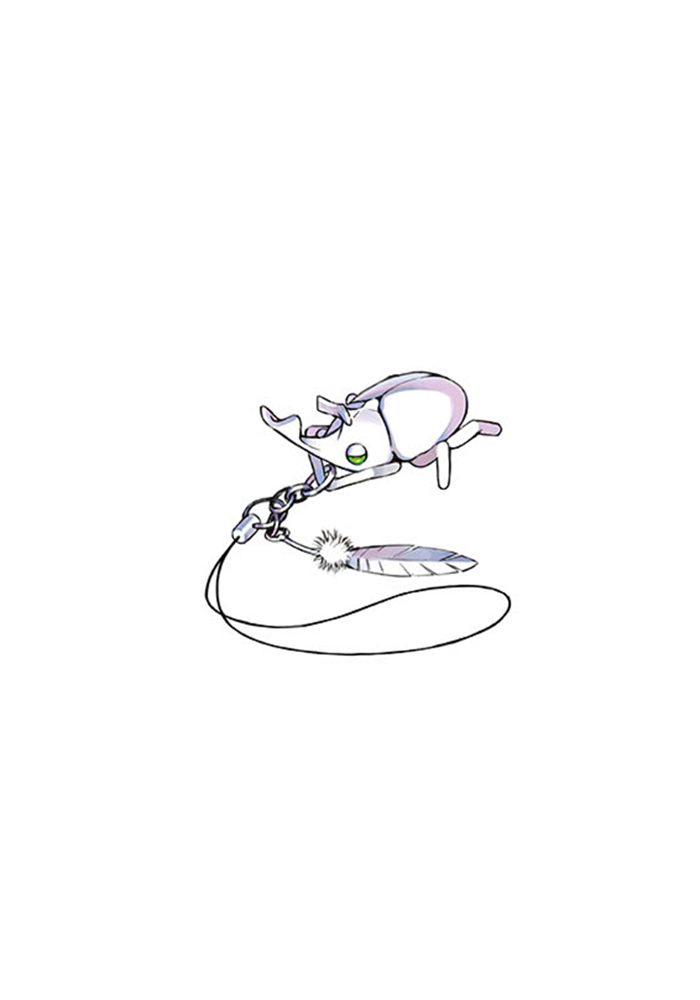

# 简介

**新约·魔法禁书目录7**

作者：镰池和马

## 内容简介

**上条的下一个「使命」是潜入覆盖常盘台中学的大小姐区域的「学舍之园」进行调查？！**

上条当麻从「黑暗的密室」醒来。将他送到那里的是土御门元春。潜入学园都市的敌对魔法师似乎正在利用灵装来毁灭学园。

身负了阻止大规模术式发动「使命」的上条，在剩下几小时内成功从「黑暗的密室」逃脱！！

——然而，眼前展开的是名门女校的更衣室……

被贴上变态标签，被女学生们追赶，他拼命进行着灵装探索。

连御坂美琴也发现了他，正当他以为终于走投无路之时……「幸运」地有人伸出了援助之手。

常盘台中学，第五位超能力者「心理掌握(Mental Out)」的食蜂操祈。

这次相遇，是偶然产生，还是「某种」必然的产物呢——

当科学与魔法交汇之时，故事就从此开始——！

## 制作信息

* 翻译：Seeker
* 台版：轻之国度
* 扫图：seed
* 录入：‖殇ㄟ
* 修图：kaaala
* EPUB制作：鹘鹰⚡
* 网翻：泉川生徒会
* 图源：阿三
* 翻译：阿三 绯月 欢欢 凉宮ハルヒ
* 校对：圈圈
* Epub制作：黄昏的鸡蛋黄
* 整合：知一一（禁书目录X系列，[index-X](https://github.com/1204244136/index-X)）


**版权声明**

转载时请保留录入信息。

本站内容仅供试看、学习与交流使用，禁止用于商业用途；下载后请在24小时内删除。请支持官方正版。


## 封面与封底

