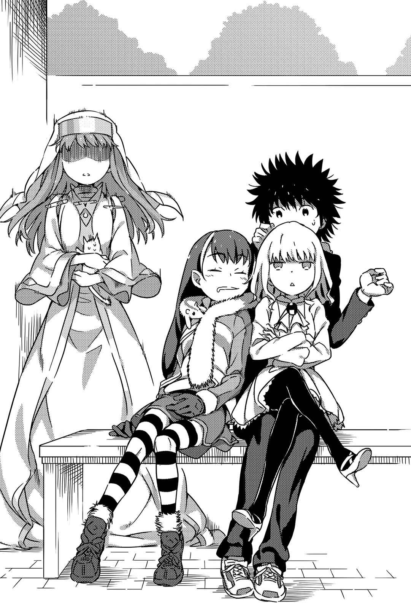

# 第一章 平稳之下的准备

> A_Terrestial_Globe.

## 1

事到如今虽然有点晚，不过就让我们重新确认一件事吧。

上条当麻是个不幸的人。

乖乖写完的作业会被风恶作剧似的吹走，搭电梯会莫名其妙地被关在高楼层，突然肚子痛时邻近的便利店没厕所，在外头走个五分钟就会迎面撞上抱有秘密的少女，还会被一见面就杀气腾腾的魔法师或带有古怪科学色彩的特殊能力者追得到处跑。

所谓的运气人人平等，现在不幸的人只是在「聚气」；这段时间越是难过，日后就越是幸福……上条压根不相信这种毫无根据的都市传说。真正不幸的人，想必是指那些「必须对大家一视同仁的机能在他们身上也毫无作用，打从出生时就跌进连神都会纳闷地说『唉～我虽然尊重自由意志，但你为什么偏要掉到那种夹缝中啊～？』的地方，而且到死都逃不出去」的人。

因此。

上条当麻的临机应变能力极强。

对于已经将「大致上照计划进行的事无法照计划收尾」当成常识的他来说，成功就是靠临机应变度过或解决当前的状况。实际上，之前他经历那几次……不，十几次……不不不，几十次超越极限的死斗都是这样。上条没碰过任何一场从头到尾都在预料之内的战斗，即使如此，他依旧能顺应当下状况，以没人想过的方法突破设置完美的包围网。

好。

到此为止是大前提。

或许，对于身经百战的上条当麻而言，这次的问题依然没什么大不了。或许他能一如往常地握紧右拳，在寻常人会落泪放弃的极限状况中仍旧保有人性的温暖，以肩膀破风前进正面挑战究极的难题，为了保护随处可见的笑容而战到遍体鳞伤，并成功守住这些理所当然该存在的事物。

那么。

就让时钟停下的秒针重新起步吧。

&nbsp;

上条当麻在浴室里那个他用来代替床铺的浴缸里醒来。

不知为何，他的两侧各有一名少女钻进同一个被窝中沉睡。

&nbsp;

「…………………………………………………………………………………………………………………………………………………………………………………………………………………………………………………………………………………………………………好，先冷静下来吧。」

尽管冷汗直冒，身体更是从头顶到脚趾都在发抖，经历过无数死斗（？）的上条仍旧没有轻易地大叫出声。

他明白。

因为他明白。

此时若做出那种一般人会有的反应，他能预见露出和平象征般睡脸的神秘少女们会当场跳起，然后「哇——你在干什么啊？！」啪啪啪地动起手。接着听到骚动的同居人，白衣修女茵蒂克丝就会冲进来，「你在干什么啊当麻——！」嘎嘎嘎地扑上来。

……虽然状声词可能多得让人有点难以理解，但详细说明起来可以保证会让人觉得自己在看凄惨的血腥杀人视频。而上条之所以要冷静也是有他的理由——因为一不小心就有可能化为绞肉状残骸被三色猫斯芬克斯吞下肚。

（……我受够了。我受够了啦——！如果用粗蜡烛来象征人家的寿命，那么这类丢脸到家的任务铁定已经把蜡烛削掉一半以上了啦！话又说回来，跟赌命大战魔法师相比，这种事累积的伤害好像还比较多呀——！）

混乱过度的上条，连思考都开始变得莫名有点娘娘腔了。

但即使闭眼不看眼前辛酸的现实，危机仍旧不会解除。

为了活下去，有此一事非做不可。

「……」

首先，就从这两名少女是什么人开始说起吧。

不知该算是不幸中的万幸，还是该说状况因此变得更为麻烦——窝在上条左右的沉睡少女，都是他的熟人。

其一是蕾薇妮雅·柏德蔚。

少女拥有柔顺蓬松的及肩金发，雪白的肌肤。每一个毛孔、每一滴血液都宛若精雕细琢的产物，简直可说是以超凡脱俗的黄金比例打造而成。如果有人说她是血统纯正的贵族，听者大概会就这么照单全收……然而，实际上少女是在魔法大国英国中，规模首屈一指的魔法结社「黎明晨光」之首。她能随心所欲地指使魔法师，而且光是挥舞法杖就能让高速公路的交流道为之崩塌。

其二是蕾莎。

将及腰黑色长发尖端绑成麻花辫的小恶魔系少女。顺带一提，她是比魔法结社更不受拘束的集团——新生之光(N∴L∴)的正规成员。而这人的实力也强大到足以面带笑容介入英国的王位篡夺骚动，以及孤身在第三次世界大战的主战场俄罗斯来回穿梭。

简单来说。

就算这两个发出可爱鼾声的少女们醒来后，喊着「哇～色狼～！」然后将别人打得不成人样也丝毫不奇怪。

（说穿了，光是柏德蔚跟蕾莎这个组合就不对劲。这根本是见不得光的魔法阵营里头特别像不法之徒的家伙们携手合作吧？把她们想成黑帮之类特殊分子的也行。虽然不知道她们为什么要混进日本、混进学园都市、甚至混进我家的浴室，但绝对不会有什么正当理由！感觉就是要抓着我的领子把我拖到国外去啊！）

一旦成了碎肉块，这些疑问便无法解答。总之无论如何上条当麻都得先确保自己的人身安全才行，其他的事全都可以摆一边去！

（……非得谨慎行事不可。）

所谓的战争，可不是单指导弹炮弹乱轰而已。必须正确地认清眼前的危机、了解该打倒的敌人何在、胜利条件是什么等等——战争从搜集这些情报的阶段就已开始。

因此。

上条当麻小心地、轻轻地，重新抓住盖在自己（以及两名少女）身上的薄被。他留意每一个细节，一点点地将被子往上举，生怕弄醒身旁的少女们。

……有件事请千万别误会，上条当麻可没有变态到想去检查毫无防备沉睡的少女们身上衣着，也没打算享受她们如珍珠般肌肤上浮出的汗珠气味。

重要的是，这两名少女手里是否拿着某种东西。

也就是武器。

「魔法师」听起来似乎无所不能，但两手空空跟灵装满载的破坏力依旧有天壤之别。为了正确地理解危机、正确地摸索回避手段，势必得确认她们有没有携带凶器。

还好，被子底下没发现什么一看就很强大的宝剑或光拿着就会遭到诅咒的法杖。

顺带一提，柏德蔚穿着丝质上衣搭迷你裙与厚质地黑丝袜（换言之似乎就是随时会看见内裤），蕾莎的装扮则像是蓝白两色为主的曲棍球制服去掉紧身短裤（换言之光是安静站着似乎就会看见内裤）。尽管两人的背后与裙子里也可能藏有凶器，但上条终究不敢轻易出手验证脑中浮现的疑问。

他已经可以预见，自己将手从少女后颈伸往背部的瞬间就会演变成「呀～色狼～霹哩啪啦！」的状况。

先前说过很多次，上条当麻是个不幸的人。

行动时必须考虑到一点——各种事、物都会在容易招来误解的最糟糕时机出现。

（……很、很好！只要知道她们没带可怕的灵装或是得另外拿出来就够了，剩下的不必深究。总而言之、总而言之，状况虽然看起来不怎么完美，但无论如何都要在这两个家伙清醒前从被窝抽身离开浴缸。这么一来就能摆脱危机了！）

在战场上，狙击手需要的并非动作如蟑螂般敏捷，而是像毛虫一样缓慢而确实地移动。

双手依旧高举被子的上条，拼命克制住自己想放声呐喊扑向浴室门的冲动，一点一点地让伸直的双腿像弹簧一般缩起，动作小心得宛如面对有彩色导线装点的定时炸弹——他打算借由屈膝，将身子从浴缸底部和被子交织成的温暖隧道中抽离。途中拇趾似乎勾到了某种与被子不同的单薄布料，上条只希望那不是柏德蔚或蕾莎的迷你裙。如果因此变成「呀～色狼～」，努力就全泡汤了。

上条至少花了四五秒钟，好让自己从仰躺姿转为近似抱膝坐的姿势。

「呼呼、呼、呼……」

他冷汗直流，呼吸声粗重得一让人听到就毫无辩解余地。然而这也难免。从少女们所用魔法的破坏力来看，现状的危险程度就算当成「不小心踩到了地雷但是脚没抬起来所以还没爆炸。好，接下来该怎么办？」等级也不为过，如果有人能保持冷静才真的奇怪。

（……脚掌已经抵住浴缸底部了。如果想直接站起身，想必会失败。要是靠着墙，将重心靠在墙上，一点一点地把身子往上挪）

行得通。

只要抽风机别在这时喷出大量胡椒让人连打喷嚏，就能在柏德蔚和蕾莎都没发现的情形下站起身。这么一来就没什么好怕的了。接着只要踏出浴缸、打开浴室门，向同居人茵蒂克丝与三色猫打招呼就好。然后就大功告成，平安度过危机！

就在这个时候。

&nbsp;

『废品回收～有没有不用的自行车、单轮车、滑板，还有其他东西啊啊啊啊啊啊啊啊啊啊啊啊啊啊啊啊啊啊啊啊啊啊！！！！！！』

屋外突然爆出大叔用上扩音器的超洪亮吼声。

&nbsp;

上条当麻明确地感受到自己脑中有条细线断了。

接着他停顿了一下。

一时之间……在少年脑中，周身三百六十度全成了往地平线彼方延伸的雪白平原。将百年人生全部奉献给修行的求道者，在最后的最后眼中或许就是这种仿佛时间与空间断绝了关联性一般和缓而平稳的心象风景。

忘我。

接着在视野边缘逐渐遭到模糊侵蚀的情况下，现实感一点点地恢复。

上条双眼的泪腺，「哇……！」的一声溃堤。

「……嗯……」

「……吵死人了，什么东西啊……？」

柏德蔚与蕾莎揉着惺忪的睡眼，嘴巴随之咕哝起来。上条确实看见了此一景象。

地狱的盖子☆掀开啦！

少年的理性跟着飞向远方。

「不要啊！不行了，没救了！可是这太不讲理了！人家到底做错什么嘛——————————————————————————————————！」

上条错乱地放声尖叫，极度的恐惧让他的音色变得极为尖锐，听起来就像个惊慌失措的人妖。

但状况远远超出他的预期。

柏德蔚跟蕾莎都只是不耐烦地重新拉好被子而已，连防爆水泥制碉堡都能碾平的超级吐槽并未袭来。

不仅如此，她们还随口这么说道：

「……唔……烦死了。你以为现在几点啊……」

「人家还有时差问题啦……好困，真的好困……」

上条依然无法相信。

少年受伤的纤细心灵没那么容易恢复！不过如果摸摸他的头或让他枕在大腿上，数值立刻就会突破上限。

姑且脱离了人妖状态的上条，像一头受惊的小鹿般不停颤抖。

「不、不对，我明白，我很清楚！当我大意地想着『什么嘛～原来是这样啊～吓了我一跳呢嘻嘻～』而转过身时，就会有很可怕的东西砸在我的后脑勺上！一定是这样！就说了不要对延髓下手啊！」

「……怎样都好啦总之让我睡觉。宰了你哦。」

「唔、唔唔。要胸部的话隔着衣服摸我会当作没这回事，总之让人家睡觉……」

这反应就像是睡眠不足或宿醉。

上条宛如以为断头台刀刃即将落下，装置却迟迟没有启动的罪人，战战兢兢地确认降临在自己身上的状况。

得救了？

得救了……也说不定？

「不！还不能安心，不行！追根究底，我连你们为了什么目的、从哪里入侵浴室都不知道！在全部搞清楚之前都不能掉以轻心！」

「从哪里……？」

蕾莎一边与柏德蔚争夺被子，一边勉强以打从心底感到不耐烦的低沉声音回答上条。

「……墙壁……」

「耸动的字眼又一个！『墙壁』怎么看都没办法跟温和的入侵方式连接在一起！这什么意思？难道你们在某处开个大洞后又堵起来了吗！」

但或许是真的放弃回答了吧，蕾莎只是把自己裹在被子里。而失去被子的柏德蔚，则是以娇小的膝盖猛顶那团被子，实行夺还作战。

到底发生了什么事？

不由分说的即死危机远离，让上条脑中总算有空间浮现这个理所当然的疑问。

可是。

他忘了。

他忘了一件事。

浴室骚动带来的即死危机不止这个。或者该说，他漏了对于上条当麻来说最切身、最巨大的危机。

危机之声随即从浴室之外——门的另一边传来。

「当麻～？你醒了吗？我的肚子好饿好饿哟！」

「呜哇——————————————————————————————！」

上条全身不自然地痉挛起来。

这下糟了。简直糟透了。两名少女睡在自己用来代替床铺的浴缸里，而棉被只有一条。由此导出的误解与造成的破坏规模会有多大？那幅画面想必会血腥到要用上多到难以计数的马赛克。

（慢着！浴室的门有上锁，不必着急！可是怪了，柏德蔚和蕾莎是怎么摸进来的？这两个睡迷糊的女孩真的有先锁门再钻进被窝里吗？如果，只是如果。如果她们没锁门就昏睡过去了呢……？）

「喝！」

上条犹如好莱坞电影般跳过浴缸边缘，在浴室地板上打了个滚，然后仿佛要踹门一般以脚底板全力抵住门的正中央。此时浴室门的门把正好开始不自然地转动。

巨响似乎让茵蒂克丝吃了一惊，她的声音随即传来：

「哇！怎、怎么了当麻！」

「哎呀～抱歉抱歉！上条先生正忙着冲掉身上的汗所以现在有点……」

就在他随口敷衍之后。

随着「叽……」的声音响起，上条抵住门的脚底有种奇妙的感觉。或者该说，抵抗消失了。比门还要大上一圈——正确说来是切成方形——的浴室墙壁，整面向外倒去。

睡迷糊的蕾莎不是说过了吗？

&nbsp;

墙壁。

&nbsp;

茵蒂克丝连忙抱着三色猫往侧面逃，在千钧一发之际躲过了倒塌的墙壁。在那之后，维持踢腿姿势发抖的上条与缩成一团的茵蒂克丝，则是无言地对视了好一会儿。

接着总算有了动静。

就在茵蒂克丝美丽的绿眸变得如野兽般狰狞之时。

「……当麻，你一大清早就让两个女孩子累得不省人事，还想趁乱要我的命……」

「怎么会……我居然蒙受了比过去任何误会都还要像午间连续剧的恶毒误会？但你可别以为度过了第三次世界大战、摆平了『格雷姆林』，还在与『转学生』等学园都市暗部的战斗中活下来的上条当麻会像以前那样轻易投降。今天我一定要真正地站起来！」

&nbsp;

之后一切全染上了缤纷的色彩——上条当麻日后如是说。

## 2

美利坚合众国，纽约。

善也好恶也好，希望也罢不希望也罢，这个全世界屈指可数的大都市，想来总会以地球为范围带来种种影响。此地既是金融的象征，也是金融的中心。尽管在科技层面来说它不如日本的学园都市，但说到全球经济活动的心脏只会是华尔街，这点毋庸置疑。

构成纽约的五个区域中，最容易让人联想到「金钱」的想必就是曼哈顿岛了。但从另一方面来说，「世界经济中心」这个有此特殊的立场，加上岛屿本身夹在两条大河之间，使得建筑高层化，人口持续密集化，交通几乎全依靠无数的桥梁与地下隧道……以这个地区的高人口密度来看，如果桥与隧道出于某些原因同时崩塌，将有短时间内居民无法维生的风险（讽刺的是，在好莱坞所拍的电影中，倒是有许多曼哈顿岛因为大灾害、大意外、大案件而孤立的故事）。

金融、戏剧、音乐、时尚……尽管曼哈顿在各个领域都是世界焦点，但这里还有一栋意义重大的建筑。

联合国总部大厦。

「什么嘛什么嘛，果然还是在白宫召开比较安全吧？」

夜色已深。

在这座虽然没有拉斯维加斯夸张，但人工照明依旧多到不自然程度的城市里，一名四十来岁的男子——罗伯特·卡崔这么说道。这人壮得看似稍微用力就会撑破赞助团体提供的高级西装，坐在大楼正面广场的低矮石阶上，咬着邻近摊贩卖的热狗……尽管他的举止实在不像个美国总统，但承担额外警备麻烦的并不是这位特立独行的总统，而是周围的能干特工。

另一方面，站在一旁翻阅笔记本的则是洛丝莱因·克拉克赫特。这位适合窄裙套装的金发碧眼女子，看上去虽然是位无懈可击的优秀秘书，但跟那位总统站在一起时「……为什么这个人会在这种地方啊？」的疑问总会集中到她身上，这个世界真是没道理。

顺带一提，她的职位是总统幕僚，因此不待在一起才奇怪。

「在总统官邸举行的政治压力太大，对于要解决这次的悬案，想必无法接受『由美国主导』这种力量均衡的势力不会参与吧。更重要的是，华府太多想捞一票的记者了。如果想秘密行事，在纽约反而容易。这点我向您说明过几次啦？」

「这里的媒体也多到满出来了吧，比方说全年无休追着好莱坞女星屁股跑的狗仔队等等。」

「既然知道就不要对着别人摊开下流的写真杂志，小心我告你性骚扰。这是『质』的问题。这里情报太多，容易掩盖『真实』。专挖演艺圈八卦的三流狗仔队跟专攻时事的政治记者，从相同画面中能取得的情报种类不一样；即使消息外流，相信的人数也会有落差。」

「G14的紧急金融合作会是吧？」

「为了让各国首脑齐聚一堂也不至于不自然，我们已悄悄地介入了股市。」

「股价突然上涨没让华尔街的家伙们哀号吗？」

「给那些家伙吃点苦头才好。我们姑且控制了幅度，避免周一有人上吊或卧轨。」

这种话一旦在相当于资本主义化身的美国传出去，政权势必会立即崩溃，但罗伯特与洛丝莱因似乎都不在意。他们很清楚，即使是同样的情报也有名为可信度的价值。没有哪个总统或幕僚会在这种大街上把国家机密说溜嘴——只要具备这种常识，不管是谁听到都会把这种言论当成笑话。

人类大脑是种会依自己喜好选择是否接受眼前情报的生物。

鬼鬼祟祟地在秘密地点开作战会议，或是以严肃表情边提防四周边谈话，反而会增加可信度。

「哦？听说伦敦市场也动手了呢。」

「知道就快点把沾满西红柿酱的嘴擦一擦，山贼。」

在无意义装模作样地舔拇指时，因为嘴里有大量黄芥末而差点摔倒的总统，以及看着这一幕认真烦恼是否该以高跟鞋踩下去的美女幕僚面前，一辆插着小型国旗的黑头车缓缓停了下来。先下车的护卫并非体格魁梧的黑衣保镖，而是一头黑长发束成了马尾，还将一把长日本刀提在腰间的东洋女子。

护卫开启车门后，一名身着豪华礼服的年长女性，以让人感受不到重心的流畅举止自后座下车。

英国女王(Queen Regnant)伊莉莎。

以王位继承剑卡提纳二世立于国家核心的女性。

她低下头，俯视那张坐在楼梯上边翻写真杂志边大嚼热狗的胡茬脸。

「什么嘛什么嘛，美国式的欢迎可真随便呢。就算是周末在家举办派对的大叔也会站着迎接客人吧？」

「如果你在满月的夜晚会变成超级美少女我就考虑考虑。」

「还有那玩意儿看起来很美味，哪边的摊贩有卖？」

「那你能不能告诉我这位护卫大姐是从哪儿雇来的？我也想让自家的警备队变得更赏心悦目一点。」

「别看神裂火织这样子，她可是全球总数不到二十位的『圣人』，不是什么能在路边摊买到的东西。」

「就是因为这样才想要嘛。她感觉能上这玩意儿的封面呢，哪像我们家的保镖每个都虎背熊腰。」

洛丝莱因·克拉克赫特不禁有些头晕——她这才想起来，英国元首也是个行事风格相当独特的人。见到那名女护卫露出不好意思的眼神，更让她万分尴尬。

然而，正常人洛丝莱因的苦难还没结束。

另一团人仿佛要钻过路上人群一般，自其他方向前来。那位不知是少年还是少女的童颜小个子，应该就是俄罗斯成教的总大主教了吧。至于他两旁……是什么人啊？一边是身穿鲜红修道服的女性，怀里抱着水桶大的碳酸饮料容器；另一边则是身着锁链与拘束衣，手边还带着锯子、钳子等拷问用具的金发少女。

他们七嘴八舌地说道：

「到了美利坚就是要找海外没发表的血腥丧尸游戏嘛，莎夏。基本上我虽然是日本动画的信徒，但不能忘记他们的近代创作源自美利坚文化！平常会被海关拦下来的血腥作品说不定也能靠外交官权限通过呢哈哈哈哈！」

「……有个问题，对于刚刚的信徒发言用『你是个俄罗斯成教徒吧』来吐槽没关系吧？补充一点，你居然敢在身为宗教领袖的总大主教面前讲这种话，难道不怕宗教审判吗？」

「我、我没有这个意思……」

……不管怎么看代表都应该是总大主教才对，但旁边两个护卫个人特色太过鲜明，完全掩盖了他的风采。

唉，所谓的正常人就是得替他人惹的麻烦收烂摊子吧？洛丝莱因·克拉克赫特不禁望向远方。

在众多国家代表面前，罗伯特·卡崔光明正大地将写真杂志翻到特集《拉斯维加斯百大兔女郎》的页面，同时对头痛不已的美女幕僚这么说道：

「其他人怎么样啦？」

「法国代表人已经在大楼里，而罗马正教的新教皇照理说很快就会在意大利外相的陪同下抵达才是。『集会』应该可以准时开始。」

「对『格雷姆林』发动总攻击吗……」

罗伯特一副像在自助洗衣店里等洗衣机停的样子，单手翻着写真杂志边咕哝。

接着他又补充似的轻声说道：

「……可是啊，在这种时候学园都市……带头那个叫亚雷斯塔的家伙却没回应，这点也让人很头痛呢。」

美国自诩为世界警察，却被排除在第三次世界大战之外。

由于夏威夷群岛的骚动他们算是直接受害者，因此如果连这次「格雷姆林」讨伐行动的主导权也落到学园都市手里，美国在国际政治上可能会遭受重大打击。

然而另一方面——

对方完全不提供协助也显得十分诡异。

虽说没有联络，但这并不代表统括理事长亚雷斯塔不会让学园都市出击，他们或许会自己采取行动。届时可能好处被人从旁捞走不说，最糟糕的情况下，因为沟通不良以「格雷姆林」为目的的学园都市与美军发生冲突也不是不可能。

对方虽然只是一座都市，却是以高科技与大量次世代兵器、无人兵器群度过全球级战争的一大势力。重要作战在即，无法掌握其动向实在令人忐忑不安。

（算了，那些家伙的秘密主义也不是今天才开始，不知道的东西再怎么瞎猜也只会作茧自缚而已……）

「好，那么等所有人都坐上豪华椅子之后，就马上开始作战会议吧。」

「既然知道就合上那本下流杂志并解决您裤子的隆起。尽管这并非正式的会议，您也不能用这副德行走进会场吧？」

「你可以来安慰我呀……呜噗！」

总统得意忘形地说完后，洛丝莱因毫不留情地以鞋跟朝他背上刺下去。一声宛如使劲击鼓般的巨响爆出。这漂亮又犀利的一击，让周围发愣的特工们顿时回神。

「……清醒了吗？」

「呜噗——！咳咳……！这、这就是剑鱼的刺击……」

「那种海洋浪漫就免了。」

洛丝莱因宛如野兽磨牙一般，以高跟鞋「喀、喀」地敲击地面进行威吓。罗伯特似乎让这可怕的声音推了一把，起身与英国代表和俄罗斯代表等人一同走向联合国总部大厦。

「这、这场会议也有些见不得光的家伙参与对吧？」

「终究不方便让他们进入那栋大楼里，但有以不会留下记录的线路与他们联机。最优先目标是解决『格雷姆林』，为此我们现在什么都得利用。他们应该会从地球的另一边参与才对。」

「我虽然不懂什么魔法，但那些人居然能够与国家代表并肩，到底是何方神圣啊？」

&nbsp;

&nbsp;

而在日本学园都市的某间学生宿舍里，把玩着移动电话的魔法结社首领优雅地翘起脚这么说道：

「是我。」

## 3

白天的房间内。柏德蔚切掉通话并将手机塞进裙子口袋里，以一脸要策划什么世界级阴谋的表情嘀咕着。

「这么一来就准备完毕了。」

「嗯？你叫了外送披萨吗？」

「我都已经特别跑来地球的另一边了，肚子饿当然要叫寿司或荞麦面呀。」

遍体鳞伤的上条，在朦胧中听到了柏德蔚与茵蒂克丝的温馨对话。

说穿了，他认真地觉得什么世界的未来根本无所谓。

尽管当务之急是得想办法处理被切了块方形开口的浴室墙壁，但说实话超怕面对押金礼金的上条就连找宿舍长哭诉都会犹豫。他脑中开始转起「能不能低调地找来什么神秘的蒙面装修专家团队把墙完美地修复到连条缝都看不见」之类有点逃避现实的念头。

……常在学园都市阴暗处爆发的水面下战斗，往往不会留下半点证据或破坏痕迹，因此绝对有这种专家存在，只可惜自己完全不知道怎么联络他们。

总而言之，为了使用浴室，也只能先拿蓝色塑料布挡住墙上的方形大洞应急。如果洗澡跟上厕所都会给人看个精光，以居住环境来说也未免太绝望了。

顺带一提。

上条当麻之所以会想得出神，大概是出血过多的关系吧。这也是理所当然，因为白衣修女用狰狞的獠牙替他在头上弄了些石榴风格装饰。

他就像交通讲习的腹语术人偶一样，有气无力地动着嘴嘀咕。

「……哎呀，一点也没错。我太大意了。这下子距离跟切换成百分之一百二十野兽模式的茵蒂克丝认真对决或与实体化的黑影状不幸集合体死斗不远了呢……」

「看着只是随便在头上缠绷带就算包扎完毕的你，让我深切感受到所谓的人类果然充满奥秘，我原先还以为包含小宇宙在内的人体早已经没什么东西可研究了呢。」

将脚伸进暖炉桌里的柏德蔚，在随口这么说的同时，一脸不满地瞪着摆在面前的烤吐司与沙拉。看样子专程跑来日本的她似乎希望早餐是白饭与味噌汤。

另一方面，一身白的猛兽修女茵蒂克丝则将烤吐司从正中央一分为二，然后强行把原先在碟子里的生菜（没有蘸酱）夹在中间，就这样一口气咔嗞咔嗞地咀嚼起来。

「当麻！这种十五秒就解决的东西算不上餐点！我要求追加面包与火腿蛋！更多！更多！更多！」

「吃法太豪迈了！上条先生不承认那种东西叫三明治！茵蒂克丝，你这招不过是『只要进了肚子里都一样』战法而已！」

依然睡眼惺忪的蕾莎把白吐司撕碎泡在热牛奶中，然后将牛奶含在嘴里。那副德行与其说是在吃早餐，不如说她打算用睡前饮料将回笼觉的诱惑叫回来，让人有点担心这孩子会不会蛀牙。

随手打开的电视，正在讲纽约的G14如何如何。早上这个时段各台几乎都是新闻，不然就是给小学生看的节目。上条常想，如果这种时候能来个大爆笑节目就好了。

新闻这种东西，如果只看标题和天气预报应该三十秒就能搞定……会这么想，大概证明了上条的感性果然跟一般高中生没两样吧；基本上，报纸他也只看电视节目表。顺带一提，茵蒂克丝明明会流着口水以完全记忆能力将「今日便当单元」拷贝到脑中，却完全没办法自己下厨，实在很会替人添麻烦。

「我可不弄。禁止火腿蛋！吃饭最重要的就是营养均衡！会觉得没吃饱都是因为你没有细嚼慢咽的错，茵蒂克丝！」

「什么？既然你这么说，那我就挑战斯芬克斯的早餐！当麻，如果不想让它饿肚子就去准备火腿蛋！」

「好残忍的恐怖攻击！」

摆在地板上的盘子被人高高举起，让三色猫不禁以两只后脚站了起来，利爪更无声地从它的前脚现形。食物造成的怨恨真是可怕。

柏德蔚喝了口在牛奶中加了蛋和砂糖等物的奶昔（本人主张这是无酒精版的蛋酒），接着一边踢着别人摆在暖炉桌里的脚，一边悠哉地这么说道：

「……总觉得来到这里后，什么世界规模的骚动跟联合势力的总攻击等等，全都变得无关紧要了呢……」

「不要讲得这里像是自己第二个家一样！你带来的麻烦论质要比其他人高出太多了！还有刚刚那几句话里是不是混进了什么很耸动的字眼啊？」

「呼啊……」

为了睡意放弃早餐的蕾莎往地上一躺，发出呻吟。要不是暖炉桌防御奏效，她的内裤就要从迷你裙底下露脸了。

她将自己放弃的肉干递向饲料遭暴君夺走的三色猫，并开口说道：

「……我们啊……呃，是为了让『王牌』随时能出击……而做准备……唔嗯，总之先确保幻想杀手(Imagine Breaker)……」

「慢着！别睡在暖炉桌旁，这样会感冒啦！还有好好跟上条先生解释！果然想把我拖下水嘛！既然如此至少要解释清楚啊！」

「呼啊……我们『新生之光(N∴L∴)』里头猜拳……在亚洲观光权争夺战中胜利的我……踩着决胜战饮恨的芙罗莉丝抢下机票……」

「我不是要你解释一个人来这里的经过！我是要你解释这股危险的气息怎么回事！」

尽管上条放声大喊，但蕾莎大概是懒得理他了，只以有气无力的动作喂三色猫碎面包与肉干，而她这么做更在茵蒂克丝内心的嫉妒之火上添加了柴薪。

「那个啊。」

柏德蔚替自己的吐司抹上奶油与糖粉，同时一派轻松地插嘴。

「总算觉得『格雷姆林』碍眼的家伙们齐聚一堂，里头包括了英国清教、罗马正教、俄罗斯成教，以及拥有一般军事力量的美军、俄军等等。唉，总之很多势力啦。」

「……………………………………………………………………………………………………………………………………………………………………………………………………………………………………………………………………………………………………呃，这跟我没关系吧？」

「你觉得本小姐屈尊来这种挤死人的房间是为了什么……？你这个蠢蛋该不会以为这就跟叫住在附近的青梅竹马起床差不多吧？」

「为什么要把我拖下水啊！」

「因为你以前就为了这件事发过牢骚吧……！嚷嚷着『如果不把我丢到世界上最危险的地方就翻脸』的家伙是谁啊？要不要我帮你把脑袋里的螺丝旋紧一点啊？」

「慢着慢着这脑内翻译不太对……等一下！柏德蔚，那把杖没办法塞进那种地方……！我听你说就是了，拜托你冷静下来！」

上条当麻宛如好莱坞电影般朝前方飞扑后猛然转身，拼了命地与柏德蔚保持距离。躲到墙边的他，现在总算有空闲整理脑中的情报了。

「……呃，该怎么说，好像……事情突然变得很不得了是吧？」

「联合势力此刻正在全力搜索『格雷姆林』的据点，一发现目标就会立刻发动总攻击。毕竟『格雷姆林』虽然个体战力极为强大，但组织根基应该没雄厚到足以称为世界级。从刻意隐藏据点这点来看，可见他们也认为遭受总攻击对他们不利。」

「事情果然变得很不得了了嘛！可是，要正面和他们冲突，也就表示得跟那个叫魔神的硬碰硬了吧？」

先前，上条曾在东欧的巴格吉城遭遇欧提努斯。

他完全无法与其对抗。

对方犹如摘取树上果实一般，轻易地夺走了少年的右手，让上条在出血与剧痛的冲击下当场失去意识。如果欧雷尔斯与右方之火没有到场相助，很难说他究竟会落到怎样的下场。

如果能集结全世界的力量，或许能够打倒欧提努斯。

「或许」吧？

上条毫无信心，完全没办法想象对方倒地的场面。即使真能做到，那也意味着魔神欧提努斯与能够和她匹敌的强大战力爆发冲突。一旦发生那种事，究竟会形成多严重的惨剧呢？

然而。

身为魔法专家的柏德蔚却显得一点也不紧张。

「唉，对手可是神秘的『格雷姆林』以及踏入魔神领域的欧提努斯，还听说他们正在组装『主神之枪(冈格尼尔)』这个麻烦到家的灵装，若想用寻常方法取胜势必得花上许多工夫吧……所以，就有人提议要确保能快速解决问题的快捷方式喽。」

「……喂。」

「不是把你丢到欧提努斯面前，因为这么做你八成会当场死亡。不过呢，作战总有它的关键之处——比方说，决定『枪』能否完成的那一刻等等。我们要在这种场面投入你，一次给予『格雷姆林』**致命的打击**。不是要你从头参战到尾，而是将幻想杀手(Imagine Breaker)当成仅此一发的绝招。若是这种战斗，你应该能活下来吧。」

「为什么讲得一副已经确定我会参战的样子啊！」

「那你不参战吗？」

「咦？这话题该不会是要往那个传说中的『请吧请吧～』的方向走吧……？」

另一方面。

就上条个人来说，由于亲眼目睹了夏威夷群岛与巴格吉城的惨状，因此他认为不能放着魔神欧提努斯率领的「格雷姆林」不管。这已经不只是发生在远方异国的战争了。为了自己的目的，「格雷姆林」有可能前往任何地方，有可能闯进任何场所。即使是高墙环绕的学园都市也不例外。

下次打开电视时。

或许「历史」已大相径庭，对这个世界造成了沉重的打击也说不定。

电视甚至有可能播出「学园都市从地图上消失」这种新闻。那些家伙拥有足以让人这么想的压倒性力量，那超乎常轨的行动力更让他们在施展力量时不带一丝犹豫。

「格雷姆林」行动的目的似乎都是制造出「主神之枪(冈格尼尔)」，但不懂魔法的上条实在不明白他们具体的行动原则。感觉「格雷姆林」根本就是朝世界地图丢飞镖决定袭击地点。

「……到头来，我还是非对付他们不可吗……」

「如果有其他可行的方法，我们才不会让对魔法一窍不通的外行人担任大规模袭击作战的关键。」

「我自认为已经明白自己有多少分量了。话说在前头，我绝对赢不了欧提努斯哟，两边身处的世界完全不一样。对上雷神托尔时我也是一败涂地。就算碰上的是玛丽安·斯琳格奈亚好了，一旦她认真地拔出『战乱之剑(丹因斯莱夫)』与我战斗，结果会怎样我也不知道……说实在话，我根本没正面击败过她。你们有把性命交给我这种家伙的觉悟吗？」

「从另一个角度来说，你跟这么多怪物交手过依然活了下来也是事实吧？把自己的目标定太高也不好，现在只要知道还有机会就够了。」

他们没期待自己正面作战。

他们要的不是上条当麻，而是幻想杀手(Imagine Breaker)。

换言之，少年就跟从飞机上扔下去的精密追踪炸弹弹头没两样。只要在专家的引导下确实地抵达目标所在处，在最适当的时机于最适当的场所挥动右手即可。除此之外别无所求，越想挑战难关就越容易远离「最佳路线」。

即使不能正面揍倒强敌，也有方法能给予对方重创。

上条刻意地吐了一口气。

「……那么，你们要带我去哪里？」

「刚刚不是说了吗？目前联合势力正在搜索明确的地点。北至北极南至南极，把各种可能性都考虑进去比较好。」

柏德蔚宛如宣告既定事项般轻松地回答。

「『格雷姆林』内部有没有正式名称我也不知道，说穿了替这个地方取名字有没有意义都让人怀疑。不过呢，为了方便起见，包括我在内的联合势力这么称呼它——」

说到这里，她顿了一下。

仿佛要以「说出名称」呼唤决定性的趋势一样。

接着，柏德蔚就像要找出什么特征似的宣告：

&nbsp;

「『船之墓场(Sargasso)』。」

## 4

「让我们确认一下发生了哪些事吧。」

在纽约的联合国总部大厦里，美国总统罗伯特·卡崔这么提议。

这里虽说是会场，却不是新闻里常见那种有百多国代表进行表决的大型空间。毕竟以让十四名首脑级人士较量来说，那种地方实在太宽敞了。

这个长方形的房间，以双层玻璃壁进行彻底的隔音。反「格雷姆林」联合势力的首脑们，则坐在仿佛要贯穿中央的长桌旁。

在这间没外窗户的房间中，可说已没有日夜之分。而在大厦里，也不会因为时间带不同导致人员出入频率出现极端的差异——这里随时都很忙碌。

那么。

神裂火织与瓦希莉莎等各势力的护卫们，并未进入这间以会议室而言偏小的房间。武装护卫不仅是防卫性战力，也有可能伤害到其他VIP。因此，在「抱持同样目的的各国代表应该不会采取敌对行动吧」这种天真的考虑下，会议室内除了肩负警备责任的美国方特工以外，其余护卫要员不得进入。

话虽如此。

即使跟其他魔法师相比，神裂与瓦希莉莎的实力依旧鹤立鸡群。

只要有那个意思，她们能空手击破满足防音、防弹、防爆标准的强化玻璃壁以实时赶往护卫对象身旁，也能在不破坏玻璃的情况下对房内的假想敌进行诅咒攻击。

而其中的瓦希莉莎，此刻正配合着玻璃另一边的总统嘴巴开合轻声咕哝。

「呃，我瞧瞧……『格雷姆林』的目的，在于制造特殊的『枪』。因此他们在夏威夷群岛引发骚动、在巴格吉城进行某种实验，甚至潜入了学园都市内部……」

「……你很无聊？」

听到神裂以无奈的口气出声，瓦希莉莎耸耸肩。

「因为在这里跟莎夏打情骂俏会被很多人瞪嘛～」

「有个问题，我砸烂你的头盖骨也无妨吧？」

一身拘束衣的俄罗斯护卫当场插嘴。

瓦希莉莎没理会，轻轻地敲了一下强化玻璃的表面。当然，连一丁点振动也没传进会议室里。

「英国怎么想？」

「『魔神欧提努斯』本身就有些难以置信的部分，但事态早已无法用我的常识衡量了吧？」

神裂一脸疲惫地叹了口气。

过去她也曾在前往学园都市的移动要塞中，与「格雷姆林」的正规成员交手。对手虽然似乎是名少女，但外表完全是个状似漆黑铁桶的粗短圆柱体。那些家伙为了提高效率，不惜把身为人类的肉体改造成那副德行。尽管不知道他们想要怎样的未来，但就算霸权落入他们手里使得这种行为变成世界的常识，「更美好的未来」多半也不会造访。

「『格雷姆林』的目的在于让魔神欧提努斯变得完美，因此需要制造『主神之枪(冈格尼尔)』。他们在夏威夷群岛取得作为炉心的庞大火山能源，为了弥补单靠魔法学问无法实现的领域而在巴格吉城进行了整体论超能力开发的实验，更在学园都市里寻找人才……其中虽然有一部分无法用理论说明之处，但他们的技术应该已经超越了我能理解的范围吧。」

「冈格尼尔」这柄出自北欧神话的长枪，对神裂火织而言也非事不关己。

说明白一点，她曾和试图完成其试验品的圣人布伦希尔德·爱克特贝尔交战并击破对方。

瓦希莉莎一副嫌无聊的样子说道：

「唉，关于这点我是同意啦，问题就在于情报全来自那群见不得光的家伙喽。」

「『黎明晨光』吗？」

「不仅如此，还有圣人席薇亚，一半是魔神的欧雷尔斯……直到不久前都还令人怀疑是否存在的大人物接连出现。虽然听说这些家伙里有部分已经顺利潜入了『格雷姆林』中，但这话究竟有几分可信度呢？」

相当于魔法业界黑帮的魔法结社，为了破坏十字教的统治能力而和「格雷姆林」联手……这几乎是预料中最糟糕的状况之一。

但从另一方面来说——

「若从我们这行常识所及的范围来想，『黎明晨光』背叛的可能性并不高就是了。」

「为什么这么说？」

「跟臣服于十字教的生活相比，『格雷姆林』抬头的世界风险要高多了。」

「……唉，尽管号称近代西洋魔法，原型还是十字教的秘技吧。」

「要是『格雷姆林』擅长的北欧神话遍及全球，犹如要覆写整个文化般根绝十字教系统的数据，对『黎明晨光』而言也是个致命性的打击吧。既然看得见利害关系，就还能相信他们。就算无法信任，至少也能预估他们何时会背叛而先下手为强吧？」

「大概吧。」

瓦希莉莎随口同意。

她并非单纯为了得到依赖性的安心感而附和能拭去自身不安的意见，也不是什么都没多想的乐观。无论状况如何演变，最后她依旧会咬住目标的咽喉，确实地了结对方。神裂直觉地感受到，那具慵懒身躯里具备了这种冰冷的意志。

当事人瓦希莉莎显得无比轻松。

想必就算人类面临存亡关头，这名女性依旧会以轻松的心态投身于最后决战吧。

「在世界各地东奔西走搜集一个个必要材料的『格雷姆林』，窝在不知道位于何处的据点。距离『枪』完成所剩的时间也不明。无论如何，要是『魔神』能够施展出传说中的力量，这个世界便再也没有胜算。得尽可能在『枪』完工前有个了断就是了。」

「混进『格雷姆林』中的间谍，是不是得为了弄清楚自己人在哪里、『船之墓场(Sargasso)』的坐标为何而判断星象啊？」

「如果来得及就好了，就很多方面来说都是。」

## 5

好啦。

不管右手里有什么东西、面临多少次生死关头，上条当麻毕竟还是高中生，吃完早餐后得准备上学才行。

话虽如此……

「喂，吃饱后就去第二十三学区喽。我们勉强和十二名统括理事会成员之一取得联系，让对方安排了超音速客机，不管『格雷姆林』当成据点的『船之墓场(Sargasso)』在世界的哪个角落，都能在数小时之内抵达……你根本被当成弹道导弹了嘛。」

「我拒绝——！上条先生终究还是学生，换句话说出席日数已经陷入超级危机啦！好歹在接到正式呼叫前让我去上课！不然至少让我参加早点名！」

柏德蔚「哼」了一声，双手抱胸毫无意义地摆起架子。

「要怎样都无妨，但为了随时能出击我可不会让你离开身边哟。说清楚一点，如果你要上课我就会坐在你的大腿上哟，我会跟你一起上课哟。这样也行吗？」

「我有班上会爆发骚动的预感！特别是蓝发耳环那家伙绝对会趁机大闹一番！」

另一方面，全力无视早餐而获得约数十分钟睡眠时间的蕾莎，似乎终于揉着眼睛清醒过来了。

她朝依旧嫌没吃饱的茵蒂克丝（虽然到头来上条还是做了火腿蛋）搭话：

「……奇怪？英国清教这么顽固，我还以为会说『别把外行高中生扯进魔法战斗』之类的话呢。啊，不过见不得光的我倒是会尽量把人拖下水就是了～」

「这种事再怎么啰嗦也拦不住当麻，这点我早知道了。」

茵蒂克丝听到后，当场哼了口气回答。

「所以我也有了对策。」

「？」

蕾莎纳闷地歪头，但抱着三色猫的茵蒂克丝并未多加解释。

在上学派与不上学派双方极为不平等的多数决之下，上条的行动受到了明确的限制。少年满怀遗憾地换上学生制服，心不甘情不愿地让柏德蔚从刚盖上蓝色塑料布的浴室中拉到外面。

早晨。

通学路。

身着相同制服的男男女女理所当然地前往学校，在崇尚「多一事不如少一事」的众多日本人中，唯有上条当麻一人带着三个女孩子（而且个子都很娇小）仿佛要违抗这股洪流似的朝完全不同的方向迈步。

「好难受……虽然不明显还是很难受啊！即使在这个因为能力开发而相对尊重特立独行的城市里，跑错地方的感觉依旧从四面八方来袭！生于英国长于英国的大小姐们难道没发现这种惊人的突兀感吗！」

他一喊之下，蕾莎不知为何双手叉腰挺起胸膛大笑。

「哈、哈、哈——！我们可是使出浑身解数用家常菜招待旅客时会让人家瞪大眼睛的国家！旅游指南上的推荐餐厅还不知为何尽是中国菜——身为这种国家的国民，你以为这种程度的排挤会让我们退缩吗——！」

「唔，我也想要能对六十亿人说『你们舌头有问题』的自信……还有我今天才知道蕾莎原来是个会自己做菜的孩子啊！」

要到第二十三学区似乎不是靠电车，而是直达公交车。

但这跟在市区循环的公交车不同，乘客数量有限，换言之每班车的间隔相当长。

也就是说。

非得于周围令人不舒服的目光下在公交车站等上好一会儿不可。

「只是坐在长椅上等公交车，为什么会让胸口这么难受……」

上条唉声叹气，蕾薇妮雅·柏德蔚则在这时一屁股坐到他的大腿上。

「这怎么回事？以搞笑来说你未免牺牲太大了吧柏德蔚，坐旁边啦！旁边！」

「开什么玩笑，我穿的可是裙子哦，哪能坐在这种十一月早晨的冰冷长椅上啊？尊重一下我的基本人权啊你这个笨蛋。」

「我明明一句话也没说错，为什么要挨骂啊？」

「呼啊……」

「还有一件事我也想问，为什么坐在旁边的蕾莎要往这边倒？这到底怎么回事啊，服务台的大姐～！」

「……睡魔又来袭了。可怕的时差……」

上条腿上有柏德蔚压制，右臂则遭到蕾莎彻底封锁。尽管温香软玉满怀，却有股电流般的冲击自上条的右太阳穴贯穿左太阳穴。

「当麻。」

「……请等一下，茵蒂克丝小姐。」

「我还真没想到自己会在怒气平息前再次露出獠牙呢。」

「这也在我意料之外！拜托你等一下！我要求针对后脑的啃咬与固定的吐槽制裁手段设立规范！具体来说是一天一咬，超过这个次数的份都咕啊————————————————————————————————————！」

## 6

在早晨的通学路上，御坂美琴其中一边脸颊微微抽搐。

那个刺猬头笨蛋，今天又惹出了一堆安稳度日不会发生的奇迹。长椅上那个依偎着他的小恶魔系少女到底是什么人？坐在他大腿上那个不是前阵子才厮杀过的危险金发少女吗？难道他敢说银发修女从背后咬住自己后脑勺是正常表现吗？大量情报同时涌入，让少女无法在心中替种种现象下结论。若要解释得更清楚，就是少女不知该针对哪一点发火。

若是平常的美琴，或许会驱使强大的磁力将长椅连根拔起，然后大喊着「泛图拉泛图拉」[^1]将椅子朝远方天空射出去，但今天的她有所不同。

她以低沉平稳的声音这么嘀咕：

「……我不想再当这种角色了……」

「哎呀呀？在那边一个人发抖的不是御坂同学吗☆」

突如其来的甜腻声音，令美琴肩膀为之一震。

少女连忙转头，发现有个面生的华丽套装女子站在那里。不过，确认到对方眼中闪着某种形似星星的东西后，美琴提高了警觉。

第五位。

这人受到「心理掌握(Mental Out)」的干涉。

「……你在这种地方干什么啊，食蜂？」

「没什么呀～？我想干什么都没关系吧。话说回来御坂同学呢？坐在那张长椅上的男性干了什么好事吗？嗅嗅，哼哼哼……」

「别闻别闻！就算你闻我的气味也什么都闻不出来啦！」

「……如果在意只要出声搭话就好啦（小声）。」

「哇！你你你你你说什么！」

相对于整张脸犹如爆炸般胀红的美琴，看似女职员或性感教师的华丽套装女性则将虚握的双拳放在嘴边，撒娇似的说道：

「你不在意吗？不在意吗～？」

「当、当然不在意！完全不在意、连一丁点儿也不在意！」

对方可是操纵人心的专家，连些许乘虚而入的破绽都不能给。因此美琴铆足全力否定。

然而身为第五位的超能力者(Level 5)技高一筹。

「顺带一提我很在意。」

「啊？」

「所以说呢～我打算去确认御坂同学连一丁点儿也不在意的事情～哎呀，毕竟以『她』的外貌而言露出微笑应该能摆平大多数的男性才是。」

华丽套装女子「唰！」一声，在眼角附近比了个横向的V字胜利手势。

「即使成熟女性不在好球带里。」

「一旦集合了这么多选择。」

「总会有一个能命中吧☆」

唰唰唰！又出现了九名摆出同样姿势的少女排成一列。从绑麻花辫的文学少女到小麦色肌肤的运动少女，应有尽有。

这让美琴想到用长棒将人偶手脚连起来让它们全部跳同样舞蹈的短剧。

眼中闪耀着星形光芒的少女们说：

「哼哈哈哈哈～！只要像不知为何只有女孩子的格斗游戏那样张开弹幕，就算是木头属性也跑不掉！一切都逃不出我的手掌心哟御坂同学～！」

「快住手！男女比例继续崩溃下去的话就乱过头啦！话说回来你该不会过去跟那个笨蛋有什么奇妙的因缘吧——！」

以美琴的角度而言，继续牵扯下去一点好处也没有。

……应该说，以那个笨蛋引发奇迹的能力，她总觉得如果就这么让那十名女性冲锋，不但十个人都会沦陷，就连身为幕后黑手的食蜂操祈都会被拖上台面。

因此，

身为学园都市第三位的超能力者(Level 5)御坂美琴将双手往前伸，为了避免第五位的多余干涉而操纵起强大磁力，瞄准公交车站长椅的金属零件。

她使出全力大喊：

「泛图拉泛图拉————！」

## 7

雅妮丝·桑提斯修女人在联合国总部大厦附设的巨大图书馆。

这里终究是图书馆，入夜后人数变得极为稀少。

但这股寂静反而与修女相衬。

她虽然隶属于英国清教，但现在正为了第三次世界大战后的罗马正教复兴工作而出差。

由于她原本就是基于特殊理由而从罗马正教转至英国清教，因此这项措施「阶段性回归彼此冲突已减少的罗马正教」的成分相当大。

工作内容简单明了。

「……这里没有。看来不必担心魔力之类的反应混在里头呢。」

「呜哇，每天光是报纸就会收集三百张以上啊？」

「换句话说，让恶意魔法记号或魔法阵通过的风险也很高。」

跟雅妮丝一起行动的是露琪亚与安洁莉娜。她们同样是从罗马正教转至英国清教后，又为了复兴罗马正教而出差的修女。

金色短发的高个子是露琪亚。

驼背且将金发绑成麻花辫的则是安洁莉娜。

「真是的，如果担心『格雷姆林』攻击，只要在开会期间禁止出版品输入不就好了……」

「借由『我们』的手这么做也会造成其他问题吧？联合国总部基本上保持中立，如果基于单一宗教的意见将原先均等搜集的出版品区隔开来，说不定会演变成国际问题。」

「也、也就是说那些『普通』的人们，根本不了解我们面临的问题有多危险对吧。」

第三次世界大战是场科学与魔法正面冲突的大规模斗争。

到了战事末期，双方的隐匿作业已经赶不上事态发展，让许多人亲眼见到了「魔法」。话虽如此，却没确认到想把「魔法」当成一门学问或技术纳入生活中的人，或者是已实际这么做的人，只冒出了一些喜欢超自然现象或末日论的集团而已。

「说实在的，对『格雷姆林』发动总攻击这件事你觉得怎样？」

「到头来，我想终究得看能不能找到他们的据点『船之墓场(Sargasso)』。尽管上头打算用大规模仪式搜索世界上的可疑地点，不过关键还是混进『格雷姆林』的协力者吧？」

「毕、毕竟要先等协力者从『船之墓场(Sargasso)』送出信号，我们的搜索部队才能侦测到嘛。」

雅妮丝仿佛要暂时打断对话一般，刻意地叹了口气。

她以钉木桩似的尖锐口吻说道：

「……那个『协力者』能不能相信都还是个未知数呢。」

「确实。声称能混进令全世界为之苦恼的『格雷姆林』据点，应该说已经混进去了——这种话没凭没据，我觉得先存疑比较保险。」

「可、可是，除了他以外没什么人能轻易骗过神出鬼没的『格雷姆林』，这也是事实吧？更重要的是，『协力者』没理由背叛我们，应该说……」

「正确说来，应该是『格雷姆林』没理由在这时候玩这种把戏吧。」

「毕竟大家利害一致，也只能姑且相信了，是吗？」

而且，「格雷姆林」能将包含魔神本身在内的庞大战力完美地隐藏至今，用寻常方式想必无法轻易发现他们。

尽管不知道所谓的「协力者」到底要怎么混进「格雷姆林」，但那家伙应该也是赌上了性命要送出信号，好让我方确认地点。

当然，途中让人起疑就全完了。

即使信号平安送出好了，一旦「格雷姆林」侦测到信号，想必会开始搜索叛徒。如果不能在总攻击开始前确保自身完全，依旧无法保障性命。

「格雷姆林」下手毫不留情，这点光看夏威夷群岛和巴格吉城的交战记录就已十分清楚。

露琪亚站着说下去：

「而且，就算顺利找到『船之墓场(Sargasso)』的位置，还有总攻击等在后头。换言之，问题严重到双方不认真打一场就解决不了。对方是顶尖的魔法师与货真价实的魔神……能否避免牺牲取胜也是个问题呢。」

「但从另一方面来说，『格雷姆林』躲起来也是事实。」

雅妮丝这么回答。

「换句话说，应该有某种原因让他们认为躲起来比较好，这说明了那些家伙不像先前的右方之火那样喜欢光明正大地待在战场正中央。如果找出『船之墓场(Sargasso)』的位置，至少能抵消『格雷姆林』设想中的优势之一。」

「希、希望不会适得其反就好。」

大家都这么想。

然而。

要是过于担忧而不敢出手，也只会让问题越来越严重。与其让事情发展到那种程度，倒不如冒险一试。

问题就在于——

该由谁下定决心以身犯险。

## 8

就在这时。

望向远方的上条当麻，脑中清晰地浮现了少年以自行车车篮载着外星人朋友飞向夜空的画面。

告诉我理由。

就在他这么想的时候，以炮弹般速度横向飞出去的长椅，载着乖乖坐好的上条、坐在少年腿上的柏德蔚、旁边靠在少年身上的蕾莎、从背后咬住少年的茵蒂克丝、用前爪攀住修女白色头巾的三色猫，朝向邻近的河川冲锋。

但长椅并未随着巨响而沉进水里。

「啪！」「磅！」的声音响起，低空飞行的长椅于接触水面后再度弹起，就像用石头打水漂一样。长椅上的上条当麻没沾到半滴水，就这么抵达了河对岸，接着椅脚在柏油路面上擦出橘色的火花尾巴，最后平安无事地停下。

上条随即对世界的不讲理放声大喊：

「到底想怎样啦！这是指上条先生的不幸终于突破界限了吗！还有茵蒂克丝，别靠咬住人家后脑勺的嘴巴支撑身体！你这回真的想把我的头皮咬烂吗！」

柏德蔚面不改色，依然坐在上条腿上摇晃她翘着的脚。

「……喂，我记得学园都市的科学技术比外面先进二三十年，没错吧？」

「未来的长椅大概都会飞天过河吧？」

尽管她们似乎有非常严重的误会，但上条没空参加这场议论。

因为新敌人来了。

袭击者从天而降。

「铿！铿！」的声音响起。双脚打桩般在长椅的靠背上着地后，御坂美琴便犹如要自己探头往双脚张出的隧道中看一般，弯着腰上下颠倒地瞪着上条当麻的脸。

她直截了当地这么质问：

「给我解释清楚。」

「这是我的台词！」

[^1]: 译注：泛图拉泛图拉，是呼请UFO的咒语：美国有位自称与外星人接触过的George Van Tassel先生表示，只要高喊「ventura ventura space people」就能呼唤UFO前来。
