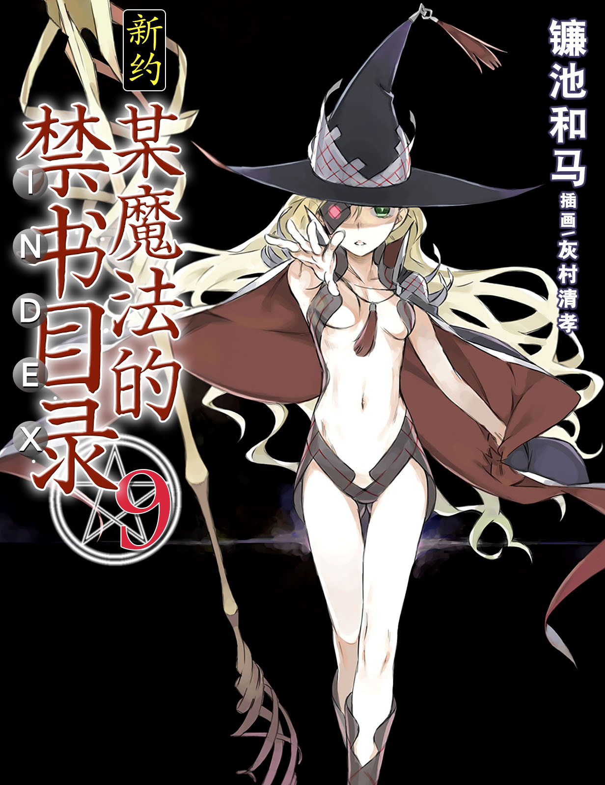

# 简介

**新约·魔法禁书目录9**

作者：镰池和马

## 内容简介

**毁灭世界的魔神欧提努斯。那里唯一存在的只有她自己，和另一个人……**

欧提努斯的支配，已然完成。

作为战斗舞台的格雷姆林大本营，漂浮在东京湾上的「船之墓场」消失了。更重要的是，整个世界也随之消失。同行的茵蒂克丝、御坂美琴、蕾莎与柏德蔚等人自然也都消失了。

统一的黑暗空间。在那片漆黑中，仅剩上条当麻一个人。原因只有一个，他拥有世界的基准点和修复点——「右手」。

对于已经成为神的欧提努斯来说，她早已不对上条当麻这个存在感到丝毫兴趣。像往常一样的逆转戏码，完全没有存在可能。

这里就是这样的「世界」。

而且。

而且。

而且。

这是一个打击上条当麻心灵的故事。

## 制作信息

* 翻译：Seeker
* 台版：天使动漫
* 扫图：真妹控
* 图源：真妹控
* 录入：污驴
* 校对：埋没湮灭
* EPUB制作：鹘鹰⚡
* 网翻：贴吧汉化组
* 图源：绿坝哥哥
* 组织：星之翔
* 翻译：月の姬 神笑琉璃 系色恨 keiketsu EDSTER792（借鉴其部分英翻）
* 校对：月の姬
* 渣润色：黄昏的鸡蛋黄
* 整合：知一一（禁书目录X系列，[index-X](https://github.com/1204244136/index-X)）


**版权声明**

转载时请保留录入信息。

本站内容仅供试看、学习与交流使用，禁止用于商业用途；下载后请在24小时内删除。请支持官方正版。


## 封面与封底

