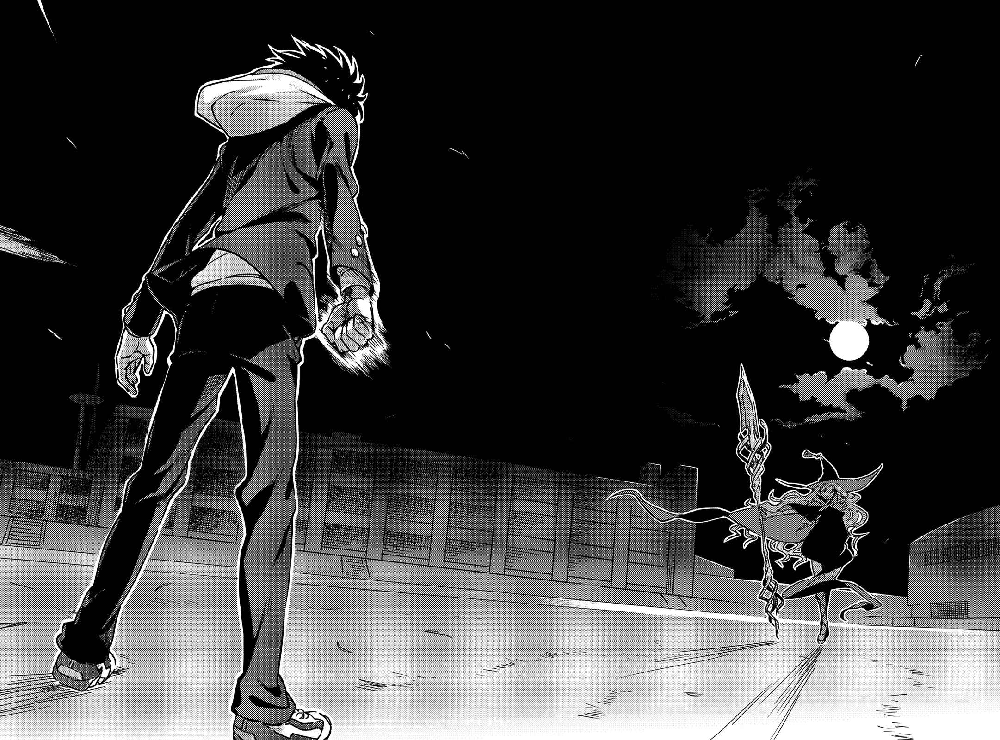

# 行间六

结论出来了。

那么，就把要说的话扔掉吧。

&nbsp;

对变化的世界没兴趣，看不出缺乏正义的和平有什么价值。

那就转过身子承受苛责吧。

&nbsp;

此时，在场的仅有两个特异点。

似近却远。所以理所当然地，打从一开始就不可能互相理解。

&nbsp;

胜利之后什么也没有。

纵然获得胜利，向往的世界也不会到来。

&nbsp;

之所以即使如此仍旧不停止交锋，想必是因为这场战斗与利害无关。

这是场赌上尊严与骄傲的战斗。双方都认为这样就够了。

&nbsp;

胜利之后会得到什么，败北之后又会失去什么。

胜利之后会失去什么，败北之后又会得到什么。

&nbsp;

知道条件了吗？

明白眼前的威胁了吗？

&nbsp;

幕已掀起。

无须解释。好好享受基于个人为了个人的个人之战吧。

