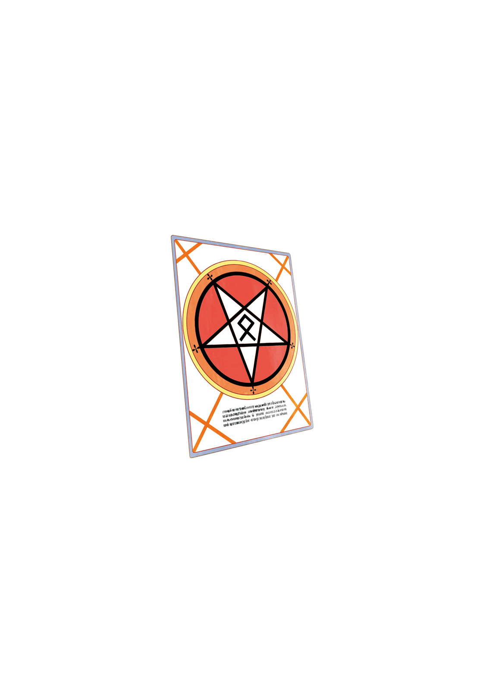

# 简介

**旧约·魔法禁书目录1**

作者：镰池和马

## 内容简介

**「超能力」与上条当麻，「魔法」与茵蒂克丝。当奇异之线交汇之时，故事就从此开始——！**

一名白衣修女从天而降，落在了上条当麻的房间里。

「不可能」……

上条当麻喃喃自语，那个身穿修道服的少女却说她是从魔法世界逃出来的。

这里是「超能力者」被认为是「普通科学」的，反超自然的学园都市。

上条对这个自称「茵蒂克丝」的少女的行为感到怀疑，但就在这时，真正的「魔法师」出现了——！

备受期待的新人带来的学园动作故事登场！

## 制作信息

* 翻译：李彦桦
* 台版：轻之国度EPUB制作组
* EPUB：江火如画
* 录入：蓝天语意 apple0143
* 初校：给你一半
* 二校：SwordGrave
* 三校：xxxholic
* 整合：知一一（禁书目录X系列，[index-X](https://github.com/1204244136/index-X)）


**版权声明**

转载时请保留录入信息。

本站内容仅供试看、学习与交流使用，禁止用于商业用途；下载后请在24小时内删除。请支持官方正版。


## 封面与封底

