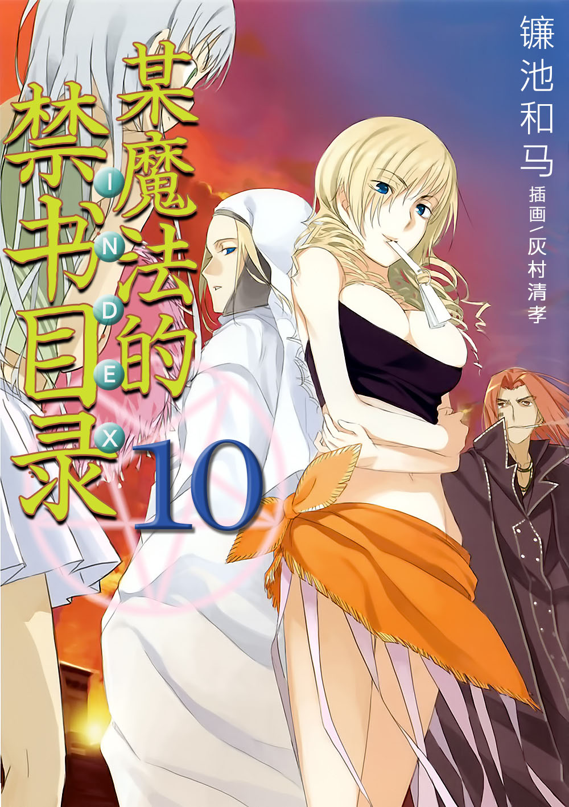

# 简介

**旧约·魔法禁书目录10**

作者：镰池和马

## 内容简介

**「使徒十字」在「大霸星祭」掀起了波澜。那是破坏人们梦想的存在……！当科学与魔法交汇之时，上条当麻的故事就从此开始——！**

为期七天的「大霸星祭」。

那是由运营委员吹寄制理和穿着啦啦队服装的月咏小萌、名门大小姐学校的御坂美琴等，学园都市所有师生齐心协力参与的超大规模活动。

「使徒十字」在「大霸星祭」掀起了波澜。

这个被称作「使徒十字」的存在，会毫不留情地摧毁上条当麻重要之人的梦想……！

上条当麻开始行动。

为了夺回每个人都期待并享受着的「大霸星祭」。

当科学与魔法交汇之时，故事就从此开始——！

## 制作信息

* 翻译：郑淑慧
* 台版：轻之国度EPUB制作组
* EPUB：江火如画
* 扫图：Ozzie
* 录入：拜金马甲
* 初校：FateZZK
* 二校：stson
* 三校：xxxholic
* 整合：知一一（禁书目录X系列，[index-X](https://github.com/1204244136/index-X)）


**版权声明**

转载时请保留录入信息。

本站内容仅供试看、学习与交流使用，禁止用于商业用途；下载后请在24小时内删除。请支持官方正版。


## 封面与封底

