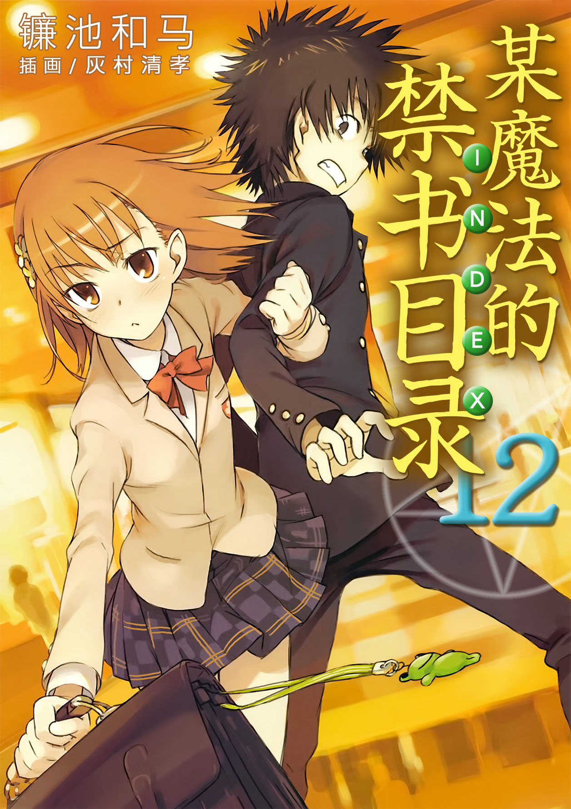

# 简介

**旧约·魔法禁书目录12**

作者：镰池和马

## 内容简介

**科学与魔法的学园喜剧篇终于开始了？当上条当麻和御坂美琴交汇之时，围绕惩罚游戏的故事就从此开始——？！**

九月三十日——学园都市迎来了换季期。

将周围的喧嚣抛之脑后，精英大小姐学校·常盘台中学的超能力者御坂美琴站在音乐厅前的广场上。

她正在等待某人。

然而，「……还没来。」

本应接受惩罚游戏的「那个少年」却始终没有出现。美琴一边叹气，一边抱着薄薄的学生包和小提琴盒子等待着那家伙——

当上条当麻和御坂美琴交汇之时，围绕惩罚游戏的故事就从此开始——？！

## 制作信息

* 翻译：郑淑慧
* 台版：轻之国度EPUB制作组
* EPUB：江火如画
* 扫图：Ozzie
* 录入：七夜
* 初校：stson
* 二校：ClairAKB48
* 三校：xxxholic
* 整合：知一一（禁书目录X系列，[index-X](https://github.com/1204244136/index-X)）


**版权声明**

转载时请保留录入信息。

本站内容仅供试看、学习与交流使用，禁止用于商业用途；下载后请在24小时内删除。请支持官方正版。


## 封面与封底

