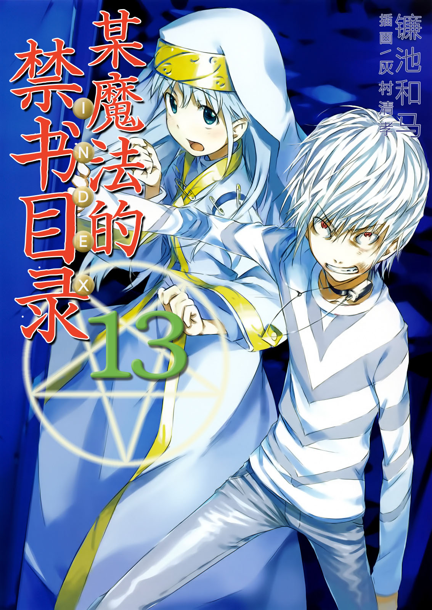
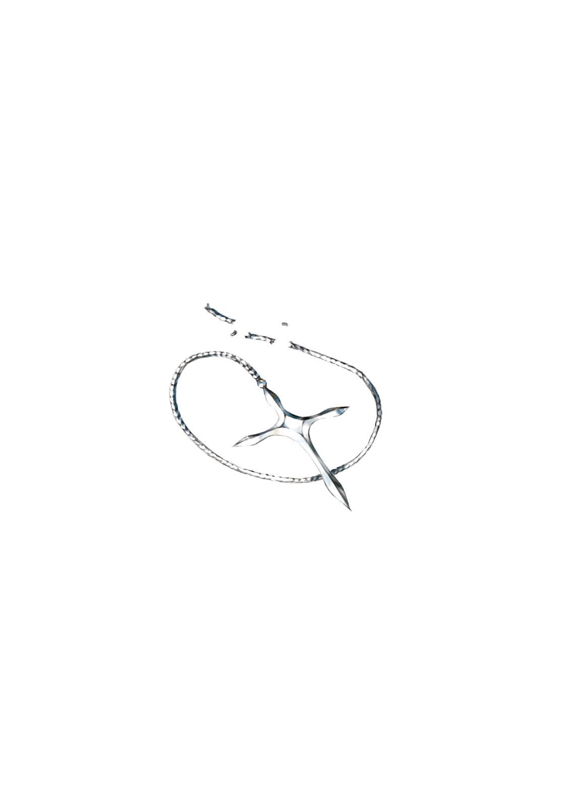

# 简介

**旧约·魔法禁书目录13**

作者：镰池和马

## 内容简介

**最强的能力者·一方通行(Accelerator)VS武装集团「猎犬部队」！！ 最弱的无能力者(Level 0)·上条当麻VS前方之风！！ 当科学与魔法交汇之时，故事就从此开始——！**

罗马正教「神之右席」的一员，「前方之风」入侵了学园都市。她操控的谜之魔法使得城市机能完全瘫痪，大部分人失去意识而倒下。

她的目标是上条当麻。

罗马正教正式认定的敌人。

与此同时，

最强能力者·一方通行(Accelerator)为了保护支持他的少女「最后之作」，与科学家木原数多率领的武装集团「猎犬部队」展开激战。

魔法与科学，两场灾难同时袭击学园都市。

上条当麻、茵蒂克丝、一方通行(Accelerator)、最后之作。当四者的四种心情交汇之时，故事就从此开始——！

## 制作信息

* 翻译：郑淑慧
* 台版：轻之国度EPUB制作组
* EPUB：江火如画
* 扫图：小狼
* 录入：浪客行
* 初校：夜の星痕
* 二校：stson
* 三校：yanplaywow
* 整合：知一一（禁书目录X系列，[index-X](https://github.com/1204244136/index-X)）


**版权声明**

转载时请保留录入信息。

本站内容仅供试看、学习与交流使用，禁止用于商业用途；下载后请在24小时内删除。请支持官方正版。


## 封面与封底

