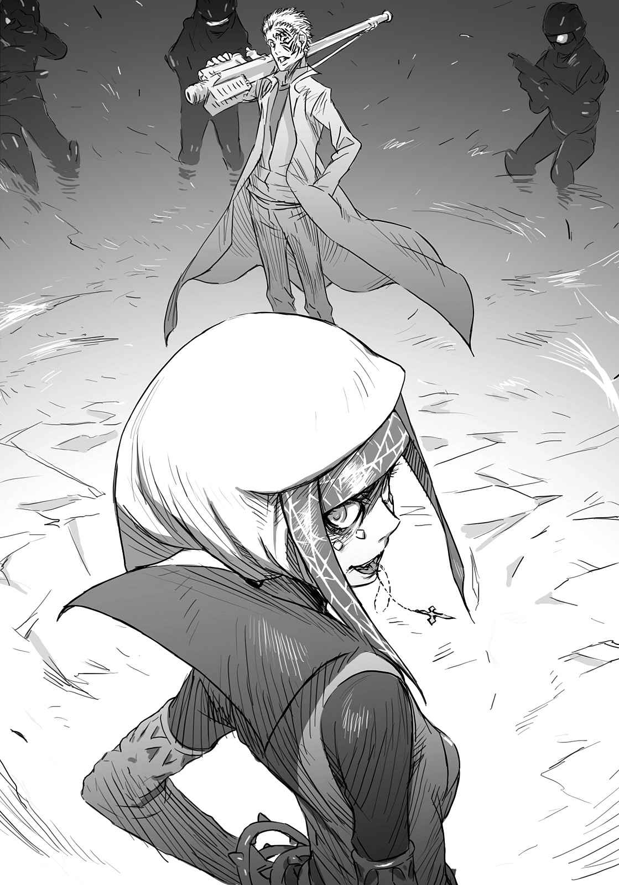

# 第六章 被冷雨淋湿的街道上

> Battle_Preparation.

## 1

九月三十日，下午六点三十三分。

「神之右席」其中之一「前方之风」，以物理性突破学园都市的第三大门。

同时刻发动不明攻击，维持治安的警备员(Anti-Skill)及风纪委员(Judgment)遭到极大损害。

警备削弱的结果，统括理事会中有三人被风杀害。

同日，下午七点零二分。

学园都市统括理事长亚雷斯塔为了阻止风，决定使用尚未完成的虚数学区·五行机关。

木原数多所率领的「猎犬部队(Hound Dog)」，在下着雨的街头展开行动。

他们的目的是回收样品编号(Serial Number)20001号「最后之作(Last Order)」。

由于判断一方通行(Accelerator)会造成回收作业的阻碍，木原数多亲自出手袭击，袭击的结果是成功。

号称学园都市最强超能力者(Level 5)的他，在木原面前完全无能为力。

但是，「猎犬部队(Hound Dog)」犯了一个小小的失误。

&nbsp;

「救救……」

&nbsp;

他们让一个少女脱逃了。

而且，

&nbsp;

「求求你救救那个人！御坂御坂求你！」

&nbsp;

这句话，传到了某个少年的耳里。

## 2

「你们在那里做什么？」

雨势越来越强。

落下的雨滴中，少女的声音响彻黑暗的街头，传到「猎犬部队(Hound Dog)」跟木原数多，还有倒在潮湿路面的一方通行(Accelerator)耳里。

纯白色修道服的影子，浮现在黑暗的夜色中。

茵蒂克丝。

她是名娇小的少女。即使身穿大大蓬起的修道服，仍旧无法掩盖她娇小的身躯。一头及腰的银色长发，清澈的碧眼，让人联想到一摸就坏的细致工艺品。而且她双手还抱着一只小小的三色猫。

（真是最糟的状况……）

倒在地面上的一方通行(Accelerator)心想。

未免也太不巧了吧？这哪是什么机会，根本只是徒增麻烦。别说手里有枪的「猎犬部队(Hound Dog)」，她就连暗巷里的不良少年也对付不了。

实际上，木原正皱着眉头。

对于眼前新出现的战力，他完全没进行任何分析或思考。他脸上露出的表情，只能用棒球比赛中突然发现投手丘上有小鸡在走路这种感觉来形容。

只要那个白衣男子一声令下，这名修女在数秒内就会变成一团绞肉。

万一对方使用那种威力足以将车子打成蜂窝的冲锋枪，任谁都想得到，那柔软的人类皮肤跟肌肉会变成怎样。

（该怎么办？不管她？救她？还是利用她……）

一方通行(Accelerator)的注意转向脖子上的项圈式电极。

能力应该还能使用。

但满身的伤口却拒绝让他移动身体。

「怎么办？」

固守在周围的黑衣人之一，在木原耳边窃窃私语。

木原无聊地叹了口气。

「你说怎么办？」

他只回了一句。

「当然是让她消失。」

（啧！）

一方通行(Accelerator)咂嘴。

茵蒂克丝目击了「猎犬部队(Hound Dog)」的活动。她目睹了这个本身应该隐瞒的非公开组织，木原的意思当然是杀人灭口。这女孩就算能逃离这里，也会不断地遭到追踪，她恐怕撑不了三天。

（横竖坐视不管我都是死路一条，那当然要试试看！）

与其说他想救茵蒂克丝，倒不如说是想看到木原数多的哭丧脸，这个目的让一方通行(Accelerator)恢复了爆发力。

（这修女不管怎样都无所谓，但我可不能一直这样被打趴。这次该换你咬牙切齿啦，木原！）

脖子上的项圈式电极开关，从刚才就一直开着。

之后只要下命令就能发动能力。

因此，他确认所有的位置。

以一方通行(Accelerator)为中心的半径十米内，有三台黑色面包车包围着他。黑色装束的「猎犬部队(Hound Dog)」人数约二十人。最麻烦的木原数多虽然站在一方通行(Accelerator)附近，要攻击他几乎是不可能。一方通行(Accelerator)用来防御的「反射」不能防止木原的攻击，即使操纵风的方向产生暴风，也可能被特殊的音波扰乱无法发挥用途。

而且。

茵蒂克丝就站在面包车形成的圈子外，约十五米之处。

（晚点再歼灭这些家伙。）

伏倒在地上的一方通行(Accelerator)以指尖触摸濡湿的柏油路。

他用指腹确认触感。

（现在要做的事只有一项。就是逃到安全的场所。跟那个修女一起逃！）

红色的瞳孔扩张收缩。

能力发动。

「哦哦哦哦哦啊啊！」

一方通行(Accelerator)大叫，单脚脚尖抵住地面，以伏倒的姿势用力踢向路面，趁机操纵矢量。他的身体获得足以比拟导弹的爆发力，从柏油路面飘浮起来，之后以惊人的速度，猛力撞上黑色面包车的后部拉门。

仿佛被铁球打中般，金属门脱离滑轨被挤压入车内。

一方通行(Accelerator)的身体坐在面包车后座上。

「咦？」

在驾驶座上待命的黑衣男子还来不及反应，一方通行(Accelerator)已经伸手从被挤坏的铁门扯下滑轨部分的金属。他握紧宽五厘米，长二十厘米的尖锐铁棒，用力戳进驾驶座椅背的正中央。

噗。

手中的触感，比这声响更为深刻。

「咿——啊！」

一方通行(Accelerator)对着被钉在驾驶座上，连尖叫还来不及发的男子说道：

「开车。」

毫不留情。

他只是静静地告知事实。

「你在三十分钟以内就会死，不快去医院就来不及了。」

男子从疼痛的程度知道，这并非靠急救箱就能解决的等级。而且他比任何人都清楚，**那个**木原数多会怎样处理碍手碍脚的受伤部属。

「咿？」

他迅速下了决定。

尖锐的引擎声响起，载着一方通行(Accelerator)的黑色面包车，以歇斯底里的动作驶出。

车子前进道路上的黑衣人纷纷左右退避。

一脸愤怒的木原发出怒喊。

此时，他们突破了包围网。

他知道后方的男人们纷纷将枪口对准车子。

一方通行(Accelerator)越过驾驶座望向挡风玻璃前方，把握茵蒂克丝所在的位置。

「靠左！」

一方通行(Accelerator)大叫后，从敞开的出入口扔出碍眼的车门，将身子伸出车外。

白色修女就站在车子前进方向的车道正中央。

「啧！」

他将手伸出车外。

茵蒂克丝双手抱着三色猫，所以能抓的部分只有上臂。就算将手伸到极限，也不能保障能否碰得到她。

但他仍旧伸长了手。

砰！枪声响起。

子弹掠过侧脸，但一方通行(Accelerator)丝毫不在意地抓住茵蒂克丝。他借势操纵矢量，硬将她拉进车里。

「哇、哇啊啊！」

茵蒂克丝发出不适合这种状况的尖叫声。

一方通行(Accelerator)调整身体位置，遮住驾驶座的椅背。指尖轻轻碰触贯穿椅背的锐利金属凶器。

「咿……嘎？」

驾驶座上的男子猛然震动。

一方通行(Accelerator)以茵蒂克丝听不到的声音低声说：

「……别嚷嚷，赶快开车。我们彼此都没有时间吧？」

「先、先生，请问您要到哪……？」

「我认识一个很厉害的医生。」一方通行(Accelerator)用索然无味的声音回答：「普通医生应该是靠不住啦。要我帮你引路，就给我好好干活啊，司机先生。」

## 3

「啊——啊——啊——啊——」

看着渐渐变小远去的黑色面包车，木原数多发出泄气的声音。

他伸出右手。

「啊——啊——啊——啊——！那个啦，那个，把那个拿来！」

他的要求非常含糊，部下却顺从地回应，从其他剩下的面包车上迅速拿出便携式反坦克导弹交给木原。

即使如此，木原仍然大骂着「快点，笨蛋！」将部下打飞，以专业操作者敲键盘般的正确动作一口气组装起大炮，然后打开保险。

他的动作没有任何迟疑。

狼狈的反而是「猎犬部队(Hound Dog)」的部下。

「司、司机怎么办？」

「那个重要吗？啊哈！逃兵当然是立即处死啊！再见了小狗狗，我至少会记住你两秒左右！」

木原将全长一米、宽三十厘米左右的大炮架在肩上，眼睛盯着枪身侧面的望远镜。

瞄准目标。

手指扣在追踪导弹的扳机上。

数十米外的面包车正要弯过转角。木原笑了。来得及。就算车子完全转弯，导弹也会追着车子斜向前进。只要打中转角那幢大楼的墙壁，受到水泥片暴风攻击的面包车应该会翻覆。

一方通行(Accelerator)应该不会这么轻易就死掉，但确定可以除掉他的交通工具。接下来，只要慢慢料理负伤的其他两人跟一方通行(Accelerator)就行了。

（你真是太天真了，一方通行(Accelerator)！使用车子不就是跟人家宣称，你已经无法进行纤细的风力操作吗！）

「再见啦，混账东西！我要把你的一身白肉轰到焦黑！」

伴随着兴奋的笑声，木原数多正要扣下扳机。

但是，

「？」

望远镜型的瞄准器突然染成黄色。

是比例偏移还是被什么东西挡住了？木原的眼睛离开望远镜，看到前方十米左右的位置，站着一个奇妙的女子。

冰冷的雨打在路面上。宽阔的马路上没有其他车子跟行人。大楼窗户射出的白色照明跟信号机的光反射在濡湿的路面，女子独自伫立其中。

先前完全没有发觉。

她脸上穿了无数的耳环，导致左右对称扭曲，脸上画着强调眼角的浓妆。这是张完全不在意他人想法的脸。女子穿着以黄色为主的礼服，看起来有点古老，似乎年代久远。感觉就像中世纪的欧洲人。

但是对木原来说，这种事根本无所谓。

现在重要的是，刚刚被这个女人一打扰，面包车已经弯过转角消失不见了。

「……」

木原的脸霎时失去表情。

他面无表情地扣下扳机。

反坦克导弹发射了。

喷射烟笔直冲向挡路的女子胸口正中央。还没看到她是否改变表情，炮弹已经爆开，冲击波与爆炸火焰洒向四周。

轰的一声，撼动柏油路的轰声炸裂开来。

原本像外膜般包裹宽阔路面的雨水整个被吹飞，周围大楼的看板发出震动。行道树被震下的大量树叶飞舞在空中。

因为在至近的距离爆发，木原周围的黑衣人受到波及被吹走了。

红色的火焰跟黑色的浓烟，像棉花糖般遮住木原的视野。

但是。

这种状况只维持了五秒。

&nbsp;

烈风将一切吹散。

&nbsp;

火焰跟浓烟，都被爆炸中心卷起的龙卷风吹得消失无踪。

女子纹丝不动地站在燃烧碎裂后，四处飞散的柏油路中心。

不仅衣服，就连一根头发都没有任何损伤或烧痕。

「真是个不错的城市啊。」

黄衣女子唐突地如此说道。

完全无视木原数多的存在。

「我还以为『侵蚀』会扩大，但似乎不是这样。这里的构成人员大部分是教职工跟学生，这样算犯规吧？对象如果是这些人，我的侵蚀速度会减慢也是理所当然，对吧？」

脸上到处穿了耳环的女人看着木原。

「……只有你是例外的全黑。」

此时，木原总算开口了。

「你是谁？」

「抢你杀人生意的敌人。」

女子转向面包车消失的转角。

「我的目标也在那辆车上。虽然由别人下手也无所谓，但是我讨厌被人从中作梗。」

木原叹了口气，仿佛在说「懒得理你」。

「杀了她。」

他一下达指示，周围的黑衣人全都举起枪来。

但是，

「算了吧。」

扳机并没有扣下。

还来不及扣下扳机，男子们已经开始呻吟毫无抵抗地倒下。这样过于爽快的攻击，反而让人觉得奇怪。

他们倒在被雨打湿的路面，其中还有人直接倒在一方通行(Accelerator)破坏的面包车残骸上。即使如此，男子仍旧动也不动。他们被剥夺了所有的力量。

到底发生了什么事？

木原轻敲导弹的炮身。

当场虽然没人理解发生了什么事，至少这名女子对自己的力量很有自信。即使身处跨出一步就会被打成蜂窝的状况，她的脸色仍旧不变。

女子露出了嫌无聊的表情说：

「不过你竟然面不改色地说『杀了她』？虽然有**杀意**却没有敌意。这根本就不把敌人当作敌人，甚至不抱任何罪恶感。就像连根拔除杂草一样。最开始的那一发攻击也一样，你这家伙真是无药可救。至少跟我差不多。」

木原完全不理睬她。

他不耐烦地对周围的黑衣人挥了挥手，

「人员分成两支小队。」

他将没有子弹的反坦克导弹任意一丢。

「让现在成员中最没用的十个人挡住她。这段时间我们其他人移动到『别墅(本部)』。懂了吧？」

这样的命令极为干脆，如果不遵守命令就一定会被枪林弹雨攻击。而且，只有木原才能打败一方通行(Accelerator)的确是不争的事实。

眼前的可疑女人、木原数多跟一方通行(Accelerator)。

如果要判断谁是最「不可怕的对手」，眼前的女人虽然有点可怕，难度应该是最低的。

下完命令后，木原坐进面包车里。

女子从背后叫住他。

「你没有敌意哦。」

「要我表现敌意，就做些更有能力的事吧。」

木原说完这句话，敲了下司机的后脑勺示意开车。

只剩下女子跟诱饵。

「……我不知道你们是什么人，不过在询问之前你们应该会先死吧。真是的，我实在是不适合收集情报。杀太多人也很麻烦的。」

女子晃动脖子发出「喀啦」的声响，伸出舌头。

锁链从她口中落下。

「接下来嘛……刚才被那个人这么瞧不起，你们这些人真的有用吗？」

## 4

上条当麻与最后之作(Last Order)始终伫立不动。

两人都没有撑伞。黑色立领制服下穿着红色T恤的上条，跟在蓝色吊带背心套上男用衬衫的最后之作(Last Order)，两人都浑身湿透。女孩额头上的电子夜视镜也淋湿了，但对这样的军事用品没有太大影响。

娇小的少女带领他来到离地下街出入口不远的某条大马路一角。清校时间一到，电车跟公交车也停驶了，黑漆漆的马路上不见任何人影。

至少没有用两只脚站立的普通人影。

「————」

地面上躺着好几个人。

雨势增强的夜空下，清一色的黑衣男倒在地面上的积水上。街灯发出的亮光反射着合成素材制成的装甲服，可怕的冲锋枪包裹着一层薄薄的水膜。从他们用安全帽或高伸缩性面具盖住脸庞的打扮看来，怎么看都不像是一般人。

听到啪嚓啪嚓的声响。

是火焰的爆裂声。

距离那些男子倒地位置数米处，有一辆被压扁的面包车。这就是火焰的薪柴。车子冲破护栏，停在步道正中央……这样来形容并不适合，因为面包车已经失去了原本形貌，应该说四处飞散比较正确。附近没有其他车辆。也就是说，那是倒地的男子们所乘坐的车。

最后之作(Last Order)指着倒在地上的一个男人。

她铁青着脸说：

「就是这个人袭击我，御坂御坂说的是真的。」

是真的哦，她重复。

上条重新望向倒地的男人们。

（他们并不是……警备员(Anti-Skill)？）

差点就被他们身上全黑的战斗装备给骗了。仔细观察后，感觉……跟普通警备员(Anti-Skill)的装备与规格不同。上条既不是军事相关人士，也没有足够的知识一眼就看得懂型号，所以他也无法断言。

（不过如果不是警备员(Anti-Skill)，这些人到底是谁？拿着比警备员(Anti-Skill)还昂贵的装备，以大批人马袭来……）

但是，这群袭击者却全部倒地。

无法掌握状况。

上条看着最后之作(Last Order)，

「在这里遭到袭击的，是你的朋友吧？」

「没错，御坂御坂回答道。」

「这……是那家伙的反击……？」

「应该不是，御坂御坂摇头。那个人很性急又容易跟人发生争吵，遇到那样的事，反击应该不仅如此，御坂御坂简单推测。」

那到底是怎样的人啊？上条在心中吐槽。

但是，

「……」

能力者并非所向无敌。

他不知道最后之作(Last Order)的朋友是使用怎样的能力，如果不是超能力者(Level 5)「超电磁炮(Railgun)」那样的异人，遇到受过训练的集团以枪械袭击时根本无法反击。无能力者(Level 0)上条虽然没资格说什么，但能力者基本上都是学生。就算说他们的力量「只适用于学校」也不为过。

万一被丢到这样的战场，根本无能为力。如果够机灵……不过，要是没有可以「临机应变」的余地也没用。在这样的心理准备下作战，普通学生根本办不到的。

如果是普通人一定会死。

（要是不去报案……）

现在无法判别最后之作(Last Order)的朋友是被捕还是逃跑中，无论如何这都是紧急事态。这件事还是乖乖仰赖警备员(Anti-Skill)的帮助比较好，上条从口袋中取出手机。

然而。

「……？」

在按下按钮前，上条的脸从手机抬起。

（……为什么……没有任何人报案……？）

他望着眼前被压扁的面包车。起火似乎过了一段时间，但火光丝毫不减。发生这么大的事件，应该会传到其他人的耳里。从远方看也应该知道发生了火灾。照理来说，就算上条不打手机，也应该早已有人通报，没人聚集看热闹这一点也很奇怪。

「……」

上条环视四周。

失去灯光的街头。完全没有任何骚动，被彻底的寂静所包围。

莫非？

这并非不能，而是无法产生骚动？

如果建筑物中，也有许多人像警备员(Anti-Skill)那样倒下？

（到底……）

这是人为攻击，还是非意图造成的现象？

就连这点也不明朗，这是完全没有任何自我主张的紧急事态。

最可怕的不是这份沉静。

而是当上条发现问题时，学园都市已经像木头被白蚁蛀空般，停止机能的事实。

这样的状况，就像在期末考试时打瞌睡，被监考官「只剩十分钟」的声音惊醒一样。

在空白(沉默)的答卷(街道)前，少年全身冒出冷汗。

（这城市里，现在到底发生什么事了？）

上条因为这样的状况动弹不得，此时眼前突然出现了动静。

最后之作(Last Order)蹲在倒地的男人身旁把玩着装备。她突然发现什么似的抬起头，慌张跑向上条。

她被雨水打湿的冰冷小手抓住上条的手，不断地拉扯。看起来就像小孩硬拉着父母到玩具卖场。

「快点，御坂御坂催促你警戒。」

她的声音异常迫切。

「他们来了，御坂御坂边将身子藏在小巷里报告。」

上条被最后之作(Last Order)拉着躲在附近停放的车辆暗处，皱着眉心想：「『他们』是谁？」

附近的排水沟都被落叶塞满，车子周围形成池子般大小的积水。光是踏进一步，袜子已经被水完全浸湿。

但他没时间抱怨。

引擎低沉的声响传来。

关掉车头灯的奇怪黑色面包车驶近。

车子发出蹑手蹑脚般的低沉排气声，停在黑衣男倒下的场所。车子后部的拉门打开，身着相同装备的人接二连三下车。乍看之下约有十人。这样的数目，就算对方手上没有武器也绝对赢不了。

而且，

「……可恶，他们从哪儿弄到这么多枪？」

上条忍不住低语。

黑衣男子们肩上全部挂着冲锋枪。身上可能还有手枪跟手榴弹等装备吧。

他们看起来不像学园都市内维持治安的警备员(Anti-Skill)。

而且来意不善。

这些人四周散发着一股紧张感，似乎只要一发现上条他们，就会马上开枪射击。

上条望向自己的右手。

这只手拥有的幻想杀手(Imagine Breaker)能够轻易挡下超能力(Level 5)的超电磁炮(Railgun)。但是，对跟异能之力无关的枪弹完全没有任何效力。

黑衣人扛起倒在路上（可能是）的同事，粗暴地塞进车里。在进行这项作业的同时，还有人在做其他动作。一名男子背着三罐家庭号大小塑料瓶串联在一起的透明圆筒。容器底部连接一条喷嘴，男人像是举起火焰喷射器般抓着喷嘴。

「那是acid，御坂御坂称呼其通称。」

「那是什么？」

「酸性净化(Acid Spray)……也就是喷洒某种特殊弱酸，借此消除指纹跟血痕等DNA情报，御坂御坂从证据湮灭手册那边获得情报。」

「……」

上条心想，这下糟了。

那个集团准备了这么夸张的设备，一定是感觉到湮灭证据的必要性。可以想见这些家伙发现目击者时，会采取怎样的行动。

结论就是——

（———万一演变成这种事态，我没信心能逃得掉。）

喉头发出「咕嘟」的声响。

感觉就连这样的声音，也很有可能被那边的黑衣男听到。上条已经分不出弄湿自己身体紧贴在T恤上的，到底是雨滴还是冷汗。

只能默默等对方离去。

不要发现，不要发现，他在脑中祈祷。

啪啦，水声传进耳里。

「———」

上条看着自己脚边。

因为排水沟堵塞，地面上有滩池塘般的积水。浸泡在内的脚微微颤抖。这样的震动在水面形成小小的波纹，波纹穿过两人躲藏的车子下方蔓延到对面。

这样应该不会被发现吧。

倾泻而下的雨滴也打在积水上。黑暗中就算仔细看也无法观察到积水的样子，没问题的，上条在心中暗暗祈祷。

&nbsp;

此时。

不远之处的黑衣人们，一齐望向这里。

## 5

车子行进了十分钟左右。

车子走十分钟，距离应该算是「尚可」，一方通行(Accelerator)心想。但反过来说，就是只有「尚可」的程度。可能性虽然不高，万一那些家伙夸张地用卫星追踪自己的逃走路径，很可能一下子就会被追上。

驾驶座上被一方通行(Accelerator)刺穿背部的男子发着抖，以微弱的声音说：

「（……还、还要走吗？哈哈，这不是开玩笑的，这样下去真的会死——）」

「（……给我安静。我还没叫你停吧？）」

一方通行(Accelerator)低声说完，轻轻动了动贯穿驾驶座的钢铁凶器。男人的身体倏地震动，呻吟声回响在车内。

听到这声音的茵蒂克丝，微微抬起头来。

「怎么了？」

「没事。对吧？」

一方通行(Accelerator)将身体贴近前方的驾驶座，不让茵蒂克丝发现他手握凶器。

驾驶座上的男人冷汗直流点头。茵蒂克丝皱了皱眉头，但似乎没注意到现在的状况。

「不过……」

一方通行(Accelerator)忍不住出声。

原本他想这辆没有后门，如赃车般的可疑面包车在街道上行走，应该会碰到警备员(Anti-Skill)，但事实上并非如此。还以为这样就能省掉跟黄泉川联系的麻烦，一方通行(Accelerator)不禁有些扫兴。

（该不会……**这样的寂静**也是木原那杂碎特地搞出来的表演吧……）

一方通行(Accelerator)现在将项圈式电极切换成普通模式。

这单纯只是为了节省能源。电池在能力使用模式下根本撑不了十五分钟。刚刚跟木原战斗时消耗了不少，而之前普通的生活中又消耗了一些。

看来电池的残量完全战斗时根本撑不到七分钟。

当然，现在他也没有使用最低限度的「反射」。想跟木原他们战斗必须节省能源。但在现在的状况下，例如一方通行(Accelerator)发现袭击前，这辆车突然被导弹打中，那铁定就是完蛋了。

因此，一方通行(Accelerator)从拉门消失的出入口望着外头流动的夜晚街头。

「啊，发现《丑小鸭》！」

身旁那个完全不同世界观的纯白修女，正在赃车的后座到处翻找。

原本的车主应该是有小孩的人吧，茵蒂克丝拉出坚硬厚纸做成的幼儿用绘本。她膝盖上的三色猫似乎被封面卡通化的鸭子刺激到狩猎本能，开始慢慢测量起距离来。

（这么喜欢书是怎样？眼睛闪亮的方式未免也太非比寻常……）

「你真是个悠闲的家伙。为什么你会出现在那里？」

「嗯？我来还你借我的东西。」

茵蒂克丝在修道服的袖子里四处翻找一阵之后说道：

「你看，就是这个最新锐日用品！不可以把这么重要的东西一直放在我这里啦！你应该很困扰吧，不过现在已经没问题了！」

「你是笨蛋吗？像这种用过就丢而且揉成一团的面纸，还给我根本就是在给我添麻烦！」

咦，是这样吗？茵蒂克丝用小小的手开始将塑胶包装的袖珍包面纸摊平。

看样子不收下来会没完没了，一方通行(Accelerator)不耐烦地从茵蒂克丝手中抢走面纸，随便塞进裤子口袋里。

「你的伤没事吧？」

「啊？」

「就是……那个啊。你刚刚倒——」

「没事。还有，如果你再提这件事，我很可能会抓狂。」

茵蒂克丝完全没注意到司机正在格格发抖。

听到一方通行(Accelerator)不认输的回答，茵蒂克丝似乎放下心来，将视线转向手边的绘本。

「嗯，日文是这样翻译的啊。」

可能茵蒂克丝知道故事的内容吧，她高速翻动书页，只在最后一页发出声音念道：

「一直被骂没有用的丑小鸭，其实是超性感帅气的天鹅呢。结束……性感帅气是什么意思？」

「就是跟你完全相反的生物。」

「这样啊。」

茵蒂克丝啪嗒一声合上绘本。

「……这故事是在说，打从一出生就注定是天鹅的胜利？」

「《丑小鸭》才不是那样的故事。」

「那是怎样的故事？童话的解释方法有众多分歧，所以很难解读。」

「啊？这……怎么说啊，那个小鬼的确是说过『想跟鸭子们当好朋友的天鹅，被迫认清自己绝对不可能加入鸭子圈内的事实，难道这样真的幸福吗？』。」

一方通行(Accelerator)不屑地「啧」了一声。

就是因为那小鬼有时会说出这种不可爱的意见，所以才拿她没辙。

驾驶座又传来烦人的呻吟声，他随便前后摇动贯穿椅背的钢铁凶器，迫使对方安静下来。

茵蒂克丝仍旧没发现状况有异。

她从绘本抬起头问道：

「那个小鬼……就是你之前在找的迷路孩子？」

「没错。不过现在我还在找她。」

「你们又走散了？」

「……嗯，对啊。」

沉默片刻后，一方通行(Accelerator)承认。

「接下来我得找到那小鬼。麻烦的是那家伙似乎无法自己回到家里。所以，我得跟你在此分别。」

「我也来帮你找吧？」

茵蒂克丝马上回答。

她正视着一方通行(Accelerator)红色的眼睛。

「因为我知道你现在很困扰啊。如果当麻在这里，应该也会说同样的话吧。」

「哼。」

他索然无味似的别开视线，对驾驶座上的男人说：

「停在那边。」

被掌握自己生命的一方通行(Accelerator)这么一命令，男子依言将车停靠在路肩。

一方通行(Accelerator)看着茵蒂克丝。

「帮我一个忙。」

「嗯。该怎么做？」

「这附近有间很大的医院。徒步大约要五到十分钟。到那里找个长相很像青蛙的医生。遇到那个医生之后……」

一方通行(Accelerator)在这里停住，敲敲自己的脖子说：

「跟他说准备御坂网络连线用电池。这样说对方就懂了。电池是很重要的东西，没了那个就不能找人。等拿到电池之后，你要赶快回到这里，知道吗？」

「知道。是『御坂网络连线用电池』对吧？」

她完美地复述。

这家伙应该不知道自己口中说的什么御坂网络，跟连接用电极的意思吧，不过她脑袋倒是挺聪明的。一方通行(Accelerator)才刚这么想，茵蒂克丝就已经抱着三色猫毫不犹豫跑到雨中的道路。

「要等我哦。」

「啊？」

「在我回来之前，一定要等我哦？」

「……知道啦。快去吧。」

一方通行(Accelerator)回答。

茵蒂克丝回头两三次之后，总算踏着积水跑走了。她小小的背影消失在黑暗深处。

「混蛋。」

他忍不住骂道，身体靠在座位的椅背上。

到医院根本就没得替换。电极本身就是试作品，对应的电池也是特殊物品，根本没有量产。如果真的有，一方通行(Accelerator)从一开始就会在口袋内塞满大量电池了。

那是个简单的谎言。

除了去找青蛙脸医生的部分。

不论去什么地方都同样危险，最糟糕的是让那个修女落单。想要提高生存几率，最好让她到人多的场所。青蛙脸医生那边虽然也很令人不安，但总比什么都不做好。

接下来展开的，简单说就是跟木原数多及「猎犬部队(Hound Dog)」的最后之作(Last Order)争夺战。如今战力不足，完全战斗根本撑不了七分钟，跟那么多敌人对战的状况，如果还要背负茵蒂克丝这个累赘，实在太愚蠢了。所以在这边必须割舍掉她，将身边的障碍送往不会惹麻烦的地方。

就是这样。

如此而已。

「——」

一方通行(Accelerator)微微吐气切换思考。

「开车。」

「还、还不肯放了我吗——嘎？」

「要死要活，你自己选。」

他轻轻摇动刺穿驾驶座的钢铁凶器，车子静静地行进。

车子跑了五分钟左右，一方通行(Accelerator)让司机停在小公园前方。

这里似乎是第七学区的边界。

一旁是标示前往隔壁学区道路的交通标志牌。

他抓住驾驶座后部脚边的大袋子，放在自己旁边的座位上。应该是「猎犬部队(Hound Dog)」的预备装备吧。像合成皮尸袋般的袋子长达一米以上。

拉开拉链一看，里面塞满了杀人兵器。

可以收纳在手掌的小型手枪、隐藏在百科全书书盒的冲锋枪、像拖把般长度的室内镇压用霰弹枪。其他还塞满了黏土般的炸药、信管、无线电或是盖住脸部的面具。

总之当下他需要的——

（是拐杖的替代品吧。）

平常一直使用的卜字形拐杖，之前跟木原作战时放开了。在能力使用模式之外，需要能支撑身体的拐杖。不管采取怎样的行动，他首先需要的是这个。

一方通行(Accelerator)大致看了一下袋中的内容物。

「还是霰弹枪最好。」

他从中随意抽出一把。

那是一把发亮的黑色金属做成的半自动式霰弹枪。枪口以下至扳机前十厘米的部分是横倒式的弹药匣。里面大概有三十发子弹吧。无论哪种枪，似乎都采用相同构造的装弹方式。

霰弹枪本体就有一米左右长度，后部枪托可以随喜好伸缩。上部还装瞭望远镜般的东西，往里头一瞧倍率并没有变化，按下开关可以看见中心有红色光点，似乎是内红点瞄准器。这应该是出于个人喜好，为了比一般瞄准方式更正确地锁定目标。

（像这种大剌剌地撒子弹的霰弹枪，装这种精密瞄准器有什么意义？）

一方通行(Accelerator)受不了地敲着内红点瞄准器，但这似乎不是问题。

他抓住霰弹枪的握柄，将枪托夹在腋下，这样看来倒也像是根拐杖。

（枪身可能会因为体重而歪曲，不过这也不是用来攻击用的。只要能拿来辅助走路就好。）

一方通行(Accelerator)心想，此时驾驶座那边传来声音。

「没用的……」

声音相当微弱。

男子的体力仿佛好几天没喝水一般干枯耗尽。

「……既然曾经跟他交手，那你也应该知道吧？木原先生是『绝对』。像你这种不中用的和平白痴，光凭现学现卖是不可能打赢他的。」

「——你这家伙，**想挨子弹吗**？」

「那、那也无所谓。」

男人的声音出乎一方通行(Accelerator)预料。

「我不想死。但、但是，我知道木原先生的可怕。不知道还好一点。我、我已经……看不到明天的太阳了。他不会放过我的，绝不会手下留情。我完了。搞不好他**可能不会大发慈悲杀了我**。木、木原先生是那种可以心平气和更新吉尼斯世界纪录，或是将世界三大事件增加为四大事件的人……」

「胡言乱语的，吵死人啦。」

一方通行(Accelerator)打断对方的话。

他五指握紧贯穿驾驶座的钢铁凶器说道：

「真是麻烦。干嘛把杀你这件事说得这么暧昧不明啊？只要我一搅动这个，你的内脏就会变得乱七八糟，喂！把血块跟今天的午饭一起吐出来吧，混蛋！」

「咿、咿咿咿啊！」

光是在他耳边大声威胁，男子的虚张声势就瓦解了。

没实际感受过「死亡」的家伙所说的梦话，只有这种程度的价值。

司机转动着眼球大叫。

「可恶，混蛋！你给我克制一点！我可不想死在这里！你们两个都是怪物！我不想跟你们扯上边！我只想回家洗个舒服的澡，然后喝酒看之前录的电视节目！」

只剩下丑陋的希望。

搞不清楚自己立场的他，无意间插手了大人物们的争斗。

隔着驾驶座，一方通行(Accelerator)静静地对着浑身格格发抖的「猎犬部队(Hound Dog)」男子说道：

「你不想死？」

「对、对啊。」

「你想像这样活着？」

「对啊！所以是怎样啦！我也想活下去啊！我可不是那种轻易放弃生命的人！我也想昂首阔步地活着啊！我是笨蛋吗！最蠢的笨蛋就是我吗？我到底在说什么？啊，这根本是不可能的！」

男人似乎已经被逼到了绝境。

如果不是这样，他不会如此语无伦次。

「你不是也很清楚？」

一方通行(Accelerator)咧开嘴角露出笑容。

驾驶通过中央后视镜确认他脸上的表情后，倒吸了一口气。

「你想现在的你还有救赎之路吗？活在这个世界上到处践踏他人，如今又跟木原那混蛋与我为敌，你这样还想幸福地活着？你到底在开什么玩笑啊，白痴。」

「呜、呜啊啊……」

「臭杂碎，你到目前为止杀了多少人？」

「……十、十四个人。」

对方好不容易挤出声音。

听到这答案的一方通行(Accelerator)，突然扫兴起来。

搞什么啊，就这种程度？

要是这样，这家伙不是比自己和平多了？

会认为这种人算「和平」的自己，才是怪物吧？

「做选择吧。你是要在这里因为出血过多而死，还是要在木原数多手里成为超爆笑的尸体？」

「不、不要。我不想死啊。就算是我也不想死。」

「哼，那就去医院吧。」

超能力者(Level 5)笑着继续说道：

「你不会死啦。没那么简单就死掉。我不会容许这种事发生。像你这种就算死一百次都嫌不够的王八蛋，我哪可能这么干脆就让你解脱？我要延长你的痛苦。为了消除我的压力，你必须在永无救赎之路上继续活下去。」

「混蛋……」

虽然对方要他接受治疗，男子仍咬牙切齿地说道：

「我会被杀的。就算我躲到地球另一端，木原先生也会追过来。我绝对活不了……」

「我认识的那个混蛋医生，绝不是会舍弃自己病患的人。很感动吧？你至少还可以多活一天啦。」

「根、根本就没有任何保证。」

「这样啊。说不定你的心脏很快就会被木原挖出来哦。」

男子略陷沉默。如果木原真的被一方通行(Accelerator)撂倒，自己有可能有机会得救。

他说：

「反正你不可能打赢木原先生。」

「也许吧。不过你也赢不了。」

一方通行(Accelerator)翻找尸袋般的合成皮袋，想看除了霰弹枪还有什么可以使用的东西。他发现了某种器材。

形状像是装有灭音器的手枪，前端装着麦克风般海绵状的感应器。在握柄稍微上方的部分——以手枪来说是相当于击锤的部分，有个三厘米左右的小型液晶屏。

「……那是嗅觉传感器。」

可能从中央后视镜看到的吧，「猎犬部队(Hound Dog)」的男子回答。

「那是将香水或除臭剂的企业所使用的东西，转用在军事上……」

「简而言之，就是机械化的警犬吧。」

这玩意应该比狗还灵敏吧。如果将五感的情报数据化，只要从多股混杂的气味中抽出必要的东西，就可以登录在记忆体上。

气味可以分类为数种，各个领域都有类似的分子结构。敌人应该就是从这方面来切入的。

「我们一直用那个来追踪目标的足迹。效果既迅速又确实。我从没看过被木原先生盯上还能活命的人……」

「————」

一方通行(Accelerator)露出无聊的表情。

对于击溃「猎犬部队(Hound Dog)」这件事，他完全没有异议。但他不喜欢经常「被对手奇袭」的模式。他比较喜欢由自己「奇袭对手」的构图。

「就算开车也没用。只要追踪轮胎的气味先找到这辆面包车，再追踪你的气味，一切就完了。我们在追到对方之前绝不会放弃。这里应该很快就会被发现。」

一方通行(Accelerator)听着男人的话，把玩着嗅觉传感器。

「这个的使用方式呢？也许可以用来找那小鬼。」

「……不可能的。」

男子微笑着说道。那是极为苍白干燥的笑声。

「『猎犬部队(Hound Dog)』拥有消除嗅觉传感器的清洗剂，多少可以干涉气味的分子构造。所以就算在袭击地点使用，也无法掌握到什么……」

听男子说，清洗剂分为喷在成员衣物上以及事后散布在现场的两种。

「你有那种清洗剂吗？」

「有的话我早就用了。但是单位不同。追踪足迹跟消除足迹是分开作业……」

一方通行(Accelerator)咂了咂嘴。

光知道有可以蒙混过嗅觉传感器的物质，也算是一个收获。

一方通行(Accelerator)将嗅觉传感器顺手一丢后说道：

「……我没什么要问了。你，待在那里别动。」

「咿？」

察觉到后座蠢动的气息，驾驶座上的男人发出害怕的声音。

自己还是会被杀。

男子这么想，但出乎意料，一方通行(Accelerator)朝没有门的出入口移动。他正要出去。

「你、你要去哪里？」

「啊？当然是去打倒木原救那小鬼啊。」

听到他不耐烦的回答，男子不禁哑然。

「你为什么不放弃？不论逃到哪里，木原先生都会带着笑容来杀你，你根本就没有准备战斗的时间。主导权全部握在对方手上，即使这样你也要去？」

「当然。」

「……这样立即回答的根据是什么？沉浸在这样的世界里，你应该很清楚自己处于怎样的状况吧？」

「我哪知道？」

一方通行(Accelerator)说道。

为了联络青蛙脸医生，他将手放在缺了门的后座出入口。

「像我这种不中用的和平白痴哪会知道？」

## 6

判断就在一瞬之间。

上条心想躲藏也没用，他抱起最后之作(Last Order)娇小的身体，弯着上半身从车子暗处奔出。

车子违规停在步道旁。

距离最近的小巷，大约只有五米。

**但是**，

&nbsp;

砰！

铁管穿透薄薄丝绸的破坏音响起。

&nbsp;

许多冲锋枪立即喷出火花。

那是一秒间不知放出几发的高速连续射击。刚刚用来当作盾牌的车子玻璃碎裂，引擎罩像被踏烂似的扭曲，铁板制的车门被打穿无数个通风孔而掉落。车座弹开，车内满是棉花。

破坏在瞬间发生，所有的声音重叠成一个炸裂音。

但上条仍旧朝小巷跑去。

子弹的尾巴穿越上条的逃走路径。

弹丸打在他前方脸部高度的水泥墙上。对方似乎想借着前方的这一发，趁上条却步时将他打成蜂窝。上条反射性地将脖子一缩，身体总算还是动了。细碎的小水泥片掠过他的头发。

他几乎是用跌倒的姿势，伏倒在潮湿的地面跑进小巷里。

「你还活着吗，最后之作(Last Order)！」

上条问道，手臂中娇小的少女无言地点了好几次头。

金属咔嚓咔嚓的摩擦声传来。那是黑衣人们装备碰撞的声音。上条咂了咂嘴，重新抱好最后之作(Last Order)的身体跑进小巷深处。

要找个地方躲起来。

右手的幻想杀手(Imagine Breaker)，此时完全派不上用场。如果是魔法或是超能力等拥有异能之力的对手还有活路，但对他们的枪械完全无机可乘。搞不好跟对方打起来，最后只会遍体鳞伤。

「最后之作(Last Order)，你是管理妹妹们(Sisters)的人，那你也可以操纵电力喽？」

「嗯，不过只有强能力(Level 3)程度，御坂御坂回答道。」

「那你能打开电子锁吗？我想从后门进入建筑物。这条小巷应该不长，对方可能在那边的出口埋伏。」

「知道了。」对方回答。

上条在小巷中最靠近自己的门前，将最后之作(Last Order)放下。

「嗯。」

最后之作(Last Order)从衬衫胸口的口袋拿出手机切断电源。使用电力系能力时，手机似乎会造成集中的障碍。她将小小的手掌对着门旁的刷卡机闭上眼睛。

咔嚓咔嚓咔嚓，黑衣人们的金属声传来。

不知对方是远是近，无法掌握距离。这条小巷曲曲折折，不用担心像直线型那样被敌人突然从入口扫射，但在这样不知是否会被对方追上的状况下，等待敌人来袭足以引起想象以上的压力。

（还没好吗……？）

上条在黑暗中听着沉重的脚步声等待着。

（可恶，还没好吗？）

最后之作(Last Order)没有任何变化。

该不会是幻想杀手(Imagine Breaker)带来不好的影响吧，当上条开始担心时——

「好了，御坂御坂睁开眼睛。」

高音阶的「哔」电子音响起。

上条将手放在铁门把手，然后转动。

门锁打开了。他抱着最后之作(Last Order)踏进建筑物。

室内没有灯光。

这里似乎是大众餐厅的厨房。因为是用火的场所，所以有逃生门。明明还是营业时间却没有灯光，看来有点诡异。调理器具的形状，微微浮现在标示逃生门的绿色灯光中。

「接下来该怎么办？御坂御坂问道。」

「这个嘛……」

上条将最后之作(Last Order)放下，朝眼前的门走去。总之他想到有灯光跟人的地方。

「那些家伙有车。如果用跑的会被追上。这个时间又没有电车跟公交车，靠门外汉司机开的出租车恐怕逃不掉。」

最后之作(Last Order)不安地抬头望着自己。

上条心想，真的很想将自己所有的不安表现出来，但不能让她看到这样的丑态。

「总之到人多的地方吧。他们应该不想引起骚动，所以才会追我们。搞大量屠杀反而是本末倒置。」

「这样真的可以帮助那个人吗，御坂御坂为自己的无能为力叹气。」

「不知道。不过，如果我们没活着就帮不了那个人。想帮那个人，首先自己得活着。你死了那家伙一定不会高兴。」

「……嗯，御坂御坂点头。」

「好吧，那我们要活下去。」

这样的台词连自己都觉得很夸张，上条苦笑着打开眼前的门。

这里好像是顾客用餐的主要空间。荧光灯白晃晃的亮光，还有有线广播不合时宜的开朗音乐声。墙壁上的大型电视正在播放广告。鼻子传来调理包特有的油脂味。

但是，

「**连这里也**……」

上条当麻不禁发出低吟。

店内有不少客人。有像是情侣般的男女以及下班的男性教职工。穿着可爱制服的女服务生在桌子间的细小通道。收银机前是年纪稍大的男性店员。

所有人都倒下了。

全身无力，但毫发无伤。

店内似乎没有引起混乱。有些叉子跟汤匙掉落在地面上，可能是顾客趴在桌上时掉的。无论哪个人，都是在自己毫不知情的状况下倒下……感觉像是这样的光景。

有的人跟地下街出入口附近倒下的警备员(Anti-Skill)一样，只是如沉睡似的倒下。不过，也有人像石像般僵硬地倒在地板上。就整体看来，可以分成好几种类型。

厨房的样子也很奇怪，那边似乎也发生了问题。

不管怎么说，这都不符合「人多的场所」的条件。

所有人都昏倒了，这样不就等于没有目击者？

（这是怎么回事？）

上条不禁呆住。

（之前那几个黑衣人也像这样倒下的。也就是说，这不是那群家伙干的。可恶，问题不止一个是吗！）

「最后之作(Last Order)，总之先到外——」

上条还没说完，就被最后之作(Last Order)拉着倒在地上。

咚！

面对大马路的窗户粉碎四散。过几秒钟后才发现，那是有人从大马路对店内发射子弹。没打中的子弹可能打到有线广播的调频器，播音器一齐沉默下来。破裂的电视喷出火花。

看到细碎的玻璃掉落在倒在地板及桌上的客人头上，让上条气血上冲。虽说子弹似乎没打到人，但这不是重点。

（混蛋，就算周围有普通民众也不在乎吗！）

有人踏着玻璃碎片慢慢走入餐厅。

上条抓住掉在附近地板上的叉子。

这么贫弱的武器实在令人觉得好笑。

天花板的灯也关了。上条他们刚刚走进的门，发出细微的声响打开。大约三名的黑衣人，以蟑螂般无声无息的动作靠近。

守护上条跟最后之作(Last Order)的，是餐厅正中央的方形柱子。

黑衣人从两个方向慢慢靠近，对他们而言，上条他们等于是没有死角。

上条握着发出钝光的叉子，将身体靠在柱子上。

他突然抬起头来。

柱子大概被刚才打中玻璃的子弹打到，正上方有风穴打开。

（贯……穿？这样无法成为护盾……！）

惊讶的上条浑身肌肉僵硬。

极力避免振动的缓慢脚步声，渐渐缩小了包围网。

## 7

一方通行(Accelerator)原本想使用手机，最后还是决定走一段路打公共电话。木原他们可能通过机器从电话线路上探知到他的号码。

他进入久未使用感觉有点脏的电话亭，首先按下紧急的红色按钮呼叫救护车。这附近的辖区就算不用指定，也会送到青蛙脸医生那里吧。

接着他投入剩下的少数硬币，重新拿起话筒。他特地确认手机的电话簿，一下下小心地按着号码。

那是最后之作(Last Order)的手机号码。

「……」

对方没接电话。默默抓着话筒的一方通行(Accelerator)耳边传来的广播，告知对方手机电源没开，或现在位于电波传不到的场所。

他挂上电话。

（……也罢，**正如我所料**。）

她很有可能躲到狭小的地方所以电波无法到达，不然就是害怕来电铃声或振动音被听到。

最坏的可能性掠过脑中，但一方通行(Accelerator)仍旧进行自己该做的事。

他重新朝电话投入零钱，拨打其他号码。

电话铃声响了一阵子。

接电话的是个上了年纪的女性护士。一方通行(Accelerator)命令对方叫青蛙脸医生来听电话。

医生马上接了电话。

『在这种时间有什么事吗？』

「出麻烦了。而且是很大的麻烦。」

『我刚刚从御坂妹妹那边听说大概的状况喽？她们好像借着电力网络进行情报交换。』

原来如此，除了电话外还有这个方法啊，一方通行(Accelerator)不禁感到佩服。

他只是借用代理演算，并没有办法利用那个网络。

「这样废话就不用多说了。把你知道的情报告诉我。那小鬼现在怎样了？」

『现在被「猎犬部队(Hound Dog)」的分遣队追缉中。她跟刚好在现场的普通民众逃跑。好像还没有抓到……我就老实说吧。那只是时间问题。』

最后之作(Last Order)逃离木原手中之后，似乎去向其他人求救了。问题是，她的求救对象不知是否有能力回应她的期待。

一方通行(Accelerator)咂了咂嘴。

「地点呢？」

『她自己也搞不清楚。好像是哪里的大众餐厅吧？』

他思考了一阵，光凭这样的情报实在不可能锁定地点。

「所以也无法派出妹妹们(Sisters)去搜索最后之作(Last Order)。」青蛙脸医生说道。当然，学园都市中十名左右的妹妹(Sisters)正在调整身体，长时间让她们在雨中行走也是顾虑之一吧。

虽然不太高兴，但他决定做原本该做的事。

「有个穿白色修道服的小鬼到你那边吗？」

『现在我正在发愁要怎么对付她。她为什么会知道你代理演算的事？』

「跟你无关。」

『……莫非，你现在真的需要新的电池？』

「没这种东西吧。」

一方通行(Accelerator)不悦地继续说道：

「还有，你要保护那个在嚷嚷什么电池的小鬼。接下来的二十四小时内，她的生命会有危险。眼睛千万不要离开她。」

『哎呀哎呀，这问题不能拜托警备员(Anti-Skill)吗？』

「和平主义的教师能做什么？敌人的等级非比寻常，要是不想增加死人，你就给我认真转换意识。」

『……这个嘛，我该不会还得保护除患者之外别人的命吧？』

「那就追加病患吧。有个背部快被刺穿的男人会送到你那边。适当处置完那家伙之后，就准备应付袭击吧。你们那边有多少战力？」

『什么战力，为什么说这么可怕的话？』

青蛙脸医生似乎吓了一跳，但一方通行(Accelerator)无暇一一回应他的反应。

时间宝贵。

「……通过那个克隆人的网络，应该可以掌握状况吧？如果这样，应该就知道我不是在开玩笑。赶快告诉我，再这样犹豫下去死亡率会不断攀升。」

『真是的……你好像也跟某少年一样，喜欢受伤跟住院？』

话筒那端传来叹气声。

沉默一阵之后，青蛙脸医生回答道：

『调整中的量产军用妹妹们(Sisters)约十人。之后就是「实验」当时使用的反坦克步枪的钢铁破坏者(Metal Eater)MX跟F2000R「玩具兵团(Toy Soldier)」，大约有人数份吧？』

一方通行(Accelerator)略作思考。

他摇了摇头。

「这样会被击垮。现在的克隆人根本不能算是战力。就算她们在万全状态也不能应付吧。让医院的职员跟患者全部撤退吧？」

『你要我离开我的工作场所？你知道这里的医院有多少张病床吗？』

「三百张左右吧？」

『七百。』青蛙脸医生干脆地回答。『新生儿跟重症患者这些不能轻易移动的患者，大约有五十二名哦。虽说幸亏没有手术中的患者，但你知道这样的大移动是多么不理智的行为吗？』

「……」

『离开这里之后，如果有紧急患者出现怎么办？这点也是问题。』

听到青蛙脸医生的话，一方通行(Accelerator)并不多做无谓的解释跟安慰。

他根本没有这样的时间。

「可以吗？」

『好吧。』

对方马上回答。

青蛙脸医生的语调跟平时轻飘飘的语调不同，已经转换成认真的语气。

『就使用发烟筒，假装发生火灾吧。如果跟恐怖分子的行为连接，就有正当理由让全部人撤退。虽然有些患者移动会很危险，但守护他们的生命是我的工作。我会尽力去做。』

「虽然这是我提出的要求，但你真的可以做到？」

『我都答应了。你没想到我这么干脆就会答应？有关紧急病患的问题，也有好几个替代方案。比如分配到其他医院等等，没有的话我又怎么会点头答应。』

「……不好意思啦。」

『虽说被利用在你们之间的争斗真的很令人不高兴，但我对所有患者都会公平对待。我一定会尽力守护送到医院的患者。』

救护车的警笛声通过。

那名「猎犬部队(Hound Dog)」的人，现在正被救护车送到医院吧。

当一方通行(Accelerator)听着铃声时，青蛙脸医生突然说道：

『那么，你打算做到什么地步？』

「宰了木原，击溃『猎犬部队(Hound Dog)』。然后毫发无伤救出那小鬼。」

『不可能。』

对方马上回答。

听到跟青蛙脸医生完全不搭调的冷酷声音，一方通行(Accelerator)皱了皱眉。

『在有限的状况中，你的行动目标太多。这绝对无法达成的。你以为你所住的是那种即使在四处逗留之际瞄准目标，还是能顺利到达的简单世界？』

「……从几时开始医生也有口头应酬服务了？你那个世界的居民，别摆出一副自以为是的样子谈论黑暗话题。」

『看样子你似乎误解了？』

青蛙脸医生毫不退缩。

他只是对一方通行(Accelerator)说出事实。

『**我所见识过的地狱远超过你所看过的**。别小看医生这种职业。我应该见过比你更多的血泪。虽说这不算是悲剧啦，但我可是人称「冥土追魂(Heaven Canceller)」，也就是说，我跟你的差异很简单。**要留在原地**，**还是要好端端地回来**。如此而已。』

医生沉默了片刻。

然后他继续说道：

『身为跟你一样了解黑暗的前辈，我要给你一个忠告。目标锁定一个就够了。杀了木原？击溃「猎犬部队(Hound Dog)」？这种无聊事之后再做也无妨。你现在非做不可的事只有一个，你还不明白吗？』

「真不愧是以人命为优先的医生。不过，将那小鬼毫发无伤的救出，跟打倒木原他们是同样的事。无论舍弃哪一个——」

『不是那样。』

「啊？」

『毫发无伤救出最后之作(Last Order)？**你还在说这种不可能实现的事**？』

「——」

一方通行(Accelerator)的血液结冻。

话筒另一边的人究竟是谁？

『刚刚我不是说过吗，我直接从在御坂网络取得情报的妹妹们(Sisters)那边得到消息。对你的事也有某种程度的了解，我是基于这些状况下说的。』

青蛙脸医生以强而有力的声音如此缓缓说道。

仿佛在说教。

『你给我好好正视事实。当你狼狈地趴在地上，应该就很清楚这种事办不到吧？听着，你会输的。面对打不赢的对手，怀抱这么多梦想又有什么用？妥协吧，一方通行(Accelerator)。最后之作(Last Order)不可能毫发无伤地救出来。就算你使出最厉害的手段，她也一定会受伤。』

心理的死角挨了一击。

不知不觉中他已经如此靠近这个医生。

「……混蛋。你明明知道我不想让这种事发生，所以就算在泥水中爬着也要杀了木原。」

『你还搞不懂啊。如果光是期望就能顺利进行，我一开始就不会当医生了，大概会关在深山里每天冥想吧。正因为这么做不能在物理上救助他人，所以我才成为医生。我老实说，你的主张全都是小孩子无视现实的任性。』

「那你要我怎么办？难道得看着那小鬼因为木原被弄得浑身是伤，还得露出笑脸说太好了，这样就算是快乐的结局？」

『没错。医生就是为此而存在的。』

青蛙脸医生虽然激动却仍面不改色。

他滔滔不绝地说：

『不管是手腕折断、皮肤剥裂、内脏损伤，只要活着带来我这里，我一定会治好她。我会守护她的生命，不留任何伤痕，包含精神上的照护，完美拯救你最重要的人。医生的工作就是回应这样的期待。所以一方通行(Accelerator)，你不要太好高骛远，只要以救助最后之作(Last Order)的「性命」为优先，这是最重要的事。那是以我这种不成熟的本领唯一拿不回的东西。我这么说有错吗？如果有错，你就告诉我比那孩子的生命更重要的是什么。』

不，他不可能没有任何想法。

对于小孩因为大人的问题，被夺走性命这种事态。

而且。

他完全了解自己的立场。正因为知道惊慌失措大喊大叫也无法解决问题，所以才以一名「医生」的身份战斗下去。

『木原？「猎犬部队(Hound Dog)」？赶快结束这么无聊的前哨战吧？先把最后之作(Last Order)带到我身边再开始打决胜战。』

之后，青蛙脸医生告诉一方通行(Accelerator)暂时放弃医院时的藏身之处，要他回收最后之作(Last Order)后将她带到那里去。

他放下话筒。

将背靠在公用电话的玻璃门上。

（……不可能毫发无伤。就算使出最厉害的手段，那个小鬼也一定会受伤，是这样吗？）

一方通行(Accelerator)吸了口气，然后吐气。

「猎犬部队(Hound Dog)」在使用嗅觉传感器。除了搜索自己，应该也会用在搜索最后之作(Last Order)吧。她现在已经身陷困境，魔爪伸来的速度却越来越快。

没有任何余地。

所以他觉悟了。

「这样正好……」

他在接受眼前的一切之后，所剩下的只有笑容。

那是大大咧开，难以想象是这个世界事物的恐怖笑容。

&nbsp;

「——为了救出那小鬼，无论是好人坏人一概格杀勿论。」

&nbsp;

「猎犬部队(Hound Dog)」拥有嗅觉传感器。

不久之后，这个位置也会被木原数多跟「猎犬部队(Hound Dog)」追上，并遭到袭击吧。

首先是迎击。

他需要这样的战场。没有闲工夫在这种地方悠闲下去了。
