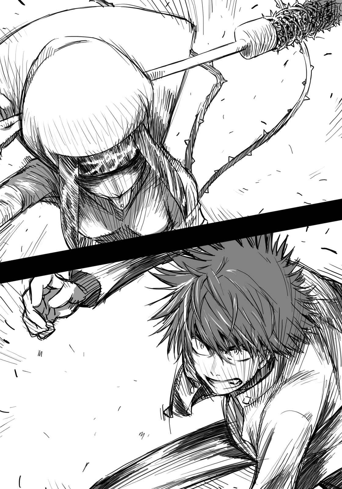
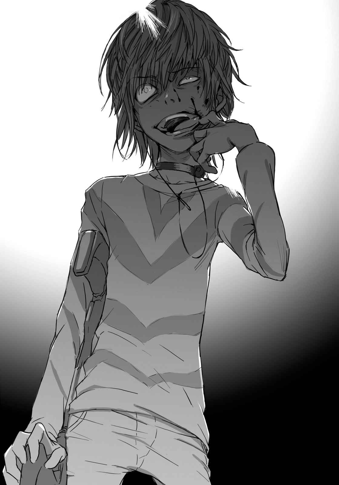

# 第七章 雨滴染上了血的颜色

> Revival_of_Destruction.

## 1

黄泉川爱穗手握着车子的方向盘。

外观是国产的便宜跑车，引擎声却意外地低。看不见的地方调得相当紧绷，可能是为了追捕逃走的人。光从排挡可达七档这点看来，应该可以想象有多夸张了。

她随意开着车，搜索今天下午以后不在大楼的最后之作(Last Order)。

（……？感觉上马路未免也太空了……）

学园都市原本是学生的城市。

在这里会开车的人顶多只有教职工、业者及大学生，跟普通的大都市圈相比，交通量没那么大。

但是，今天街道上却没有任何车辆。

定时挥动雨刷的挡风玻璃前方，看起来就像机场跑道。

「这是怎么了……」

黄泉川嘀咕着。

此时，用来取代汽车音响的车内无线电灯光亮起。她打开方向灯，减速将车子停在路边。

黄泉川看着无线电机器，嘎的一声，明信片大小的纸片吐出。

原理应该跟数码相机用小型打印机相同吧。那是警备员(Anti-Skill)的司令本部向各终端送出通缉犯照片时使用的机器。

照片相当粗糙，应该是远距离拍摄的。拍照时好像有晃动，轮廓相当不清楚。即使如此，仍然看得出一名身穿黄色衣服的女子，站在众多倒地的警备员(Anti-Skill)中。

「？」

黄泉川感到疑惑。

平常除了照片，还会加上现场的状况等文字情报，这次却没有。光凭这样，完全搞不懂照片中的女子到底做了什么。根本无法判断她是事件的嫌犯，抑或是应该保护的对象。

走失的最后之作(Last Order)也很令人在意，但是「事件」优先于「迷路小孩」。

黄泉川按下无线电按钮说道：

「黄泉川呼叫本部，要求有关call 334的详细情报。」

她心想可能是联络失误，所以想要确认，但对方没有回应。

传进耳里的，只有低低的沙沙杂音。

之后她向无线电说了好几次，却没有听到回应。

「……」

黄泉川按下无线电的切断按钮。

在路边的车内，黄泉川重新抓好明信片大小的纸片。上面印着倒在雨中的警备员(Anti-Skill)，以及站在正中间的黄衣女子。

（这女人……）

她用另一只手的手指，弹着照片中的女人。

（到底是怎么回事？就看起来的感觉，她似乎不是保护对象。看起来就像我们的同事被她击溃……）

一股诡异的触感，从黄泉川背后袭来。

就在她对自己的同事倒在地面这件事，感到愤怒的同时，

（算了，等见到她之后再仔细**盘问**吧——）

黄泉川胡乱想着，但她没机会重新启动车子了。

&nbsp;

呜。

黄泉川爱穗的脑部，突然有阵冲击袭来。

&nbsp;

「啊……？」

她甚至发不出叫声。

全身的力气抽离，她的上半身靠在方向盘。受到压迫的胸口相当痛苦，她却无计可施。从身体中心到指尖，所有力量都被夺取。

眼前的视野急速变窄。

（发……生什么……）

在不明就里的状态下，黄泉川失去了意识。

无力下垂的手臂距车内无线电按钮只有数十厘米。但是手动不了，也无法呼救，就连呼吸也无法由自己控制。

（……这个，照片。）

可能是同事传来的信息要她「小心点」。很可能是跟自己相同状况的警备员(Anti-Skill)，挤出最后力气传来的信息。

但是，这样的努力却没有用。

（……可恶……）

拇指跟食指间夹住的照片，轻飘飘地落下。

同时，黄泉川爱穗的意识完全消失。

没有车辆的道路。

异常寂静的街道。

无人回应的车内无线电。

……莫非，大规模的事态正在进行中……

## 2

「第三资源再生处理设施是吧？」

黑衣人的其中之一，看着矗立在第五学区一角的建筑群说道。

这里是第七学区附近的某设施。一方通行(Accelerator)跟「猎犬部队(Hound Dog)」的逃兵使用的面包车，被丢在第七学区旁的公园附近。

「那家伙跑进麻烦的地方啦，南希。」

听到同事的话，她本人忍不住笑了。

她嘀咕着：「什么南希啊。」因为规定大家彼此用代号互称，所以也没办法。

南希是跟普通日本人一样的黄色人种。黑发黑眼的她，对自己的外貌并没有任何自卑感。如果要用代号，她也希望用汉字。木原数多一定是那种在网络上会使用耍帅别名的人。

即使全身覆盖漆黑装甲服跟面具，仍旧无法隐藏她成熟女性的曲线。「猎犬部队(Hound Dog)」是不分男女将人渣集中的组织，除了南希外还有其他几位女性。虽说是同性，也不会产生什么微妙的连带感。这个组织里的成员都是从追赶事件嫌犯得到快感的原先警备员(Anti-Skill)，或是在讯问过程中引进「不会造成伤口的拷问」的分析技术者，基本上全体都是互相蔑视的人渣。

她轻轻摇摇手中的道具。

那是玩具枪般的器材———嗅觉传感器。

握柄上方，也就是以枪械来说相当于击锤的部分，有个三厘米大小的液晶屏。里面呈现出许多正在上上下下的棒形图。就像系统元件画面上的音阶条。

「目标的『气味』持续到这里。应该不会错。」

南希对着后方的同事说。

气味。

如果是警犬，像今天这样下雨的天气就不能追踪，而这台机器能解决很大一部分像这样的问题。气味之所以会追丢，并不是因为「消失」，而是因为「混淆」了。感应器就能应对混淆的气味。

他们将视线转向「气味」的位置。

「好大的设施。」

南希身旁的一个黑衣人说道。

虽然是没用的废话，但事实的确是如此。

她眼前展开的，是四方长达两千米的巨大设施。用途是对垃圾做资源再生利用。在缺乏资源的学园都市，基本的纸张、铁或铅等金属、橡胶及塑胶等石油制品，还有其他许多物品都会重新再生利用。这里就是回收以第五学区为中心周边四个学区产生的「资源」，然后加工成可用物品的设施。

这么广大的腹地，很容易让人联想到某海岸的石油化学联合企业。里头有排列着直径一百米以上圆桶形燃料槽的区块，也有无数烟囱凸起的工厂区。

竟然来到再生利用设施了。

作为垃圾般人渣的开战之地，未免也太合适了。

「南希，那家伙的目的是什么？」

洛特问道。

「这个设施就战略上而言，并不是非常重要。但如果只是躲在暗处，也没必要费工夫特地躲过安保来到这里。」

「哼。没想到答案居然这么简单啊。」

南希粗鲁地回答，洛特看来一脸不满。南希在他眼前轻轻摇晃嗅觉传感器。

「为了逃离这个，所以想要经由垃圾处理场消除气味。」

「……那家伙知道我们的装备？」

「奥森那个笨蛋跟目标一起逃跑了，车上也有备用品。」

光是沾上垃圾的气味，应该很难骗过嗅觉传感器。但如果使用可以改变气味分子构造的某种清洗剂，那又另当别论。「猎犬部队(Hound Dog)」的证据湮灭小队虽然开发了专用品，不过像这么大的资源处理设施，就算有同种药品也不奇怪。

这算是苦肉计吧，南希微笑后询问同事：

「洛特，设施的简图呢？」

「已经从书库(Bank)那边弄到手了。」

「传送给所有人。作业员的巡逻路线呢？」

「不用在意巡逻路径。」名叫洛特的男子干脆说道：「内部几乎采用自动化。作业员只有十四名左右，他们的工作都是在操纵中心敲键盘。就连机械的保养也是从外部组织，请派遣人员来进行。」

「好，这样可以省去**收拾的麻烦**。」

南希随意说完，将嗅觉传感器交给同事。开始检查肩上挂着的冲锋枪。

洛特轻摇标示简图的小型终端机。

「出入口有二十四处。如果要兼顾所有地方，一一仔细搜索内部设施，就人数上来说是不可能的。」

现在的「猎犬部队(Hound Dog)」分散为应付不明敌人的人马、追赶最后之作(Last Order)的另一组人马、守护木原数多的保镖，战力四处分散。因此，现在这里只有十人左右。

「将目标引到这里就好。敌人应该认为我们这边人数很多。从地图上的A点攻击，诱导对方的意识从安全门C奇袭。只要丢几颗炸弹，对方应该很容易就动摇。懂了吧？」

「那家伙如果使用能力突破怎么办？这样就无法诱导他了。」

「别担心。」

听到洛特的声音，南希重新望向设施。

眼前的建筑物群厚厚的水泥墙上装置了好几重的金属管，令人联想到重工业设施。

「木原先生所说的如果是事实，目标就没有那么万能。」

## 3

「就是这个……」

一方通行(Accelerator)在第三资源再生处理设施的操纵室内露出微笑。

没有窗户的小房间，四方墙壁上装设了几十台荧幕。从工厂的作业状况到安保，全部都由这里监控。

十四个作业员对手拿霰弹枪侵入的歹徒完全无计可施，各自缩着身体颤抖着。一方通行(Accelerator)却看也不看他们。他盯着其中一个荧幕，上面是工厂备有的清洗剂清单。

一方通行(Accelerator)想要的，是利用化学反应将气味粒子转换成「其他物质」的清洗剂。

（发现了，有好几种。这样就能甩掉他们的「嗅觉」。）

他已经决定跟包含木原数多在内的「猎犬部队(Hound Dog)」抗战到底，但他不喜欢让自己当「老是遇袭的一方」。能完全使用能力一战的时间不到七分钟。木原本人当然另当别论，但要避免将力量浪费在他部下的「猎犬部队(Hound Dog)」。这么一来，战斗的主导权当然还是由自己掌握比较好。

当然，最重要的不是跟木原他们战斗，而是平安无事地救出最后之作(Last Order)。

（就算想寻找最后之作(Last Order)，现在应该先甩掉「猎犬部队(Hound Dog)」的追击。要是等到回收那小鬼之后，反而会增加被流弹打中的危险性啊！）

救出她再处理追击的难度反而更高。一方通行(Accelerator)的能力原本就是用来守护他自己，要是每次「猎犬部队(Hound Dog)」出现都得使用能力，电池应该撑不了多久。

就这层意思来说，应该由自己掌握「何时作战何时避开」。

（赶快使用清洗剂消除自己的气味离开这里。木原的爪牙应该很快就伸向那小鬼了。别在这边绕远路，赶快先回正题。清洗剂放在设施哪里……？）

此时，荧幕画面唰唰晃动。

操作室内数十个荧幕的影像，接二连三被灰色杂讯消除。画面全部消失之前，设施北侧第二出口的安保影像，突然出现黑衣男的身影。

既然有办法击溃第三资源再生处理设施所有的警报装置，对方应该也知道监视器的位置。这么说来，那个男人是故意让他知道自己所在的场所，试图将他引到那里。

（混蛋！竟然比预料的还快！）

这个设施已经被包围了。

一方通行(Accelerator)不拄着拐杖就不能移动。也就是没有速度。即使用清洗剂逃离嗅觉传感器，也必须跟进入设施的敌人为敌。

他无法逃离那群家伙。而且——

（我也不想逃。那群跟踪狂，我就在这里撂倒你们。）

一方通行(Accelerator)将体重靠在用来支撑身体的霰弹枪上环视四周。

他认真警告被卷入的作业员。

「接下来会发生枪战。就算战斗结束，后续的人马也会闯进这里。枪声停止后等个二十分钟左右，然后将工作服换成便服离开设施吧。」

从对方的回应，看不出是点头答应还是在颤抖。

（有意思。这步棋该怎么……）

他确认现在的状况。

看来无法使用能力。工厂内部被厚厚的水泥阻挡，跟外部的电波通信精准度会因此下降。加上为了再生利用资源，这里设置了大量的输送带及压缩机等大型发动机具，四周都是强力的电磁波。将妹妹们(Sisters)的脑波转换成电磁波形成电子情报网的御坂网络，在此完全无法使用。

总之杂讯很多。

状况好跟不好时的落差很大。如果只是普通会话，可能只是「稍微紊乱」，但在使用能力途中，很可能会直接发生爆炸事故。

（总之，在这里使用能力，就无法到达木原那里。）

像这样手无寸铁战斗，是以往没有的经验。

不能使用能力，他就成为只有拄着拐杖行走能力的常人。

手上的武器，就只有用来代替拐杖的一把霰弹枪。

弹匣中的子弹，只有三十发左右。

「要怎么……？」

他摸索着该怎么只靠这些装备，迎击擅长组织战斗的「猎犬部队(Hound Dog)」。

并且在意着刻意让监视器拍到的黑衣人，

（怎么办？）

一方通行(Accelerator)的眼睛从荧幕离开，他拿出纸质简图摊了开来。

要故意上钩，还是逃脱？攻防战就此展开。

## 4

御坂美琴在超市里。

她站在贩卖雨具的区域。

「嗯……太小了。」

她盯着便宜的塑胶伞嘀咕。这样的伞小一点比较受欢迎，但是小成这样的结果就是被雨淋湿。

透过宽广的玻璃窗看着外面，天色已经全暗。大颗大颗的雨滴打在玻璃上。

御坂美琴赢了大霸星祭的打赌，所以得到让上条当麻接受惩罚游戏的权利。但是，惩罚游戏却中断了，她现在正在重新寻找上条……

「怎么会下雨啊？」

她的目光落在跟学生书包一起抓着的手机公司纸袋里。

（我不想让呱太跟跳子(吊带)被淋湿。）

正当美琴这么嘀咕时，手机的来电铃声突然响起。她一脸厌烦地拿出电话。

上面出现的是学妹白井黑子的号码。

『姐～姐～大～人～』

「什么事，黑子？」

『我因为风纪委员(Judgment)的工作现在还不能回宿舍，请您帮我跟那个讨厌的舍监说一下。现在应该已经过了门禁时间吧？』

「我、我现在人在超市。」

『啊？！』

白井发出了不太像淑女的回应。

距离白井稍远的位置，其他的声音传进扩音器。

『咦？白井同学，联络不上御坂学姐吗？』

那是白井同学风纪委员(Judgment)的同事，初春饰利的声音。

也就是说，白井现在人在支部。

『真麻烦，除了姐姐大人之外没办法联系舍监。不过还真是伤脑筋啊。延长门禁的手续需要提出文件，那个舍监又不回电话。这样我们两个一定不由分说就被她扣分。』

『咦。不过，御坂学姐今天为什么打破门禁了？』

『？』

才刚听到倒吸一口气的声音，挤压东西的钝重声立即传进耳里。手机大概受到了猛烈的握力。

白井黑子问道：

『该、该不会……姐姐大人跟那个混蛋类人猿终于进入夜晚的约会？那个混蛋，欣赏下雨的夜景还真够帅的？』

「才不是啦，笨蛋！」

美琴忍不住大喊。

但白井似乎没有听到，

『可恶，不能这样下去。守护姐姐大人的贞操是我白井黑子的任务！』

「不、不要那么大声说贞操这种事啦！」

『那我说得更具体一点。』

「不要再说了！」

美琴面红耳赤大叫，但白井已经完全听不进人话。播音器那边传来连珠炮般的语句。

『无论如何我一定会赶过去，姐姐大人您现在在哪里？请您寄GPS服务用的认证密码给我——』

『不行啦——』

初春的一句话，就让白井连珠炮卡弹了。

初春继续说道：

『你看，这边的一堆事务文件、会计文件还有指示文件完全没弄好。白井同学，今晚要熬夜啦，熬夜哦。晚饭的便当也已经买好了，绝对不能外出一步，就连洗澡也不行。』

『呜嘎啊啊啊啊啊啊啊啊啊啊啊啊啊啊啊啊啊啊啊啊啊啊啊！』

『咿、咿呀？白井同学？白井同学？』

电话那边传来啪嗒啪嗒的声音。

美琴将手机拿远，受不了地说道：

「呃……我要挂断喽？」

初春代替错乱的白井回答道：

『啊，好的。我已经抓住白井同学了，还有，请加油！』

「我都说不是约会了！」

美琴全力对着话筒叫道，声音似乎没有传到对方。才听到啪嗒啪嗒的暴动声音连续传来，通话就这样咔嚓一声断掉。

## 5

上条当麻跟最后之作(Last Order)躲在柱子的暗处。

没有灯光的大众餐厅店内，沉静到令人害怕。

绝望的三十秒。

脑部构造快要因为过大的压力而崩坏。

但是，躲在柱子暗处屏住呼吸的上条，此时发现了异变。

不管经过多久，那些人都没有过来。

踏进这间大众餐厅的黑衣男，应该已经确认了上条跟最后之作(Last Order)的大致位置。对方应该知道他们手无寸铁。全身装备枪械及装甲服的集团，不可能故意警戒手无寸铁的高中生跟小女孩，一直站在原地不动吧。

（这是怎样的状况？）

轻举妄动会产生危险的想法，

以及不赶快行动就会失去机会的想法交错着。

「……」

身旁紧贴着的最后之作(Last Order)，不安地抓住上条的上衣。

那只小小的手，好不容易让上条守住了平常心。

接着又过了三十秒。

没有明显的声音。

破掉的窗户吹进的雨声，异常清晰地传进上条耳里。

他屏住呼吸。

闭上眼睛。

等待时机。

然后，有动静了。

&nbsp;

「嗨♪吓到了吗。别害怕，快出来哦？」

&nbsp;

尖锐的女子声音传来。

因为被用来当作挡箭牌的柱子挡住，上条无法确认对方的长相。

也不知道对方在哪里。

只是，

（怎么回事？跟先前的家伙明显不同？）

之前追杀上条他们的黑衣人，感觉上尽量避免自我主张，想要不发出任何声响，以最快的速度杀了他们。简而言之就是尽可能省去多余动作，只采取最低限度的行动。

女子的声音却完全相反。

基本上会发出声音强调自己的存在，这一点就跟黑衣人的行动模式「不同」。跟之前那些遑论男女分别，就连是否是人类都搞不清楚，犹如影子般的存在完全不同。

（也就是说，她不是黑衣人的……同伙？）

即使如此，随便出去感觉上也很危险。出声的人到底是谁？

「哈哈，你在害怕啊？算了，刚才情况那么危急也没办法。但是，我这边也有自己的事要做——要是不乖乖听话——」

女子笑着继续说道。

那是完全无视对方的动摇与警戒的声音。

&nbsp;

「**我就把你们变成一堆肉块哦**。」

&nbsp;

「！」

上条抱着最后之作(Last Order)的身体，突然跑出柱子阴暗处伏倒在地。

轰响传来。

刚才用以躲避的柱子，因为看不见的一击横倒下来。攻击似乎打中柱子中央，柱子折成ㄑ字形，断成两段飞向墙壁。因为速度过快，墙壁就像被炮弹打到般四散。

建筑物整体传来震动。

不知是否支撑的骨架被破坏了，传出吱嘎的锐利声响，好不容易逃过黑衣人攻击的店内玻璃全部碎掉。

上条护着最后之作(Last Order)，并转动视线。

没有光亮的餐厅中央站着一名女子。

从外部射进的街灯光亮，微照着她的身影。

奇怪的女人。

身上的服装很像中世纪欧洲女性穿的礼服。头发全部被包在头上的布覆盖住，就连一根头发也看不到。脸部方面，口、鼻与眼皮全都打上耳环，整张脸失去平衡。强调眼角的浓妆更增加她给人的威迫感。

然后是女子的手。

她手上握着全长超过一米的巨大锤子。握柄的中段到前端卷有锐利的带刺铁丝。这是不让敌人抓住握柄的防卫方法，还是某种仪式用的装置？

（……）

被打中绝对不只是疼痛而已，但光凭那个，实在不可能赢过手拿冲锋枪，身穿装甲服的集团。但即使如此，却不知发生了什么事，黑衣男子倒在女子周围。

似乎没有一个是清醒的。

（这是……）

她无声无息，轻易地解决这些拥有轻机枪跟装甲服，全副武装经过训练的黑衣人。

（好像……）

情报的不足，反而强调出她的诡异。

（跟走出地下街时，四处倒地的警备员(Anti-Skill)一样……）

能知道的只有一点，这个女人，并不是上条他们的救星。

（刚刚倒在坏掉车旁的黑衣人……！）

「你是……」

上条低声询问，边从最后之作(Last Order)身上起身站起来。

女子轻轻晃了晃来历不明的锤子，静静说道：

「『神之右席』其中之一，前方之风。」

自称叫风的女子，像是恶作剧般伸出舌头。

「发现目标。就是这样，赶快让我杀了你吧，上条当麻。」

她舌头上的细链发出声音落下。

&nbsp;

——锁链前端，是被唾液濡湿的小小十字架。

## 6

「猎犬部队(Hound Dog)」无声无息侵入一方通行(Accelerator)潜藏的第三资源再生处理设施。

走进钢筋水泥建造的工厂，机械的声音比想象中嘈杂。

南希心想：这边也该舍弃掉才是。多增加工作量也只是浪费时间，现在的一方通行(Accelerator)应该无法妥善使用能力，必须避免出现任何让他有可能恢复心理余裕的事态。

南希的周围有五名左右的同僚。

因为他们是诱导组，必须尽量展示自己是「多数人」。先由南希他们大肆开火，等目标逃到通道深处后，再由别组人马伏击———作战计划是这样。

目标通往的大致路径，可以用先前交给同事的嗅觉传感器追踪。在这种状况下在室内索敌，应该不会跟丢。

（接下来该担心的……是枪吗？）

根据嗅觉传感器，目标的气味曾经过停在路边的面包车，然后才前往这边的设施。车内没有人，只有装满预备装备的袋子。袋子的拉链被打开。对方手上也许有枪械。

（不，一方通行(Accelerator)的射击能力没那么好，一直靠着能力过活的他，并没有受过什么训练。我们应该是处于有利的立场。）

南希这么想。

（不过……）

由于大部分的生产作业都是自动化，没有空调的水泥建筑物内相当闷热。外面虽然下着冰冷的雨，内部却充满不停运作的机械产生的热气。

这样的热度不断刺激着神经，一行人缓缓走在钢铁通道上。感觉就连白晃晃的荧光灯光亮也带有热度。

非常紧张。

所以才会产生错觉吧，南希判断。

她瞄了同事的脸一眼，被黑色面具覆盖的他们，动作不太流畅，感觉有点僵硬。

在这样的设施内，因为种种因素，会引起电波干扰。

一方通行(Accelerator)的能力受到通信设备辅助，「因为有可能会引发爆炸，一方通行(Accelerator)几乎无法在这样的设施内使用能力。」这是木原的意见。

不仅是南希，这里的「猎犬部队(Hound Dog)」成员都这么认为。在这么多限制下，应该没办法使用能力吧？力量越强，爆炸的风险就越大。

但反过来说，也不免令人担心「万一对方被追到穷途末路，很可能在会爆炸的觉悟下使用能力」。

只有木原数多才能打倒一方通行(Accelerator)。

南希她们所使用的枪弹跟炸弹，根本没有任何用处。

（所以，必须「在对方觉得无路可逃之前杀掉他」。）

他们的诱导作战就是为了这个。

由于目标警戒自己这边，一旦逃入深处就会松懈下来。另一组就趁此机会射杀他。要让这个作战成功，就算多少有些风险，也必须挺身出面引起一方通行(Accelerator)的注意。虽说对方无法使用强大的能力，手持枪械的可能性还是很高。只顾着引诱敌人，很可能会被射穿脑袋。

（这个嘛……会紧张也是理所当然。在这里的人包括我在内，都只习惯「赶快杀掉对方」。之前根本就没受过把这种事态放在念头的训练。）

部队有许多种类。

在丛林里的活动，不需要学习有关人质的交涉技巧，都市型的狙击手就算不学无人岛的生活方式也没问题。正因为采取了省去多余麻烦，将时间利用在其他方面，特化成各领域的训练法，才能制造这么多拥有尖端实力的特殊部队。

也就是说，南希他们现在的立场，就等同于接受沙漠战训练的军队，被强迫去爬北极圈的雪山一样。

（办得到吗……）

南希在黑色面具下，吞了一口唾沫。

（……如果办不到就会死。）

&nbsp;

喀啦。

此时，小小的金属声，截断了南希的思考。

&nbsp;

「？」

南希他们一齐将枪口瞄准声音的方向。

看不到任何人。也没有可以隐藏的空间。南希维持着同一个姿势，对附近的同事以眼神跟手势联系。

「（……那不是器材发出的声音。）」

「（……我也有同感。可是如果真的有人，根本就没地方可躲。实在找不出什么有利的地点。）」

「（……对方有没有可能丢了什么会发出声音的东西？）」

「（……也就是说，目标就在附近。）」

全体都感到紧张。

「（……洛特。嗅觉传感器呢？）」

「（……等一下，现在分析刚刚完成。）」

鼓动加速。放在扳机上的食指微微震动。皮肤跟手套间微微汗湿。

之后，

&nbsp;

咔嚓。

这次是所有照明一齐熄灭。

&nbsp;

仿佛算计好时机般的黑暗。

这是使用光线跟声音促使敌人紧张，撼动心理的作战。

「糟糕。」南希现在才注意到。

现在如果随便扣下扳机，密集的同伴就会发生损伤。即使将枪口朝上，四周墙壁跟天花板都是金属块，随意放出的子弹经过反射，可能会打中自己。

她甚至没有想到枪的保险装置。

万一不小心碰动到颤抖的指尖，很可能会扣下扳机，她被这样的想法束缚着。一方通行(Accelerator)似乎注意到，他们没有携带夜视用装备。

「（……等一下！）」

她用眼神联络同伴，但黑暗中信号无法传达给对方。

用声音传达是最好的方法，但这样就等于是告诉「敌人」自己的方位。

心脏鼓动的声音，听起来反而有点诡异。

扳机上的手指震动。

扳机……枪声……爆炸……南希脑内出现这样的联想。

此时，巨大的轰响「砰」地炸裂开来。

她觉得心脏快停了。

（呜……啊……！那是……蒸气的排气声！只是声音而已！）

好不容易忍住扣下食指的冲动，正当她开始将神经集中在各感官，企图搜索引起声音的目标时——

「嘎？」

一旁突然传来低沉的声响。

有人类倒下的震动，沿着贴近地板的双脚传来。

鼻子里传来铁的味道。

（糟了——）

冷静下来应该可以发现，那只是黑暗深处有只扳手扔了过来。如果看穿这个圈套，反而可以取回心理上的余地。

但是，

敌人的目标就是像这样，一步步夺取我方的「冷静」。

（那个笨蛋……不只是能力，甚至还会利用人性的恐惧——？）

等南希注意到这一点，为时已晚。

她在黑暗中开始集中全身的神经，就在这个时候——

喀。自己的肩膀有另一根工具掷来，袭来的力道并不猛烈。

在不自觉的情况下意外丧失冷静，身体任意反应起来。

**扣在扳机上的手指震动超过了一定值**。

&nbsp;

多道枪声响起，空气中充满了更多的铁味。

## 7

黑暗中的大众餐厅，被异样的紧张感包围。

上条当麻跟自称是「风」的女子对峙。

（混蛋。接二连三跑出来……）

这个女人如果是魔法势力的人，就轮到幻想杀手(Imagine Breaker)出场了。但是，光这样并不能安心。风的实力如果属实，那她的能力就足以无声无息地一举歼灭持有轻机枪武装的四人。在幻想杀手(Imagine Breaker)派上用场前，他有可能瞬间被对方杀害。

而且。

虽然没有仔细查看过倒地的黑衣人，从对方没有受伤跟出血这点看来，跟以往所见「失去意识的人们」过于酷似。如果两者是同一人所为，风就是麻痹整座学园都市机能的始作俑者。

光凭单枪匹马，就快要击溃科学阵营顶点的女人。

这么一想，那些黑衣人根本无法跟眼前人物的危险度相比。

「别那么紧张啦？」

风叮叮当当地摇晃着锁链说道。

「你根本就没时间感受到疼痛。」

风随意挥动右手缠有带刺铁丝的锤子。

往横向出手的一击。

她距离上条几乎五米以上。

「！」

一阵寒意袭来，上条推开到目前为止守护的最后之作(Last Order)屈下身，正上方突然有东西袭来。那是包含细小碎片的风块。撕裂空气、突破墙壁，将细小的残骸卷入中心部，由透明转变成钝色的空气，由左向右通过。

喀！整座建筑物为之倾斜。

（那是挥动锤子，击出飞行武器的魔法……？）

血气全失的上条耳里，只听到碎片噼里啪啦落下的声音。

她的行动完全没顾及周遭还倒着许多一般客人。

「躲起来，最后之作(Last Order)！」

上条对刚才被推倒在地试图起身的最后之作(Last Order)叫道。在确认她移动到四角柱后方之后——

（这到底是怎样啦，不管是黑衣人还是这女人……！）

上条咬牙，当然风不可能就此罢手。

风接着后退，随意纵横挥动锤子两三次。连接在舌头上的锁链，像是被挥动般摇晃着。锤子的轨道差点就碰到舌头上的锁链，看来相当惊险。眼前曾数次迸发出橘色的火花。瞄准只要差个几厘米，就有可能扯断连接舌头跟锁链的舌环，但风的表情相当从容。

风的锤子撕裂了空气。

轰！爆音传进耳里。

破坏的暴风卷起。

锤子犹如将沉重铁球击飞的棒子般，桌子被打飞，地板卷起，倒地的黑衣人手脚被扯断，落在无力倒地的客人头上。上条不禁火冒三丈，但光是对付朝自己飞来的空气钝器已经让他分身乏术。

咚！被上条的右手一碰，空气钝器随即弹开消失。

幻想杀手(Imagine Breaker)。

如果没有这个消灭所有异能之力的能力，他的身体可能已经变成碎片。

风块并非单纯笔直飞来，有时左右画着弧线阻碍上条的进路，或是突然劈头由停住脚步的他头上直直落下。

「哈哈，真不愧是传说中的右手。干得好啊！」

风笑着将锤子由上往下用力挥动。伴随着这样的动作，卷起了破坏之风。

（是纵向？）

上条连忙将右手往头上一揭。

但风块一口气**由左向右横向穿过**。

「……！」

上条浑身冒出冷汗，他突然弓起背，只将上半身往后一仰。讨厌的轰响穿过脸部前方，鼻尖的皮肤被略微削去。

身旁的墙壁，砰的一声碎裂开来。

原本有些倾斜的天花板，又发出更危险的震动。

（什么？锤子跟攻击的轨道偏移了……？）

上条的脑袋涌起许多疑问，但风根本不可能一一回应他的问题。

「哈哈哈哈哈哈哈哈！太开心了！」

伴随着动作，她舌头上的锁链左右晃动。

前端的十字架发出不自然的亮光。

亮光明灭了两三次。

此时，风仿佛发现目标落空般皱起眉头。

「原来如此，原来如此。」

铿锵啪嚓！轰响传出，接二连三放出粗暴风势攻击的风饶富兴味地点头。对方的态度相当轻蔑，上条无法缩短两人间五米的距离。

「那是叫……幻想杀手对吧？那只右手正如报告一样效果极佳。**我夹杂其中的**『**真正目的**』**完全没效**。」

真正目的？挥动右手的上条思考对方的话。

有关幻想杀手(Imagine Breaker)的报告，他很在意这点。上条在罗马正教的重要度似乎改变了。

「但是，光是这样还不太清楚……好吧，我就试试看。」

「？」

「像这样！」

风发出发自腹部的声音，将手中的锤子由前方往横向挥动。

砰！空气钝器随着轰声出现。

钝器并非瞄准上条，而是朝着趴在桌上失去意识的一般客人挥去。

「你这家伙！」

右手突然伸出。离客人头部只剩一点的距离，被右手碰到的空气钝器朝着四面八方飞散。这一击包含了令人毛骨悚然的威力。上条极端愤怒。

风看着眼前的状况，兴味盎然地眯起眼睛。

「……咦，是这样啊。看起来好像不是这么简单呢。」

上条心想，这是战力调查吗？

风也许正在调查幻想杀手(Imagine Breaker)的具体效果跟范围。

「对不起啦——」

她持续攻击，脸上不见一丝焦躁。

「感受不到痛苦似乎是不可能的。看来只能直接杀了你。如果意识存在会相当地痛啊，可能会因为冲击过大而死哦。如果你想死得幸福些，就变得被虐一点如何？」

锁链擦动的声音传来。

风的舌头上连接的锁链，随着她的动作，由左向右画出弧形。风掠过锁链，将锤子纵向挥动。

啪！橘色的火花散开。

（咦？从刚刚开始就……）

空气钝器发出火花，画着由右至左的弧形轨道袭来。

（锤子的动作跟攻击的动作不同——）

仿佛是随着舌头上锁链的轨道进行。

（这种模式……？）

攻击仿佛是被锁链所诱导。

「该不会……那个锁链的十字架！」

上条用右手捏碎空气的武器大叫。

风回应他的话笑着说：

「哎呀，露馅了？」

十字架装饰的长长锁链不断描绘着轨道。每当风挥动锤子掠过锁链，空气钝器就随着锁链线条画出的路径袭来。

（可恶！就算知道也防不了！）

身体会忍不住反应锤子产生的冲击波的夸张轨道。但锤子跟锁链的动作不同，才刚以为对方由上往下挥动，锁链却画着弧线袭来，锤子往横向挥动时，锁链却由下往上晃动。

「攻击的动作」跟「实际袭来的攻击方向」各自不同。万一视觉被蒙骗，反应慢个一步可能会导致身体被切断。

「混蛋！」

「哎呀，感觉越来越麻烦了。」

轰！空气钝器更为猛烈地袭来。

而且，钝器并非瞄准上条，而是落在前方的地板上，木材地板卷起化为大量的木片，形成尖锐的碎片朝上条的身体袭来。

「呀……啊啊啊啊啊啊啊啊啊啊？」

不是单一部位被刺到，而是全身都受到碎片攻击。

上条被殴飞至后方滚倒在地。

他晃了晃因痛楚而意识朦胧的脑袋，拼命想恢复意识。

不知不觉间，他已经被逼向最后之作(Last Order)后方。

上条惊讶地从地板抬起头。

躲在柱子暗处的最后之作(Last Order)，正站起身想奔向自己。

「快逃！」

「呵呵。」

听到上条的大叫，风愉快地笑着。

凭她的攻击，要将最后之作(Last Order)连柱子一起打倒根本是轻而易举。

最后之作(Last Order)动也不动。不知是动弹不得，还是凭自己的意志不动，上条根本无从理解。

照这样下去，她小小的身体会变成一团肉。

「混蛋！」

上条从地板起身，将呆站的最后之作(Last Order)扑倒在地。她倒下的瞬间，风几乎同时放出攻击。敌人产生的空气钝器毫不留情地折断柱子，被上条的右手打散。即使如此，大量的碎片仍旧四处飞散。

这边太危险了。

必须尽快让最后之作(Last Order)避难。

「快逃啊！快！」

上条大叫，最后之作(Last Order)呆站着摇头。

她不想丢下上条不管。

「快点！快去找人来救我！」

所以，上条捏造一个不可能实现的目的给她。

被上条这么一说，她总算摇摇晃晃站起身来。当她不小心跌倒时，口袋内的东西散落一地。玩具般充满甜香的唇蜜，以及可爱的儿童用的手机掉落到地板，最后之作(Last Order)试图再次蹲下身。

「不要捡！」

听到上条大叫，她的肩膀猛然一震，迈开小小的脚跑了起来。她从破裂的窗户跑出外面道路。背影充满焦虑，几乎像是茫然自失。

风将卷着带刺铁丝的巨大锤子，对着娇小的少女。

但上条插手挡住她与最后之作(Last Order)之间。在这段时间，建筑物缓缓震动。四周的柱子碎裂，天花板一口气开始倾斜。最后之作(Last Order)跑出的那面窗户，被落下的天花板压碎堵塞。

让一个目标逃走的风，脸上丝毫不见焦躁之色。

她反而愉快地笑着对上条说：

「你还真是残酷啊。对那么小的少女来讲，在黑暗中毫无目的地逃跑，可是相当沉重的负荷。她可能会因为害怕而全身僵硬，然后开始崩溃哦。」

她摇晃着巨大的锤子。

「与其让她遭遇那种事，还不如一起杀了她比较幸福吧？」

听到这句话，上条忍不住朝地板吐了口唾沫。

这家伙真是卑鄙。

「……我才不会让她背负这么沉重的负荷。」

他重新握紧右手，

对笑得很愉快的风说道：

「只要我去迎接她就没有任何问题。所以我绝对不会死。」

「哎呀，太有趣了。不过呢，等我把你的五脏六腑搅成人肉果汁，你还能说出这种话吗？」

锤子挥动的钝音响起，风舌头上的锁链，发出了声响并晃动。

「反正我的目标是你，被你这样的异教猴子打扰还真是令人生气。既然你不逃走，我反而容易瞄准，真是多谢你啦！」

多股空气钝器狂吹，大众餐厅店内被破坏得乱七八糟。

## 8

在没有照明的工厂内，一方通行(Accelerator)屏息躲着。

作战只要一开始顺利，接下来就是自己的胜利。

一方通行(Accelerator)在面包车中夺走了好几样装备。其中一项是代替拐杖的霰弹枪，另一项是小型无线电。

他也将无线电使用在作战上。

现在敌方集团因为害怕在黑暗中互相残杀，四处分散后使用无线电取得联系。一方通行(Accelerator)混在其中，以夹杂着杂音的声音假扮「伙伴」，然后进行错误的情报交换，企图切断敌人间的合作。对方很快就发现一方通行(Accelerator)混了进来，却无法区别耳朵里传来的声音中谁是伙伴，谁又是敌人。结果就是他们对「所有声音」的疑惑更深。

不使用无线电，就无法知道伙伴现在的位置。

就算敌人发现人影，也会因为害怕「自相残杀（或是怕遭到自相残杀）」而放慢瞄准目标的速度。伙伴之间的连接因此中断。相对地，一方通行(Accelerator)只要「将所有人影当成敌人」来行动，这对他而言是极大的有利之处。

「猎犬部队(Hound Dog)」的威胁是「枪械」跟「集团」。

按照现在的方法，对方可说已经失去这两者。

对一方通行(Accelerator)而言，今天是头一次不使用能力，而进行这种煽动恐惧感的战术，但对方却顺利地上钩。恐惧果然是人类共通的感觉。在暗巷内，一方通行(Accelerator)就算什么都不做，就足以成为恐惧的象征。只要稍微认真使用之前的做法，就能得到这么大的成果。

那些家伙已经不是敌人。

只是会动的目标。

（接下来……）

利用无线电跟恐怖，这些家伙已经四分五裂，各自孤立。就算这里发生混乱，在援军到达之前还有数分钟的空当，完全没必要在意四周。

一方通行(Accelerator)躲在黑暗中，嘴角带着笑容。

视线前方，出现一个跟同伴分开，现在正害怕地搜索敌人的**猎物**。

&nbsp;

（就让本大爷吃个饱吧，你们这些肥美的野兽。）

&nbsp;

距离目标约十五米。

霰弹枪距离越近威力越大。就这点来说，这样的距离虽然不算最理想，一方通行(Accelerator)仍将背靠在墙上，拐杖离开地板，在适当瞄准目标后开炮。

轰！

伴随着震耳的轰响，后坐力反弹回肩膀。正如他所预料的一般，散弹还没打到目标就四处飞散。但周围都是坚硬的水泥跟金属板。多发子弹像乒乓球般反弹，从各角度激烈冲击。

尖叫声响起。

黑暗中有液体四处飞散，人类的身影像动作片般回转。一方通行(Accelerator)确认敌人中弹后，拄着霰弹枪靠近黑衣人。

对方的手臂似乎受伤了。

右臂被霰弹枪的子弹打中，由于采取旋转姿势倒地，另一只手也扭伤了。

手上的霰弹枪滑得远远的，对方似乎想拔出预备用手枪，由于双手都受伤，并无法顺利拿到武器。

看起来就像不断扭动的毛虫。

一方通行(Accelerator)将手靠在附近的墙壁，将霰弹枪的枪口从身旁抵住黑衣人的脸颊。

「开、开玩笑吧……？」

声音意外地高亢。仔细一看，就算身穿黑衣也可以看出女性的曲线。

「开玩笑？是啊。」

不管怎样都无所谓，一方通行(Accelerator)随意回答后说道：

&nbsp;

「这是新花招。」

&nbsp;

他扣下了扳机。

砰！一方通行(Accelerator)的身体无法承担发射的冲击而往后倒。他心想：这不是只靠单手就能发射的枪啊。他摇晃着头起身后，眼前的黑衣女子正在痛苦地打滚。

「哦、哦呜……哦呜呜啊啊啊啊啊啊啊啊啊啊啊啊？」

她将受伤的双手捂住嘴，这两只手却诡异地陷入脸部深处。她下颚的部分已经被霰弹枪打飞。如果将手拿开，就能看到对方只剩下上排的牙齿。

一方通行(Accelerator)发现自己的脸颊有温热的东西附着。

他动了动舌头将那东西含进嘴里，连唾液一同咀嚼。

是肉的味道。

「啊哈。」

他忍不住笑了出来。

没必要多花时间在无法战斗的女人身上。一方通行(Accelerator)应该尽早离开这里。听到枪声的话，其他的「猎犬部队(Hound Dog)」也会赶来。他不希望发生被敌方从正面以子弹攻击这种事。自始至终都躲在暗处，一个个处理掉猎物才是最好的方法。一方通行(Accelerator)心想早点离开比较好，时间刻不容缓。

**但是**。

他拄着霰弹枪代替拐杖，摇摇晃晃站起身来。

总觉得事情变得**有趣**起来。

虽然知道这么做不好，但他无法抑制迸发的**开放感**。

他咬着嘴里的东西，站在下颚被打飞的女子面前。

「……哦——哦——看来很会吸奶嘴嘛。」

下颚消失的女人惊讶地看着他。

一方通行(Accelerator)无法想象自己现在露出怎样的表情。

「你到底是用怎样的脸活着！别开玩笑啦，喂！」

他用力踹向趴在地板上的女人腹部。

连续的钝音传来。五下、十下、十五下、二十下，女子的身体突然消失在黑暗中。

仔细一看，那是金属加工用的碾压机。

就像悬崖一样，从这里通过输送带将铁制品丢下，然后挤压固定。深度约三米，大小约四方十米。从空罐跟金属棒已经堆积如山这点看来，实际上应该更深才是。

女子在三米下方。

双手受伤，脸的下半部被打烂，令人不忍卒睹的人类。

看到这样的景象，一方通行(Accelerator)却毫无怜悯之心。

他瞄了一眼碾压机投入口的角落。大部分的设备都是由操纵室来操纵，不过还是有手动设备。墙壁上有个像是手动设备的大按钮。

女子似乎理解一方通行(Accelerator)在观察什么。

她看着头顶上的投入口，似乎在向他哀求。

「啊呼，啊嘿，呼啊哈……」

「抱歉啦。」

一方通行(Accelerator)插嘴道歉。

&nbsp;

「你还不知道自己在跟谁为敌？」

&nbsp;

咚！

他将手掌敲向墙壁，按下大大的按钮。

毫不留情。

迟钝的机器运作声响彻设施内。

「接下来……」

一方通行(Accelerator)的视线已经转开，他吐出灼热的气息重新开始徘徊。

「接下来的猎物，在哪里迷路呢……」

他的嘴角，露出大大咧开的笑容。

## 9

大众餐厅店内因为「风」的攻击，接二连三遭到破坏。

没多久，上条就被逼入困境。

他满身是血背靠在崩坏的墙壁上。即使幻想杀手(Imagine Breaker)可以防止直接攻击，却无法弹开毁坏的地板跟桌子碎片。

在狭窄的店内，上条剩下的路越来越少。

被逼到狭小场所后，就只能用右手继续防御。风的攻击次数并不多，但每一发的轨道极为复杂，必须先读取轨道后才能行动，但上条的手有些赶不上。

就单纯的破坏力而言，对方比不上超电磁炮(Railgun)御坂美琴。上条之所以能够应付美琴，是因为地形上的问题。跟她对战时，上条绝对不会选狭窄的场所。如果不是可以任意行动自在闪躲的宽阔地方，他根本就无法应付。

不这么做，一下子就会被逼到死角。

但是，在这间快倒的大众餐厅内——

（……还有许多昏倒的客人……）

受到不明攻击而昏迷的客人跟服务生倒在地上。直接受到风的攻击当然会死，如果对建筑物带来太大损害，天花板也有可能崩塌下来压死所有人。

上条过度小心地注意四周。

这样的动作在风的眼里相当明显。

「你还真是体贴啊——」

她呵呵笑着，将巨大的锤子水平举起。

「不先担心自己没问题吗？你看♪」

咻！她随意挥动武器。

舌尖的锁链描绘出的轨道，从上条的脸部横向掠过。

空气钝器的瞄准方向，略微往上条身旁偏移，还故意调节到上条伸手也无法触及的地方。

「！」

上条用尽全力一跃，在攻击碰到客人之前用右手弹开。

他的身体就像排球接球练习一般被翻弄着。

攻击接二连三瞄准周围的客人，有时会朝上条自身袭来牵制性的一击。光是得做出这么多吃力的动作，就把上条累得上气不接下气。残留在他体内的体力，一下子就被耗光。

「你这家伙！」

「嗯——呵呵——？到现在还这么热血？你应该知道现在学园都市变成什么样了吧。我如果是那种会在乎他人的人，打从一开始就不会这么做。」

「可恶！」

虽然他心想不可能，这么夸张的行为，竟然全部都是为了杀害上条当麻一个人所做的。

即使他认为不可能。

只是要杀一介小小的高中生，这样规模未免太夸张了。

「注意你自己的价值——」

风轻松地说道，并以巨大的锤子砍倒空气。

「**我的目的是上条当麻**。**除此之外全都是赠送的**。就连那个禁书目录，跟你比起来也只是小事一件。」

她干脆说道。

「现在的你无疑是罗马正教的敌人。我们不择任何手段都要杀死敌人。说得极端一点，就算消灭日本这个国家也要杀了你……话虽如此，考虑到**那只右手**，我无法使用平常的形态。看样子我得直接取你性命了。」

她像是变魔术般挥动一张文件。

那可能是什么命令，因为四周太暗所以看不清楚。基本上也不可能是用日文书写。

「这是罗马教皇的亲笔签名。你现在是二十亿人的敌人。」

什么意思？上条听到对方的话不禁愕然。

不论是因为出现了「罗马正教」这个字眼，还是针对自己可能会将一个国家从历史上消除，这种规模过度离谱的话题。

到目前为止，上条当麻大多处于「自己被卷入某事件中心」的状况。以他自身为中心发生的事件，自八月三十一日的阿兹特克魔法师以来是第一次。

在不寒而栗的上条面前，风再次将文件像变魔术般收起。

「听起来很像在开玩笑吧？那我就让你清醒，知道我可不是在开玩笑。」

她重新拿好锤子微笑着说道。

舌尖上的锁链晃动，十字架左右微微摇动。

「什么……」

「**接下来**，**我要杀了店里所有的人**。」

上条几乎无法呼吸。

风微笑地继续说道：

「感觉上因为这种无聊的理由杀害所有人，这样你会比较痛苦。做到这种地步，你应该就会比较清楚事情的状况吧？」

「住手！」

上条无视对自己不利的状况，忍不住奔向风站立的方向。她笑着一路后退，还摇着头。伴随着金属的摩擦声，舌头上的锁链仿佛包围着风一般画着螺旋。

在这种状态下挥动锤子，就会产生以风为中心的破坏漩涡。

「给我吹走吧！」

伴随着咆哮，风的右手动了。

轰响传来。

失去照明犹如废墟般的大众餐厅内，充满了铁的味道。

## 10

黑暗的闷热工厂中，响起短促的呼吸声。

躲藏在暗处的「猎犬部队(Hound Dog)」维拉，是被人称为「不知为何会堕落到这种地方」的女性。个性开朗，喜欢与人相处，却又懂得拿捏与人之间的距离。无论是脑力还是体力劳动都能胜任。她就是这样的人。

她也有她自己的苦衷，就算其他人对这件事感兴趣，她总是有办法轻描淡写带过。

在「猎犬部队(Hound Dog)」这群人渣般的集团中，拥有某种程度良知的维拉，寻求与他人的协调。在彼此互相轻蔑的集团中，这种行为却相当突兀，即使只有一点点，维拉也想建立起与「伙伴」之间的信赖关系。

但是，

（……无线电好吵。）

哀号跟求救的声音不断传来，维拉的反应是觉得很麻烦。根本就不知道哪个是真的，哪个是陷阱。之前说要帮助伙伴采取单独行动的凯恩斯，后来就失联了。随便回应也很危险。

现在没有人可以相信。

之前慢慢建立起的东西，全部当场瓦解。

「呜……」

维拉的嘴巴忍不住传出呜咽声。

总之还是先离开设施，再重新开始比较好。之前洛特说出口也有陷阱，但这样的警戒报告也很可疑。而且那声音真的是洛特吗？就算有点风险，也必须离开这里。即使要丢下这里的「伙伴」，这是为了避免全灭。

（糟透了……真是糟糕的一天……）

踩着摇摇晃晃不稳的步伐，维拉开始寻找出口。她已经没有战斗意志，过度的紧张反而切断了她的集中跟思考。

此时她发现了。

（无线电……）

刚刚那么嘈杂的无线电，不知何时开始只传来沙沙的一定杂音。之前害怕让场面更混乱，所以没用无线电说话，但到了这地步，她不禁突然担心起来。维拉按下按钮，将嘴唇凑近。

「我是维拉、维拉。请报告状况。OVER。」

就算询问也没有任何人回答。

全身冷汗狂喷。自己的无线电也可能被当成造假而忽略掉，更甚者说不定所有人都已经成为一方通行(Accelerator)的食饵，状况最糟的联想从脑海中掠过。

（不，即使如此……）

寻找思考逃路的维拉想到其他可能性。

（还存活的人可能跟我一样先退避到外面了。设施的墙壁很厚，内部跟外部的电波被遮断的可能性很大。如果大家都出去了，这边的电波就很难传到。）

在这种场合，维拉等于是被「伙伴」抛弃。这样反而还好一点。至少比所有「伙伴」在这种垃圾处理设施内一起完蛋来得好。

（没错。「猎犬部队(Hound Dog)」不可能这么简单就被打败。一方通行(Accelerator)所采取的黑暗战术，如果不在完全的黑暗中就没有效果。在月光下就算没有无线电，也可以区分敌我。这么一来，出去设施外对付他可能比较有效率。）

那么，自己也应该到安全的外界去。

维拉在心中做出结论，用比刚刚有力的脚步寻找出口。

自己还有希望。

只要大家重新集结在一起，就算是一方通行(Accelerator)也不可怕。

正因为她如此想。

&nbsp;

看到快要被碾压机压扁的同事的那一瞬间，

维拉的思绪一口气陷入恐慌状态。

&nbsp;

严格而论，维拉并没有直接看到「被压扁的同事」。她眼里只看到将金属用品压平成块的设备。地板三米下方有个区块，左右长度大约十米。

挤压用的厚厚铁板落下。

但是，**铁板的那一端传来了呻吟声**。

（……南希！）

正因为重视伙伴，维拉光凭这点声音，就能知道出声的人是谁。其间还一直传来吱嘎声，厚厚的铁板缓缓继续往下。

「呜、呜啊啊……呜啊啊、啊啊、啊！」

她近乎错乱地将手掌敲在墙壁上的按钮。伴随着咔嚓声，碾压机的动作停止了。

呻吟声仍旧继续传来。

肉身的人类根本无法承受这种铁板的压迫。南希之所以还活着，大概是因为整面地板铺满了等待压平的金属零件。南希的身体，就陷在堆积如山的金属零件所形成的缓冲内。

但是她快死了。

正因她无法简单死去，所以自己才会这么痛苦。

按下墙壁上其他的按钮后，铁板恢复到原本在上方的位置。

说不定南希还有救。

但是。

按钮的表面上沾着某种东西。那是类似自动贩卖机旁的垃圾箱般，肮脏的黑色液体。按下按钮，就必须触碰那个污垢。

**即使污垢是人类的血与肉**。

**即使被挤压得血肉模糊的骨头**，**与带有皮肤的小碎肉就粘在上面**。

「——啊？」

连接思考的细线断裂。

似乎有细小的「噗滋」声响传来。

「呜嘎？哇啊！啊啊啊啊啊啊啊啊啊啊啊啊啊！」

维拉扯开喉咙大叫，全力往后退。她已经无法忍耐下去了。她感受到以往形成自己的所有要素正在逐渐崩解。如果现在有一滴水滴掉落在皮肤上，她一定会因为冲击而死。

在这样的状况下她的脚绊到了什么，伴随着滑溜的触感，维拉一屁股跌坐在地。

往脚边一看，地上有一块烂烂的肉块。

虽然已经血肉模糊，不管怎么看都像是人类的下颚。

「呜哇啊啊啊啊啊啊啊啊啊啊啊啊啊啊啊啊啊啊啊啊啊啊啊啊啊啊！」

她踢开那东西，试图逃跑。

就在她慌张移动视线时，又遇到了其他同事。不，用「遇到」来形容不知是否正确。看着眼前身体被粗铁线固定，在切断的蒸气管喷出的高温蒸气下被煮熟的人类，这种字眼不知是否还适用。

呕吐物倾泻而出。

因为被盖着脸的面具阻挡，所以无法漏出来。口鼻虽然漏出黏腻的液体，维拉却丝毫没有感到不舒服。现在根本无暇兼顾这种事。

「咿……呜啊、啊啊啊啊啊啊啊啊啊啊啊……」

压得扁扁的声音，从自己的嘴里延延不断传出。

维拉看着沉默的无线电。

就是这么回事。

沉默的意义相当单纯。根本就没有什么作战。也没有卷土重来或逆转的策略。也许根本就没有任何同事离开设施。「猎犬部队(Hound Dog)」的所有人员，都像这样卷入第三资源再生处理设施中，被可怕的设备所杀害。也许就像现在的自己一样，被追赶到精神面的死角，就连判断能力也丧失，只能呆然伫立，然后被处理掉。

维拉的手失去了握力。

无线电跟轻机枪咚的一声掉在地板上。维拉自己也忍不住屈膝跪下。

自己到底是在跟怎样的对手为敌？

以往的一方通行(Accelerator)并不会特意使用武器，也不用考虑地形，只凭自己的超能力就能除掉眼前的障碍。因此，她们认为能力受限的他，只要用战略就能打倒。

但是，现在截然不同了。

使用武器，利用建筑物，预先探知自己这边的心理，然后编排出最有效率搅乱心理的方法并予以实行。不只是单纯凭愤怒杀害敌人，如果能给对方最大的精神伤害，甚至会采取不杀害对方的选择。

可怕的是他的精神成长速度。现在的他，已经不是只能依靠能力的小孩。他已经懂得利用所有东西杀人。就目前的时间点，一方通行(Accelerator)已经成为极大的威胁，今后可能还会变本加厉。变得无人能敌，足以毁坏整个世界。

因为过于惊愕，维拉的神经麻痹了。

她已经失去了感受恐惧的资格。

那是怪物。

愚蠢的是，「猎犬部队(Hound Dog)」却帮助这只怪物破茧而出。

喀喀。

维拉的身后，传来细微的脚步声。

她没有回头，只是垂着头淡淡地笑了。

## 11

「咳！」液体喷出的声音，响彻黑暗的大众餐厅。

血块一滴滴地落在地板上。

上条当麻看到眼前的光景，忍不住停止原本想冲过去动手的姿势。

那的确是鲜血。

他呆然地看着红色液体喷出的一点。

&nbsp;

从到目前为止骄傲的风口中喷出。

&nbsp;

「呕……」

她的身体弯成ㄑ字，不住咳嗽。每咳一次，指间的细缝就流出黏糊糊的液体。

「嘎……哈……啊啊。」

她摇摇晃晃地一步、两步往后退。动作失去了以往的从容，看起来不像在演戏，似乎真的非常痛苦。

（发生……）

对方突然的咯血像是给上条泼了盆冷水，遮断了他的思考。

（那是魔法的副作用？虽然很对不起她，但这是个机会。）

意识恢复了。

对痛苦的人挥拳虽然会有些抗拒感，但老实说根本就没有说这种场面话的余地。不善用这个机会打倒她，这家伙会以半玩游戏的态度将许多牺牲者卷入。

上条咬牙觉悟，握紧右拳。

「呜……啊啊啊啊啊啊！」

但是，在他出手之前风突然转换方向，朝意想不到的方向，挥动卷着带刺铁丝的锤子。

锤子画出掠过舌头锁链的轨道，锁链与锤子迸出火花。

动作失去了以往的轻松，就像醉汉乱打人般杂乱粗暴的动作。

轰！伴随着沉重的破坏声，墙壁开了一个大洞。

风朝那里跑去。

她对追上来的上条放出两三发牵制攻击，奔出建筑物外。

「……」

应该追她吗？还是自己反而因为她这样逃跑而得救？老实说上条搞不清楚现在的状况。

（到、到底是怎么了？）

风没有从建筑物外面，将整间店跟上条一起击毁。实在很难想象她是为了顾虑其他客人。她大概忙于应对身上发生的异变，根本无暇顾及其他事情。

上条将新发生的问题稍作整理。

「神之右席。」

前方之风。

然后，是罗马正教。

## 12

白井黑子跟初春饰利，位于风纪委员(Judgment)第一七七支部。

名称听起来很气派，其实是初春所就读初中校舍里的其中一间。

好几张桌子并排着，不是教室里用合板跟铁管组成的那种桌子，这里看起来就像间办公室。作业用电脑排在每张桌上，却有包薯片无视这些精密机器大剌剌地搁着。

初春饰利双手在塑料袋里面翻找。

「白井同学。有中华盖饭跟鱼肉便当，晚饭你要吃哪个？」

「这种事不管怎样都无所谓吧！」

「哦？那我要中华盖饭哦。」

「我要吃中华盖饭啦！呜呜，现在这个瞬间姐姐大人正跟那个类人猿一起散步在夜晚的街头……呜嘎啊啊啊啊啊啊啊啊啊啊啊！」

双马尾的少女白井黑子双手在桌上砰地一拍。

室内只有两人的声音。房间里虽然有大型无线电，但现在是处于沉默状态。基本上，风纪委员(Judgment)的工作在清校时间就结束了。因为她们的主要任务是压制校内发生的纷争，原本在这个时间，还有学生在值班是很不寻常的。

加班少女初春饰利拿出自己的手机。

「哦，平常一直在看的综艺节目开始了！」

「给我工作，初春！」

「你有资格这么说我吗，白井同学？还有，我是那种可以边看电视边工作的人哦——」

手机虽然也有电视功能，不过初春好像很喜欢那个综艺节目，她特意打开室内的大型电视电源。

「哼！」

生气的白井夺走遥控器，随便换到其他频道。画面出现不怎么有趣的新闻节目。「喂！干什么啦，白井同学！」初春大叫，两个少女开始遥控器争夺战。

电视中，介于播报员跟艺人之间的女性正在念新闻稿。

『接下来是，呃……学、学园都市的新闻。』

咦？停止争夺的白井跟初春目光望着电视。

这间电视台是学园都市外部的全国电视台。这样的「外部」电视台很少播放学园都市的情报。播报员会这么困惑，也是因为这个理由吧。

『目前学园都市发生了侵入骚动。随着这起事件，都市内部的受害持续扩大。接下来是现场状况。现场的石砂先生？』

画面切换了。

那是超高倍率望远镜头的粗糙影像，摄像头应该位于学园都市外部。可以模糊看到穿着黄衣的女子走在雨中的街道。

女子摇摇晃晃地走着，踢开倒地的人们，在雨中的街道行走。她口中伸出舌头，上面连接的长长锁链左右晃动。

镜头还来不及移到现场记者，摄像头突然摇晃。咔嚓一声，灰色杂讯盖住画面。摄影棚的播报员连续呼叫记者的名字好几次，却没有任何回应。根本无法判断记者到底在不在。

画面马上切回摄影棚。

在绝妙的时机避免了穿帮。

『刚、刚才那个人就是入侵者吧？』

坐在播报员身旁的评论家，以冷静的声音回答。

『有鉴于学园都市的警备状况跟一般学校不同，应该不可能是单纯针对学生的变态犯罪。』

『什么？』

『那应该是针对科学崇拜的恐怖行为，或是强行夺取尖端科技。很有可能是这方面。』

『也就是说，对观众们最在意的学生们的安全也会带来影响？』

『当然。』

评论员像是演戏般夸张地摇着头。

『大人的事情竟然牵连到小孩，这比普通的街头杀人魔还要恶劣。真是的，影像中的那女人是怎么回事？儿童的性命往往都会遭到轻视，放纵那种无聊的社会不适应者——』

咚的声音传来。

评论员唐突地趴下，额头撞在桌面上。

「？」

白井皱起眉头。

一开始还以为他又在做戏，评论者的身体晃动了一下，突然倒在桌子下。可以听到播报员的尖叫声传来。摄像头摇摇晃晃，似乎是AD的轻装年轻人马上奔进摄影棚。

摄像头外传来连续指示的粗犷声音，画面马上切换到广告。很明显地就是发生问题了。

以小脸闻名的年轻女艺人，因洗面奶效果而感动的画面出现，初春将视线转向白井。

「……刚刚的影像，报告有传过来吗？今天一直在进行手写作业，所以完全没注意到。但是，如果真的靠一个人打倒警备员(Anti-Skill)，那个入侵者的危险程度，实在是非比寻常。为什么那么可怕的人会侵入……」

「风纪委员(Judgment)被校外……也很少因为夜间活动被召集。但状况如果真的很糟，警备员(Anti-Skill)那边也会要求援助。在那之前应该尽量把文件——」

「……」

初春饰利没有回应白井。

才觉得她的身体往后晃动，接下来初春已经毫无抵抗倒在地板上。「啪嗒」的声响听起来很大，之后初春就不再动弹。

白井惊讶地跑到初春身旁。

「初春！」

即使在耳边呼唤初春的名字，或是拍打她的脸颊，倒在地上的她丝毫没有反应。

电视的声音传进不明就里的白井耳里。

广告结束后，新闻节目也没有重新开始。画面切换到自动反射式幻灯机「请稍候」的画面。

## 13

「猎犬部队(Hound Dog)」的家伙几乎都解决了。

因为无法掌握正确的人数，所以必须小心伏兵，但一方通行(Accelerator)的直觉告诉他战斗已经结束了。

「猎犬部队(Hound Dog)」的残兵如果分辨得出这种气氛是「表演」，那他会感到佩服，但对方不可能有这样的余地。一方通行(Accelerator)设下的程序，自陷阱出现的时机到沉默的间隔，全都经过大脑生理学的计算，一定会让对方陷入恐慌状态。

那不是光靠着毅力论就能处理的恐惧，而是从脑部的信号面直接攻击情感。根本无人招架得住。只要是人类——只要是正常人类，绝不可能逃过这样的攻击。大呼小叫，胡乱挥动手脚，精神的承受力已经到达最大的限度。

一方通行(Accelerator)打开设施内发现的清洗剂盖子。他将透明的液体从头灌下，然后将空容器丢掉。

（都做到这种地步了，木原一定会行动。对我而言牺牲也算值得啦，去给我惊慌失措吧，王八蛋。报告几分钟后就会传到那家伙耳里，不过我应该先做点什么。）

一方通行(Accelerator)的目的是救出最后之作(Last Order)。

但他现在根本无法掌握如今还在逃跑（不知是否如此）的少女的位置。手机如果能打通，情况也许会不同，但似乎也不太可靠。在这样的情形下，为了救最后之作(Last Order)，只好尽力防碍木原他们。

将他们的注意力全都集中在自己身上。

「在夺取目标最后之作(Last Order)之前，必须先解决掉眼前的一方通行(Accelerator)。」只要让他们这么想就有胜算。

这样的想法如果能成真，就表示一方通行(Accelerator)自己将被敌人逼到角落……

（不管怎样我都要做到。）

他用霰弹枪代替拐杖，朝设施的出口走去。

拷问「猎犬部队(Hound Dog)」问出情报也是方法之一，但一方通行(Accelerator)却避免这么做。在设施内无法使用能力，拄着拐杖的他又无法将大人运到外面去。到目前为止能够胜利，是因为他有计策。即使对方受伤也大意不得。现在的他只要挨一发子弹就会死。要是一不留神被逆转，根本就没人能救最后之作(Last Order)。

一方通行(Accelerator)思考下一个行动目标。

（再调查一次「猎犬部队(Hound Dog)」的面包车吧。虽然不可能这么简单就找到对方的指挥本部，就算击溃其他人马，也必须掌握到大概的位置情报。）

此时，他的思考中断。

地面上有血迹。

看到连续的点点血迹，一方通行(Accelerator)微微皱眉。敌兵全在他的计算操纵内，煽动他们的恐怖再一个一个击溃，但他不记得曾使用过这条路径追赶对方。

还有人活着。

「……」

顺着血迹的路径来看，敌人的脚步相当蹒跚，集中力也很散漫。因为极度的恐怖，对什么都相当胆怯。自己的心理操作似乎奏效了。

（或者是故意这么做来诱导我？）

一方通行(Accelerator)拄着拐杖，慢慢地追踪着血迹。

前端有个非常小的逃生口。铁门上头有绿色的灯。门的旁边有个被强化玻璃罩住的按钮。玻璃破裂，里头的杠杆被动过了。

有人打开门出去外面。

一方通行(Accelerator)将身体靠在门旁的墙壁，伸出手触碰门把。拐杖的存在很碍事，如果双手都能用，另一只手应该就能碰到项圈式电极。虽然有爆发的危险，万不得已的情况下只好使用能力。

他慢慢地转动门把。

无声地推动门。

「————」

没有可疑之处。

至少没有设置炸弹。一方通行(Accelerator)确认这一点后，一口气打开铁门。

不知何时变成倾盆大雨的雨滴倾泻而下。

对屏息躲在闷热设施内的一方通行(Accelerator)而言，这是极为舒服的刺激。

但是——

「是那个啊……」

他的脸上没有笑容。

一方通行(Accelerator)所站的地方是二楼。从这边走下铁制的逃生梯，是长二十米左右的柏油路，路的尽头是区隔领地的铁网墙。

可以看到攀登铁网的人影。

黑色的背影，那无疑是「猎犬部队(Hound Dog)」。

铁网附近停了一辆车，黑衣人的目的地显而易见。

他原本以为那是「猎犬部队(Hound Dog)」的新帮手，但并不是。

那台车是正规的警备员(Anti-Skill)巡逻时使用的。

搞什么啊？一方通行(Accelerator)心想。

这些家伙不该出现在这里吧？

这应该是黑暗跟黑暗之间的战斗，一般人不应该出手吧？

「………………………………………………………………………」

一方通行(Accelerator)的口中，漏出了细微的叹息。

他没有说话。

从他沉默的耳中，传来了黑衣人的叫唤声。

在倾盆大雨中，即使相距二十米，仍旧可以鲜明地听到的声音。

「喂！有人在吗？救、救救我，救救我！你们是守护这城市的警备员(Anti-Skill)吧！那就保护我吧！那家伙……那家伙杀了所有人！哈哈，你看着吧！我得救啦。你的魔爪已经碰不到我了！」

杂音传来。

连长时间处于黑暗世界的他，也没听过的恶劣发言接二连三袭来。

「听好，你再怎么挣扎都没用！我这边有警备员(Anti-Skill)守护我。能碰得到我就试试看啊！如果你对警备员(Anti-Skill)出手，你就会被正式通缉！这样你跟那个你守护的小鬼之间快乐的生活也会结束！你只好回到冰冷的研究所，当一辈子的实验小白鼠！哈哈哈哈哈哈哈！」

握着霰弹枪的手，充满强烈的力量。

**理智破裂**。

电极的电池根本撑不了七分钟所以要储备能力，在这边使用完的话就无法跟木原数多一战，这些事他全都忘得一干二净。

一方通行(Accelerator)将手伸向脖子。

那是电极的开关。

毫不犹豫。

&nbsp;

他要亲手血祭那个混蛋。

他的脑袋中，只有这个想法。

## 14

警备员(Anti-Skill)才乡良太跟杉山枝雄相当幸运。

街道大多数的治安维持机关都停止机能的状况中，由于他们不小心睡过头，没有遭到跟其他成员一样的昏睡被害。车内的无线电联络没人回应，他们也认为那是机器的问题。不论好坏，他们都处于状况外。

现在，他们也非常幸运。

为了保护爬上铁网满身是血的男人，才乡从驾驶座，杉山从副驾驶座，两人各自下车朝那里走近。

在这个瞬间，他们首先听到一声呐喊。

那是野兽般的人类叫声。

才乡跟杉山两人还来不及寻找怒号的真正身份，第二波就已袭来。

那是道厚厚的铁门。

纵向回转的铁门以可怕的速度飞来，惊险地掠过才乡跟杉山的肌肤，如巨大锯子的刀刃般，突入两个警备员(Anti-Skill)停放的巡逻车正中央。

&nbsp;

锵！

火花四散，车子弯曲成L字。

&nbsp;

毫无特异之处的普通车子，突然被炮弹从旁攻击。车子的后半部仍旧保持纵向，前半部却横向扭曲得乱七八糟。受到如此巨大的威力，车子丝毫没有打滑。被炮弹击中的部分，破裂的金属就像花一样绽开。破坏车子的铁门力道不减，粉碎掉柏油路后才停止。断线的电线接触到一口气切断的汽油管，引起小小的火花。

光是这样就够了。

从旁被击溃的车子因为这一击而爆炸，向四周散布火焰及浓烟。

「发、发生什么事了？」

在视野遭到遮蔽的状况下，才乡只能这么叫道。

因为铁门以极高的速度飞来，才乡根本不知道是什么让车子爆发。什么都看不到的状况，反而助长了他的焦虑。

他也看不到应该就在附近的同事的脸。

在这样的状况中，

「呀啊啊？住、住手！」

陌生男子的声音，传进才乡耳里。

才乡还来不及发现，那是他们想要保护的黑衣男声音。

「等、等一下，一方通行(Accelerator)！我不要，不，不是这样啦！警备员(Anti-Skill)！到、到到到底在哪里啊！救我……咿呀，呀啊，嘎啊啊啊啊啊啊啊啊啊啊啊啊？」

噗吱！富有弹性的热狗被咬断的声音传来。感到切身危险的才乡，忍不住拔出腰间的手枪，却无法轻举妄动。浓烟完全遮蔽了眼前的视野。要是随便开枪，有可能会伤及同事杉山跟保护对象。基本上他根本就无法判别浓烟的那一头发生了什么事，引发的「事物」是人或是猛兽。完全无法想象要瞄准哪边开火，才能解决问题。

「住、住手！别动！离开那个人！」

在什么都看不到的状况中，才乡仍旧举着枪大叫。

从近距离似乎传来了笑声。

那不是高亢的笑声，而是捂住嘴之后还忍不住漏出的笑声。

之后有钝音连续出现。

时间只有十秒左右，然后尖叫声停止。

结果，才乡终究是动弹不得。

这世上有些东西，还是别看的好。

他直觉到这一幕幸运地被浓烟给遮盖住。

倾盆大雨灭掉了爆炸车辆的火，原本阻碍视野的浓烟也消失了。

同事杉山一屁股坐在附近地上。

对方惊讶地张合着嘴，完全发不出声音来。

他只是铁青着脸，摇摇晃晃地用食指指着地面。

才乡朝那个方向一看。

他们要保护的男子已经消失踪影，不管怎么看都没发现。

&nbsp;

杉山指向的地方，

只有少量的血痕，跟被扯下的两根人类脚趾。
