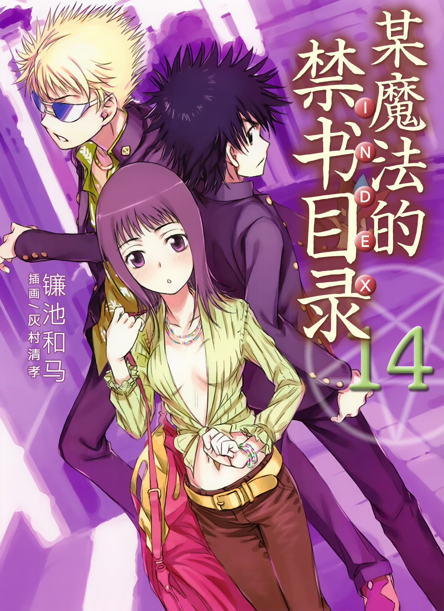
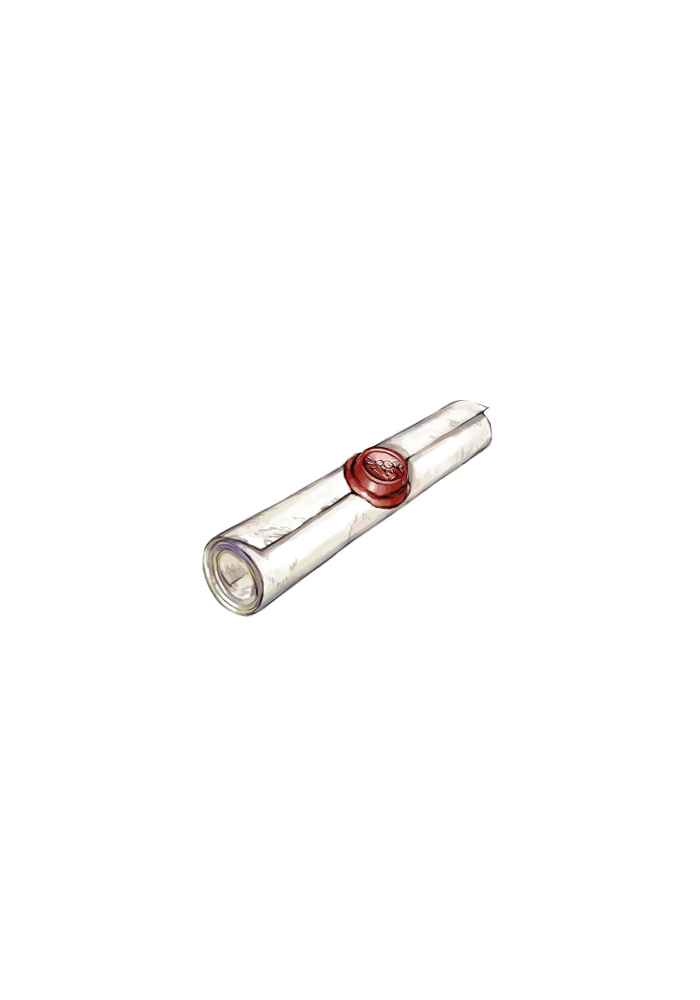

# 简介

**旧约·魔法禁书目录14**

作者：镰池和马

## 内容简介

**高阶灵装「C文书」引发了大规模魔法！上条当麻与天草式十字凄教徒·五和一起奔赴法国……！当科学与魔法交汇之时，上条当麻的故事就从此开始——！**

十月。

突然，世界各地开始出现罗马正教的反科学示威活动。这些反对行动无非是对以学园都市为首的「科学阵营」的谴责。

在世界陷入混乱之际，上条得知名为「C文书」的灵装是这次事件的罪魁祸首，于是与土御门一起飞往据说藏有「C文书」的法国旅游城市阿维尼翁。在阿维尼翁，当上条与天草式十字凄教徒五和重逢后，他们携手展开了对「C文书」的搜索……就在他们面前，「神之右席」左方之地挡住了去路。

当科学与魔法交汇之时，上条当麻的故事就从此开始——！

## 制作信息

* 翻译：郑淑慧
* 台版：轻之国度EPUB制作组
* EPUB：江火如画
* 扫图：人见人欺负的qs狼timekeeper
* 录入：天天被捅菊花的章鱼zlckira
* 初校：a960364
* 二校：stson
* 整合：知一一（禁书目录X系列，[index-X](https://github.com/1204244136/index-X)）


**版权声明**

转载时请保留录入信息。

本站内容仅供试看、学习与交流使用，禁止用于商业用途；下载后请在24小时内删除。请支持官方正版。


## 封面与封底

