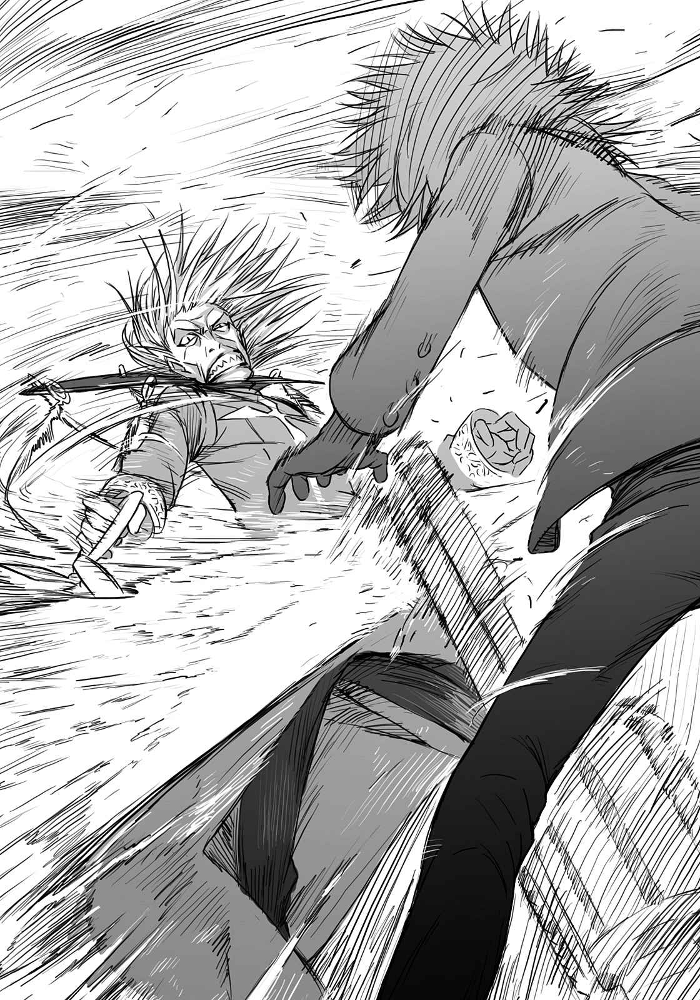

# 第四章 蔽日的钢铁之群

> Cruel_Troopers.

## 1

上条跟五和奔跑在阿维尼翁的街道上。

恐怖的暴徒已经不见踪影。

大半的暴徒都被驱逐了。

道路四处翻卷起来，建筑物的墙壁崩坏，整条路根本就无法好好前进。许多车辆动弹不得。上条穿过充满烟雾跟火药味的空气，跨越瓦砾堆，穿过开了大洞的墙壁，跑向教皇厅宫殿。

街上到处都是驱动铠(Powered Suit)。

不论是路上，或是建筑物的屋顶。上条心想，稍作观察就可以看到这么多数量了，阿维尼翁全城里应该有数百或数千具吧。

（可恶，怎么会这样……）

上条穿过水管破裂浸水的道路，跳过折断横倒的街灯，暗自咬牙。

（设计战争的是罗马正教，学园都市应该是为了阻止对方而行动。但为什么会变成这样！）

这个战场缺少了决定性的东西。

血腥味。

驱动铠(Powered Suit)的转轮式对隔墙用霰弹枪，可以分类使用多种子弹，打在血肉之躯的只是空包弹。但莫大的炸药所产生的声响化成冲击波，声音的炮弹，毫不留情地打倒阿维尼翁的暴徒。

昏倒的暴徒到处堆积如山。在他们身旁，驱动铠(Powered Suit)正在膨胀由防弹纤维做成的巨大热气球。

（是侦察用的……？）

在学园都市制的连续剧上曾经看过。

搭载小型摄像头的热气球，像气球一样温热空气后在空中移动。因为温热空气要使用电子炉，缺点是电磁的消耗非常快，不过声响比螺旋叶片式小，重要的是单价便宜，适合携带。

现在驱动铠(Powered Suit)正在膨胀的，是比连续剧中看到的大上好几倍，热气球下部挂着同是防弹纤维制造的吊挂式篮子。

用途应该跟原本的气球很相近。将昏倒的人放进去，靠机械操纵移动到作战行动区域外。

重新环视四周，到处飘浮着黑色的热气球，就像蒲公英的棉毛被风吹动。

也就是说，有这么多人被驱动铠(Powered Suit)打倒。

「……」

他们的思考可能跟土御门一样。

在狭窄的阿维尼翁昂内首阔步的暴徒，会对作战造成妨碍。拥有C文书的敌人可能混在暴徒中逃出。因此，首先要让暴徒安静下来，然后再瞄准真正的目标。

但是，

「土御门他不会用这种手段……」

咦？五和一脸疑问将头转向他，上条没有回答。

上条在奔跑时看到爆炸的车辆，忍不住用力握紧拳头。

（以自己的行动为优先，竟然使用暴力让街上的人屈服，我怎么能接受这种做法！）

上条总算意识到，统括理事会成员亲船最中试图阻止什么了。她并不是单纯地憎恨罗马正教。也不是希望他打倒学园都市的敌人。一切都是希望能够阻止这样的状况——破坏一切的「纷争」本身。

（我一定要阻止。）

上条咬着牙，跑在成为战场的街道上。

（不能放任这崩坏的漩涡不管。如果有人想把这种状况正当化，那我就毁掉这无聊的幻想！）

「到、到了。就是那里……！」

就这样，上条跟五和到达了教皇厅宫殿。

从名称给人的感觉，上条的脑袋浮现的是庄严的教堂跟金碧辉煌的宫殿，然而实际上眼前的建筑物，是中世纪的要塞。与其说是城堡，不如称之为要塞比较恰当。切割过的岩块堆积而成的巨大建筑物，给人一种拒人于千里之外的氛围。

上条仰望十米以上的外墙，一看到教皇厅宫殿他马上皱起眉头。

「有风穴……」

拿着枪的五和发出低语。

正面双开式的巨大门扉被吹进内部，高楼层的窗户跟周围的墙壁整个被粉碎。里面不知有谁在，断续的枪声与爆炸音传来。

「已经开始了。走吧，五和！」

「……好的！」

进入听得到枪声的建筑物虽然不是什么明智之举，但也只能这么做了。

## 2

土御门元春浑身是血。

他并没有被驱动铠(Powered Suit)的子弹打中。那是为了引开他们使用折纸魔法所产生的副作用。

得到一点点机会的土御门，奔跑在狭窄的道路上。他踉跄地躲在路边车辆的阴暗处。

数道枪声撕裂空气袭来。

虽说只是空包弹，这样的空气块仍旧具有镇压暴徒的效果。一击就能击碎车辆的玻璃，连金属制的车门也被空气块打凹。

（开什么玩笑……）

土御门靠在车子侧面咂嘴。

被打中虽然不会死，但一定会昏厥。躲在盾牌暗处的土御门耳里，突然听到了其他钝响。

他惊讶地往声音的方向一看，许多驱动铠(Powered Suit)其中一具，以惊讶的跳跃力飞过十米以上的高空，朝土御门的正上方逼进。

「该死！」

土御门在马上往后退同时，驱动铠(Powered Suit)的巨大身体压碎车辆。无法承受重量被压扁的车体一口气炸开。土御门的身体受到波及，硬是被炸飞到自己跳跃力以上的距离。

火焰中的驱动铠(Powered Suit)，毫不在意地对隔墙用霰弹枪，对准在路上滚动的土御门。

附近区划的细小道路两旁，建筑物犹如悬崖般左右林立。土御门穿过转角，打算将建筑物当成护盾，但在此之前驱动铠(Powered Suit)先采取了行动。随着枪声一起放出的空气块，直击土御门的脚边。

脚被绊到的土御门滚倒在地。

伏倒在地上的他，好不容易转过转角。

（呜……啊啊啊啊啊？）

往脚踝一看，已经变成了青黑色。骨头似乎没折断，但动作无疑是受到了限制。

（驱动铠(Powered Suit)的数量……乍看大约有十四具。装甲看来薄弱，但起码应该能正面挡下反坦克导弹。而且……）

听着转角那边传来的机械作动声，土御门从口袋拿出急救用贴布，强行固定脚踝。

（……还使用了新型的驱动辅助装置，可以当场学习战场的条件。那是为了达成最有效率的表现，而自动调节的驱动轮。）

在热带雨林或南极大陆，即使使用同样的兵器，因环境的不同性能也会改变。在沙漠还要注意沙子进入，湿地里要小心不要陷入泥沼。

通常会按每个地域进行「容易使用的整备行动」，不同地域的自然环境和兵器特色会有所不同，但是这种驱动铠(Powered Suit)例外。由于机械会扫描周边环境进行自动调整，因此可在维持系统预设值的状态下，活跃于全世界的战场。

（自动调节情报会送信号给作战行动中的所有机械。哈哈，那些家伙应该是最懂得如何在阿维尼翁步行的人吧？）

有脚的兵器，最大的问题是如何维持平衡。但它们没有这样的弱点。就算是崩坏的地面，它们也能行走得比血肉之躯的人类更平稳。

（混蛋，该如何进攻？）

土御门元春确认用贴布固定的脚踝状况心想。

就在这时，它们靠近了。

## 3

教皇厅宫殿的内部相当宽广。

上条心想，也包含了一股孤寂的气氛。空无一物。被没有壁纸的裸露石墙包围的这个空间，除了支撑天花板的等间隔柱子，什么都没有。就像财宝全部都被搜刮一空的金字塔。

（果然……罗马正教的大部队并没有在阿维尼翁展开。只派出少数精锐，就表示不想让同是罗马正教的人知道C文书的事。莫非，只有地个人组成部队行动？）

「似乎……没有人在。」

五和架好枪说道。

平日这里被当成观光地开放，现在应该没有那个闲暇。之前是害怕阿维尼翁的暴徒，现在则成了驱动铠(Powered Suit)们暴动的中心点。

枪声与爆炸声仍旧持续传来。

既然声音还在继续，就表示并非单方面的镇压，而是交战状况。

阿维尼翁除了地之外，似乎还有操纵C文书的魔法师。学园都市的驱动铠(Powered Suit)虽然充满威胁，能跟这些家伙正面作战的罗马正教也非同小可。

在这个当下不能受到双方的攻击，上条的步调自然慢了下来。

「……那具驱动铠(Powered Suit)，到底是从哪里出现的？」

「咦？」

上条对着望向他的五和说道：

「搭乘它的是学园都市的人，也有可能是将装备借给协力派的机关。基本上这么招摇地行动，根本就不想隐瞒。学园都市到底想怎么样……？」

手机里有电视功能。

在这种状况下随意发出声音很危险，但他还是想得到情报。

上条确认周围没有人之后，拿出手机打开电视功能，不知是不是没有对应海外的频道，没有出现任何画面。上条稍作思考后，叫出手机的记录，打了其中的一个号码。

「御坂！」

『干、干什么？』

电话那一端是御坂美琴。

「我有事要问你，现在可以吗？」

『咦，是吗？这是说非我不可吗？找别人也没关系吧。例如我妈。』

「咦？……这样啊，说得也是。就算不是御坂也没关系，可以打去问美铃伯母——」

『NONONONO！等一下，你应该是有事要问我所以才打来的吧？』

「？？？也对，学园都市里的人，应该比美铃伯母合适。」

上条歪着头，总之先进入正题再说。

「御坂，你那边可以看新闻吗？网络也行。我想请你通过海外的新闻，帮我查一下阿维尼翁发生了什么事。」

『啊？』

听到如此唐突的疑问，美琴发出疑问的声音。

……上条虽然这么觉得，但似乎并非如此。

『你在说什么啊。现在打开电视不是只能看到临时新闻吗？阿维尼翁是法国的城市对吧，听说那边的某宗教团体，在制造抵触国际法的特别破坏兵器，目前正展开镇压讨伐作战，不是弄得一团乱吗？』

「……你说什么？」

美琴对惊讶的上条继续说道：

『听说原本应该是法国政府该处理的事，因为需要特殊技术的相关专家，所以学园都市也介入了……倒是你现在人在哪里？要找到这种信息无法进入的地方，应该更困难吧？』

「嗯，那个……」

上条试着想混过去，但此刻他的思考却告中断。

因为声音消失了。

以枪声为中心的战斗声响，不知何时突然停止，恢复成教皇厅宫殿原本拥有的刺耳寂静。

（……）

电话那端的美琴好像还说了什么，上条并没有回答。

即使屏住呼吸将意识集中在耳朵，仍然无法捕捉到任何声音。

他和身旁的五和互看一眼，缓缓前进。

（什么……？）

从通道的深处、墙壁的缝隙、门扉的那一端，都渗出一股不知名的紧张感，一改先前的氛围。

上条无法看破原因所在。

因为在他看破之前，答案已经从对面前来。

&nbsp;

砰！

轰响传来，上条身旁厚厚的墙壁突然被打破。

&nbsp;

将墙壁打破的，正是驱动铠(Powered Suit)。

上条的身体撞上驱动铠(Powered Suit)，身躯直接被压倒在地板上。手中的手机掉落在地板上，液晶屏就此摔成碎片。

「？」

五和连忙将枪的尖端刺向驱动铠(Powered Suit)，但却中途停了手。

手脚无力落下的驱动铠(Powered Suit)，完全进入机能停止状态。好像是被某人投掷过来——用这种方式来形容最为适当。

驱动铠(Powered Suit)被抛掷来的周遭，到处散落着筒状物体。三百五十CC果汁罐大小的物体，是驱动铠(Powered Suit)所使用的对隔墙用霰弹枪子弹。其他地方四散着巨大的转轮式枪支。

「混……」

上条摇晃着头试图站起身来，此时突然听到脚步声。

他抬起头。

五和为了庇护上条也架起枪来。

就在两人的前方。

被强硬扯毁的墙壁那一端，站着手持白色巨大刀刃的魔法师。

左方之地。

使用「优先」魔法击溃驱动铠(Powered Suit)的男人，连一滴汗也没有流。

「被摆了一道啦——」

夸张的声音里，夹杂着些许焦躁。

「为了解决暴动这种混乱，竟然制造更大的混乱吞噬掉原本的暴动。没想到学园都市竟然这么认真。即使受到某种程度的国际谴责，似乎也一定要解决掉**这个**啊——」

拿着白色断头刀以外的另一只手。

那只手握着卷成一束的羊皮纸。长度约十五厘米，直径约三厘米程度的小小纸片，上头还有蜡封的就是……

「C文书……」

五和呆然说道。

那是能让发言者的话，完全植入为「对罗马正教完全正确」的强大灵装。如果不是由原本使用的术者，而是由地所掌握……

「真是的，实在是群麻烦的家伙。我一个人要打倒他们很简单，操纵这东西的术者如果被集中攻击，对术式行使也会产生影响。真是的，无法使用人类的术式是我本身『体质』的问题，才会被凡人的术者拖后腿……现在趁此机会打道回府才是上策吧。」

「你想我会乖乖让你走？」

上条缓缓架起右手说道：

「C文书就算回到梵蒂冈也能使用。既然知道这件事，你想我会乖乖让你走吗？」

「所以你想怎样？压制阿维尼翁的学园都市部队不可能阻止我。还是，你觉得你那只右手比他们都厉害？你有什么证据能如此断言？」

「……」

在教皇厅宫殿的枪声停止的时间点，就应该知道攻入这里的驱动铠(Powered Suit)，全都被他所击破了。

如此夸耀自身实力的地，仿佛嘲笑般对上条他们笑道：

「话虽如此，要你们什么都不做就接受，似乎不太可能啦。」

他将左手的C文书收进怀里，缓缓准备右手的白色断头刀：

「你们就充分地挑战，再干脆地放弃吧。对我而言，这种发展也比较有趣。」

## 4

阿维尼翁的街道接二连三崩坏。

因为冲击波般的空包弹而昏迷的暴徒，被坚固的驱动铠(Powered Suit)拉着堆积如山，然后被放入防弹纤维织成的热气球，不知被运到哪里去了。

土御门元春在其中奔跑。

他变换位置从瓦砾堆到车子的暗处，重复细微的移动，借此逃离驱动铠(Powered Suit)的追击。虽然他尽可能利用遮蔽物采取逃避射线的行动，断续的开火声仍旧迸裂开来。他尽量避开平坦的地面，朝着街灯横倒或是道路崩坏的场所前进。

（啧，光是这种程度还不会跌倒。可能是驱动辅助装置发挥效用了……！）

驱动铠(Powered Suit)虽然是平衡不佳的双足步行型，而且拥有相当的重量，但他们的举动却相当平稳。不是在平地时看到的一步步踏行的步行方式，而是如蟑螂般流畅的行动。

扫描所有环境，自动进行最适合当地状况调整的驱动铠(Powered Suit)，用车辆般的速度前进，以比人类更柔软的动作踩踏地面，追踪土御门。

被追上只是时间问题。

土御门在道路正中央停下。左右两侧高大的建筑物严重崩坏，犹如山崩般塞住道路。因为瓦砾很大，抓住碎片的凸起处攀登应该可以翻过去，但是驱动铠(Powered Suit)应该不会给他这种时间。当他攀爬墙壁时，很有可能会从背后被射杀。

背后传来「咔嚓」的金属声。

犹如齿轮转动般的钝音。

土御门的背脊发凉。这是以往没有听到的切换声。很容易就能猜得出真面目。

（……对隔墙用霰弹枪。）

从暴徒镇压用的空包弹，切换成可以撬开核弹庇护所大门的实弹。

（——来了！）

土御门头也不回，尽全力往旁边用力一跃。之后，敲击身体般的爆炸声迸开。以往封锁住前进路径，如土石堆般的瓦砾山，轰的一声一口气消失在虚空中。只凭一发攻击，就打穿直径数米的圆形风穴。

「……！」

土御门压住耳朵往身后一看。

驱动铠(Powered Suit)手持整个拳头可以塞进去的枪口朝这里瞄准，再次将手指扣在扳机上。

阿维尼翁的街道很狭窄。

接下来再往旁边跳开是不可能的。

「？蓝色木片护我身！(你们这些傀儡，好歹给我好好挡住子弹！)」

土御门取出折纸大喊的同时，枪声的爆音从正面袭来。

伴随着轰响一起射出的十几发对物弹，被土御门前方的盾牌弹开，朝周围飞散破坏建筑物的墙壁。

土御门的口中吐出了血块。

那是魔法造成的副作用。

即使如此，土御门仍旧拿出黑色折纸喊道：

「黑色乃水之象征，以其暴力为我开道！(快起来吧，这群混蛋。全毁掉让我开心一下啦！)」

空无一物的空间，突然出现了直径一米左右的水球。水球猛然朝着驱动铠(Powered Suit)撞去，将其巨大的身体一口气往后吹飞。

但这已经是极限了。

因为持续使用魔法，土御门的侧腹缓缓渗出血来。他的手试图撑着古老建筑物外墙，在他的手碰到墙壁之前，单脚突然跪了下来。

「混蛋……」

光是稍稍观察周围，就可以看到数具驱动铠(Powered Suit)。屋顶上还有瞄准这里的人。

（……）

土御门确认敌人的位置后，缓缓举起手来。

他动着嘴唇说道：

「投降……要杀要剐随便你们。」

不过，他附加了一句但书——

&nbsp;

「如果你们办得到啦。」

&nbsp;

土御门元春的话说到一半，枪口瞄准他的驱动铠(Powered Suit)突然产生变化。

喀喀。

动作原本比血肉之躯的人类还要灵活的驱动铠(Powered Suit)，突然间僵硬不动。他们慌张地确认动作，仿佛齿轮卡住般，只发出咔嚓咔嚓的声音。指尖似乎也不能动，也听不到枪声。

「想知道吗？」

土御门缓缓靠近后，驱动铠(Powered Suit)内传来紧张的气氛。虽然是强力兵器，操纵者却同样是人类。

「这玩意搭载了新型的驱动辅助装置。不惯是沙漠还是南极，机械都能自行调查环境，进行自动整备。」

「但是呢，」他说道：

「因状况而异，这反而会成为脚镣。例如依序回溯特定条件时，自动装置就会产生故障。简单来说，如果一口气输入『往右转』跟『往左转』两个相反条件时，判断能力就会因此迟钝，出现安保漏洞。你们忘了HsPS-15是好不容易才能够出现在迎击兵器展的试作机吗？」

再加上这种类型的驱动铠(Powered Suit)，所取得的环境情报是跟其他机体共有的。反过来说，一台机器故障恐怕就会对整体造成影响。

土御门接近停止动作的驱动铠(Powered Suit)，从机械的手臂强行夺取对隔墙用霰弹枪。

「……驱动辅助装置的错误会影响到整体。想从那里面出来，就只能把脱离装置先改成手动设定再实行。因为需要许多麻烦的作业，最少也要花十分钟左右。」

他将从坦克炮管切下般的大型霰弹枪，扛在肩膀上说道。

驱动铠(Powered Suit)内的那些人，似乎呆愣愣地听着土御门所言。他们完全无法想象，连自己都不知道的机体问题，为什么眼前的这个人会知道？

相对地，土御门用拳头敲打附近驱动铠(Powered Suit)的装甲，厌烦地说道：

「要出来就快点。如果知道你们已经无法攻击，阿维尼翁的暴徒可是会一拥而上哦。」

这句话一说完，驱动铠(Powered Suit)内传来咔嚓咔嚓的声音，对方似乎非常焦急。看着这样的情景，土御门开始思考。

（接下来……）

虽然他成功地短暂夺走驱动铠(Powered Suit)的机能，但部队本身却没有消灭。

接下来才是真正的胜负，土御门心想。

总之，在他们修复脱离装置从铠甲出来的这段时间，动作也会一直被封锁。只要脱离战斗状态，就能进行沟通。

（首先说明我是以学园都市间谍身份行动的事。不对，这次的行动并非上层的意图。真是的，如果能顺利进行对话就好了。）

土御门正在思考要如何进行「交涉」，但是他中途截断思考，突然抬起头来。

爆音传来。

土御门看到的，是在蓝色的广阔天空悠悠飞舞的漆黑轰炸机。

一百米等级的机体不止一架。十架以上的轰炸机画着大大的弧形，在阿维尼翁上空盘旋。

看到充满特征的外形，土御门忍不住咬牙。

（学园都市制的HsB-02……超音速隐形轰炸机？）

土御门跟上条前往阿维尼翁时，曾利用时速达七千千米以上的超音速客机。这是使用了相同技术制造的轰炸机。其压倒性的速度，仅以直飞就能甩掉追踪导弹。

冷静下来后，只有一个疑问产生。

在阿维尼翁出现这么多的驱动铠(Powered Suit)，到底是从哪里来的？

答案就是这个。

从学园都市装入轰炸机的驱动铠(Powered Suit)，以一小时左右的时间运到法国，从上空以降落伞一齐空投到阿维尼翁近郊。这种强硬的招数，只有学园都市精巧的工学技术才能实现。

当然，HsB-02装载的不只是它。应该还有原来「轰炸」用的东西。

（该死……）

土御门瞪着上空心想。

（先投下驱动铠(Powered Suit)，是为了确认C文书在阿维尼翁。确认之后，再使用轰炸机一口气轰掉教皇厅宫殿？）

虽然是粗糙易懂的作战，考虑到「神之右席」的左方之地所拥有的特殊术式威力，很难想象能产生确实的结果。

锵！土御门敲向附近的驱动铠(Powered Suit)的装甲。

「喂！阿维尼翁居民的避难状况如何？轰炸是何时决定进行的？如果是最新型HsB-02，该不会是打算在这里使用『那个』吧！」

他在如此大喊时，感觉到自己的思考中夹杂着焦躁。

（亚雷斯塔那家伙，到底在想什么？其他人也就算了，你不是很了解魔法世界？如果采取普通的军事行动就能全部解决，就不会有「必要之恶教会(Necessarius)」这种组织。你难道不知道如果要确实消灭C文书，这样的程度根本就不够？）

还是——土御门重新思考。

（……该不会，还有其他王牌？）

## 5

这里是阿维尼翁上空九千米处。

十一架超音速隐形轰炸机HsB-02中的一架，搭载拄着拐杖的「超能力者(Level 5)」。原本应该装载大量炸弹的广大空间里，只有「超能力者(Level 5)」跟数名整备员。

机内装置的扩音器传来尖锐的警告铃声，以及混杂着杂音的联系。听到这些话的整备员之一对「超能力者(Level 5)」说：

「作战行动A的目标达成！直接移往作战行动B。作战行动C一开始，外壁会打开。请准备降落伞！」

「没必要。」

听到整备员的话，「超能力者(Level 5)」厌烦地回答。

「超能力者(Level 5)」缓缓拄着拐杖，眺望机体墙壁上的薄型荧幕。

（不过还真是麻烦啊。我这边也很忙，学园都市外部也开战了。还是赶快结束无聊的事情，回到「正题」才是。）

从上空俯瞰而下的阿维尼翁，是被古老外墙包围的小小街道。因为领地被墙壁所限制，给人一种内部挤满高大建筑的印象。

看到这样的景象，「超能力者(Level 5)」笑了。

「哈哈，就像学园都市的缩小版。」

「啊？」

「没事。不过这世界变得越来越方便啦。从学园都市到法国，竟然只要一小时左右就能飞到。」

「不、不过还是有不方便的地方。」

整备员在脑海中选择该说什么，并回应跟「超能力者(Level 5)」的对话。

「超音速飞行时因为空气摩擦，机体表面的温度会急速上升。在最高速度的状况下会高达一千度，所以整个机体必须环绕流通液状冷却剂的管线。」

「液态氧跟液态氢？」

「是的。低凝固点冷却剂的管线通过这些油槽内，增强冷却作用。这些液态氧与液态氢可以用作航天飞机的推进剂，也被当成本机的燃料之一使用……也就是说，在消耗燃料时也会失去冷却效果。」

「所以才不折回，改道经过英国回去？不过，竟然能让对方接受轰炸机的补给。基本上，日本能拥有轰炸机吗？」

「超能力者(Level 5)」惊讶地说道，机内的扩音器再次传来警告铃声。

听到广播，整备员大喊：

「作战行动B，开始！」

伴随着声音，在周边飞行的轰炸机中的四架，脱离周围的路线。

轰炸机回旋远离约十五千米后，缓缓扩大圆周的半径。

然后转动机头，一口气加快速度。

四架飞机描绘出正方型的轨道。

轰炸机下部，装着跟「超能力者(Level 5)」所搭乘的飞机不同的零件。

长度约机体全长一半的漆黑刀刃。

犹如警棒般伸长展开的刀刃表面，是电气收缩形式，能够以百分之一毫米为单位，操纵凹凸及外观。

这种又大又长的纤细大型刀刃，在超音速轰炸机的加速力下挥动，以时速七千千米以上的速度切开大气。

光是这样，方向朝下发生的大气刀刃就拥有绝大的破坏力。

若是此时少量的铁砂，混入大气刀刃会变成怎样？

答案出来了。

&nbsp;

轰！

四架轰炸机在大地上，切出一个包围阿维尼翁街道的正方形。

&nbsp;

刀刃侧面散布的铁砂只有数克。

这些金属粉末，得到超过时速一万千米的绝大速度，超越液体成为了气体。摄氏八千度以上的气体状刀刃，无视上空数千米的距离，伴随着橘色的光辉切断地球。

「超能力者(Level 5)」搭乘的轰炸机产生晃动。

因为友军的超音速轰炸机通过，大气受到了扰乱。

「……」

手支撑在附近的墙壁上，「超能力者(Level 5)」的眼睛没有离开荧幕。

首先出现的是，宽二十米，深十米以上的沟渠。

之后，这渠道沟熔化成橙色的熔岩之后崩塌。地质仿佛熔岩般沸腾。才一瞬间，阿维尼翁的旧市街被熔岩的河川隔离开来。别说是电气跟水道，就连通过街道附近的隆河水流也被强行切断，街道外部马上产生泛滥。

这么一来，阿维尼翁旧市街里的人全都被关在里面。

阿维尼翁外墙之外也有街道。成为熔岩的地区那边的居民之前已经被驱动铠(Powered Suit)强制撤退，不过应该不会有人感谢吧。

（哈，只要有三千克左右的铁砂，一个小时就能将欧亚大陆整个截断的「地壳破断(Earth Blade)」？学园都市还真是做出有趣的东西啦？）

原本，轰炸机还需要多架战斗机护卫。

大型轰炸机跟小型战斗机不同，不能进行急速回旋。如果这么做就会马上失速，弄不好还会输给惯性，造成机体在空中解体。也就是被敌方锁定时，没有办法避开导弹。虽然可以利用干扰雷达用的箔片与照明灯等避开瞄准，却也无法完全闪避。因此，必须在轰炸机周围部署战斗机，借助其力量不让敌方锁定。

但是，这架超音速轰炸机HsB-02，并不适用这种法则。

既然只能直线前进，那就制造出靠直线前进就能甩掉导弹的机体。

时速七千千米以上的压倒性速度，实现了这个可能。别说是战斗机所放出的空对空导弹，就连事前在轰炸点等待的地对空导弹，即使被锁定也能先完成轰炸，再逃到导弹的射程外。

这是用绝招颠覆以往空战法则的强攻高速轰炸战术。

再加上学园都市制的高隐密功能，敌方几乎无法防范HsB-02的攻击于未然。

「确认作战行动领域隔离！」

机内的整备员喊着。

放出「地壳破断(Earth Blade)」的轰炸机，拉开二十千米以上的间距开始减速。其间不知是否操纵了刀刃表面的「图样」，「下方的烈风」已经消失。

「接下来进行包含作战目标在内，作战领域的全面轰炸！」

「地壳破断(Earth Blade)」乍看虽然是很粗糙的攻击，借由电气操纵刀刃表面的「图样」，轰炸不仅是直线，甚至可以做到曲线跟点攻击，就连切下拼图其中一片的纤细破坏也能办到。若有需要，一架轰炸机甚至可以同时描绘出多数线条。

「为了确保本次轰炸所使用的八架飞机飞行路线，将变更本机航线。请准备防御意外冲击！」

下一波的攻击对象，是阿维尼翁旧市街内部。

目标不只是「教皇厅宫殿」这个建筑物，而是旧市街的一整个区域。那里现在有刚刚先行下降的驱动铠(Powered Suit)部队，他们(Pilot)装备了某种信号发射器，轰炸机会避开信号彻底烧毁阿维尼翁，预定将那里变成一片熔岩之海。

作战时的驱动铠(Powered Suit)是抛弃式的，会使用轰炸用的「地壳破断(Earth Blade)」烧毁，里面的驾驶员会扮作当地人，移动到附近的地中海沿岸，利用在那边待命的潜艇离开法国。因为穿着驱动铠(Powered Suit)进行长距离移动未免太招摇了，无法回收的装备就在当地销毁。

只不过按照这样的作战推展，降落地面的部队，必须凭一己之力度过熔岩之海。就这个部分，他们应该持有某些设备。刚好城内变得满是熔岩，多少会有一些上升气流，可能会使用应用蒲公英棉毛理论的携带装备飞行。

「……」

朝荧幕一看，阿维尼翁的旧市街现在到处都是来不及逃跑的人。刚好有部队的人在身旁，也许可以幸免于难，但大部分的人都应该会被摄氏八千度的刀刃烧死。

「变更。」

「啊？」

「目标是教皇厅宫殿吧，先集中在那里攻击。要是这样还没有做出成果，就轮到我下去。之后如果没收到我的联系，到时再照原本预定轰掉整个旧市街。」

「不，但是……超能力者(Level 5)的投下作战，分类在作战行动C。通常在作战行动B时，敌方势力的扫荡已经结束——」

「变更。」

「超能力者(Level 5)」只重复了这句话。

整备员的背脊僵硬。他可能是回想起「超能力者(Level 5)」为什么会搭乘轰炸机的理由。

这个「超能力者(Level 5)」是颗炸弹。

跟核弹及氢弹相同，他是装载在大型轰炸机里，投入作战行动领域的炸弹。

整备员抓住手边的无线电，开始与某人联系。似乎在跟主导作战的上层讨论，重复好几次对话应酬后，整备员放下无线对讲机，静静地看着「超能力者(Level 5)」。

「……申、申请受理了。变更作战行动B的预定，攻击集中在教皇厅宫殿。」

他脸上的表情非常不可思议，仿佛不知道顽固的上层，为什么会做这么柔软的应对。

相对地，「超能力者(Level 5)」扬起嘴角笑了。

「这样就好。」

「但、但是，为什么……？」

整备员询问后，「超能力者(Level 5)」一副无聊至极地咂了咂嘴。

荧幕上出现的是被隔离的阿维尼翁市街，以及米粒般大小四处逃窜的人们。

「对你们而言大家看起来恐怕都一样，就算是坏人，其实也有种类跟强弱之分。」

可能正在进行打开外壁的程序了，机内响起电子音。

听着这些声音，「超能力者(Level 5)」对整备员说道：

「一流的恶人啊，可不会瞄准敌人的性命哦。」

## 6

在烧热的铁板洒上冷水发出的声音，增幅好几百倍的轰响，响彻整个教皇厅宫殿。

建筑物外面似乎发生了什么事，上条、五和以及地，却无法将视线投向外面。

上条架起右拳，瞪着地的脸。

两人间的距离大约七米前后。

这里已经是地所持有的小麦粉断头刀的射程圈内。再加上，他还拥有「优先」的特殊效果。

地板的状况不佳。四处散乱着地打碎的石墙碎片，倒下的驱动铠(Powered Suit)原本拿着的圆筒状子弹散落一地。

「我再问你最后一次，你真的不打算乖乖把C文书交给我？」

「是的，用不着客气。你就好好地牺牲吧。」

听到这句话，上条向前奔跑。

地配合他的动作，挥动右手的小麦粉刀刃。

上条的右手往前伸出，边防御边跑动。

「优先——大气于下位，小麦粉于上位。」

伴随着轰响，小麦粉的断头刀一口气膨胀起来。

断头刀成为宽三米左右的巨大团扇，卷入庞大的空气朝着上条飞去。

「？」

上条无法反应。

同时跑向地的五和，强硬抓住上条的手臂。当五和拖着上条往旁一跳避开时，拥有硬度跟锐利度的「普通空气」，将教皇厅宫殿的地板与墙壁破坏得乱七八糟。散落在地板上的好几颗子弹犹如烟火般破裂开来。听到冲击波般的爆声，上条的喉咙几乎被堵住。

五和轻轻放开上条的手臂。

她以这种反应所无法想象的敏捷动作，架好手中的枪，犹如铁棒般刺向地的咽喉。

咚！撕裂空气般的声音响起。

「优先——刀刃于下位，人的肌肤于上位。」

光凭地一句话，五和的攻击被他的皮肤弹开。

金属的震动声，响彻整个教皇厅宫殿。

枪仿佛刺在岩块上，五和的手被酥麻的痛感包围。

但是，五和的动作没有停止。

她维持刺出枪的姿态，踢起脚边的小石头，瞄准地的眼睛锐利地放出。

地不仅没有转头，就连眼皮也没有闭上。

他只是随意挥了挥右臂。

横扫而出的一击，将小石头与五和，甚至是从其他角度试图突入的上条卷入，一口气将他们挤到远处。

钝响传出，上条与五和双双摔倒在地。

「好痛……？」

试图起身的五和皱起脸来。

她跌倒的地方，有许多地打毁的石墙残骸。因为倒在上面，脚踝似乎受了伤。

左方之地似乎没看漏这一点。

「优先——人肉于下位，小麦粉于上位。」

断头刀飞来。

脚受伤动弹不得的五和，突然架起枪来。

此时，上条从一旁插手。

他举起右手，将地的攻击吹散到四面八方。

轰！声音响起。

地又试图挥动右手臂，五和将上条的身体往旁一推，压着痛楚的脚，自己也朝着另一个方向跳走。

地的断头刀朝着两人正中央穿过。

「哎呀，真是勇敢。」

地看着忍住痛苦的五和，淡淡地笑道：

「但是应该是极限了吧？拖后腿……还真是人如其名。」

听到这句话，上条开始火冒三丈。

「……没错，」

五和低语道。

但是她的嘴角带着笑意。

「但是，你总算露出破绽了。而且还是决定性的破绽。」

「你说什么？」

「就是……之前土御门曾经提过，你最擅长的优先术式『光之处刑』的弱点。现在你的动作，的确有些不自然之处……」

「哦？」地饶富兴味地回应。

五和缓缓将枪的尖端指着地。

「天草式十字凄教不使用咒文跟魔法阵，也能组合生活用品与习惯中残留的魔法记号形成术式，所以很擅长寻找记号。」

「原来如此，那还真是伤脑筋啊。」

地用不带感情的声音说道：

「但是，就算发现，你也没有时间能活用了吧？」

地说着，将右手高举到头顶。

他将断头刀变得犹如螺丝般锐利，刺向高高的天花板。

「优先——天花板于下位，小麦粉于上位。」

地的手做出拉动荧光灯绳子的手势，发动攻击。

轰。

天花板突然落下，犹如古老城堡的陷阱。

支撑天花板的柱子，不自然地往地板下沉。

「！」

五和连忙将枪垂直架好。

由于枪抵在落下的天花板与地板之间，她总算逃过被压死的命运。

但是，五和的武器因此被夺走。

此时，

&nbsp;

地的断头刀毫不留情地袭来。

&nbsp;

咚！迸出了轰响。

横向飞来的断头刀直击手无寸铁的五和身体。她的身体折成ㄑ字形，发出钝响，娇小的身躯仿佛无法承受冲击般往后方弹出。她在地板上反弹两三次后，身体滚动了数米，失去力量停止动作。

浑身无力的五和，已经无法起身。

她的手脚无力地垂下。看她的胸口还有起伏，应该是还没有死，但似乎已经失去意识。

（可恶……）

上条咬牙。

「五和！」

「嗯，就是这样。普通的魔法师竟然妄想对抗『神之右席』，光这种想法就是错误的。」

当地在自吹自擂时，原本落下的天花板再次回到原来的高度。被压缩的柱子也恢复成原本的长度。

五和的枪免除了压迫，喀啦一声滚倒在地板。

「你这家伙……」

上条朝着右拳，缓缓地注入力量。

即使看到他这样的表情，地仍然显得一派从容。

「哎呀哎呀。你这么随便就发火还真是伤脑筋。现在是战斗中哦，你该不会要我毫不反击，乖乖地继续挨你的打吧？」

「……」

「我还真是沮丧啊。原本听说是幻想杀手(Imagine Breaker)，我还以为多少会苦战一阵子。没想到未完成到这种地步。如果恢复了原本的性能，至少可以从刚才的攻击中保护那个魔法师。」

「你说什么？」上条皱起眉头。

幻想杀手(Imagine Breaker)——原本的性能。

看到上条望向自己的右手，地露出浅浅的笑容。

「咦，莫非你不知道？」

「咦？」

「呵呵，应该不可能吧？照理说你必须知道才是。莫非……嗯？莫非你**不记得该记得的事情**？」

「你这家伙！」

「我该不会说中了吧！哎呀哎呀，我可是发现了一个有趣的研究材料啊！」

「……！」

在此动怒也许不合时宜。

但是，这些话对失去记忆的上条而言，是强行挖取他内心一角的刀刃。

「哈哈哈！」

看着摇摇晃晃企图起身的上条，地大声笑道：

「原来如此，是这样啊！我的确没接到那样的报告……莫非你是在隐藏这件事！为什么？难不成倒在那边的魔法师你也没跟她说过？你为什么会丧失记忆，从那方面调查看看，也许会很有趣哦？」

（混蛋！）

怒气支配了上条。

上条下定决心，不向任何人提起自己失忆的事。为了记忆丧失后，首次邂逅的那个白色少女。这是他自己的原则。是他必须遵守的事。一想到那样的原则会在这种情况下被打破，他的脑中不禁一片混乱。

「这样不是很好？」

左方之地笑着，说出令人难解的话：

「总之要死在这里，就舍弃掉这些担心吧。我是不知道你在担心什么，就让我完全帮你打散吧。」

上条使出几乎要咬碎下颚的力量咬紧牙关，面对以缓慢动作架起小麦粉断头刀的地。

（……那刀刃的破坏力，并没有那么强。）

上条瞪着在地的周围卷着漩涡的白色粉末，心想：

（问题是之前的「优先」……只要能找到那个使用在攻击与防御上的力量弱点，如果真的有，就能将地逼到绝境！）

土御门跟五和都断言「有」。

也许那只是对左方之地的言语应酬，很可能只是虚张声势。

（事有蹊跷。）

上条测量自己跟地之间的距离，

（仔细想想，地的攻击的确很奇怪。我之前一直以为那只是碰巧的误算，就没去多想了。对，那是——）

「咦，你不主动攻击？」

地轻轻挥着小麦粉做成的断头刀，仿佛嘲笑般说道：

「要等你出手太麻烦了，那就由我主动吧！」

说出这些话同时，白色刀刃放出。

看到这情景的上条当麻，则是——

## 7

轰！小麦粉刀刃直攻脸部而来，上条并未使出右手。

对迫近面前的一击，他只是转动脖子就避开了。

就着倒地的姿势，他从崩坏的外墙碎片——拿起一块便当盒大小的石块。

上条起身，像还击般把石块扔向地。

「优先——石块于下位，人类肌肤于上位。」

地像歌唱般低声说道。

石块虽然打中地的脸，地的表情却丝毫没有改变。

配合这个时机，上条将手插进长裤口袋里。地的眼神变得险恶。上条无视他的表情，将口袋里的东西朝地丢去。

小麦粉的断头刀发出声音。

但是，看到撕裂尖端的东西，让地皱起眉头。

那只是个简单的钱包。

上条丢出当作武器，完全没有任何效果的合成皮后，看着地的反应说道：

「怎么啦？」

犹如突破现状的一句话。

「你明明可以轻易弹开五和的枪跟土御门的魔法，为什么不能用『优先』防住普通的钱包？」

「……？」

为了让上条住嘴，地放出小麦粉的断头刀。

上条用右手打散地的攻击继续说道：

「仔细想想还真是奇怪。」

上条拨开断头刀残骸的粉末，往前站出。

「被那白色刀刃打中，我跟五和竟然还能活着。你根本就没有手下留情的理由，我也不认为你是那种会放过败者的人，这样事情就简单了。你用那种刀砍杀我们的时候，并非不杀我们，**是因为你根本就杀不了我们**。」

光凭小麦粉刀刃本身的威力，并没有办法杀人。能够使其威力增幅的，是将「优先」的术式运用在断头刀上。

这么一来，

「你的『优先』还真是冥顽不灵，当你阻止我们攻击后的下一击，刀刃的威力一定会减轻。也就是说你的『优先』**无法一次对付多数对象**。当一个『优先』要换到其他的『优先』，就必须重新一一设定。就是这点吧。」

「呼。」

地笑道。

他嘴角露出笑容，重新架起巨大的刀刃。

「……你的伙伴所说『光之处刑』的『弱点』，就是指这个？」

听起来很像是谜题解开后安心的语气。

「因为这个还没有调整。我对你这番话还颇有兴趣。」

微笑的圣职者。

「但是，」

语气一转，地的话又恢复了嘲笑的语气。

「既然知道这件事又能怎样？你该不会认为我左方之地，会这么简单就会输吧！」

轰！撕裂空气的白色刀刃飞来。

上条用右手弹飞攻击后，追赶后退试图逃跑的地。

「地！」

他大叫，但是对方的动作更快。地挥动小麦粉的断头刀后说：

「优先——地板于下位，小麦粉于上位。」

厚厚的石头地板被吹起，细小的碎片朝上条袭来。少年往一旁跳跃避开。

「你这家伙做到这种地步的理由是什么！不仅是我们，就连阿维尼翁的人也牵连在内！有做到这种地步的价值吗？」

「哈，这场骚动有一半的原因，都是你们学园都市引起的吧？」

地短距离跳动往后退，并收集手边的小麦粉说道：

「所有十字教徒的最终目标——就是『神圣的国度』。」

「什么？」

「哎呀，对十字教文化圈的人而言，那是比红绿灯的颜色还普及的情报。不过，因为你来自宗教色彩极薄的远东岛国，所以也没办法。」

地带着轻微的无聊跟失望之意说道：

「那是最后审判之后，由神一手打造的王国。只允许信仰极度虔诚的人居留，永远的救赎之地。你不觉得很棒吗？我的目标就是那个，要帮助许多跟我相同目标的人。」

地放出小麦粉的断头刀，上条用右手打散他的攻击。

地板上的好几个筒状子弹，因为风压而滚动。

看着散成粉末状的武器，地说道：

「但是，我突然有这样的想法。」

明明没有风，粉末却极为诡异地乖乖回到地的手中。

「听说，人们在那个神圣的国度中不会争斗。如果神真的建立起完美的王国，将世界上累积正确信仰的人类都集中在这里，人类这种『集团』是否能够回应神的期待？」

上条听着这些话，继续往前奔跑。

地试图阻止他，又放出断头刀。

「神会将深信十字教的人，领导至『神圣的国度』。但是，光是罗马正教就分成了无数派系。假使神是用『只选择虔诚的罗马正教徒』当作搜索条件给予救赎，这个『神圣的国度』，应该会延续罗马正教内部的派系问题吧？」

小麦粉呼应地的右手，蠢动着化成巨大的刀刃。

白色断头刀与上条的拳头激烈冲突。

「……即使神建造了这么完美的国度，内部的人类如果丑陋地分裂，那不就没有任何意义？原本应该很完美的王国，被卷入这种纷争不是得不偿失吗？这根本无法称之为『永远的救赎』。」

上条用右手打散小麦粉的断头刀后如此问道。

地似乎知道再往后退也没有意义，他往前站出。

「我想要获得救赎，也想给予他人救赎。即使神的计划是完美的，我们人类如果无法满足神的期待，那就全部功亏一篑。所以我想知道！现状之下的人类在『神圣的国度』是否会发生纷争。如果发生了，在审判日之前只要将大家引导到好的方向不就行了！」

「所以才会有『神之右席』！」地大吼。

跟成员前方之风不同，那是为了罗马正教自己选择的道路。

既然做到了这个地步，地也许打算真心守护相信罗马正教的人。

但是，

「……你所谓的救赎，就只有这种程度？」

上条忍不住咬紧臼齿。

亲船最中那张为了让自己行动，而甘愿挨子弹的脸浮现在脑中。

他想着共同奋战的土御门跟五和。

「罗马正教并不坏。我不认为培育出奥索拉跟雅妮丝这些人的罗马正教教义，会偏差到这种地步。你是在那之前的问题。你根本就不懂救赎这个字眼的意义！」

在阿维尼翁街头暴动的暴徒。

为了压制那些人而来到这里，被地所击溃的驱动铠(Powered Suit)。

「你们的神，怎么能要你们宣扬这种会发生纷争的教义！开什么玩笑？少在那边随便决定救赎的定义，一个人自我满足！」

他盯着前方眼前的男人。

那是他的敌人。

「这种无聊的幻想，我要在这里将它粉碎！」

上条大叫，奔到地的跟前。

地往后又退了一步，架起右手的断头刀。这样下去，无论过多久都无法追上他。

即使如此，上条仍旧前进。

脚底踩到地板上驱动铠(Powered Suit)的子弹，但他完全无视。

然后将脚边的东西往前用力踢出。

那是五和落下的海军用船上枪(Friuli Spear)。

枪轻易地被踢起，在地板上滑动。撞上驱动铠(Powered Suit)掉落的对隔墙用霰弹枪枪身，轨道经若干弯曲后，朝地的脚踝袭去。

「！」

地挥下断头刀，将五和的枪强行敲在地上。

轻轻抬起脚就能避开的攻击，他却特地使用断头刀应战。

（果然。）

这段时间，上条更深入地的身边。

他深入、敏捷地潜进以往所无法靠近的敌人面前。

（地本身如果有强大的力量，根本就不需要「交换优先顺位」的魔法。明明不用交换，但因为君临顶点的家伙从最初就在顶点，所以他的身体能力并不高。）

也就是说——上条提出了结论。

他在右拳注入所有的力量。

（——左方之地一点也不强。他只是躲在安全地带装出很强的样子，其实并不比亲自站在战场上的我或五和更强！）

将五和的枪打在地上的地，喃喃念着「优先」放出小麦粉的断头刀反击，上条用右拳破坏他的攻击。

「太慢了！」

他的拳头直接朝着地的脸部挥去。

轰！钝响迸出。

直击造成的迟钝反作用，从紧握的拳头传到手腕。

因为将全身重量施加在右臂上，上条的身体往前倾倒。

（发现了！）

他得到这样的确信。

但是，地还没有倒下。

「你……这家伙……异教徒的死猴子————————————！」

伴随着怒吼，「神之右席」恢复了力量。

他的鞋底在地板上一滑沙沙作响。地的脚被倒地的驱动铠(Powered Suit)绊住差点跌倒。失去平衡的地，身体猛然往后仰，但他的战意并没有减弱。地用不稳定的姿态挥动右手，小麦粉的断头刀瞄准上条腹部用力挥出。

「优先——人体于下位，小麦粉于上位！」

放出来的刀刃，设定成能切断人体。

相对地，上条刚刚才打中地的脸。

在这种状态下，很难使用右手弹开断头刀。就算扭动身体避开也很困难。

（——————！）

上条突然用力踩下脚边的东西。

那是枪身极粗的对隔墙用霰弹枪——被地打倒的驱动铠(Powered Suit)所拿的武器。

因瓦砾的碎片而倾斜的霰弹枪，被上条的脚一踩，就像跷跷板一般猛然晃动，受到反作用的金属块直立在他面前。

「你太天真了吧！」

地的表情没有改变。

对隔墙用霰弹枪相当沉重，并非那么简单就可以够得到。就算上条抓到巨大的枪支，在这种状况下，重新准备好双手瞄准敌人到扣扳机为止，中间有数秒的时间差。起死回生的方法并不管用。包含上条拼死命抓住的对隔墙用霰弹枪在内，地的断头刀倏地朝上条的腹部挥去。

&nbsp;

咚！凄厉的声响传遍整个教皇厅宫殿。

&nbsp;

红色的血液喷洒而出。

身体折成ㄑ字形的上条口中，流出了黏腻的液体。既不能用右手防卫，也无法扭曲身体避开，他的身体受到直线朝腹部而来的一击，失去了力量。

「为……」

倒吸一口气的声音传来。

但是，那并非出自上条，而是来自左方之地的口中。

这也难怪。

明明使用「优先」的魔法增强断头刀的威力，**上条的身体却没有断成两截**。

「……」

上条咧嘴笑着，用右手握紧刺向腹部的断头刀。

仅仅如此，小麦粉的刀刃就粉碎散开。

左方之地想往后退，上条却先一步往前踏出。

这里已经在上条拳头的出手范围内。

「这种莫名其妙的结果是怎么回事……幻想杀手(Imagine Breaker)应该只适用于右手吧？发生什么事了？异教徒的猴子该不会已经对这种力量——！」

「才不是这样。」

上条握紧右拳，

「现在这跟幻想杀手(Imagine Breaker)无关。」

「那为什……？」

地想要大叫，但上条却先有了动作。

他瞄准了左方之地满是惊讶之色的脸。

&nbsp;

「你以为我会告诉你吗？」

&nbsp;

轰！钝响传来。

这次，地的身体飞出倒下。

## 8

「呜……」

上条压着疼痛的腹部，在摇摇晃晃的双脚注入力量，好不容易才能站起来。

被断头刀砍中的腹部并没有破裂，不过瘀青了很大一块。

（总算是……得救了？）

上条看着因为冲击而歪掉的对隔墙用霰弹枪与五和的枪，好不容易安心地吐出一口气。

地最后放出的小麦粉断头刀……瞄准上条所放出的一击，当然包括了「断头刀的威力优先于上条的身体」这种魔法。受到直接的一击，上条的腹部应该很快就被刺破。

上条之所以还活着，是多亏了遭到直击前，上条所踹起来的「驱动铠(Powered Suit)的对隔墙用霰弹枪」。

地的「优先」力量的确强大，但优先项目只适用于一种。「优先」如果要从一个项目变更到另一个项目，必须重新设定条件。

也就是说，在「断头刀的威力优先于上条的身体」的状况下，反之也就意味着「除了上条身体以外的东西，没有什么特别影响」。所以，当「上条的身体」与「断头刀」之间夹有「其他物体」时，断头刀就会停止。空气或钱包这种原本柔软的东西应该无效，但霰弹枪可是金属制的。

断头刀原本的威力就算是直接击中，内脏也应该不会破裂。只要使用某种强度的物体抵挡，要防止那一击应该不难。

关键是「上条的身体」，适用优先魔法到什么程度……「上条的衣服」跟「上条的行李」自然另当别论，不过如果是由他人持有「驱动铠(Powered Suit)的对隔墙用霰弹枪」，似乎就并没当成上条身体的一部分。

就连之前五和被上条踹飞的枪，跟霰弹枪同样是「他人的东西」。因此，地无法「连枪将上条的身体砍成两半」。如果上条平常带着枪行走，也许就无法像这样应对地的攻击。

因为有了那把枪，上条发现了地的弱点。如果没有它，现在上条的身体就会被砍断。

「——————」

上条看着滚倒在地上的地。

大量的小麦粉无法保持刀刃的形状，散落在他的周边。

（这样，似乎就结束了……五和没事吧？土御门那边……也许还在跟驱动铠(Powered Suit)作战……）

上条看着失去魔法效力，随风飞散的小麦粉。

他忍着痛，却吐出安心的气息。

他重新看着地的脸。

倒在地上的地怀中滚出一个用古老羊皮纸卷成一圈的筒状物，是Document of Constantine——通称「C文书」的强大灵装。

上条蹲下身子，用右手抓住。

不，抓住之前灵装就先毁掉了。

上条的指尖抓住C文书的途中，仿佛烟灰变长的香烟敲打在烟灰缸边缘一般，羊皮纸开始碎裂。灵装像粉末般失去形体，乘着缓和的风不知道吹散到何处去。

一切太过简单了。

以往发生的骚动仿佛显得过于空虚。

上条的意识从C文书离开，这次他开始思索到刚刚为止跟自己作战的敌人。

（……「地」……）

上条俯看失去意识倒地的男子。

这里不是学园都市。就算胜负已分也不能交给警备员(Anti-Skill)处理。在地醒来前并确实拘捕他为止，千万不能大意。

（对了，土御门那家伙没问题吧？总之联系上他，先跟英国清教那边交涉吧。总觉得这么做，对学园都市的影响会比较小……）

强袭阿维尼翁的驱动铠(Powered Suit)虽然是学园都市制造，但上条压根儿没有跟他们讨论的想法。可能是因为第一印象太差了。

上条环视四周。

五和倒在稍远的地方。

上条走近摇晃她瘦小的肩膀，但她却没有清醒过来的样子。不过她的嘴唇传来规律的呼吸声，胸口微微上下起伏。

「对了，她的枪……」

上条捡起自己踹飞的枪，再次回到五和身边。

吓人的武器再次放置在五和身旁。

「谢谢你，五和。如果你不在这里，也许我根本不会赢。」

上条静静地对闭着眼睛的少女说道。

因为她被地先打倒了，所以没让她听到上条跟地之间，谈论有关丧失记忆的事情……应该是吧。但是他无法感到高兴。因为五和不知道这些事，却仍然协助自己作战。

「——————」

他的内心满是苦涩。

但是现在——上条甩掉这些苦涩。

（总之先跟土御门谈谈吧……）

他想用手机跟土御门取得联络，找了口袋却没发现手机。环视四周，他的手机滚落在稍远的地方。

捡起来一看，液晶屏碎裂什么都看不到，不知道哪边的零件坏了，机体无法折叠。

「混蛋。」上条骂道，此时背后传来动静。

「！」

上条慌张地转头，地仍旧倒在地上。但是手臂的位置有些许改变。他试图起身，似乎已经没了力气。

「哈哈，原来如此，幻想杀手(Imagine Breaker)跟我们的确相克。无论做什么都会无效化，感觉就像自己的努力遭到了否定。」

倒在地上的地，不快地瞪着上条，缓缓地动着发抖的嘴唇。

「……你不问我？」

「什么？」

「有关幻想杀手(Imagine Breaker)的事。」

听到出其不意的这番话，上条的动作微微停止。

幻想杀手(Imagine Breaker)。

到目前为止理所当然地使用，却没有太大疑问的力量。地似乎知道有关于这力量的事。也就是说，这力量并非科学阵营之物，而是属于魔法阵营。不过，就连记忆了十万三千本魔道书的茵蒂克丝，似乎也不知道幻想杀手(Imagine Breaker)的真实面貌。

上条稍作思考。

「你知道？」

「呵呵呵。」

左方之地听到上条说的话，冷酷地笑了。

「会向我确认这件事，看样子你是真的失去记忆啦——」

「……」

「呵呵。你想想看，那个幻想杀手(Imagine Breaker)为什么会在你的『右手』？其中隐藏了一个很大的答案。能够消除一切魔法的那种效力，其实具有某种意义……」

地看着烦恼的上条，愉快地笑了。

他说：

「答案很简单。」

地轻轻吐气的声音，在上条的耳朵听来特别大声。

地缓缓地动了嘴唇。

「幻想杀手(Imagine Breaker)的真实身份是——」

但上条无法听到后续了。

&nbsp;

轰！传出了极大的轰响。

左方之地的身体突然爆开。

&nbsp;

不，严格的说，上条并没有看到地爆开的那一瞬间。

突破天花板袭来的橘色闪光，从地的正上方落下。直径三米左右的光柱贯穿地板的途中，可怕的暴风吹乱整个教皇厅宫殿。上条的双脚瞬间从地面剥离，犹如棉屑一般被吹向后方数米。倒在其他地方的五和跟驱动铠(Powered Suit)，也受到暴风的吹动滚向这个方向。

「啊啊啊啊啊啊啊啊啊啊啊啊啊啊啊啊啊啊啊啊啊啊啊啊啊啊啊啊？」

被摔在地板上的上条大叫。

不同于这剧烈的疼痛，手臂附近有些许刺痛。就像被太阳晒伤后隔天的感觉。仔细一看，皮肤微微呈现红色。他被烫伤了。

（发、发生什么……？）

上条摇了摇朦胧的脑袋，朝着爆破地点看去。

此时他全身僵硬。

刚刚为止地倒地之处，已经化为了熔岩的漩涡。石头地板变成好几米的橙色熔岩沼，开了一个大洞的天花板边缘，也有同样的事物滴下。水蒸气蒸发的声音传来。光是靠近，就可以感觉到热风如同一堵看不到的墙迎面袭来。

窗外有东西。

在蓝色天空中缓缓回旋飞行的黑色物体——是多架轰炸机。

代替投掷炸弹用隔层的，是漆黑的金属制刀刃。

虽然不知道发生了什么事，但可以知道正在进行某种攻击。

「地……」

无法接近过度烧灼热气的上条，大喊敌人男子的名字。

在广阔天空飞舞的钢铁羽翼，再次瞄准这里。

因助跑而加速的轰炸机，以极快的速度穿越蓝色天空。

「地——————————————————！」

叫声被掩盖住。

多道闪光柱撕裂了天花板，再度朝地倒下的地点正确刺下。这种精度与其说是轰炸，不如说比较接近狙击。橘色的光线夺去上条的所有视野。受到余波的牵连，上条的身体在地板上重复弹跳好几次后滚倒。

上条就此失去意识。

但是，就算没有昏过去，他也看不到地。

上条前方一角的墙壁跟天花板全都消失，变成熔岩之海。教皇厅宫殿就这样失去三分之一。

&nbsp;

——然后，左方之地消失得连尸体都不留。
