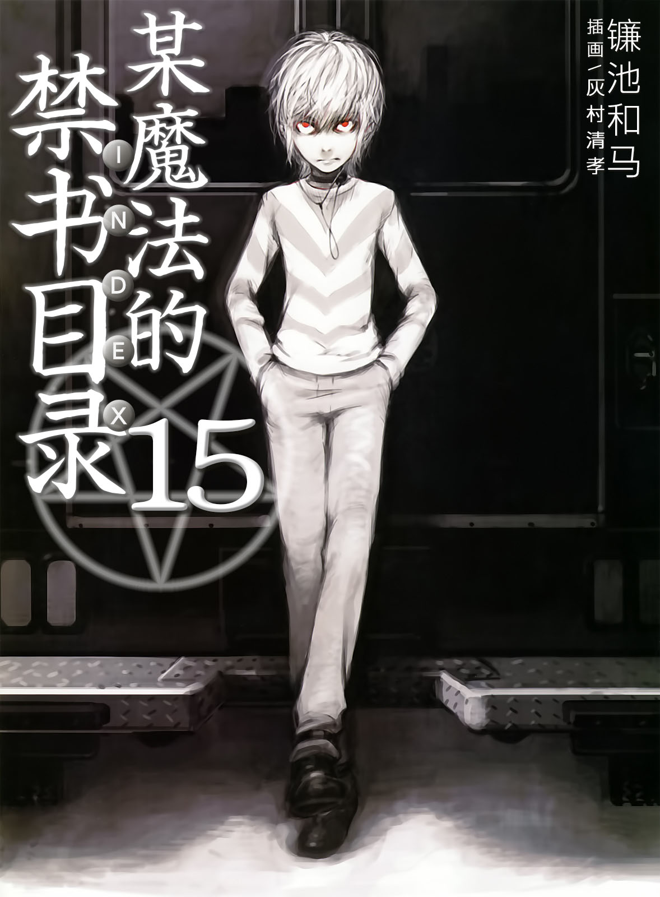

# 简介

**旧约·魔法禁书目录15**

作者：镰池和马

## 内容简介

**这个故事中，幻想杀手(Imagine Breaker)的少年并未登场。当「GROUP」的能力者·一方通行(Accelerator)与神秘组织「SCHOOL」邂逅之时，学园都市「暗部」的故事就从此开始——！**

在阿维尼翁进攻作战中，治安维持力量缺席的学园都市成为了无法之地。在那里，黑暗组织们正在暗中活动。

——为自己而行动的人。

——喜好黑暗、享受杀戮的人。

——试图粉碎他人希望的人。

——为了重要之人挺身而出的人。

——向上层发起挑战的人。

——消灭叛乱分子的人。

——以暴力阻止失控局面的人。

在这个由科学支配一切的城市里，能够生存下来的将是……

当「GROUP」的能力者·一方通行(Accelerator)与神秘组织「SCHOOL」邂逅之时，学园都市「暗部」的故事就从此开始——！

## 制作信息

* 翻译：郑淑慧
* 台版：轻之国度EPUB制作组
* EPUB：江火如画
* 扫图：QS狼=timekeeper
* 录入：yanplaywow
* 初校：夜
* 二校：stson
* 整合：知一一（禁书目录X系列，[index-X](https://github.com/1204244136/index-X)）


**版权声明**

转载时请保留录入信息。

本站内容仅供试看、学习与交流使用，禁止用于商业用途；下载后请在24小时内删除。请支持官方正版。


## 封面与封底

