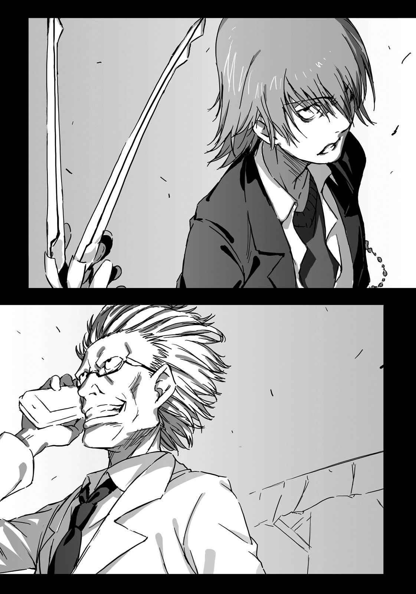
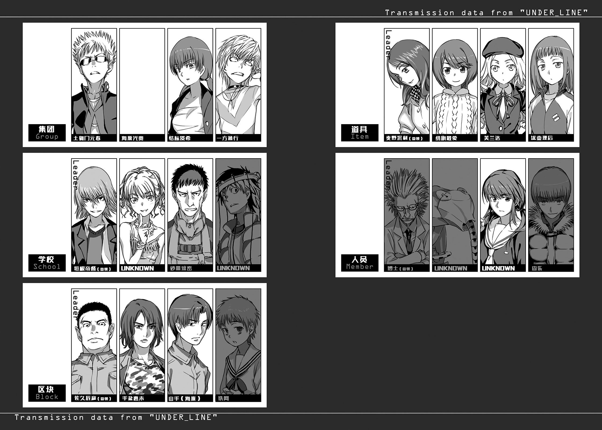

# 行间二

「SCHOOL」所属的超能力者(Level 5)·垣根帝督位于第四学区。

这里是学园都市内餐厅最多的场所，食品相关设施非常多。休旅车就藏在其中之一的食用肉冷冻仓库内。

「没有『ITEM』的气息，看样子似乎是甩掉她们了。」

垣根打开休旅车后门，确认里面的东西。

里面装的不是冷冻肉。而是一个如同小型衣柜般的、金属制的巨大箱子。

「……这就是『镊子』……」

「SCHOOL」下层组织之一的司机，发出呻吟般地低语。

垣根的嘴角露出笑容。

「超微粒物体干涉用吸着式操作器。说白一点，就是能把比原子更小的基本粒子抓住的机械手指。所以才叫做『镊子』。」

世界上的物质，由许多基本粒子所组合而成。基本粒子工程学研究所会特意抽取物质中的基本粒子，制造出不安定的物质进行各种实验。

一般实验用机械臂，无法抓取比原子还小的物质。「镊子」使用了磁力、光波、电子等，构筑出「吸取」的方法。

「只要走错一步，就有可能引起原子崩坏(Meltdowner)。」

「啊？」

「没事。」垣根说道：

「之前补充了被『ITEM』杀害的狙击手射杀亲船，这些事前准备虽然很麻烦，还是有相当的价值，这样我就可以放心了。」

司机盯着大型装置看了一会儿：

「不过，抢这种东西到底打算做什么？」

「你在说什么，当然就是那个啊，要抓取细小的东西。**这跟亚雷斯塔的突破口有关**。」

「？？？」

司机露出不明就里的表情，垣根也没有特别追加说明。他打开休旅车行李厢里的工具箱，从中取出螺丝，松开大型装置「镊子」的螺丝。

「要、要弄坏吗？」

「是重新组合啦。」垣根觉得很无聊地说道：「你知道这家伙为什么这么大？就是要防止失窃。如果只有集中最基本的零件，就可以变得小一点。」

咔嚓咔嚓的声响连续传来。

「镊子」被重新组合，马上变成原本最适合的形状。

垣根手上拿着类似金属制手套般的东西。食指与中指两根指头上，有玻璃制的长指甲，玻璃中有细金属棒般的零件。手背部分是手机般小巧的荧幕。

用途在于利用玻璃指甲中抽取出基本粒子，由里面的金属棒进行各种测定。

「竟、竟然变得这么小。」

「这就是学园都市的尖端技术啊。发展得太过火也是一种问题。」

垣根将手套套在右手确认状态。

「嗯，感觉不错……跟其他人联系。要进行下一步行动了。」

「是。」正当司机点头时——

啪嚓，锐利的金属声响彻冷冻仓库。

垣根与司机往声音的方向看去，冷冻仓库厚厚的墙壁被切出一个方形。正午的耀眼光线，从朝内侧倒下的墙壁那边射入。

外面没有任何人。

但袭击无疑是瞄准这里发出的。

「哇。嘎啊啊啊啊啊啊啊啊啊啊啊？」

司机突然发出尖叫。

垣根一看，司机头部的皮肤刚好消失。脂肪与肌肉接着消失，最后连脑部也消失，只剩下衣服与骨头崩落在地。

喀啦喀啦的声响，听起来轻如塑胶。

垣根微微皱眉。

「你是垣根帝督？超能力者(Level 5)就此消失未免太可惜了。」

无法判定方向的声音，在垣根耳边响起。

他注意所有方位，并启动刚刚组好的「镊子」。

（没想到会在这里使用这个。）

「……是『GROUP』吗，还是『ITEM』？」

「很可惜，我是『MEMBER』。垣根少年，你抽过烟吗？」

来源不明的中年男子声音，听起来相当悠闲。

「从盒子里拿出香烟时，不是会用手指砰砰地敲烟盒吗？我小时候一直搞不懂那动作的意义。不过看起来很帅就是了。所以我吃零食时也会敲零食盒子。」

「啊？」

「你现在所做的，就是那种行为。」

「少瞧不起人。看样子你想成为很有趣的尸体。」

此时，装在右手上的「镊子」发出「哔」的电子音。

往荧幕一看，机器所采取到的空气粒子中，可以看见机械微粒般的东西。在电子显微镜大小的世界里，很明显地混杂着人工物体。

「纳米粒子？利用那个一一夺取人类的细胞啊。」

「**不**，**我的**没那么了不起。既没有回路也没有动力。只是根据特定频率，表示特定反应的单纯反射合金粒子。我称之为『含羞草』。」

不知人在哪里的中年男子，用意兴阑珊的声音说道：

「不过，如果调整频率，就能像使用电视遥控器来玩遥控飞机那样操作。通常是让它附着在空气中的杂菌上，散布在四周，使它产生的效果倍增。」

沙！声音包围垣根帝督的周围。

往四周一看，还没来得及逃跑，「含羞草」已经朝他袭来。

带着机械兽的「MEMBER」的博士，在冷冻仓库外悠闲伫立着。手上的小型终端机上显示「含羞草」操纵程序的运作状态。

博士位于沿着人行道建立的商店街。这个区域允许业务上的路边停车，载着许多水果，如可丽饼摊贩般的商用小货车在路旁展开成一排。

一旁的机械兽说：

『正如高层的情报，在第四学区的冷冻仓库内。』

「那就是高层的力量。学园都市是他们的领土，这城市中充斥着不明的技术。不管怎么挣扎，终究无法逃脱。」

吃着色泽鲜艳的南国水果，博士静静地说道：

「我对艺术感到绝望，是在十二岁的冬天。」

机械兽默默听着博士的话。

「我非常憧憬欧洲的建筑物。很欣赏那种花费大量时间与人力建筑『作品』，只为了完成一项美的庞大规模。同时却也很难理解。光是看建筑物的外观说出『美』是件很简单的事。不过一一仔细理解其中细致的含义时，由于建筑规模过于庞大，必须花费极大的时间。简单来说，就是可看之处太多，反而让人觉得疲惫。」

『所以博士您才会如此执着于公式。』

博士点头。

「公式最棒了。没有任何多余、充满功能性、在最小的空间内能填入许多的美。公式本身就充满了艺术美感，同时又兼具俳句般的诗意。而且，这么多的美，只要解开这一行就能够充分享受……我想发现隐藏在世界角落的美，并欣赏其中的美感。所以，无论我是拜倒在谁的脚下都行，就算被叫成亚雷斯塔的狗也无所谓。」

博士望向手表。

「含羞草」差不多该完成敌人的排除了。

杀掉第二位的超能力者(Level 5)，亚雷斯塔应该不会摆出什么好脸色。不过只要再制造出新的超能力者(Level 5)，应该就没问题。

「走吧。回收『镊子』之后，只要再解决其他『SCHOOL』的正规要员，工作就算结束了。」

『我们「MEMBER」之一的查乐，在第二十三学区终点站附近，被打倒的那件事呢？』

「一方通行(Accelerator)是称呼他为『死角移动(Kill Point)』吧。总之如果他还没死，放着不管也无所谓。有空的话你就去回收。」

博士说道。

机械兽并没有回答。

&nbsp;

轰！爆音响起。

冷冻仓库从内部被炸得粉碎。

&nbsp;

因为爆炸力过大，周围大楼的玻璃也连带地碎裂了。人们发出惊呼四处逃窜，面对人行道的商店街的商用小货车，也引起轻微的骚动。

灰蒙蒙的粉尘扬起。

垣根帝督突破粉尘缓缓走近。

他的身体上全无伤痕。

毫发无伤。

「喂，你说你是在十二岁那年的冬天感到绝望？」

博士连忙向「含羞草」下达指示，却没有任何回应。滞空在附近的「含羞草」，全都被空气中微粒子爆炸所造成的冲击波赶到远方去。

看到博士手忙脚乱的样子，垣根露出微笑。

他笑道：

「**我就让你再绝望一次吧**。」

