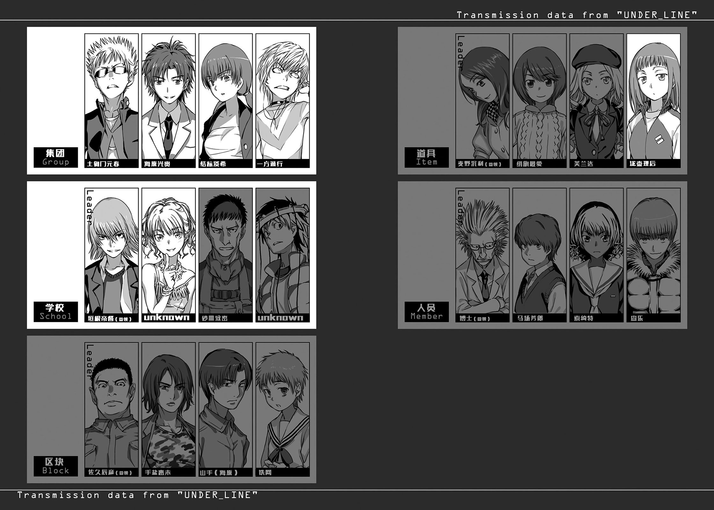

# 行间四

礼服少女在酒店的某房间内关了一小时，再次回到「SCHOOL」的秘密基地。超能力者(Level 5)垣根帝督也在那里。

「喂，你到哪里去了？」

「去赚点零用钱。学者果然行不通。基本费用算得一清二楚，一点小费也不给。」

「哼。一个小时听起来还挺可疑的。」

「我们可没有做什么怪事。虽然进了酒店房间，也只是在里面翻翻杂志聊聊天。」

「……没做限制级的事？」

「没有啦。没那个必要。别人可能会这样，我的『顾客』不会要求那个。你知道有钱人到店里拿钱给女人的理由吗？并不是要满足性欲，他们只是想靠自己的力量，建构出工作以外的人际关系。」

「还真是难懂的世界。」垣根说道。

礼服少女看来有些受不了：

「不是有所谓的工作狂吗？因为工作太有趣，结果连家庭也丢掉的人。对这些人而言，靠金钱构筑出的关系是一种救赎。金钱是工作的结果。那些钱如果能购买友情或爱情，他们就会觉得『可以凭自己的力量建立人际关系』或『自己并非无法适应社会的人』。我只是收钱让他们缓和自卑。」

「啊——」垣根发出丝毫不感兴趣的声音。

听到这种回答，礼服少女也不想再多说明。

「对了。追赶我们的『ITEM』已经无法行动了。原因是自相残杀。第四位的麦野沉利被打倒，已经失去了维持组织的力量。」

「啊？自相残杀？那个麦野曾经逃离过我的攻击呢……那是谁打倒麦野的？芙兰达跟我们交易完就逃走，绢旗最爱被我打倒了。泷壶理后又没有直接战斗力……」

说到一半，垣根不再说话。

「该不会……」

「没错。正规成员如果办不到，下层组织的人就很可疑。」

两人脑中浮现的，是为了守护搜索能力者泷壶理后，自己回到电梯厅的无能力者(Level 0)。垣根轻吹了声口哨，称赞滨面仕上。

礼服少女盯着垣根。

「使用『镊子』的『解析』进行得如何？」

垣根帝督的右手套着机械制手套。食指与中指装有两片透明指甲。虽然凭肉眼无法确认，爪子里有从大气中采取的硅块。虽说是块，其实只有七十纳米，不使用电子显微镜就根本无法确认。

「我一直觉得奇怪。」

垣根让指甲发出喀吱声响嘀咕着：

「亚雷斯塔那混蛋，**未免也太清楚我们的动向了**。光凭防盗摄像头与警备机器人、卫星的监视应该不够。我一直很好奇，他是从哪里搜集情报？」

「……」

「根本就没什么。他在城市中散布约五千万台看不到的机械搜集情报。会知道每个角落发生的事情，也是理所当然。」

就是「滞空回线(Underline)」。

形状是在球体的机体侧面，伸出左右三对共六根的针状纤毛。移动方式也不是在地面步行，比较像在空气中飘浮。

这样极小的机械靠着空气的对流自行发电，可以半永久收集情报。使用直进型电子光线在「滞空回线(Underline)」内，交换体内生产的量子信号，形成一种网络。「滞空回线(Underline)」是与「没有窗户的大楼」连接的唯一情报玄关，当然，它小小的体内隐藏了许多足以撼动世界「最暗部」的情报。

「但是，就算知道『滞空回线(Underline)』的存在，也很难找到电子显微镜大小的机械，就算发现了，也没有取出情报的手段。因为必须撬开纳米尺寸的机体，在端口上连接电线。况且，体内所收藏的量子信号突然遭到外部『观察』时，很可能会发生情报的变质。」

因此，才需要「镊子」。

不管纳米粒子有多小，只要有为了抓住基本粒子，而开发出的「镊子」就没有问题。这么一来，就很有可能从「滞空回线(Underline)」抽出情报。

礼服少女看着垣根说道：

「解析结果呢？」

「正如预测。」垣根回答。

「不行。『滞空回线(Underline)』的确有许多情报，光凭这样无法跟亚雷斯塔处于同等立场。除了这些情报之外，还需要其他的王牌。」

「那么，还是要做吧。」

「……是啊，杀掉学园都市的第一位。只有这条路。为了跟亚雷斯塔交涉能够处于优势，光是『第二候补(备用方案)』还是不行。必须成为无可替代的『第一候补(主要方案)』核心。」

「这样啊。」

礼服少女不带太多感慨地回答道：

「要怎么做都无所谓，但我不会插手跟一方通行(Accelerator)的战斗。」

「啊？」

「我的『心理定规(Measure Heart)』是调节与人心的距离。所以，只要保持与一方通行(Accelerator)最亲近的人的距离，也许一方通行(Accelerator)就会犹豫对我发动攻击。」

「所以？」

「但是，与『最亲近的人』敌对时的反应，不一定保证能让他不对我拔刀相向。有时甚至会做出更激烈的攻击。比方说对方为什么要背叛我……一方通行(Accelerator)在这方面可以信得过吗？抱歉，我觉得不管跟那家伙如何调节距离，还是会被攻击。我无法掌握那个人的心。」

「嗯。」垣根觉得很无聊似的回应。

他的声音里没有失望。他对礼服少女的战力没有多大期待。

礼服少女看着套在垣根右手的「爪子」：

「如果掌握与亚雷斯塔的『直接交涉权』，知道结果了就跟我说一声。」

「哦。」垣根回答后，礼服少女离开了「SCHOOL」的秘密基地。

垣根帝督盯着「镊子」，缓缓地笑了。

「——『一方通行(Accelerator)』是吧？」

