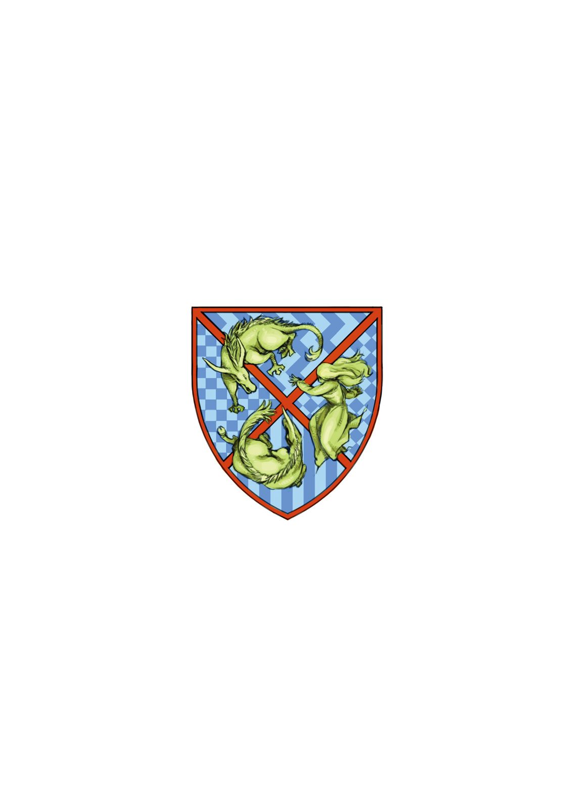

# 简介

**旧约·魔法禁书目录16**

作者：镰池和马

## 内容简介

**罗马正教暗部「神之右席」的第三使徒，即便是上条当麻的「右手」也无法奏效！无能力者(Level 0)·上条当麻VS罗马正教的暗部·后方之水！当科学与魔法交汇之时，故事就从此开始——！**

罗马正教的暗部「神之右席」中的后方之水终于行动了。这个同时拥有「圣人」的力量和「神之右席」「特性」的最强大、最凶恶的敌人，看上了上条当麻的「右手」，从而潜入学园都市。

接到后方之水宣告的英国清教，派遣天草式十字凄教的五和作为保镖前往保护上条。当她住在上条家中进行护卫时，以压倒性的料理技能和勤劳细致，让寄宿修女茵蒂克丝的地位变得岌岌可危。而看到这一幕，上条眼中不禁流下了一行泪……

然而，这样短暂的安息时刻也很快结束，最强、最大的敌人终于现身……！！

## 制作信息

* 翻译：郑淑慧
* 台版：SOSG小说组
* EPUB：gameking
* 录入：葉月零 watashi101 折原あずさ 水树奈々 哦☆卖糕的
* 校对：葉月零 watashi101 折原あずさ 水树奈々 哦☆卖糕的
* 二校：watashi101
* 扫图：watashi101
* 修图：vic65cn K 　gsnoopy 　折原あずさ
* 排版：watashi101
* 整合：知一一（禁书目录X系列，[index-X](https://github.com/1204244136/index-X)）


**版权声明**

转载时请保留录入信息。

本站内容仅供试看、学习与交流使用，禁止用于商业用途；下载后请在24小时内删除。请支持官方正版。


## 封面与封底

