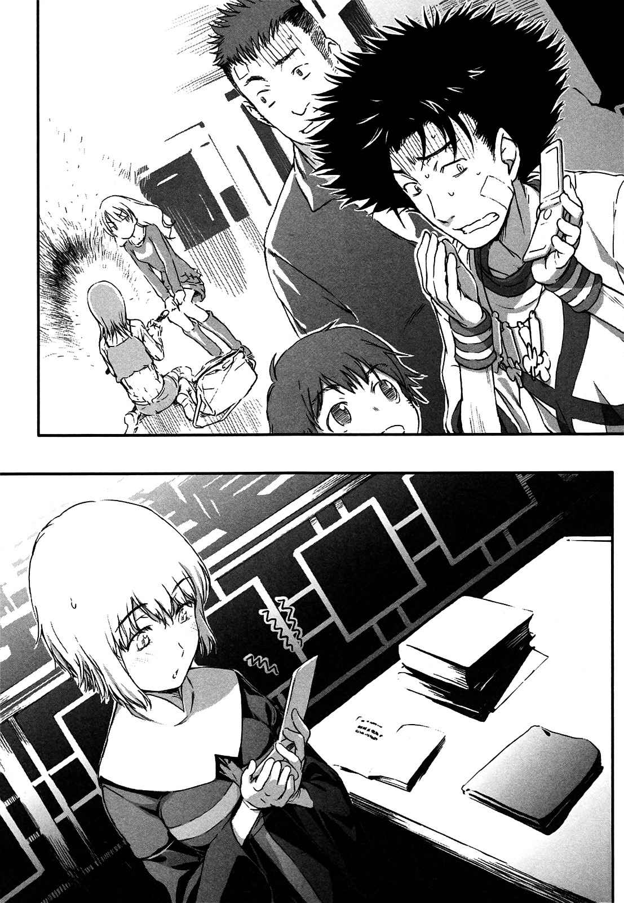
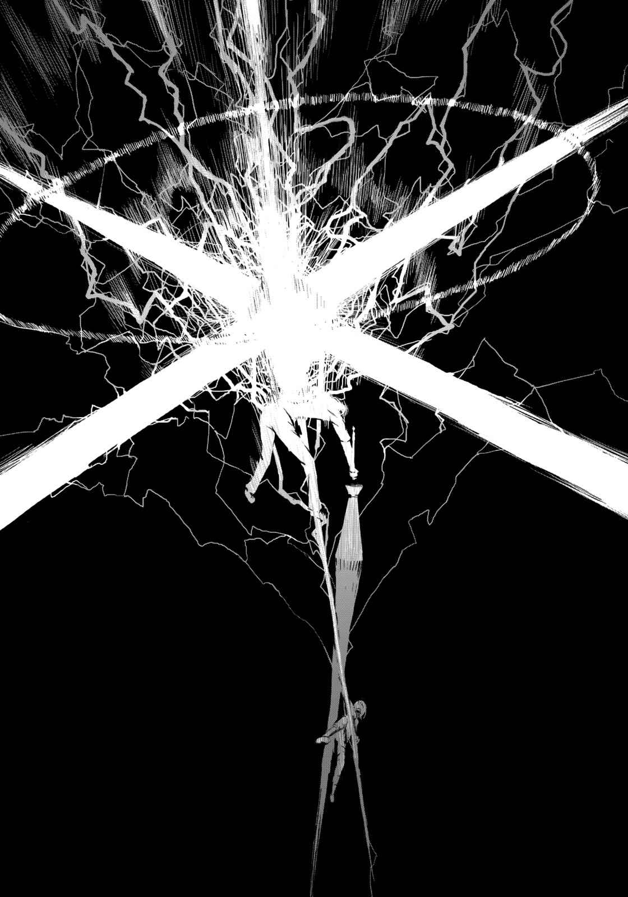

# 第二章 在失败中屹立的人们

> Flere210.

## 1

夜晚的医院响起慌张的声音。

这里是第二十二学区第七楼层的急诊医院。

载着患者的推床的小小车轮，发出喀啦喀啦的声响。许多急救队员包围着推床前进，声音从急救门诊传到建筑物内。推着推床的手由急救队员换成了医生与护士，进入集中治疗室后，消失在手术室的门后。

「……总算……结束了。老实说，很难说是稳定的状态。」

年轻医师看着从手术室出来的推床再次回到集中治疗室，如此说道。

探病时间已经结束的医院走廊相当寂寞。

但是，微暗的走廊现在有好几个人影。或者应该可以称之为「很多」。男女老少合计五十人左右，有人靠着墙，有人坐在沙发上，他们听着医生说的话。这些人大半衣服破裂，缠着绷带。还有不少人白色的绷带上渗出红色的血迹。

他们自称是「天草式」，年轻医师不知道那是怎样的组织。看起来应该是很麻烦的集团吧，Skill-Out的大人物住院时，也像这样有许多不良少年在大厅里。因此他决定不要太深入这个问题。

「简而言之，一般人在这种情况下要绝对安静休养。详细状况就是全身挫伤跟脑震荡。还有右肩跟左脚踝的关节脱臼。内脏也受到压迫。」

「……也就是说，是大意不得的状况吧？」

头发黑亮如甲虫的高大男子，慎重地选择措词如此问道。

医生沉重地叹了口气：

「应该说是不幸中的万幸啦……最担心的是长时间在水中，造成脑部缺氧的危险性……但这方面的伤害似乎不大。」

看着电子化的病历表，年轻医生流畅地说道：

「不过……虽然有多名目击者，这实在是很难令人置信的『原因』啊。人类的身体从铁桥飞离数百米，在河面上弹跳好几次，然后再摔进水里……这种状况本身就令人难以置信，而且被卷入这么严重的惨剧，却只是徘徊在生死的紧要关头，这只能说是太神奇了。」

「是对方手下留情……」

在黑暗的走廊中，有人这么说。

年轻男医生往声音的方向转过头去，却不知道是谁说的。这群人是很奇怪的集团，整群人在医院里虽然很醒目，却没有一人「突出」。看起来就像是「名为群众的景象」。而且还是「近五十人缠着绷带的集团」。

「总之，现在一切还没结束是吧？」

唯一「突出」的甲虫男，仿佛在做确认似的询问医生。

「如果可以说话，我想跟他道个歉。」

「你、你在说什么？当然要绝对静养啊？我、我是不知道你为什么要道歉，现在最好别这么做。病人因为麻醉睡得很熟，就算没有麻醉的影响，体力也还没恢复，现在该让他休息。」

年轻男医生用下巴指着集中治疗室。

集中治疗室的墙壁是玻璃制的，大概是为了方便从外部一一确认患者的变化，从走廊这里可以看到数名患者躺在里面。被大量机械包围的床铺之一，躺着那个刺猬头少年。

甲虫男在年轻男医生的催促下望向集中治疗室，表情略变阴沉。

一名少女跪在床边的地板上。身穿白色修道服的她用双手包住患者的手掌。

是茵蒂克丝。

「……这是我身为医生的经验，应该让他静养。」

年轻男医生面无表情地警告。

甲虫男似乎没有勇气走进里面。看到他默默点头后，年轻男医生离开走廊。

甲虫男——建宫斋字从集中治疗室的玻璃墙后退一步。

真的非常不甘心，自己无法帮那个少年做什么。天草式相传的恢复或治疗魔法根本行不通。顶多只能祈求他平安无事。但是，他不知道自己有没有祈祷的资格。

口口声声说要从后方之水手中保护他，结果却被打得落花流水。因对方随意放出的攻击而遍体鳞伤的建宫他们，只能倒在地上看着后方之水前往目标。

而且，护卫对象本身最后还为了守护天草式的「伙伴」而战……结果变成这种下场，全身到处缠满绷带及纱布。一般人也许不懂，但从魔法观点来看事情却是一目了然。现在的天草式，甚至不像平常那样与环境融为一体。

如今他们真的是一败涂地。

输给了后方之水，更重要的，是输给了上条当麻。

「……混蛋。」

建宫紧咬着牙关。

不管自己被打得多惨，敌人是不会等自己的。五和说后方之水曾说过，一天后如果不切断上条当麻的右手交给他，他会再度前来攻击上条。当然，无论是右臂还是攻击，他都不会容许。

他知道自己该做什么。

为了守护上条当麻，无论发生什么事他都要面对。

「你为什么要蹲在那里？」

建宫问道。在微暗的走廊中，没有什么光线，几乎一片黑暗的一角，传来小动物惊讶发抖的气息。

不仔细看根本无法看清楚。

但是，缩在沙发一角的人，的确是五和。

她手脚缠着绷带，右颊上贴着方形的纱布。看起来虽然惨不忍睹，但是这些历历在目的肉体伤害，根本比不上她的精神所受到的伤害。

「……我……」

她的声音相当不安定，还混杂着打嗝声。那是呜咽。可能是流下太多眼泪，而无法灵活控制横膈膜。

「……我……说过……要保护他。无论是枪……还是魔法……根本都……没有用……他却说……谢谢你……我明明无法保护他，也无法对离开的水报一箭之仇……他却说谢谢你……」

滴滴答答的声响传来。

那也许是泪水，也可能是紧握的手掌中所滴下的鲜血。

「当我……听到他这么说时，还以为他有什么厉害的力量，其实不是。他根本无法依赖任何防御术式。就算有再强的恢复魔法，连一丁点擦伤也治不好。他真的，只靠着一副躯体奋战……」

「五和……」

「我却对他见死不救。」

五和似乎在笑。

她抽动着鼻子，扭曲的脸看起来仿佛在笑。

「像我这种人，怎么能厚着脸皮独活？像我这种人混在满是被害人的集团里，为什么没有遭天谴？这太奇怪了吧？明明应该是我躺在那张病床上！这样一切就都能结束了！」

这句话掺杂着各种情绪动摇。那既是咨询，也是喃喃自语，又是忏悔，也是出气，同时也是丧家之犬不甘的泣诉，还有猛兽的咆哮。

连她也无法掌握自己的情绪。

被逼到这种地步的五和，根本没有余地去注意这些。

建宫发现了这一点，微微眯着眼，像是要撕裂黑暗般大步跨到五和身边。

「你还不站起来？」

「……」

「你到底在这里做什么？」

建宫轻轻说道，却用力一把抓起五和的胸口。周围的人还来不及说什么，五和已经被可怕的肌力一把抓起，用力摔在附近的墙壁上。

轰！传来可怕的声响。

五和的背部感到冲击袭来，呼吸变得不顺畅。但她却丝毫没有抵抗，只是像喘气般吸气，用泪眼瞪着建宫。

「……就连……」

气息断断续续的五和动着嘴唇：

「就连建宫……你不是也输了吗？」

「——」

她自己也知道这番话很丑陋，也知道不应该将气出在建宫身上。即使如此她还是对建宫说出带刺的话，这表示不这么做，她的精神无法承受。名叫五和的少女一定也很想守护那个少年。她一定发自内心想要达成这样的约定，但是这样的心意，却被压倒性的力量粉碎。

建宫不想勉强自己去理解这种心情。

这种感情，恐怕是只有五和才能理解的重要感情。

相对地，他这么说：

「那家伙如此拼命，就是为了要守护这种女人？」

听到这句话，五和的双眼圆睁。

仿佛被刀刺中般的表情。那张就算被摔到墙上也没表现出痛苦的脸，因为建宫这句话充满了痛苦。

「看着你最亲近的人被欺负，还有为了守护你而浑身是伤的救命恩人……你却丝毫不想行动。那家伙如此拼命，就是为了要守护这种女人？要是这样那家伙不就是枉死了？哈，结局还真简单。这不就是笨蛋为了帮助笨蛋，结果做了不值得的蠢事？」

五和的脑袋一阵发热。被吊起的她发出野兽般的叫声，想用拳头殴打建宫。还来不及这么做，建宫已经将被压在墙壁上的她朝地板猛然摔去。

轰！巨大的声响让人错觉认为是地鸣。

建宫跨坐在再次呼吸困难的五和身上，盯着她的眼睛看。

「够了吧？如果还不懂，就让我告诉你。」

他的声音相当低沉。

从建宫斋字的音色，可以感觉到点燃的怒火。

「——后方之水，一定会来。」

五和的身体颤动。

建宫重新确认这个让人想逃避的事实。

「当我们还在这样磨蹭，期限就不断的逼近。每一秒钟的浪费，只会降低原本就很低的幸福可能性！你能容许这种事发生吗？就算再低，却还是存在的可能性，你要因为那些无聊的后悔跟罪恶感全都舍弃？任凭那家伙就这样任意被放弃，在毫不知情的状况下被砍掉右手？要想守护他的笑容就给我站起来，别因为自己的问题就抛弃掉别人的人生！」

近乎咆哮的呐喊。

建宫对着无言的五和说道：

「……如果喊救兵就会有救兵来，这我也做得到。那个『圣人』，女教皇如果说要来，我也会这么做。但根本没有这种好事。你听到没有——后方之水一定会来。你想让这间医院成为战场吗？只因为你忙着逃避无聊的现实！」

「建……宫……」

「就算你保持沉默，水也不会罢手！就算求援，如今英国清教也不会变更作战计划派出增援，像这种好事根本不可能发生！现在能战斗的只有我们！虽然很悲惨，目前在这里的我们如果不行动，又有谁来守护那个因麻醉而沉睡的家伙！你难道不知道这点吗！」

建宫抓住五和胸口的手发出声音。

力量之大，简直连自己的手都要破坏掉。于是，五和明白了。会觉得愤怒、对自己感到耻辱的人不只是自己。在场的所有人都得被迫面对想守护上条，却不幸挫败的事实。

即使如此，他们仍旧试着站起来。

就算尝到身为败犬的耻辱，却不像她这样蹲着，而是重新站起来。

为了守护重要的事物。

既然如此，

（我、我……想……）

「想向他道歉？」

建宫看着她的眼睛说道。

「你想让那个『应该守护的人』，再次回到阳光下？」

五和忘了咳嗽，微微点头。

她似乎说了些什么，声音却因为呜咽颤抖听不清楚。

「……那就战斗吧。证明你是最棒的女人，让那家伙觉得你在为了他拼命。无论要道歉还是要笑，要是那家伙没命就都做不成了。不想在他的墓前忏悔，只有跟我们一起奋战了。」

建宫放开五和的胸口，慢慢站起身来。

他环视四周，像是在确认般问道：

「……你们当中，还有跟五和一样的笨蛋吗？」

建宫的嗓门相当大，仿佛要打破因后悔与无力感而彻底变得阴沉的空气。

「要是还有就给我站出来，我会让你清醒。」

没有人响应。

但可以感觉到某种觉悟。

后悔与无力感并没有消失，但斗志超越了那些负面情感。

建宫重新看着站在医院走廊的近五十名伙伴，说道：

「没有就好，接下来只有全力以赴了。」

天草式十字凄教的人们不再回头。

他们留下集中诊疗室的少年与修女，再次回到跟强敌作战的战场。

「真是的。需要拯救的人就在眼前，怎么能不伸出手援助？」

该做的事，只有一个。

让已经陷入死棋的棋局翻盘，守住那个少年的性命。

## 2

后方之水伫立在夜晚的黑暗中。

这里是离第二十二学区第三楼层市街，稍远一角的自然公园。他在这里的理由很单纯，因为他想尽量远离充满科学技术的人工物。如今他正因为注意到这里的森林，也是应用了水栽培技术的科学而沮丧。

（这里整体都是人工的地下空间？）

抬头虽然可以看到星空，也只是映照在天象仪屏幕上的幻影。只要懂得魔法，应该会发现个中的差别。

这里可能没有花太多维护费用，在光线微弱的黑暗中，可以看到小小的方形光亮。

那是水的手机。

来电对象是罗马教皇。他们的手机电源并没有打开。天线前端的亮光，其实是魔法所产生的光亮。

（这样应该无法排除窃听的风险吧？而且天草式或英国清教的尖兵也在学园都市。）

话虽如此，总比在科学阵营的大本营傻傻地使用电话好。

『不过，你只是夺走右手而不杀他？我先前听前方之风说过，「神之右席」不会改变自己的方针吧？』

「那是风的个性问题。实际上是根据局势随机应变行动……地则是失控冲过头了。」

水虽然残杀了同组织中的同僚，还将尸体邮寄到敌对组织那边，但看得出来他一点都没感到后悔或有罪恶感。

「实际上，那名少年的特异性都集中在『右臂』。只要夺走它就能排除掉威胁。我们可没闲到得一直去跟那个未成年小子鬼混。」

『我倒是喜欢这种做法。』

罗马教皇似乎在电话那端笑了。

『之前我也曾经对风说过……如果以自我意志成为上帝明确的敌人，当然只能粉碎掉，但我听说那个少年还不懂上帝。若是杀了他，老实说我会有点反感……但当时风却嗤之以鼻。』

「……我不知道你对我的期待是什么，我不是像你这样的善人，也不是博爱主义者。」

水的声音相当平坦。

「该杀的时候我就会下手。现在还不是时候，不过时候到了我还是会杀。当好几个选择与时运重叠，那一刻也许就不会到来，如此而已。」

他的话中没有任何虚假。

世间仅有四人的最高组织。毫不留情杀了身为少数同僚之一的左方之地，这就是后方之水。

只要「右臂」消失，除去敌对性就行了。

如果不行，或是对方拒绝交出「右臂」——接下来很简单。

除掉。

这么说也许太过简单，但是水会以更简单的一击，将一切还诸大地。

因为他有这种力量与觉悟。

后方之水虽然认知到这点，表情却没有动摇。

『真是奇妙的状况啊。』

罗马教皇突然这么说。

『原本以历代教皇「咨询对象」立场所成立的「神之右席」踏入敌阵中心，而我却只在梵蒂冈旁观。』

十字教是一神教。

神只有一位，所有的奇迹都是由他集中管理。没有人会抗拒绝对的上帝，世界的一切原本应该充满幸福。应该不会有不幸的人出现。

但是，现实中又是如何？

回顾历史应该就很清楚了。十字军远征的失败、黑死病的流行、奥斯曼土耳其势力的扩大。别说个人的幸或不幸，就连差点造成全欧洲死绝的转换期，也曾发生过好几次。

凭教皇一个人根本无法处理一切。

话虽如此，高揭着「上帝是绝对的」，身为十字教象征的教皇，竟会向某人咨询，这本身就是一种不祥之事。

此时产生的，就是「神之右席」。

拥有连教皇也有时也必须依赖的知识与力量，紧贴在十字教社会金字塔结构旁的特殊「咨询对象」。

枢机主教、执政、军师，不同于这些职位，原本「完全不存在于金字塔」，任务则在于给予无声的建议。

这样的席位有四个。对应天使中最重要四大天使的「右席」成员，会配合需要不断更换「内容」而存续着。

虽说状况特殊，有时教皇们会太过依赖「影子般的咨询对象」。不知从何时开始，「神之右席」反而成了罗马正教的中心。

水对此事开始稍作思考。

但他并没有提及这点。

「下次的联系，应该是事后报告。不管目标是死是活。」

此时，他的话被某个庞大的声音遮住。

原因是大气。

有某种东西混杂在黑暗中，突然闪烁了一下。那是常人感官无法掌握的微小光亮。水一察觉到危险后，将手机夹在肩膀与耳朵间，轻松地纵身往下跳。

空气自动卷起漩涡，水刚刚站立的空间，连同地面整个被挖起，削除消失。

看着奇怪现象皱起眉头的水，终于想起一个预测。

（……在空气中散布微粒子，用那个分解物质。）

他如果是详知科学的人，应该会想起那是名叫「含羞草」的纳米尺寸反射合金。没有回路或动力，根据特定频率进行不固定反应的极小粒子。就像是使用电视遥控器来操纵遥控车，能一一夺取动植物的细胞。

当水警戒着看不见的魔爪，这次换形成人工夜空的巨大天象仪的屏幕产生异变了。伴随着尖锐的蜂鸣器声响，一整面出现警告的信息。

『第三楼层发布无氧警报。请各位居民至指定的灾害对应建筑避难，或穿上各家庭内设置的氧气泵。重复，第三楼层发布无氧警报——』

「原来如此。」

水露出大胆的笑容。

「看样子，**对方**在这个楼层散布了攻击用微粒子，试图让我无路可逃。」

『状况很糟糕吧。』

「看起来是这样啦。」

水在口中吟唱着，空气中的水分全成了他的帮手。他从碰触的水分的动态，推测「含羞草」大致的散布模式。

此时，周遭的树林传来树叶摩擦的细微声响。朝声音的方向望去，可以看到在林木间驱动铠(Powered Suit)反射出的蓝光。稍远的地方也传来其他驱动音。对方似乎准备了可以分开使用汽油引擎与电力的都市型短期警戒用装甲车。

他的笑容消失了。

「做事前的战力调查？既然这样，我就让他们领教佣兵的做法(Hand is dirty)吧。」

『希望你不要做无谓的杀生。』

「详细状况我并不清楚，不过好像都是无人机，没有人类的气息。所以他们才能靠我这么近。」

砰！有新的声响迸出。

那是水从脚边的影子，拿出全长五米以上特大铁棒的声音。

「不过，学园都市还真棒啊。」

肩上扛着沉重铁块的他说道：

「我喜欢特意制造出不流血战场这一点。刚好能让我活动活动筋骨。」

仿佛在响应他这番话般，敌人的集团行动了。

夜晚的公园一角，数个影子以水为中心包围他。

无数的子弹袭来。

「含羞草」也以肉眼看不到的方式侵噬而来。

但水并没有倒下。

他避开子弹，吹走了「含羞草」，并时而借用「含羞草」，准确地应付轨道不自然扭曲的子弹，迅速进行反击。

（我是不知道科学的构造啦，指挥者应该是躲在现场某处吧。）

水一口气穿破包围网，手上五米以上的铁棒，犹如长枪般刺向装甲车的侧面。他无视重量连装甲车一起整个甩动铁棒，击飞无数的驱动铠(Powered Suit)，随后将铁棒朝地面挥下，挂在前端的装甲车摔成碎片，牵制了滞空的「含羞草」，不知使用了怎样的术式，水心平气和地走在猛烈燃烧的火焰中。

（那我就拆下所有的驱动铠(Powered Suit)的装甲，撬开装甲车的车身，仔细确认清楚。）

「神之右席」后方之水行动了。

轰响与破坏声支配了一切。

## 3

日本与英国之间，约有九小时的时差。

现在应该是在日本称之为深夜的时间，伦敦还是黄昏。因为纬度的关系，秋天与冬天时的英国日落时间很早。天空已经微带紫色。

皇家艺术院。

英国屈指可数的名门美术馆，也是培养下一个时代主人翁的美术学校赞助人，那里正不断传来讲师的声音。

站在日光灯照耀下讲台上的人，是雪莉·克伦威尔。

「那么，今天就来谈谈纹章。」

狮子般蓬松的金发，再加上巧克力色般肌肤的女性。她身上的服装是破破烂烂的哥特萝莉风黑色礼服。雪莉虽然是优秀的雕塑家，但她对于美的品位似乎没有发挥在自己的作品以外……这是学生之间给她的评价。

「所谓的纹章就是那个啦，上头有家纹的东西。那可不是不知名的魔法符码……当然，那样的纹章也是有啦，不过现在我就不岔题了。」

学生们报以微笑。

他们似乎认为这是在开玩笑吧。魔法师雪莉毫不在意地继续说道：

「纹章这种东西，是由好几个部分所组合，再整组进行使用，今天我带来的就是其中最主要的盾之纹章。」

雪莉用提不起劲的语调说：

「大家也许会认为，这跟在画布上加上油彩赖以为生的你们无关，但描绘带有记号性的作品时，这种知识就很有帮助。总之就先把它当作回避灵感低落期的方法，大家随便听听老师说吧。」

此时，教室门外传来了压抑的敲门声。

雪莉将盾之纹章样品放在讲台，惊讶地盯着声音传来的方向。

将门无声地开出一个细缝的，是这所美术学校的年轻事务员。去年刚上任的女事务员将头微倾着，用充满歉意的声音说道：

「抱歉……英国图书馆那边有联系……」

「是吗？」

雪莉随口回应后，用食指摸着纹章边缘，略作思考。

「所以，不好意思，请你们先自习。」

她对学生们这么说完，挠着头走出教室。

来到走廊后，娇小的事务员用胆怯的眼神看着雪莉。

「呃……真的很抱歉。」

「别在意。他们也比较喜欢自习吧。作品可不是教了就会做的东西。不喜欢自习的人，反而不适合创作。」

「是、是吗……」

雪莉以一脸颇感麻烦的样子，询问露出暧昧笑容的事务员：

「那……你说的联系是？」

「是、是的。是电话。请您到办公室去。」

在事务员带领下进入小房间，办公桌上放置的电话之一，正闪着保留灯号。

「就是那个？」

「来自英国图书馆的联系……是艺术品处理这方面的事？」

「就是这样。」

雪莉很常接到大英博物馆或圣乔治大教堂的「联系」，周围的人似乎认为她在承接古老艺术品鉴定或修缮的案子。

看着点头回到自己桌子的事务员，雪莉脸色厌烦地拿起电话。

电话那端，传来相当悠闲的女子声音。

『哎呀哎呀。请问你是雪莉吗？』

「……又是你哦，奥索拉。真是的，难道就没有其他的书籍管理员？」

相较于极不耐烦的雪莉，名叫奥索拉的女子咯咯笑道：

『那个，大型垃圾回收日是星期一跟星期五哦。』

「知道啦知道啦。我知道你的话题最后会拉回来，进正题吧。」

最近学会如何对付这个女人的雪莉，用平板的语调催促对方说下去。

奥索拉说话就是这种感觉。

『我从英国图书馆残留的过去魔法事件簿，调查了「神之右席」……后方之水的事情。』

「这我今早上班前已经听过了。那么……结果呢？」

『验证过九月三十日的目击证词之后，有许多目击证词提到，这件事里头的「他」自称为后方之水，活动主要以英国国内为中心。』

「这个午休时我听过了。」

『而且，有一部分的人说「他」是英国的「骑士」……似乎也有这种证词。』

「啊？」

雪莉的眉毛首度惊讶地挑动。

（罗马正教的后方之水，是英国的骑士……）

在现今的英国，「骑士」的爵位就跟勋章一样。无关乎家世，只有对英国留下优秀功绩的人，才能由女王陛下直接授与。这种爵位无法传承给子孙。感觉上就像是国民荣誉奖。

但是，英国的暗部现在仍旧存在着「骑士派」这种大派系。为了王室与国家拿起剑，将对其造成威胁的人都当成敌人，拼了命也要歼灭对方——就像远东地区的武士一样，「骑士」们原本是应该随着枪械的发展而消失的。

「……现在虽然是其他宗派的干部，没想到以前曾经是我们的骑士。如果这是真的，未免也太麻烦了吧？弄不好学园都市那边，还可能要我们负起后方之水引发事件的责任。」

『不过，白金汉宫里保管的骑士名册里，并没有发现特征跟后方之水一致的人物哦。』

「所以说情报是假的喽？」

精通魔法的佣兵，被周遭的人误解了……是这样吗？

「嗯——」奥索拉发出烦恼的声音：

『的确，在骑士名册是没发现啦。』

「啊？」

『被选为骑士的人，依照其家世会准备盾之纹章吧？询问过伦敦郊外的工匠后，发现一张不知是谁拜托的盾之纹章设计图……有人匿名订制了这个，但是制作途中突然取消了。』

「……这样啊。」

雪莉歪着嘴角：

「纹章的设计，是将其家世、历史、用途符码化。你是要我调查那个，找出『记录上不存在的骑士』的底细？」

『如果从纹章设计图上获取情报，会比较方便吧……我是这么想啦，那……我用「chuán zhēn」将订单传给你。』

雪莉望向传真机的方向，此时机器刚好吐出纸来。刚才的年轻事务员跑向传真机。

从事务员那边拿到约十张纸的雪莉，将纸一张张排在桌上，用食指摸着上面所写的东西。与其说是艺术品，看起来更像机械设计图。黑白的纸上到处详细地书写着颜色的指定，似乎是要加强印象。

「……主要的颜色有两个。以原色的蓝色为底，装饰是绿色。使用的动物有……龙、独角兽、这边的女子是白绢幽灵……？盾牌分成四个区域，配置了三种动物。」[^1]

『有什么发现吗？』

「很简单。」

看了设计图好一阵子的雪莉，有点惊讶地叹了口气。

「我虽然是不清楚啦，不过订制这纹章的委托者，好像是相当别扭的怪人。」

『啊？』

「龙、独角兽、白绢幽灵。这三者的共通点，在于全都是『在现实中不存在的生物』。而且纹章的颜色也很奇怪。在基本色的蓝色上，又重复配置同样也是基本色的绿色，这是违反规则啊……表现得这么露骨还真是好笑。这家伙似乎很不服气被列为『骑士』。」

雪莉像留声机的唱针一样，将记录在设计图上的情报转换成人类的语言。

「大概是受到『王室派』的热烈邀约，无法拒绝，所以只好心不甘情不愿地接下任命仪式召集令。也就是说……这家伙在成为『骑士』前，是自由活跃的战斗专家，而且应该做了对英国有益的活动……明明是佣兵，却被提拔为骑士，这就是他在肮脏的战场中，也能堂堂正正贯彻自我的证明。像这种背景没有污点的人，是最难缠的敌手。」

仔细问过订单的委托时间，那似乎是十年以上的事了。

年代如此久远，而且已经取消委托的订单，工匠还如此煞有其事地保存着，由此可以窥见后方之水在英国活动时聚集了多少声望。

『还有，魔法业界的「骑士派」爵位任命资格只授予英国人，根据这点来调查以英国为据点的佣兵如何？』

「不。」

雪莉用食指敲着设计图上的动物：

「龙、独角兽、白绢幽灵。这些全都出现在英格兰的传说中。指的并不是英国，而是英格兰、苏格兰、威尔士、北爱尔兰四个分类当中的『英格兰』。」

『……？独角兽不是在希腊方面吗？』

「那是出自伊丽莎白一世收集独角兽角的传说。」

「实际上那只是单纯动物的骸骨啦。」雪莉嘀咕之后说道：

「像这种英格兰地方出身，为英国谋利的自由佣兵……而且不属于任何古板的魔法结社，『容易招揽』的独行佣兵还真是可疑。再加上即使被委托讨厌的事情也无法拒绝，从这些情报，应该可以找出那个在某种程度受到『王室派』重用的家伙吧。」

## 4

以建宫斋字为首的天草式本队五十人，位于第二十二学区第七楼层的暗巷。接到联系的建宫，一手拿着手机对周围的同伴说道：

「第三层楼的自然公园里，后方之水与学园都市的无人机装甲部队，似乎发生了冲突。」

紧张气氛传遍在场的所有人。

说到第三楼层，刚好是上条与五和遇袭之处。

是谁赢根本就不用多言。他们很清楚名叫后方之水的怪物，根本就不会被量产品的机械群给打倒。

在建宫附近的牛深，用窥探的眼神说道：

「……要去吗？」

「不。」

建宫啪的一声折上手机，摇了摇头。

「要是贸然闯进去，结果会怎样应该很清楚吧。我们先等待英国那边的情报。等做好最适当的准备，想出最适当的作战方式，在最适当的时机，面临最适当的战争……这是决战。所谓认真应战就是这么回事。」

即使得知打倒重要的伙伴，救命恩人上条的后方之水现在的位置，在此还是要先忍住。建宫内心的怒火应该也在猛烈地燃烧。为了获得一次胜利，建宫压抑住所有的感情，说出要「等待」。

「现在并不是最适当的时机。要想出最适当的作战方式，等奥索拉整理完情报还不迟。既然这样，现在我们能做的事情是什么？答案很简单——只能做最适当的准备。」

建宫环视四周。

四周的天草式成员们，各自进行着剑与枪的保养。平常留意着要「隐藏」的他们，必须牺牲武器某种程度的强度与威力。现在他们正在进行解除这些限制的「补强」。

「……请等我三小时。」

声音突然传来。

建宫朝声音传来的方向望去，在那里的是将皮带犹如武士般绑在身上的五和。她低着头进行长枪的补强——应该说是全面补强。

她所使用的枪由连接端接上了数根短棒组成，无论如何强度都不足。现在她在握柄部分喷上了喷雾状的固定剂，用树脂块弄粗一圈后，再用砂纸仔细地研磨表面。

「把形状整理到用得顺手，再研磨对付怪物用的刀刃，需要一些时间……一切都交给我吧。我挨过那家伙的直接攻击，知道怎样的东西最好用……」

她用砂纸研磨、整理形状，等树脂变薄后，又在上面喷上喷雾剂。不断地重复这样的作业数十、数百次。

削着树脂的沙沙声，听起来似乎满怀杀意，建宫突然觉得背脊一阵发寒。感觉就像吃人老婆婆在半夜磨菜刀的声音。他只敢在心中这么想。糟、糟糕，刚才太得意忘形把她逼得太紧了。

不知是不是想到同一件事，一旁的牛深在建宫的耳边说道：

「（……怎么办？火好像点得太大，在石油化学工业区引起了大火呢，你看五和那样子。）」

「（……真、真是的！因为啊，你看她那时在医院里，看起来就像失了魂的空壳，那个啊，就是那个啦！我只是要帮她打气啊！）」

「（……你这大笨蛋！你果然没经过深思熟虑就随便煽动她！我们接下来可能会亲眼目睹，恋爱中的女人有多可怕！）」

「（……咦，这都是我的错吗？那你说当时我该怎么办！）」

「建宫，还有牛深。」

被五和这么一叫，两个男人突然僵直不动。

五和低着头，用令人难以捉摸的表情说道：

「没事，我没事——可以请你们小声一点让我专心吗？」

平板不带感情的声音。

五和只说了这句话，继续沙沙沙地用砂纸磨着枪的侧面。枪的形状慢慢改变，越来越好拿，越来越好用，越来越容易杀人。

呜哇哇哇哇哇哇！周遭的其它伙伴看到浑身颤抖的建宫与牛深，发出打从内心惊讶的叹息。

感觉上今天的五和特别暴力，建宫他们悄悄地绑好皮带，进行衣服的魔法补强，确认每个人的笔记本上，都记住了周边的地形。

就这样，建宫与牛深两人更认真地双手合十，祈祷现在不在眼前的敌人能平安无事。

「你虽然很厉害，可是当我们家五和进入『一定要杀了你模式』时，千万要好好守住自己啊。」他们对着不在眼前的敌人说道。

「（……我、我绝绝绝绝绝对，不要当那个负责拦住五和抓狂的人。）」

「（……这这这、这点我也有同感。）」

此时，建宫斋字手机的来电铃声突然响起。

『哎呀呀。你是建宫先生吗？』

「呜哇，奥索拉小姐！这个声音还真能安慰人心啊！」

建宫心中相当重要的某个地方突然崩坏，就这样当场哭倒在地。

电话那边的人似乎无法掌握状况，

『呃……很抱歉我打错电话了。那我告——』

「别挂断！如果你挂断电话，我又会再次被抛回刚才的紧张感里！」

仿佛抓到救命稻草般的建宫，完全沉浸在与奥索拉的对话中，为了让周遭听得到，他将手机转成扩音模式，等着奥索拉说话。

『有、有关后方之水的情报。』

天生脱线的奥索拉，用罕见的认真语调报告：

『已经查出后方之水的本名了。威廉·奥威尔。英格兰地方出身的魔法佣兵，没有所属集团。当然，他并非一出生就是罗马正教徒，有他童年时在英国清教教会受洗的记录。单打独斗的他一直持续活动，最擅长的是攻入敌人的据点。』

最擅长。

包含在这句话的含义，就是他的能力不仅是「攻入据点」。在各式各样的战斗中，他最擅长的是据点压制。但是，这不代表除此之外的战斗他就不会。如果是这样，威廉·奥威尔早就已经败北，不在这里了。

『还有，奥威尔也拥有身为魔法师的魔法名。他将Flere210这个名字刻在胸前。』

「Flere……是吗？」

魔法名所使用的是拉丁语的单词。Flere的单纯意义是「眼泪」。不知道其中包含了怎样的含义。不过对威廉·奥威尔而言，一定有将之刻在胸口的理由。同时也表示，他拥有能将它刻在胸口的压倒性实力。

圣人。

代表敌人是与自己完全不同等级的字眼，在建宫脑中回响。

「威廉·奥威尔佣兵时代的战历呢？」

『俄罗斯西部展开的「占星施术旅团援护」、法国中部的「奥尔良骑士团歼灭战」、多佛海峡附近的「英国第三公主救出战」……真的是数都数不清。』

参加数场战争获得胜利，并且生还，这些证据都显示出后方之水强大的实力。

奥索拉罗列出水所参加的战役名称。其中有好几场建宫都曾听过。这些战争都是有名的激战。是即使现在的天草式团结起来也无法超越，可称之为噩梦的战场。

「强敌……不，应该说是难敌。」

『不过，威廉·奥威尔并不是那种试图用暴力解决眼前所有问题的人。例如在缺乏医疗设备的纷争地区，他会散播能应用在医疗上的药草知识减轻死亡率，在闹饥荒的村子教导居民食用牛蒡的料理方法……在战争以外的方式也非常活跃。甚至还被一部分的人称为「贤者」哦。』

这是真正意识到现实战争的人，才能做到的事。

有些问题并非派遣大批部队、捐款这种方法就可以解决。亲身感受战场的空气，了解当地的人们需要的是什么，然后教导「他们也可以做到的事」，并非暂时，而是永久地提高他们的生活品质。看来后方之水这个人，似乎不是个只会打仗的笨蛋。

兼具强韧肉体与柔软思考的，聪明野兽。

建宫认为他就是这种人。

『找不到他的弱点。在自由佣兵时代，他似乎就已经行使了身为圣人的爆发性力量。』

「……再加上，他现在改宗到罗马正教，甚至还拥有『神之右席』的力量？」

没错，佣兵时代的许多传说，都是在威廉·奥威尔还没被称之为「后方之水」前所树立的功绩。如今他的实力又在当时之上了。而且不仅追加了实力，还得到了一整个全新的战斗基盘。建宫重新了解到他们的敌人有多可怕。这次的敌人，恐怕比女教皇还可怕。

（这么大的力量，到底要怎么操控？）

看神裂的样子，她似乎很自然地就能操控身为圣人的力量，实际上没这么单纯。像建宫这种普通魔法师，如果要操纵如此庞大的力量，恐怕马上就会引起自灭。

而水所掌握的力量，更是超乎其上。

（……在魔法的本领方面，对方也远远超过自己。）

『威廉原本要被封为英国骑士，在任命仪式的一周前突然行踪不明。所以做到一半的盾之纹章，一直被放置在工匠家。』

之后再次现身时，他已经成为英国清教的敌人。

这个过程中虽然不知发生了什么事，但现在不是追究这点的时候。

「我并不期待能找出他的弱点。那你知道水的战斗模式吗？比方说使用的武器或流派？」

『流派方面，他似乎是采用完全独学的方式。本人称之为「佣兵的做法(Hand is dirty)」。有关他所使用的武器，是全长超过五米的钢铁棍棒。听说外观就像骑士所使用的长枪。』

这些都是实际对战过的建宫他们，也掌握到的情报。

『还有……战斗中的移动方式也很特殊，不是用跑的，而是像在地面滑行般行动。』

「……？」

这点倒是没注意到。对方接近时没听到声音，就是这个原因？经她这么一说，的确有这种感觉，因为后方之水的速度太快，「除了方向转换的那一瞬间，看起来就像突然消失」。

『那似乎是操纵水的一种移动术式。马车可以在冰上滑行，是因为冰与车轮间有一层薄薄的水膜对吧？』

「也就是说……那家伙在成为『后方之水』之前，就很擅长运用水吗……」

前方之风、左方之地、后方之水。

这都是源自四大天使的名字。水的领域是「神之力(加百列)」，属性是水。上次战斗中敌人之所以没使用「水之术式」攻击，就表示自己被他看扁到这个程度。

（……那该怎么拟定作战计划？）

未知数——所设定的作战计划上限太高，再加上未知数项目太多，面对这种情况，建宫忍不住想笑出来。

就在这时。

「不管敌人是何方神圣，我们该做的事都一样……」

就这么一句话。

进行长枪补强的五和，几乎没有动唇插口说道：

「没错，建宫。」

「别想逃」，受到这种弦外之音的宣告，握着手机的建宫忍不住颤抖起来。

## 5

深夜三点。

后方之水站在第二十二学区第三楼层的铁桥上。

从公园到这里的路上，散布着他打倒的八座「含羞草」控制用自定型天线台、十七台装甲车、三十八具驱动铠(Powered Suit)。全都是无人机。打倒敌人后移动，在移动地点又碰到敌人然后歼灭对方……这种动作一直重复，却还是没发现指挥作战的操纵者。看样子，对方比他想象中还会动脑。

完全不顾星象仪屏幕上映照出来的虚假夜空，水心想：

（这种时候，要是有风的「天罚术式」就简单了……）

即使如此，不到一个小时敌军部队就撤退了。

学园都市高层应该是判断如此过于片面的胜败，只是在浪费军备。水也这么想。他不想去追究那些垃圾铁块，究竟要花费多少才能生产出来。近代兵器必须花费莫大费用制造，会让人对金钱的感觉变得很奇怪。他心想如果能更有效地使用金钱就好了。

「……但是，没想到对方还不笨嘛。」

这是他对于对方迅速的撤退所下的评价。

不论哪个领域都一样，专家对于本身领域的自尊心特别高。对军人而言，直接来说就是「力量」。被对方打得落花流水，绝不可能坐视。了解到这一点，建立起能让部下理解实际状况的理论，督促他们迅速撤退，学园都市里存在着这种指导者。

不过，不论那个指导者发挥了多优秀的政治手腕，在其手下又集结了多骁勇善战的战力，水该做的事仍旧没有改变。

粉碎幻想杀手(Imagine Breaker)。

以及，迎击妨碍这个目标的所有因子。

（接下来，）

水拿出怀表确认时间。

（距离幻想杀手(Imagine Breaker)的交涉期限，还剩下十九小时……）

盖上怀表的盖子，收进长裤口袋后，水慢慢转动着眼珠望向旁边。

「『结果』出现了？」

水对着黑暗中说话。

「距离期限还有半天以上，准备好了吗？」

在黑暗深处，传来沙沙的脚步声。

脚步声不止一个。

脚步声的数量有五十人左右。每个都是英国清教的分派，天草式十字凄教的成员。包围自己的脚步声相当立体，这意味着他们是从构成铁桥的钢筋之间出现。

男女老少，每个人都穿着到处可见的普通服装，手中却握着剑、枪、斧头、弓箭、鞭子等武器，这些可怕的武器反射着街灯的光亮。里面还有佣兵水未曾见过的、东洋特有的锁镰、十字、铁笛等武器。

站在最前头的是天草式十字凄教的现任代理教皇·建宫斋字。

之所以会知道他的名字原因非常单纯，上次战斗时，他从天草式成员呼唤及切换战术时，所泄露的单词中得知这个名字。战地的情报收集能力也是佣兵必要的技能。

「好吧，既然你们推给我这样麻烦的难题，我也没必要再烦恼。多亏你们加速了我的决断，这点我要感谢你们。」

建宫手上拿着的是焰形剑。跟阔刃大剑、双手剑一样，是用来将厚重甲胄连敌人一起击溃，大型化到极限的双手剑。

全长超过一百八十厘米，犹如怪物般尺寸的武器。

但是，在水的眼中看来，就犹如小孩子所拿的树枝。

「麻烦的难题，是吧？」

水吹了声口哨露出笑容，用脚底轻敲着地面。

影子无声地蠢动着，超过五米的铁块就从那里伸出。

「只要牺牲一只手臂，就能脱离与罗马正教二十亿人为敌的状况。你们难道不觉得很划算吗？」

「敌人并非罗马正教，是将认真相信上帝的一般人当食物，像你们这样任意玩弄他人的人。」

「哼，交涉决裂了？」

「不然呢？」

「无所谓。那不是我得困扰的问题。该困扰的是你们……你们亲手放弃了存活的可能性。」

水重新抓好从脚边的影子伸出的特大铁棒，像是挥动网球拍般，轻松地确认手腕的动作说道：

「我再警告你们一次。我是圣人。」

「……」

「而且还拥有身为『神之右席』的力量。」

「……」

「如果正确理解了这些事之后，你们还是愿意为了守护该守护的人而战，那我会很期待所谓人类拥有的可能性。我会期待你们的大言不惭不是梦话，并且尽数领教你们倾全力所准备的绝招。」

水变了。

不是外表的变化。也不是长出天使羽翼，或是头上出现光环这样具体的变化。但是，当时水身上的确发散出某种看不到的东西。

「然后，我会赢。」

水的脚只跨出了半步。

那半步并非是为了移动，而是为了架好铁棒。这个安静且沉重的决定性动作，表示他要粉碎所有认为是敌人的人，一个都不留。

「我会证明给你们看，胜负不是由善恶，而是由强弱决定。希望你们至少让我使出一项『绝招』。做不到这一点，就表示你们不是弱者而是笨蛋——」

水的话并没有说完。

&nbsp;

咚砰！

忍无可忍的五和无视两人的对话，突然放出认真的一击。

&nbsp;

无声放出的海军用船上枪(Friuli Spear)以电光般的速度，笔直朝水刺去，利用刀尖的「冰冷夜气」所形成的术式一口气发动——然后引爆。轰！闪光四散，爆风狂吹，受到攻击的不只是水，就连周边的柏油路也毫不留情地粉碎。

就连同伙建宫斋字也受到吹动而摔倒。

「五、五和……？」

惊讶的建宫低声说道，但五和连头也不回。从她肩头传来的，只有尖锐刺人的感情。

五和瞪着蒙蒙升起的粉尘，架着枪咂了咂嘴。

灰色的帘幕被铁棒撕裂，水毫发无伤地出现。

「应该先听人把话说完吧。」

「……有话要说，我晚点再听。」

五和非但没有退却，反而又往前跨出一步。

「等我把你打得浑身是伤，到时你的下巴还没碎到不能说话的时候！」

原本面无表情，但眉间聚集异样力量的天草式成员们，听到这番几乎震破耳膜的话，纷纷抱着头或将视线转开。

「（……糟糕！五和那家伙整个人抓狂了？）」

「（……你看，都是因为代理教皇你在医院里说什么『证明你是最棒的女人』这种口没遮拦的话，才害得五和整个人女力全开！）」

「（……笨死了。恋爱中的女人，就连上帝也敢为敌啦。）」

相对于骚动的男成员们，女成员对马则做出意外冷静的评语。

五和与水完全无视这些人，面对面瞪着彼此。

不知从何时开始，天草式的中心点突然变了。

「嗯，是很勇敢啦，不过希望你能把这种言辞化为现实的实力。」

「不劳你费心。我们就算化成肉片，也一定要彻底杀了你，让你后悔自己做过的事！」

咦！要做到这种地步吗？五和无视身后传来的声音，又往前跨出一步。

踏进决定性射程的两人，丢下茫然的建宫斋字爆发激烈冲突。

## 6

深夜的铁桥传来爆炸声。

身为圣人，拥有莫大力量的水，与普通人五和的速度压倒性地不同。以肉眼几乎看不到的速度从正面冲刺的水，全身的肌肉一口气膨胀，以断头刀般的威势挥下巨大的铁棒。

五和的枪晚了半步，好不容易做出反应。

她朝着水的攻击轨道挥出枪，准备挡下这一击。但根本没人可以挡住水的一击。

然而。

「！」

嘎吱！

岩石互相碰撞的声音传来，五和的枪阻止了水的铁棒。

五和瘦小的身体，原本就算跟海军用船上枪(Friuli Spear)一起被粉碎也不足为奇。

「那柄枪……？」

「是啊，我在外面包上了一千五百层树脂。」

五和让武器发出吱嘎声，并笑道：

「表现的象征是树木的年轮，隐藏术式的真正身份是『植物的繁殖力』——在术式的极限来临前，硬度会随时间不断成长。就请你好好体会随着每一秒所增加的耐久力！」

你就见识一下「杂草」的力量吧，五和如此宣言。

「不过，似乎还加上其他术式了……」

「……在古今东西所有文明中，为什么会产生衣服这种东西？我应该不用跟你说明其中隐藏的术式意义吧？」

仔细一看，五和所穿的高领毛衣，腋下部分不自然地裂开，露出白皙的肌肤。仿佛代替五和承受铁棒所造成的损害。

「『守护穿着者的身体』……这应该是最重要的意义。不过，那也只是辅助性的损伤缓和术式，没有方便到任何攻击都能手无寸铁地防御。」

在上次战斗中，水并没有看到这种做法。但他们根本没有必要留一手。也就是说，天草式的成员可以当场准备效果这么高的灵装与术式。

但水最惊讶的不是这一点。

（竟然跟得上我的速度……？）

水是圣人。其压倒性的速度，一般血肉之躯的人类根本跟不上。原本他不费吹灰之力，就能消灭五和。

对方竟然还做出反应。

虽然是迟了半步才好不容易跟上的程度，并没有余地反击。但她的防御的确是成功了。

为什么？疑惑的水之后马上发现了答案。

近五十人的天草式成员动作，有一定的规律。不是单纯进行有效率战斗的布阵，那是一种独特的规律。才刚觉得中心在五和，马上又移到其他人，想要寻找中心时，又消失在全体不见踪影，等到要将中心排除在意识外时，中心又再次回到五和身上。「中心」这种生物仿佛在一个组织中不断地移动，感觉非常奇妙。

时而聚集，时而分散，就像沙漏的沙子，各自的动作形成一个极大的意义。

（也就是说，他们互相增强了彼此的动态视力与运动能力？）

「竟然耍这种小把戏……」

看到这样**习惯与圣人战斗的举动**，让水微微蹙眉。圣人是全世界不到二十人的稀有才能，一生中能见到圣人的人很有限。

（哼，对了。天草式十字凄教。跟我一样的圣人，曾经属于那里。）

因为这种理由，他们「眼睛很熟悉」圣人的速度、臂力与思想。因为有活用这些经验的头脑，才能组成术式跟上水的行动。

水将铁棒往后拉，重新架好武器，重新盯着五和的脸：

「——但还是太慢。」

「！」

唰！水再次逼近。

还来不及察觉到暴风，横砍的铁棒已经朝着五和挥来。五和好不容易接住这一招，正当她的衣服裂开分散魔法冲击时，下一击又从正上方袭来。当五和试着挥舞手上的枪，第一击的冲击现在才传来，让她的身体忍不住朝后仰。至于敌人比冲击传导还快速的第二发攻击，老人谏早牺牲他的刀让轨道慢了半秒，名叫对马的女子，则趁机抓住五和的脖子往旁边纵身一跃。

持续放出的第三发攻击，通过五和刚刚所站的场所，无情地粉碎铁桥的柏油路。

轰隆！铁桥不安定地摇晃着。

虽然免于直击，但飞散的大量碎片还是敲打到谏早的全身，将他击飞。

水还想再追赶五和，此时灰色的粉尘中，突然有某种东西反射。

就像红外线激光在烟雾中，隐约可以辨认的状态。

那条细直光线的真面目是——

&nbsp;

钢丝(Wire)。

&nbsp;

而且不是一两根。

仔细一看，以五和为中心的近五十人，从指尖放出极细的钢丝。每个人操纵的丝线各有七根，总计三百五十根的蜘蛛丝，从全方面朝水袭来。

「哼。」

水并没有避开。

砰嚓！他反而将身子暴露在极细的刀刃下，试图使用蛮力强行拉断。

别说是必杀，就连一秒也无法阻止他。

展示出压倒性力量的「神之右席」，后方之水，

&nbsp;

『——杀了。』

&nbsp;

只听到一句话。

耳边传来低语似的声音。

&nbsp;

『——你杀了我。』

&nbsp;

（原来如此，原来是这招啊……？）

在水咬牙的瞬间，钢丝切断面喷出红雾。红雾在深夜的黑暗中扩散，瞬间包围水的全身。

「隐藏术式的真正面貌，是『对杀人的惩罚』。」

站在毁坏铁桥中央的五和如此低语着，红雾从内侧噗的一声膨胀开来。

天草式的魔法，在雾的内部卷起莫大的爆炸。先筑起一道无法脱逃的牢笼，再从内侧引起压倒性的爆炸。这样一来，无论动作再怎么快也无法避开。

「将钢丝重新定义为一个人的生命线，然后对破坏钢丝的人给予惩罚的术式。这是利用了古今东西所有文化圈共通的宗教观——这也就是无论使用任何文化圈的防御术式，也无法防止的『负面怨念』。」

包围水的红色热块，连续从内部膨胀了两三次。砰！砰！水中爆炸般的钝音接二连三炸裂开来。爆炸的数目以连锁反应增加，不知不觉间红雾已经像葡萄般扭曲变形。

这是光凭个人力量无法进行，必须由天草式这种「单一团体」交织而成的最高等级绝技。

但是，五和的表情不太妙。

&nbsp;

啪！

必杀术式由中心被破解，朝四面八方飞散。

&nbsp;

这爆炸远比天草式所准备的还要庞大。比他们用来杀人的攻击还要强大的爆风，轻轻松松就破坏了牢笼。

粉尘与水蒸气混合，周围扬起一整面灰色的帘幕。

在帘幕那端，男子粗犷的声音传来：

「我来告诉你们我的特性。」

在帘幕那端晃动的巨大身影。

坚定的声音，从那个直立的影子发出。

「我的特性是『神之力(加百列)』。因为受胎告知的关系，我可以使用跟圣母有关的术式——也就是圣母崇拜的秘密仪式。」

他继续说道：

「圣母崇拜的特征，就是『对严厉惩罚的衰减』。」

「神之右席」后方之水的声音，

占据了整个世界。

「信仰主的人会得救。而对不守规律的人给予符合的惩罚，也是『神子』的特征。但是圣母崇拜会使其减轻。比方说在每天点名时，代替溜出修道院的女子回应，在女子回来之前骗过监视的眼睛。」

身影缓缓晃动。

他穿过粉尘与水蒸气形成的帘幕往前定。

「不同于人、神与圣灵之子的『神子』，圣母是不折不扣的人子，却也是深入神之领域的稀有存在。从这点发展，圣母得到了『以压倒性的慈悲，将受到严厉惩罚而痛苦之人的直诉传达给神』这种特性。」

声音响彻四方。

相当高亢，没有任何隐藏。

「——我先说结论。我的特性是消除惩罚的『圣母的慈悲』。就连严格公正并确切的最后审判都可以歪曲，甚至能变更将灵魂送往天国或地狱的路标。所有针对罪与恶的制约行为，对我而言都没有意义。要消除掉『杀人罪』，根本不必动一根手指头。就连『神之力』也能消除的我，你想这种东西会管用吗？」

轰！爆炸声响起。

包围水的灰色帘幕，被一口气消除。

「哼。我不是说过要听别人把话说完吗？」

水将巨大的铁棒扛在肩膀上，百无聊赖地叹了口气。

那里除了他以外，没有任何人。天草式的五十名战斗要员，早已小心地仅留下让人感觉到「人类气息」的术式，全数消失无踪。

一个人被留在铁桥的水，脸上带着猎人追踪猎物足迹般的笑容。

「追踪的乐趣越来越多了。」

## 7

以建宫斋字为中心的现天草式成员，移动到离铁桥三百米的小广场。这种行动与他们对水设下的「杀人禁忌」术式互相连动，一旦术式遭到破解，全体不由分说马上组起术式高速逃走。

但那只是一时的苟且偷安。

像那样的高手，不可能无法察觉到人类的气息与魔力流动。在这个封闭的地下街里，能逃跑的地方有限——更重要的是，他们天草式有不能逃跑的理由。

「阵法果然还是被破了。该怎么办呢，代理教皇？」

牛深回收被切成数段、犹如木棉线般的钢丝，询问建宫的指示。

「……要是能打败他就好了，只可惜天不从人愿。」

建宫手里拿着焰形剑，环视在场的每个人说道。

刚才对付后方之水时，天草式虽然展现了好几项运动能力，实际上那些能力并非如此方便。应该说，如果这五十人都能经常以相同速度跟「圣人」一起行动，天草式应该就会比一名「圣人」还要受到重视。

「就算想蒙混过去，还是有极限。」

五和调整着紊乱的呼吸说道。

实际上那种肉体强化术式，关键在于经常触碰伙伴的背部。隐藏的术式意义就是「借由抚摸背部达到肉体的恢复」。他们在战斗中不断变化阵型，在移动交会之际将手伸向伙伴的背部，使其恢复体内机能，并进行短暂强化。这是个人无法办到，集团所特有的「为伙伴设想」行为所组成的术式，如果能在拥有风水上与「寝室」或「休息处」之类性质相呼应的「脉动」区域进行，更可增强效果。

伙伴之间的互助，虽然可以提高运动能力跟上「圣人」，但如果无法看穿敌人的攻击，阵型一旦产生混乱，就无法兼顾伙伴的「增幅」。只要一个地方出现破绽，就会对周围整体的动作造成影响，不知不觉间集团的行动速度就会变慢。

光是这样，无法赢过后方之水。

所谓「圣人」，就是这样的怪物。

「这么一来，我们只好使出『绝招』。依循『神子』处刑的样式，以持『枪』的五和为中心进行反击。千万不要手下留情，觉悟吧。」

他特意盯着五和确认。

五和双手紧握海军用船上枪(Friuli Spear)，轻轻地点头。

就在这时。

在场所有人突然威到肌肤一阵寒意袭来。似乎有某种巨大的气息，正在撕裂黑暗以高速逼近。不必去猜那道气息的主人是谁，那无疑是后方之水。

他们天草式还有「绝招」作战没有施展。

而正因为那是「绝招」，才无法轻易使出。

「啧，重新组成阵势！」

建宫大叫，天草式所有人犹如波浪般行动。

并非往前后左右移动，而是朝「下」。他们将手插进瓷砖状的人工地面，将边长一平方米的方形瓷砖如舱口般撬开。里面等待着他们的，是钢铁与水泥交织而成的地下空间。

潮湿的金属梯与扶手，再加上交错纵横的粗管线。五和将背紧贴在发出轰响的器材群，穿过器材间的空隙，发现这里兼具了水力发电用涡轮与变电设施的功能。

地下街楼层之间的隔层厚度约十米。这种空间被拿来当成能源生产设施。

建宫与五和穿过复杂的空间，并到处展开钢丝构成陷阱术式。光凭这样虽然无法打倒水，但只要能拖延时间就好。

天草式的目标在下方。

他们暂时由水所在的第三楼层撤退到无害的第四楼层，借此争取时间，想趁这段时间完成「绝招」的准备工作。

『你们让我见识了很有趣的东西，看来我非得回礼不可。』

微暗的空间中突然传来粗犷的男子声音。

声音回响了好几次，却无法掌握来源的方向。

『你们应该知道拥有「神之力(加百列)」性质的我，掌管的是什么吧？』

「咦？」

根本没时间反应。

突然间，纵横交错在水泥空间里的巨大水管，从内部猛然爆开。直径超过一米、厚度超过五厘米的水管犹如纸片般破裂，周围洒满无数大小如吉他拨片般的金属片。橘色的火花在各处炸裂，高速飞来的金属片直击水泥，在周围不断弹跳。

『水是很容易改变体积的物质，如果善加利用也可以成为炸弹。』

轰隆隆隆隆隆隆！四面八方的水管接二连三地爆开。

大量的金属片被水与水蒸气的混合物压出，化成散弹雨袭击天草式。好不容易反应过来的五和，用枪弹开朝脸上袭来的一块金属片，整个人却差点被打翻。

这种破坏力当然不容小觑，但五和有更在意的事。

在水管破裂前，她曾经看到发光文字般的东西。

浮出的字是laguz。

那个记号文字的真面目是——

「什么……是水的卢恩？」

因为极度平庸、太过基本，所以被称之为代表性的魔法。

『那反应……我之前不是将地的尸体送过去，从他身上你们应该多少学习到一些有关「神之右席」的事吧？』

根据英国清教的报告，「神之右席」的肉体比一般人类更接近天使，因此可以使用特别术式，反之，他们应该无法使用一般魔法师使用的术式……

『这没什么好惊讶的。「神之右席」的确无法使用普通人的魔法。但我的圣母崇拜术式拥有能够免除这些制约、束缚及条件的效力。』

他能同时使用圣人与「神之右席」的力量。

除此之外，还完美地掌握了人类与天使的术式。

『你们不觉得很奇怪吗？最初袭击时，**到底是谁使用了**「**闲人驱散**」**这种普通到极点的魔法**？』

攻击的种类与威力有压倒性的差异。

同时兼具质与量的怪物，不带任何感情，只是单纯陈述着事实：

『不要把我后方之水，看成跟「神之右席」一样的人。』

（呜……！）

接下来又有好几条水管破裂，最后连水力发电用的涡轮装置整个都爆开来。看着犹如巨大回旋刀刃般袭来的涡轮螺旋叶片，五和直接跳过楼梯的金属制扶手，一口气掉落到黑暗深处。她用枪突破设置在地板上的舱门状门板，采出身子往外脱逃，来到了第三层楼的下一层，也就是第四楼层的天花板部分。

距离地板约二十米高度的空间。金属制细小通道与楼梯沿着天花板纵横交错的光景，看起来就像舞台剧的舞台。正下方所展开的——不是第四楼层的街景，而是巨大的天象仪屏幕。那是将地面摄像头拍摄下来的天空景象反映出来的东西。覆盖整条街道的巨大布幔，被规则配置的无数细柱与钢丝，吊在天花板上。

但是，如今五和根本无暇注意这奇异的光景。

「……！水呢——！」

「我在这里。」

才发现声音来自一旁，风压已经袭来。还来不及转过头去，五和手上的枪反射性地动了起来。好不容易挡住敌人放出的重击——在这么想的瞬间，五和的身体被水平吹离十五米远。就连用来防御的枪也整个被打飞。

轰！钝响从后方传来。

五和好不容易忍住袭击全身的损伤，采取预备着地的姿态。但找不到着地处所的她，逼不得已只好落在巨大屏幕上。

出乎意料，屏幕支撑住五和的身体，并没有破裂。看样子防止天花板落下物的功能发挥了功效。

五和毫不在意不安定的脚边，架好手上的枪看着前方。

后方之水。

男子肩上扛着五和的枪所无法比拟的巨大铁棒，也从扶手一跃而下落在屏幕上。

「好，测试到此为止。」

水架好手上的铁棍，静静说道：

「既然彼此手上都有武器，不打个一场似乎说不过去吧？」

「……说得也是。」

五和将十字状的枪尖对准水，缓缓说道。

「不过，不止我一个人就是了。」

话说到一半，水的头部上方的舱门突然打开。天草式的人们出现。每个人都带着伤，衣服上带着红色的一污渍，却没有任何人缺席。

总数五十人，共一百只眼珠盯着水。

相对地，怪物却一点也不害怕。

「无所谓。」

缓缓地。

他一步也没有移动，只有重心往下落。

「来吧。」

说出这句话的同时，天草式全体朝后方之水飞奔而去。

## 8

五和从正面扑向水的身边。

站在映照着星空的巨大屏幕上的水还没回应，手持刀刃的天草式少年们，接二连三从前后左右各方向的上空袭来。

近二十只刀尖朝着水的身体招呼过去，就算躲过了，还有三十厘米长的刀尖袭向水。

换作常人，这种数量绝对无法应对。

但水回应了。

轰！巨大的铁棒撕裂空气。人在上空的牛深与香烧被打倒，特意朝四周撒去的冲击波袭击了其他人。水无视前方被击飞的天草式，转过身将铁棒朝正后方挥去。

一连串的动作几乎就像是爆炸。

以水为中心，天草式的攻击从四面八方袭来。

「！」

正当五和想追加攻击时，她不禁在银幕上停下脚步。

因为水的身体犹如雪橇般滑近。

穿过突然静止的五和的防御网，铁棒从斜前方朝她的头盖骨一口气挥下。

那是钢铁形成的电光。

但是，这一击并没打中五和。

砰！挥棒落空。原本应该在射程圈内的五和消失了。仔细一看，五和身上色彩明亮的长袖套头毛衣挂在铁棒前端。水将视线从眼前转到前方。站在稍远处的五和，不知使用了怎样的方法，身上仍旧穿着吊带背心，只脱掉了套头毛衣。

水轻轻挥动铁棒，丢掉布片。

「这是替身？」

「可惜我身上穿的不多。」

五和重新架好十字枪，静静地说道：

「你可不要让我太丢脸哦。」

话还没说完，两人重新正面冲突。

水的铁棒，就连大地也能轻易敲碎。

但是，五和的枪回应了。这种动作使用各种术式补强肉体，费尽诸多努力才能够跟上圣人。一击、两击、三击，她以比水慢半拍的举动，好不容易成功地弹回攻击。

「动作不错。」

水高速挥动铁棒，坦率地称赞敌人。

「可是你没问题吗？感觉上越来越慢了。」

「呜……！」

不断逼近的落差。等这种落差达到一定程度，无法阻挡水的一击时，五和的肉体就会化成无数肉片。

为了支援五和，对马与谏早这些天草式成员从各角度攻击水，水以可怕的速度放出铁棒，犹如防壁般阻挡了攻击。水与五和交刀之际，还利用余暇牵制周围的天草式，还趁隙让卢恩的文字发出亮光，利用高压缩的水块反击。

建宫进行猛攻，并朝着五和使眼色。

「（……『那个』准备得如何了？）」

「（……根本就……没时间……！）」

「五……！」

建宫想大叫重整阵势，此时水的一击再度袭来。

用来防御的焰形剑被弹开，被冲击波砍倒的建宫，在巨大屏幕上弹跳转动了两三次。

「接下来，」

看着呼吸紊乱的五和，水重新架好铁棒。

「我很期待看你能撑几秒。」

水全身的肌肉，伴随着这句话一口气膨胀。

无法逃离水的射程。

巨大的铁棒与五和的枪激烈冲突。虽然好不容易避开了直击，但这已经是五和的极限。每当两人的武器激烈冲突，组成攻击的齿轮就仿佛缺了一角，五和的速度明显下降。

根本就没有反击的余地。

无法完全挡下的攻击余波，化成冲击波敲向脚边的屏幕。防弹纤维所织成的特殊布料，犹如丝袜般被撕裂。

像这样一点一滴削去精力的地狱，就像在跑马拉松。

不过，这次的马拉松，跑者背后有绞碎人肉的机器。

只要停下脚步就是死。

即使如此，就算硬跑下去，超过极限的身体也会四散碎裂。

枪与钝器的交锋一直持续着。

「呼……！」

水深吸一口气，正当他想强攻时，五和行动了。

不是往前站出，而是像要逃离水的攻击般，突然往后退。

只有数米，有等于无的逃避。

对于行使圣人运动能力的水而言，那是瞬间就能缩短的距离。但是对五和而言，这应该是决死的判断吧。全力一跳的结果，她失去了身体的平衡，看样子就快要跌倒。

五和无法进行下一个行动。

无论是回避攻击，还是防御。

「哼。」

正当水兴味索然地叹了口气，准备结束她的生命时。

水撕裂空气，以喷射战斗机般的速度准备使出杀招——

&nbsp;

喀喀！

他的动作突然停住，仿佛被什么东西阻止了。

&nbsp;

「什……」

惊讶的水看着自己的脚边。

他之所以能高速移动，是靠着某种术式。在鞋底与地面之间产生薄薄的水膜，就像轮子在冰上滑动般的理论，让身体「滑动」。

这术式在不知不觉间产生了破绽。

天草式的五和应该无暇逆算水的术式，并加以破坏。目前为止完全看不到那样的仪式动作。

但是，

等他发现时，一缕淡光射出。光线来自水的脚边。奇异的花纹一口气扩张，阻碍了水所使用的移动术式。

五和无法挡住水的攻击，攻击的余波变成冲击波撕裂了脚边的屏幕。被撕裂的布幔所画出的图样形成了一种阵法，妨碍了水的移动术式。

这不是偶然。

天草式十字凄教使用魔法时，并不用特殊咒文与灵装，而是将随处可见的日用品或行事中隐藏的魔法符码回收或重新编成，借此形成术式。

而且，

&nbsp;

看到瞬间出现破绽的水，

眼前的五和，露出微微的笑意。

&nbsp;

五和的枪，毫不留情朝眼前猛然倒下的水刺去。

好不容易等到这时才放出，犹如电光般迅速的反击。

轰！面对撕裂空气的直线攻击，水首次采取回避行动。

「呜？」

水并没有往前后左右躲避，而是往上方跃起。

即使站在不安定的屏幕上，水光凭一步就能一口气向上方跃起五米高，他将脚勾在吊着荧幕的细细支柱之一。

「——建宫。还有大家！」

即使如此，五和的姿势仍旧没有改变。

她蹲低腰，重新将海军用十字枪的枪尖正确刺向水。

「这才是『绝招』！」

五和大喊，全身蓄满力量，原本分散在周围的天草式成员也呼应她。他们或是接近五和，或是与她保持一定距离，这种阵型看来更加强调五和就是中心轴。

单脚勾在细支柱，寻找着地场所的水，确实感觉到眼下展开的局面中，有种意志或魔力般的东西，正朝五和一齐集中。

这是种前兆。某种巨大事件要发生前的第一波。

（要来了吗……！）

水还来不及说话，五和行动了。

砰！爆音迸裂。

当他察觉到那是人类的脚踢在屏幕上的声音时，五和已经如导弹或航天飞机般疾速突破夜空。吊着巨大屏幕的支柱，有好几根被巨大的威力折断。以压倒性速度逼近的五和手里，拿着手巾般小小的布块。她将之包住枪柄重新架好长枪。

「是管枪？」

原理是用以减轻长枪与手掌间的摩擦，借此让刺枪的速度与威力倍增。

但是，五和所用的跟原本用途不同。

「接招吧。」

接下来放出的一击。

如果没有事先下功夫保护手掌，她很有可能在施行魔法途中就此失去手腕。

&nbsp;

「——圣人崩坏！」

&nbsp;

砰！五和手中的枪爆开。

这不是比喻，她手中的枪真的化为一道电光。直线飞出的锐利一击，这次真的毫不留情刺向水的腹部正中央，蓝白色的紫电从他的背部喷出，撕裂了深夜的黑暗。包住枪柄的布，因为压倒性的摩擦而喷出黑烟。

伴随着轰响，在水背部所出现的不是火花，而是突然朝上下左右延伸的光之十字架。

「……！」

水还来不及说话，隐藏的术式就发动了。

五和——不，应该说是天草式十字凄教全体所放出的，正是货真价实的「圣人崩坏」。

圣人与「神子」的身体符征相似，是能够借由偶像崇拜理论，引出与「神子」同种力量的人类。

反过来说，也可以借由人为破坏其「类似『神子』的身体特征」的平衡，暂时封印其身为「圣人」的力量。

突然失去平衡的「圣人」不仅会失去力量，还会因为无法控制残留在体内的力量引起自动失控，而动弹不得。

过去，

天草式十字凄教曾经失去过一个圣人。

因为害怕自己强大的力量，会将无辜的他人卷入，所以才离开属于自己容身之处的善良圣人。无法阻止她的天草式成员，许下一个誓言。

总有一天，他们一定要获得不会对她造成负担的强大力量。

这次他们一定要获得强大的力量，这么一来就可以赶上她，对她说不用担心。

而他们的努力的结晶，就是「圣人崩坏」。

为了支持身为圣人的她，为了能正确理解身为圣人的她，为了跨越彼此间的那道藩篱，为了能够面对圣人的她视为「威胁」的问题，「圣人崩坏」就是在这种理论下产生的结晶。

货真价实，

只有天草式十字凄教才能成功编出，

「为了打倒圣人而存在」的专用特殊攻击术式。

（魔力在体内失控所造成的僵硬时间，大约三十秒。）

理论上「只适用于圣人」的术式，对「普通魔法师」则完全没有影响的攻击术式。就其特性而言，因为不可能有「圣人」会特地拿自己的身体来实验，就某种意义来说，这是事前完全没经过演练的当下决胜负。

但是，五和的确感受到威力了。

她借机算出有效时间，

（我要使用这段时间，让成为「普通人」的水完全无力化！）

但是，

&nbsp;

「这术式很棒。」

&nbsp;

这次换五和的表情僵硬了。

化为电光的海军用船上枪(Friuli Spear)，不知不觉间恢复了原状。那不是五和的指示所导致的变化。而是被来自外部的力量强制逆算解除了术式。

水的左手放在腹部上。

这么做不是为了压住伤口。他的手掌在快要接触到皮肤的位置，抓住了五和的枪。也许在五和的枪化为电光之前，水的手就已轻强行抓住她的海军用船上枪(Friuli Spear)尖端。那是他在敌人发动攻击前所下的功夫。所以那道特殊的电光，尖端稍有偏移了。

「如果我只是普通圣人，可能会在这里完蛋。」

水的嘴唇扭曲。

那并不是嘲笑，而是遭遇强敌时露出的喜悦笑容。

「但很可惜，」

水用一只左手压住五和的枪，然后挥动右手。

全长超过五米的铁棒。

「我既是圣人，同时也是『神之右席』！」

啪！轰响在第二十二学区迸出。

五和根本无暇使出利用衣服当作替身的术式。

当五和发现那是来自自己体内的声音时，她已经停止了呼吸。由上往下被敲打的身体，不用一秒就突破厚厚的防弹纤维屏幕，猛然朝二十米下方的地面坠落。

「嘎……啊啊啊啊啊啊啊啊啊啊啊啊啊啊啊！」

途中可以看到好几层防御术式展开所形成的光亮。那应该是来自天草式的成员。五和自己也拼命试着组成能减轻落下速度的术式。但是，这些术式完全被突破，五和的身体就此掉落在柏油路上。

灰色的粉尘犹如烟雾般扬起。

浑身是伤的五和身体埋在碎裂的柏油路上，只能转动脖子看着上方。纵横裂开的屏幕那一端，有某种东西炸开。才刚听到波浪打在岩石上的声音，屏幕的龟裂处马上喷出大量的水。好几十吨的水看起来既像巨人的手臂，也像是龙的下颚。天草式的人们被其压倒性的质量击溃，纷纷从上方掉落。可以听到好几个惨叫声响起。

只有一个身影，如羽毛般轻飘飘地降落。

「真是无聊。即使集结所有人，想出来的方法还是有限啊？」

是后方之水。

他将脚踏在几乎快崩溃的五和附近的柏油路上，静静地说道：

「距离我所说的期限，还有一些时间。」

用来当作天象仪的屏幕流出瀑布般的水，机械警告音到处响起。但水不为所动。仿佛在宣告自己已经打倒了所有敌人，他泰然自若地俯视着五和。

「我让你选择。看你是要交出那个少年的右手，还是成为路上的污渍？」

「……」

她没有回答。

但她行动了。五和抓住碎裂柏油路的碎片，动着满目疮痍的身体，全身是血的她试图站起。

「这我就没办法了。」

水架好特大号的铁棒，静静说道：

「既然想死，就消失在浪花之间吧。」

铁棒的前端指着头顶上方。

「轰隆！」的爆音传来。

从撕裂的屏幕间如瀑布般落下，现在正蹂躏着第四楼层的庞大水量，在水的指示下激昂地产生波动。全长二十米左右，犹如地面长出的建设重型机械，拥有机械臂等关节的巨大铁锤，连同脚边的大地在内，瞄准在地面爬动的猎物。

五和没有闭上眼。

所以，她在最后一刻发现了一件事。

水的手突然停止。

&nbsp;

此时，

周围突然充满一股不明的杀气。

&nbsp;

那股杀气并非来自后方之水，也不是来自倒在周围的建宫或牛深这些天草式伙伴，更不是来自浑身满目疮痍的五和。无法判别距离或方向，但确实充满敌意的感情。水停下了手，将注意力从原本的目标转到其他方面。连水这等人物也必须注意的某种事物，就在附近。

「……原来如此。」

后方之水低声说道，然后笑了。

那是五和曾近在眼前见过，遇到强敌时的表情。但是，这次的表情比面对五和时还要深刻好几倍，甚至是好几十倍。

原本在第四楼层空中波动的数十吨水块就此解体。失去魔法操控的庞大水量落在人工河川中，就像海啸般撒着巨大波纹浸湿整个堤防。

水放松肩头的力量，将巨大的铁棒重新扛在肩上。

然后，他看着五和的脸说道：

「你捡回了一条命，感谢你的主子吧。」

这时爆音响起。

才刚这么想，后方之水已经消失。由于速度过快，肉眼根本无法捕捉。

五和呆然看着空无一人的前方。

自己还活着。

身处碎裂的柏油路与水泥、轰炸后的瓦砾堆与大量的淹水，在这种惨状中，她咀嚼着这种事实，却没有任何高兴的感觉。让人搞不清楚是否已经明确输掉的暧昧结果。在不知如何判断的情况下，五和只是不断在脑中反刍着水说的话。

「……感谢……你的……主子……？」

五和转过头，看了看四周。

她想知道水先前到底看到了什么，却什么也没看到。放眼所及，只看到水消失时所见到的一片黑暗。

## 9

距离五和落下的路面，约两百米之处。

水泥固定的河原，形成了一个小小的展望台。在「闲人驱散」下完全没有人类气息的冰冷设施，站着两名圣人。

其中一人是后方之水。

另一个人则是……

「我的『伙伴』们承蒙你照顾啦。」

修长的身材与白皙的肌肤。一头黑长发即使绑起仍然长度及腰。身上穿着在腰部扎起的T恤，外头罩着牛仔布质外套，下半身是牛仔裤。但外套右手臂的部分连肩膀一起被切断，相反地，牛仔裤则是从左大腿开始整条裤管切掉。

这种充满个性的装扮，却因为某样东西失去了光彩。

插在腰带上的一把刀。

全长超过两米的日本刀，名为「七天七刀」。

「在远东地区，有个以一击必杀为信条的圣人。」

水满意地点头。

隶属于国家或组织的圣人，无法轻易地在各处活动。但这名圣人即使背负这种风险，却还是出现在水面前。

他重新握好铁棒。

言下之意是，这样总算不是「欺负弱小」，可以享受真正战斗的乐趣。

「听说天草式的圣人生性厌战，你有胆跟我决一死战吗？」

「是的。」

她说：

「我的个性的确是那样。不过，我似乎比自己想象中还要幼稚。」

神裂火织说道：

「也许是因为你让我看到。他们被你打得落花流水的样子吧。这可不行哦，我明明有那样的魔法名。『愤怒』可是七原罪之一啊，这我之前明明学过的。」

过去曾被称作女教皇的圣人，如此鲜明地出现，

就连包围瓦砾堆的黑暗，也因为她的君临被吹散。

「我想不该再一直烦恼下去。绝不能让他们的决心白费。这样就够了。」

为了那个遭遇无理暴力而倒下的少年。

以及为了阻止如此的暴虐，遭到压倒性力量蹂躏的伙伴们。

她将手伸向刀柄，仿佛要捏碎它一般。

&nbsp;

两名「圣人」的目光，从正面激烈对峙。

以此为信号。

世界上不到二十人的怪物之间的战斗，就此拉开序幕。

[^1]: 译注：白绢幽灵（Silky），在英格兰传说中数世纪以来身穿白绢衣，在古屋里出没的幽灵。
