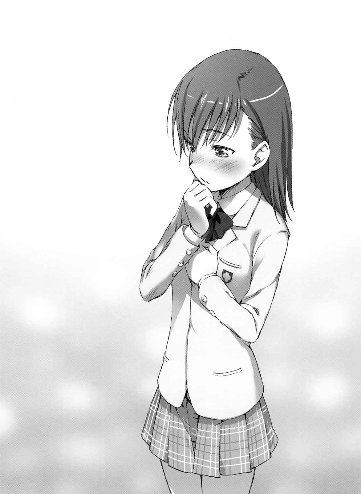
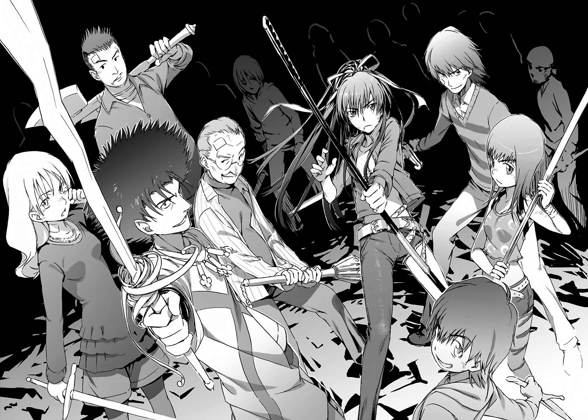

# 第四章 谁会是谁的守护者呢

> Leader_is_All_Members.

## 1

御坂美琴蹒珊地走在深夜的街道上。

为了得到洗澡呱太，她使用了其他洗澡设施，不巧却遭遇到「无氧警报」这种第二十二学区特有的危险状况，被关在大楼内。等回过神时间已经是深夜，身体也变冷了，这么一来专程来澡堂洗澡不就没意义了。

（混蛋……结果只好回去再用宿舍里的浴缸了。）

此时她发现第二十二学区的出入口，不知为何遭到封锁。

现在「无氧警报」似乎解除了，大楼的出入限制已经开放。不过似乎发生了系统不良的问题，管理闸门的中年伯伯正为难地挠着头。

平常她还会抱怨个一两句，听到在伯伯背后慌乱的脚步声，以及四处传来的粗犷怒吼与叱责。不知是不是自己多心，应对这些抱怨的伯伯脸色苍白。这种状况下自己再抱怨，对方未免也太可怜了，所以美琴决定不再多说。

（嗯，到底发生了什么事？）

外表虽然看不出来，美琴也跟某少年一样拥有好管闲事的麻烦体质。她有些在意那边的骚动。

「呜哇？」

突然间，美琴的刘海附近散发出静电。这对她而言是相当稀奇的轻度能力失控。美琴对眼前吓一跳的伯伯露出笑容点了点头，先离开当场。这也许是学园都市特有的感觉吧，无法控制自己的能力是件很丢脸的事。就这样，原本想插手进入麻烦发生现场的心情也随之萎缩。

如果她精通魔法，也许会察觉到刚才是「闲人驱散」这种影响人类感觉与认知的术式效果，与自身能力的控制之间所产生的冲突。

（不过，刚刚那是怎么了？）

美琴疑惑地想着，总之在闸门运作不良解除之前自己无法到地面上，所以她看着第二十二学区的指示地图，决定前往第七楼层的高级酒店。

（现在突然过去不知能不能住……舍监有点可怕呢。还是要打电话给黑子，拜托她用空间移动让我脱离这里？）

就这样，她沿着螺旋状斜坡来到第七楼层。

就在这时。

前方的黑暗中，突然出现了某人的身影。对方走路的方式并不寻常。与其说不稳定，应该说那样的举动相当不安定。是可疑人物？美琴皱着眉头，当人影走到街灯下，她脸上充满了惊讶。

是上条当麻。

「等等……你在这里干什么？」

美琴连忙跑近。

平常的她并不会做出这种反应。因为知道这个少年经常徘徊在夜晚的街头，跟美琴之间似乎存在着某种孽缘。虽然有时碰面会吵架，但像现在这样担心对方却是少之又少。

但是，现在的美琴面临了必须采取跟既往不同行动模式的状况。

上条当麻的样子，明显地相当奇怪。

脸色发青，看起来就像浸在冰冷的海水里。身上的绷带因为勉强行动到处松脱，有的地方甚至渗出红色。他身上穿的衣服也很奇怪，不是平常看惯的学生制服，看起来就像是病人用的手术衣。

「是御坂啊……？」

上条将身体靠在街灯的柱子，好不容易才维持住平衡说道。不知是不是被强行拉断，他的脸颊和手臂上还有黏有电极的贴布，就连电线也还垂在地面上。

仔细看他的眼睛，美琴不禁大吃一惊。

虽然不仔细瞧无法看清楚上条的右眼与左眼，瞳孔张开的方式有些许不同。焦距没有对准，就像透过毛玻璃看风景。

从上条的表情看来，他似乎没注意到这件事。

还是情况紧急到让他无暇注意这种琐事？

「……」

上条的嘴唇微微颤动，但美琴听不到他说的话。

他以缓慢的动作将手从街灯放开，重新迈开脚步。当他想通过美琴身旁时，膝盖突然失去力气。

美琴连忙支撑住快跌倒在地的上条。

「笨蛋！你这家伙，那些伤是怎么回事？还有这些电极的电线是……你该不会是从哪里的医院偷跑出来吧？」

「我非去……不可……」

可能因为双方距离很近，这次她总算能听到上条的声音。

「那些人……应该……还在战斗。所以……我一定要去……」

光听到这些片断，美琴发现自己浑身正在颤抖。

她可以猜测到这个少年，以往应该很常在她不知情之下被卷入事件。但是，她一直以为那只是打架的延长线上所发生的事。过去她虽然曾经目击一次上条与学园都市最强的超能力者(Level 5)战斗的场面，但那种状况应该是一生中只可能发生一次的事。谁能想象他有好几次曾经徘徊在这种生死关头？

同时，她又觉得这是有可能发生的事。

她的脑袋里面只浮现一个单词。

（……记忆丧失。）

像这样每次削减生命力持续战斗下去，身体应该不可能平安无事。美琴不知道他的失忆是出自精神的打击，或是脑部的构造问题。但无论是哪个原因，都「很有可能」。因为上条的身体是如此的残破不堪。

美琴心想得阻止他。

必须阻止眼前这个拖着快要死去的身体，即使经历丧失记忆，却仍要前往某个危机的少年。

「……？」

上条惊讶地望着一直紧抓自己手臂不放的美琴。

从他的表情看来，他无法理解美琴为什么像这样站着不动。

从脸上可以看得出来，上条深信由于自己完全不对任何人说出会让人担心的话，所以绝不会有人发现，像那种不说就会有人察觉到他的危机，并对他伸出援手的好事，绝不可能发生在自己身上。

这种小事，让美琴感到相当愤怒。

那是发自内心深处的愤怒。

「你为什么……不说？」

回过神来，她才发现自己说出了这句话。

虽然知道这些话说出口就无法收回，她还是开口了。

「像是救救我、帮帮我！不，就算不是这么具体的内容也无所谓。可以更单纯地说出来啊。难道你就不能坦白地说出害怕或不安吗？」

「御坂。你在……说什……」

「我都知道了。」

都到了这时候还想敷衍过去……不，应该说他还在演戏不想将美琴卷入，对于这样的上条，美琴不顾一切地说了出来。

&nbsp;

「我知道你失去了记忆！」

&nbsp;

在这个瞬间，上条的肩头猛然一震。

剧烈到——足以看见那是左右他人生的极大「动摇」。

看见这样的上条，美琴受到相当大的冲击。

这是为什么？

这个少年曾经救过她一命。不只是她，还有她应该守护的近一万名少女。

那时，上条当麻出现在单枪匹马，迎战学园都市最强超能力者(Level 5)的美琴面前。他毫不客气地穿着鞋子就这样踏入，打算独自扛起所有问题赴死的美琴内心深处。

那的确是太过粗鲁，甚至可以说是侵害他人隐私的拙劣方法。但是，名叫御坂美琴的少女，以及她的妹妹们(Sisters)，却被这种方法所拯救。

这种做法，只有上条当麻无权否定。

这个少年，即使被这种做法拯救也无所谓。

所以，美琴说道：

「我知道你的包袱有多大。但有必要全部自己一个人扛下来吗？浑身遍体鳞伤，就连记忆也丧失了，像这样单枪匹马作战的理由到底是什么？」

上条听着她这些话。

眼见他默不作声，美琴继续说道：

「我也能战斗啊。」

她从正面攻击，将自己的意志告诉对方。

以往所无法说出口的事，就这样自然地脱口而出。

「我也可以成为你的力量！」

并非因为她是学园都市第三位的「超电磁炮(Level 5)」。那不是如此低层面的事。即使在这一瞬间失去所有力量，变成普通的无能力者(Level 0)，美琴发誓她还是会说出相同的话。

「你根本没有理由自己一直像这样继续受伤啊！说吧，现在你要去哪里，要跟谁战斗！今天就让我来吧。我来让你安心！」

「御……坂……」

「让你也尝尝别人是抱着怎样的心情在等你的滋味！也去体会一下眼巴巴看着你躺在医院病床，只能看到安全地带的人是什么心情！你这家伙帮助妹妹们(Sisters)那时候不也是这样！明明说过会先跟我商量，却自己跑去跟学园都市最强的超能力者(Level 5)挑战！为什么这种理论却不能适用在你自己身上？为什么只有你一个人可以不必向他人求援？」

美琴发出呐喊，盯着上条的脸。

他的表情只有愕然。

但是，那并非遭遇「未知之事」的表情。而是「隐藏已久之事」被揭露的惊讶。

他还记得有关一方通行(Accelerator)与妹妹们(Sisters)的事。

美琴不禁为此松了一口气，但一方面又暗暗对在这种局面下，还计较这种事的自己感到厌恶。在最应该担心上条的状况下，美琴却做出了试图消除一己「不安」的行为。

上条当麻没有发现。

还是他虽然发现了，却假装不知道？

「总、总之，我会跟你到医院去。就算你怎么说我也不管，不亲眼看着你回医院，我绝对不会罢休。」

美琴抓住上条的手臂，另一只手操纵手机叫出地图，检索医院的所在位置。

「……这样……啊。」

上条愣了好一会儿，总算缓缓动着嘴唇。

那看起来像是笑容。

「原来你已经知道啦。」

虽然很沮丧，上条的身体却意外地充满力量。美琴心想，这是最危险的状态。所以她的手并没放开上条。

「不过，并不是这样。」

上条制止还想说些什么的美琴说道：

「因为失去记忆，所以我不知道详细状况。」

上条的内心并没有受到挫折。

「我想不起以前的自己是怎样的人。也无法想象该用怎样的心情迎接死期。但是，无论遍体鳞伤，还是作战到失去记忆为止，我当然没理由一直独自受伤下去。」

失忆这件事被发现了。这应该是很重大的事。但是上条最重要的部分，并不在此。

&nbsp;

「但是，我一直硬撑着直到失忆，应该不是为了要责备他人。」

&nbsp;

美琴的表情为之冻结。

这种结论，对上条当麻而言才是最重要的部分。

正因如此，少年才隐藏失忆的事实。这都是某人的错，不行动就不会发生这种事，为了不说出这样无聊的台词去伤害他人。

那是已经无法想起的一个过去。

但上条仍旧觉悟，要为了守护重要的事物而受伤，实际上那样的牺牲的确成为了某个结果。那并非故意要引人热泪去美化自杀的念头，只是应该采取的行动另一端，有某种结果在等待。即使会受伤，但仍旧促使他前进的某种结果。

「我已经想不起以前的事了，但是就算想不起来，多亏了那个看不到的部分，所以我还在这里。是已经记不起来的那个我，让现在的我行动。他还活着，不是在『脑袋(这里)』，而是在『内心(这里)』。所以我就算不用想起过去，也知道我想做的事，还有我该做的事是什么。」

也许上条当麻拥有某种暧昧不明，就连自己也无法确切证实的「骄傲」存在。正因为有这种信念，所以他才不后悔。如果能遇到过去的自己，他也会毫不犹豫地笑着说声「谢谢」。眼前的少年如此坚信着。

「抱歉，御坂。你赶快回去吧。」

仔细一看，美琴的手已经放开了。

上条的手臂以异样强大的力量动着。

「我要去。那并不是能拜托别人去做的事。也没有非做不可的强制力……只是，我要去。结果像这种事还是没有改变。就算我的记忆没有因为意外而丧失，我该做的事还是一样的。上条当麻这个人，并不会因为有没有记忆而动摇。」

少年背对着美琴，重新迈出步伐。

他的脚步如此不稳，如果要认真要追赶，绝对可以追上。

（怎么办……）

但是，美琴无法行动。

对方的背影，就在眼前伸手可及之处。

（我说的话并没有错。他应该马上回医院。而且，我也可以选择跟他一起到战场……但是，我知道他并没有说谎。也许，现在，在这里，用自己的脚站立，对他而言意义重大。）

就在这段时间，上条行动了。

在美琴烦恼的这段时间，上条行动了。

（但是，这种事我无法阻止他。根本办不到。在这里目送他离去，才是最正确的选择吧。双手合十向神祈求，祈祷他平安归来才是最正确的。除此之外的其他选择，都只是「多余」。这家伙绝对不会希望那么做……）

虚弱的背影渐渐远去。没时间了。

明知必须阻止他，但美琴无论如何就是无法行动。

&nbsp;

（怎么办？我完全……无法接受。）

&nbsp;

上条当麻说的话也许没有半句虚假。他只是说出自己的真心话，决心遵从自己的意志行动。

照理说，应该尊重这种意见并默默守护着他。

她知道这个道理。就算自己是笨蛋也非懂不可。

但是，她无法认同。

无论怎样都无法认同。

（……这……样啊。）

不知不觉间，她将手贴在自己的胸口。

名叫御坂美琴的少女察觉到了。

那跟理论、理性、体面、世人想法、羞耻、他人的意见全然无关，像这样存在于自己中心的一个意见，才是御坂美琴这个人最最重要的部分。既悲惨又丑陋，任性又别扭——即使如此，这才是最为赤裸的一个「人」。

美琴并不知道这种情感的名称。

她不知道应该将这种情感分类到哪里。

但是，就在今天，这一天，这个时间，这一瞬间。

御坂美琴知道了。

自己的心中，竟然沉睡着可以如此轻易打破世人想法的庞大感情。

即使自己身为学园都市只有七人的超能力者(Level 5)，熟知以「只属于自己的现实(Personal Reality)」掌控自己精神的方法，那样强大的感情，却能将这一切全部粉碎。

&nbsp;

上条当麻的背影，消失在黑暗中。

御坂美琴最后还是没有阻止他。

并非被上条的行动所打动。

而是自己察觉到的某种感情压迫着胸口，让她连一根指头都动弹不得。

## 2

后方之水的铁棒发出声响。

并不是有什么特别术式或灵装，只有体力。使用「唯闪」这种特别术式暂时增强力量的神裂，与完全不知极限何在全力攻击的水，两人之间的「差距」瞬间膨胀——然后极限终于到来。

轰响迸出。

接住铁棒的七天七刀与神裂火织的身体被猛力击飞。

「嘎啊啊啊啊啊啊啊啊啊啊啊？」

踏碎瓦砾堆奋战的神裂，就这样在没有任何反弹的情况下飞出一百米。她仿佛炮弹般接二连三撞飞瓦砾，粉碎水泥块在四周扬起粉尘。

「结束了，远东的圣人。」

水的声音里充满了失望。

但被埋在瓦砾堆里停止动作的神裂，根本无暇响应。

沾满鲜血的身体里仅存的体力，不到最初的一半。

（……到底……是……）

在没有任何小动作与圈套的情况下。

该如何才能打倒「力量」悬殊的对手？

（……那个力量的……真面目是……？）

嘴里吐出鲜血的神裂心想。

利用「唯闪」使出圣人全力的神裂知道，圣人的性质本来就超越了血肉之躯的人类极限。「唯闪」是一击必杀的拔刀术，如果不这样使用，很有可能伤到自己的身体。

但水却轻易超越这种限制。

因此，他与神裂之间的差距越来越大。

（——「唯闪」的……魔法构造，连一点余地……也没有。）

这术式不止能让运动量增幅，就算超越人类身体极限也不会破坏肌肉，就像在极端的速度下被甩出，不会失去重心的道理，那是犹如拼图般，将术式的拼图片纤细组合而成的「结晶」。如果要求更多，或想要改变某部分，途中所有的平衡会就此崩坏。拼凑完所有拼图片的拼图，根本无法再加上新的拼图片。

这是以格斗战为主的「圣人」极限。

难道水能组成比这个更精密的身体控制术式？

神裂试着提出好几个假设，但每一个都失败了。

没错，只要增强一部分就会产生极限。在引出与水相同的性能同时，人类的肉体就会崩解。无论是在物理，还是魔法上。

（水的……力量是……）

基本上，圣人不可能发挥百分之百的天赋力量。

因为圣人拥有与「神子」相似的身体特征，所以能获得部分惊人力量。即使是部分的力量，普通人类也无法掌握。

光是要操纵天赋力量的一部分，就已经很难了。

这就是圣人。

无论以任何方式组成任何术式，都绝对不能产生浪费。这么一来，会造成好不容易产生的力量分散。基于偶像崇拜理论进入身体的力量，实际上可以自行操纵的部分有限。

这种缺点本身并非坏事。在百分之百行使力量的状况下，圣人的肉体可能会被过度高压的力量粉碎。与其说是魔法，更近于自我防卫本能。从还不懂魔法知识的婴儿时期开始，他们已经学会了让这种力量安定下来的方法。

但是，

（……水……没有……身为「圣人」的……极限……？……那个力量……已经……轻易地……超越了……人类能够操纵的……领域……？）

更何况，水除了圣人之外，还拥有「神之右席」的力量。被称为后方之水的大天使「神之力」属性。乍看之下似乎只是力量单纯倍增，但实际上光是这样，反馈的负荷也会倍增。

没错。

奇妙的是，水轻易完全掌握了百分之两百以上的力量，却没有引发任何失控，而且使用时还面不改色。

（……这是，不可能的。这已经不是……素质或天才的层面。圣人与「神之右席」这两种无法兼容的性质，不可能同时存在于……一具肉体之内……）

天才这个字眼，以说服力也许可以让人认同这一切。

但并非如此。

正因为神裂自己也处于这个领域，所以她很清楚。

所谓天才与才能，实际上并非如此方便的字眼。

（……事有蹊跷……）

轻微的声响传来。

那是后方之水降落在神裂前方的声音。

（……圣人与……「神之右席」……）

神裂瞪着眼前的强敌心想：

（……像这样能让双方力量共存的术式(Trick)，一定存在于某处……！）

「！」

当水往前跨出一步时，神裂朝一旁滚倒。

她强行抓住掉落在地面上的七天七刀。

同一时间，水将超过五米的铁棒往旁边一挥。这是足以将瓦砾与地面整个打平，极为强硬的一击。

神裂原本打算用来进行奇袭的刀，只好转成防守。

铁棒与刀相交时，轰响传出。在铁棒压下之前，神裂看来几乎快被击飞，她将刀插在地面上减少攻击的威力。即使如此，她仍旧滑行了十米以上才停止。

「还要再打吗？」

水钦佩地说道。

但是，这是自觉到自己的力量在对方之上的佩服。

「没有逆转的机会。只要你好好考虑自己的力量，以及绝招的数量就会理解这件事。如果你说靠努力或祈祷奇迹就会到来，那我们这种被夸大的少数『圣人』其实也没什么了不起。」

「……被夸大？」

浑身是伤的神裂低语。

那是打从内心，蔑视对方的声音。

「又不是凭自己的双手获得，而是天生拥有的东西。你使用那种力量就心满意足了？」

「说这种话又有什么用？」

水并不理会。

「之前我应该说过。像信念这种用来说给别人听的东西，到底有多少真实性存在。」

神裂与水同时扑向对方。

两人从正面冲突，金属相互迸出火花。

「你应该很愤怒吧。将实力差距悬殊的一般人与天草式的人们，卷入圣人的战斗中。」

「……！」

「但这就是战场。天生能力的差别、手中武器的性能、战斗人员的数量。战争的规则就是意识到如此明显的差距，却还是堂堂正正地交锋。如果不想被卷入其中，一开始就不该站在『这里』。」

已经无法互斗了。

神裂的身体不敌水挤压的力量，轻易地往后退。

「没必要让没有力量的人战斗。」

水对着快倒下的神裂说道。

「兵刃相交这种事，只要交给真正的军队去做。」

这就是不讨论信念的水他的真心话？

跟其他「神之右席」不同，只要粉碎少年右手的这个男人。

不是天使而是圣母——彻底使用「慈悲之力」之人内心的一部分？

的确，神裂也有同样的想法。

在过于残酷的战场中，不管是否受过训练，个体的战斗力根本没有任何意义。不管准备得多充分，会死的时候就是会死。如果不喜欢这样，神裂这个圣人就该事先排除到处散布的风险，让他们在安全的战场上战斗。

但是，这种事根本办不到。

就算只单纯考虑敌方与伙伴的战力差距，还是免不了会担心伏兵的可能性。但是，这跟真正的战场不同。根本不可能事先完全掌握所有在噩梦般瞬间发生的偶然，还能防范于未然。

神裂将之称为不成熟。

因为自己的能力不足，所以她无法控制不断变化的战况，伤害了重要的伙伴们。「那时候」她真的这么想。当时，身为女教皇的神裂因为无法忍受这点，所以才脱离了天草式。

但是，

（为什么……）

神裂火织将自己与后方之水重叠，紧咬牙关。

（这是多么傲慢的想法啊。）

因为天草式的魔法师很弱所以会死，如果所有人都拥有与圣人一样的力量，就根本没人会死。这是真的吗？有可能吗？那么那个少年呢？跟大家一起战斗、胜利、欢笑的那个少年又是怎么回事？

结果，嘴上说要并肩作战，神裂火织自己，何尝不是不相信十字凄教的实力？不是人格或精神，而是实力。所以神裂无法将自己交给任何人，只能破坏双方的合作关系，自己不断重复不必要的失败。

天草式十字凄教，有这么脆弱吗？

真正脆弱的到底是谁？

即使在如此严酷的状况下勉强获得胜利，又能得到什么？

即使时代朝自己期望的方向前进，即使世界往更美好的方向转动，最后无法成为胜者力量的人，是否又能跟得上？

他们应该会觉得自己被抛下了。

他们应该会认为在周遭满溢的幸福中，只有自己被留下。

圣人。

只不过凭着出生时所得的东西——使用「天赋」特权的笨蛋，像这种无聊的意志冲突，到底要傲慢到什么地步？

「我是……大笨蛋。」

神裂火织骂道。

她察觉到，以往自己一直在进行的不自觉暴力。

原来是这么回事。

无论后方之水、「神之右席」、神裂火织全都一样。

由「特别的某人」管理一切，「除此之外的其他人」就只能张大嘴接受管理。这都是为了你好，无谓的努力只会暴露丑态，浪费有限资源，被大家讪笑，所以什么都不要做默默地跟上来就好。神裂在不知不觉中，对自己重要的伙伴要求了这种事。

「————」

神裂火织拭去满是鲜血的嘴唇，重新架好七天七刀。

自己应该做怎样的选择？

（我知道。）

能够真正救出「伙伴」们的选择是什么？

堂堂正正地承认他们是「伙伴」，不让他们被留在光芒中的选择是什么？

（我知道了！）

用来纠正绝对的敌人，后方之水所犯错误的正确选择是什么？

能解开水所拥有的力量，足以对抗其压倒性暴力的选择是什么？

（我知道了！）

只要一个谜解开，之后的一切也会迎刃而解。握着七天七刀的双手发出了声响。那是神裂最后的力量。正因为她相信这么做是正确的，所以才能毫无保留使出一切的，信念的力量。

敌人是拥有圣人之力，以及「神之右席」之力的后方之水。

在史上最强的敌人面前，神裂火织采取了最后的行动。

## 3

距离两名圣人战斗的第五层楼上方约三十米处，站在殒石洞状崩落的第四楼层边缘，茫然眺望着战斗的现天草式成员，在那一瞬间，突然听到了那个声音。

「——，……求求……」

那是世界上不到二十人，货真价实的圣人声音。

「——求求……你们。」

过去曾率领过天草式，前女教皇的声音。

「求求你们，助我一臂之力。」

是神裂火织的声音。

一开始，五和与建宫还无法领悟自己听到了什么。就算在脑袋里处理这句话的意思，他们也不认为这番话是对自己说的。

但是，神裂的确对自己说了这句话。

如此遥不可及的神裂火织，一出生就跟自己不同的神裂火织，嘴里说着不想伤害重要伙伴所以背对了自己的，那个神裂火织。

竟然向自己求救。

希望自己能协助她，打倒无法独自击败的强敌。

「——啊。」

好几个人发现自己在颤抖。

好几个人发现自己快要落泪。

也就是说，神裂这番言行的意义正是如此。

&nbsp;

女教皇肯定了自己。

不是把他们当成沉重的包袱，而是肯定他们是拥有足以并肩作战能力的伙伴。

&nbsp;

以往并没发生过这种事。

为什么到了这个局面，神裂火织会向天草式十字凄教求助？

原因很简单。

神裂火织有个无法光凭一己之力打倒的敌人。

但她还是有面对敌人的理由。

而且，

像这样不合理的希望，

守护她的梦想的最后一块拼图片，

就是建宫以及五和这样，极为普通的天草式十字凄教。

「……」

等了好久才终于等到的这一刻，这个瞬间。

原本因无力感而抛下武器的人，重新拾起了武器。

没有一个人拒绝她的要求。

身上包着绷带，就连绷带也渗着血红，有人甚至连绷带都破了，即使如此也无所谓。

自己聚集起来也无法战胜，就连神裂火织也招架不住的「怪物」，虽然被要求再次站在这种怪物面前，却没有任何人退却。这表示他们心中充满了多大的喜乐。能成为女教皇的力量，重新和这个人并肩作战，这种事实带给他们极大的喜乐。

有人发出吼叫提高斗志，也有人流下世上最为欢喜的泪水。也有人静静地、在没让人发现的状况下默默咀嚼着幸福。原先靠在墙上的人，靠着自己的脚重新站起。「代理」教皇建宫仿佛卸下了暂时的重担般，吐出一口气。

「……走吧。」

身为天草式十字凄教暂时的指导者，建宫斋字下达最后的指示。

一句话似乎还不够，他感慨万千地说道：

&nbsp;

「走吧！到我们天草式十字凄教该去的地方！」

&nbsp;

他大吼一声，首先跳下第四楼层的大洞前往战场。

即使知道自己没有力量。

即使如此，作战的理由还是没有改变。

所以，天草式十字教更要团结起来面对强敌。

与他们认定为领袖的唯一女性一起。

## 4

（什……么……？）

后方之水无法理解神裂火织采取的行动。

将一般魔法师卷入圣人之间战斗的中心会发生什么事，这应该显而易见。原本神裂就是因为讨厌这点，才会让后方之水远离天草式，重新准备了新战场。

但是，

「哦哦哦哦哦哦哦哦哦哦哦哦哦哦！」

有人手拿宝剑奔跑，有人持枪高高跃起。不怕死的人们在瞬间聚集，重新筑起布阵，仿佛要守护满身是伤的神裂。

在水的眼中看来，他们所形成的墙壁比糕点还要脆弱。

他架好铁棒，以可怕的表情说道：

「向弱者求助……你难道这么怕死？」

「看起来像这样吗？」

神裂用沾满鲜血的双手架起七天七刀说道。

她的嘴角甚至露出了笑容。

「的确，这些伙伴们在我身边会受伤。我就是害怕这点，所以才离开天草式十字凄教。」

但是，神裂强而有力地下结论：

「但这场悲剧，并非因为他们太脆弱才引起的。」

「……」

「是将他们视为『弱者』，不相信他们实力的我。在心中某处看不起他们，无法将自己交付给他们的我。我抛下了近在咫尺的力量，靠着学艺不精的武艺独自持续战斗，结果让敌人有机可乘！这种傲慢，以及『由我来守护你们』的优越感，才是造成一切悲剧的元凶！」

自觉到本身的弱点，却仍然勇往直前的人才会成长。

神裂火织浑身是伤的体内，有股新的力量在蕴酿。

「所以我要克服。我要相信他们，把自己交给他们，将彼此的力量发挥到最大限度，我要拿回我的天草式十字凄教！我们的领袖是我们自己，我们的伙伴是我们自己！根本就不需要『圣人』这种唯我独尊的上司(Top)！」

（什么……？）

神裂火织的确找回了以往没有的信心。

那就是内在的坚强。

只有对自己的行动有自信的人，才会拥有的强韧之心。

但是，没有胜算这点仍旧没变。即使追加了五十多名乌合之众，也没有任何问题。像现在的天草式，根本不用对他们使出全力应战。在水与神裂的激烈作战中，他们只是轻易地就能被击飞的背景。

（这是集团心理？竟然紧抓着不可能的错觉。）

「没有根据的希望只是妄想。」

水的全身充满力量。

「你们以为这样就可以打倒我吗！」

铁棒猛然挥舞试图打飞这群无聊的人，神裂火织毫不畏惧地突进铁棒的射程圈内。

七天七刀与铁棒激烈冲突，为了减轻这种冲击，多个天草式成员展开防护术式。虽然任何精神论，都无法改变彼此的实力差距。但神裂仍旧与水对抗。

「所谓的圣人，因为天生拥有与『神子』相似的身体特征，指的就是在偶像崇拜理论下，获得『神子』部分力量的人。」

根据情报，神裂与现在的天草式之间，有间隔数年的空白。

但她们连一句话也没交谈，只凭着一个呼吸就克服了所有的时间空白。

「但即使是『圣人』，也无法行使像你这样的力量。你显然拥有超越普通圣人(我)的力量，这是为什么？」

这样的对抗并没有用。

水马上反击，包含神裂在内的天草式布阵产生激烈动摇。

即使如此，天草式十字凄教却仍拼命奋战。

「——答案很简单，当然是因为『圣母崇拜』！」

「没错。」水毫不隐瞒，堂堂正正地说道。

自己是使用圣母属性的人。

但是，后方之水原本掌管的，应该是大天使「神之力」。跟慈悲的象征圣母相比，「神之力」烧毁了娥摩拉这座城市，在最后审判中扮演了破坏世界的角色，其他还有许多进行直接攻击的神话。为什么避开如此「简单易懂的攻击方法」，而采用迂回的圣母方式？

「你的身体特征所相似的，应该不止『神子』吧？除了『神子』之外，身体的特征跟圣母也很相似，所以也获得了那样的力量！！」

「神子」与圣母是亲子关系。所以身体特征相似这点，应该不足为奇。

而且，圣母是十字教中仅次「神子」的第二号人物，身为所有圣人中完成产下「神子」这种最高奇迹的人物，所以拥有极为强大的力量。礼赞圣母的圣母崇拜打动了许多民心，与代表世界规范的严正「神子」相较，圣母则是赋予了许多额外慈悲，许多向圣母祈祷后达成心愿的「奇迹报告」传到教会，甚至给罗马正教高层带来了「这样下去圣母崇拜会不会自行独立」的危机感。

圣人与圣母。

如果，有同时具备这两种特性的身体特征的人存在。

那无疑就是后方之水。

这样与生俱来的才能，也许就是靠着「神之右席」开花结果。

存在于他体内的力量，到底有多大？

「你是具备两种不同性质的人，同时也拥有多重身体特征。所以，身为『普通』圣人的我，光凭资质，一开始就输给了你。」

「神之右席」原本是超越人类，以「神上」为目标的人。也就是说，他们的目标从一开始就不是「普通圣人」。

由于神裂自己只是「普通圣人」，所以很难想象这种领域。也许圣人或天使所使用的「某种能力」，拥有「突破一定以上极限就会进入安定」的性质。飞机的速度慢比较好操纵，但过慢又会失速坠落。水所进行的，是故意让飞机高速飞行，借此使机体保持安定的战略。

那样的高度，比圣人还要高。

高速安定的路线。

水拥有了圣人与圣母的两种性质，不同于「降低速度使其安定」的普通圣人，他处于高速的安定路线。因此，他才能够强行统合原本不安定就会产生失控的力量。

不过，

「但另一面，你也具备了『弱点』。」

神裂火织这么说。

是的，与缓慢飞行的机体相比，以音速数倍飞行着，操纵显然更为纤细且困难。

「跟我相比，应该说跟全世界的圣人相比，你对圣人专用术式应该更是难以应付！」

此时神裂将话题中断。

因为她改变了说话对象。

不是对水，而是对天草式的伙伴。

也就是，

「——『圣人崩坏』！」

「！」

「使用铁棒响应或避开所有攻击的水，**唯独面对这种术式时**，**才会使用魔法手段进行真正的**『**防御**』。胜利的机会就在那里。」

普通人类无法完美操纵圣人的力量。更何况是同时使用「神之右席」与圣人的力量。这是实际身为圣人的神裂才知道的情报。

神裂当初以为，可以同时完美操纵这两种力量的特别术式是存在的。

结果还是没有发现，但这也是理所当然。

那样的术式原本就不存在。

「原本就没有尝试过的『圣人崩坏』，身为史无前例的存在的水，如果接下这招会怎么样？就连水自己也无法想象吧！」

水之所以会尽全力防御「圣人崩坏」，并非因为自己的力量会在短短数十秒内无法使用。

「所谓的『圣人崩坏』，是强行使类似『神子』身体特征的平衡崩坏，使体内的力量失控。让圣人暂时无法行动。原本让对方在数十秒无法行动已经是极限了，但如果是拥有圣人与圣母特质的水，可预期的结果相当单纯明快——水会自行引爆！」

他所操纵的术式，必须依存比圣人还纤细的「天生物质」。

换句话说，那不是以人工手段可以补强的。

像这种神乎其技的平衡只要稍有崩坏，很可能在瞬间发生爆炸。就跟时速超过一千米的阻力机器一样。正因为操纵了莫大的力量，所以使用时更要小心注意，因此他才会尽「全力」采取防御行动。

「————」

被看破这点的水，一言不发。

但他的表情产生了变化。

微笑。

不是以往睥睨的笑容。被称为完美无瑕的他，在唯一的缺点被敌人看破后，露出了悲壮的笑容。

如果只是弱点，根本不用如此焦虑。

所谓的战争并不是这样。

水连续使出更加凌厉的攻击，神裂用七天七刀吃力接住，她微微吐气，调整刀的细微角度，有意图地产生攻击波。

并非针对水，而是要破坏他背后的东西。

被瓦砾堆掩埋的背景之一，生锈的带刺铁丝。

（……原来如此，来这招啊……？）

水仰望上方，遭到切断飞过天空的锐利细铁线，刚好形成一个圆形。之后神裂的钢丝「七闪」，切断了周围一整面，从瓦砾堆中陆续抽出了魔法层面的意义，并如雕刻般逐渐出现。

那是巨大的十字架、锐利铁棒般的钉子，以及荆棘做的王冠。

也就是，

「『神子』处刑的象征？」

对使用其力量的圣人而言，他们也继承了同样的弱点。

但光凭这样就能打倒圣人，就不必那么费事了。

实际上，对神裂这种「普通圣人」而言，并没有那么大的效果。

但是，

后方之水可是「特别的圣人」。

身体特征比世界上不到二十名的圣人还要稀少，且同时拥有圣人与圣母力量的人。具有莫大力量的他，同时也是需要极纤细平衡控制，所以神裂火织当场形成的「处刑」象征才有效果。

一般认为「处刑」的术式跟圣母无关，但这里不同。

没错，

因为圣母被当成十字教史上最伟大的圣人。

「————！」

神裂察觉到水的中心，有某种东西正在沸腾。

即使是「普通圣人」，也很清楚的明显变化。

也就是说——后方之水，

「你开始动摇了。」

神裂斩钉截铁，充满自信地说道。

在名为「水」的存在核心里，同时包含圣人与圣母的力量，受到了来自外部的压迫发生竞争，发出刺耳的哀鸣。

现在应该办得到。

神裂用发自丹田的声音大喊：

「准备好了！『持枪者(朗基努斯)』，现在正是『处刑』仪式最后的关键！」

「啧！！」

掌握「圣人崩坏」关键的五和听到了神裂的话，马上取出手巾，包住枪柄架起海军用船上枪(Friuli Spear)。

「……有意思。」

但水的行动更快。

「天草式十字凄教啊？这名字值得我铭记在心！」

这句话一脱口，水一口气穿越近二十米——不，是连系第四楼层与第五楼层的大洞，跳到约两倍以上的高度。途中有数十、数百根钢丝在夜空中飞舞试图拦阻，却无法阻止水的动作。

街道的光线由圆形的大洞落下，看起来就像巨大的月亮。

背对着这样的人工月亮，水架起铁棒。

「圣母的慈悲缓和严惩(THMIMSSP)。」

之前，那一击曾以小行星激烈冲撞般的破坏力袭击过神裂。那是在最佳状态下的神裂也无法打倒的威力。如今又加上两倍的滑空距离，现在的天草式根本无法匹敌。整个第五楼层可能就此被摧毁。

「时而向上帝真理直诉之力(TCTCDBPTTROG)，让你在慈悲中升天(BWIMAATH)！」

水以极快的速度直线落下。沐浴在夜景灯光下的铁棒，拉出一条蓝白色的尾光。

（惨了？）

重新配置的无数钢丝再次筑起防护阵，神裂通过本身的魔力，试图防御他的攻击。还是不够。水的一击，无情地突破一切防御接近地面。

曾经受过那一击的神裂知道再挨上一发，这次真的会没命。不仅是神裂，就连周边的天草式全员都会被全数歼灭。

（唯一的生命线是——）

在咬紧牙关的神裂身旁。五和将枪架在头上。「圣人崩坏」。但术式的准备还没完成，这样下去会来不及的。

（放弃……）

神裂火织将手伸向七天七刀。

她抬头瞪着化为破坏之块落下的水，用力踩在满是瓦砾堆的广场上。她一口气将刀从刀鞘拔出，并水平架好。

这种举动并非反击。

全都是防御。收集古今东西的所有记号，当场组成术式，神裂火织化为了一面护盾。

（怎么可能……放弃！）

&nbsp;

后方之水，使出全力落下地面。

&nbsp;

光芒四处迸发。

神裂火织的眼、耳、鼻、舌、肌肤，所有的感觉都消失了。

## 5

破坏。

就连这个单词的意义也无法理解。

五感全部消失，只剩下一片空白。瓦砾被吹散的声音、狂袭的冲击波、飞扬的粉尘、铁锈的味道、某种东西被破坏的触感，全都从脑袋消失。所谓真正的破坏、纯粹的消灭，原来「空白」到这种地步。

（……呜。）

需要一些时间，才能让一片空白的五感恢复。

此时神裂感觉到了。

虽然只有一点点，但五感正逐渐恢复的事实。

并非消失，而是逐渐恢复……

（发生了……什么事……？）

后方之水放出的一击，应该隐藏了绝对的破坏力。包含神裂在内，天草式成员就算全数丧命也不足为奇。但水的术式仿佛像是消失了。神裂没有受伤，甚至完全没有受到伤害。

（**消失**……**不见了**……？**术式**、**魔法**，**消失了**？）

神裂突然抬起头来。

无论善恶强弱，将魔法这种东西完全消除。

能办到这件事的人，她只认识一个。

「该……不会……」

五感恢复了。

自己发出的声音进入耳中，此时所有的感觉都苏醒了。水虽然放出了噩梦般的一击，却真的「什么都没发生」。在眼前毫无改变的景象正中央的那个人——

&nbsp;

上条当麻。

从正面压制水的魔法攻击，强行抓住铁棒，仿佛要将之捏碎的少年。

&nbsp;

如果水只用臂力挥动铁棒，浑身是血的上条应该连右手都会被粉碎。但这次完全是魔法攻击。而少年的右手蕴藏了无论任何异能之力，都能消除掉的功能。

正因为水的攻击是绝大的「魔法」攻击。

少年的右手，才能使这一击毫不留情地失效！

「什……！」

「——，……」

浑身是血的上条，似乎对着惊讶的水说了些什么。没人听到他所说的话。然后，上条像靠在铁棒似的倒下。并不是失去力气，而是为了封住水的动作。

「啧！！」

看到这景象的神裂行动了。

只有上条一个人，光是挥动铁棒就能甩开。但神裂趁着水惊讶的那一瞬间丢下七天七刀，以抓住树干般的态势，连同巨大铁棒一起封住水的肩膀。

「你们！」

水大叫，但两人都没有听见。

浑身是伤的上条与神裂，盯着同一个地方。

天草式十字凄教的五和。

普通的魔法师五和。

「交给我吧……」

五和重新架好用手巾包住的枪柄，其他天草式成员，也进入特殊术式的启动准备。

&nbsp;

「我一定会刺中。」

&nbsp;

咆哮声响起，五和开始狂奔。

少女受到多道术式保护的娇小身躯，一口气加速朝水冲进。

水试图回避。

但是他身为圣人的臂力，被同是圣人的神裂封住，原本用来甩掉她的「神之右席」圣母特殊术式，又被上条的右手消除了。

「哦。」

动弹不得的时间，只有数秒。

只要有这样的时间就够了。

「哦哦哦哦哦哦哦哦哦哦哦哦哦哦哦哦哦哦哦哦哦哦哦哦？！」

在这一瞬间，水发出了狂吼。

并非是出自恐惧。

知道自己无法避开接下来的一击，却没有动摇内部的信念，反而想对突击过来的五和跨出一大步，为此而用力、充满斗志的吼叫。

「圣人崩坏」。

五和的枪分解，化为一道雷击。超越物质束缚的术式，化为压制这个场合的一击朝水袭去。

&nbsp;

砰！空气振动的声响迸出。

电光穿过水的腹部，从背部喷出，这次完全侵蚀了他的身体。

&nbsp;

受到直接命中的冲击，上条与神裂忍不住放开了手。

光之十字架自上下左右，从水的背部爆炸性地延伸。贯穿十字架交错的中心点，水受到冲击的身体瞬时飞起。

受到「圣人崩坏」的一击，水的身体在水泥瓷砖上滚动数十米，巨大的铁棒离手了。遭击飞的他，直接掉进第五楼层的人工湖里。当他的身体犹如炮弹般进入水中完全消失后，更大的变化发生。

魔力失控。

后方之水自身的引爆。

圣人与圣母的属性，受到「圣人崩坏」的攻击后同时反应引发竞争，在他体内发生了只有「圣人崩坏」才能引起的激烈连锁爆炸。

轰！深夜中黑暗的人工湖被白昼般的闪光包围。上条一行人的视野一片空白。大量的水完全蒸发的可怕声响传入耳中。

当神裂火织再次睁开眼睛时，水已经不存在了。

但是，人工湖里的水全都蒸发殆尽。湖的边缘整个被吹掉了。与人工湖同样宽度的蒸气柱往正上方延伸。巨大蒸气柱撞上地下街的天花板，朝四面八方扩散。千年巨木般压倒性的光景，显示着水的引爆有多严重。
