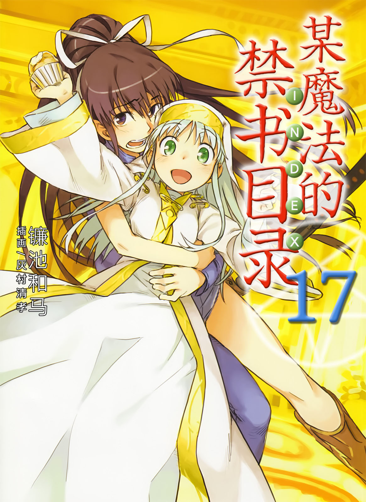
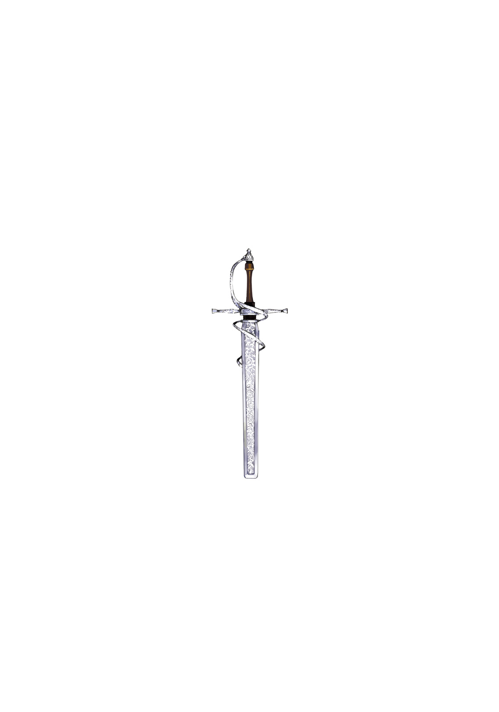

# 简介

**旧约·魔法禁书目录17**

作者：镰池和马

## 内容简介

**这次的「不幸」将在英国开幕！上条当麻一边安抚饥饿的银发修女，一边在潜藏神秘魔法结社的英国奔走！当科学与魔法交汇之时，故事就从此开始——！**

英国清教「必要之恶教会(Necessarius)」最高主教萝拉·斯图亚特发布了「禁书目录召集令」。任务是与英国「王室」一起调查在连接法国和英国的欧盟隧道中发生的爆炸事件。

接到命令后的茵蒂克丝和她的监护人上条当麻登上了飞往英国的飞机。本想愉快地享受空中旅行，但机内却正在进行一场神秘的劫机计划……！在全力安抚银发修女饥饿感的同时，上条试图解决事态，他将面临怎样的命运？！

这次的「不幸」将在英国开幕！

## 制作信息

* 译者：faxiajin
* EPUB制作：祈者之路
* 网译：轻之国度
* 翻译：黄瀞瑶
* 台版：SOSG小说组
* EPUB：gameking
* 录入：watashi101 哦☆卖糕的 ℡(零の忆希_ 镜hinata
* 校对：watashi101 哦☆卖糕的 ℡(零の忆希_ 镜hinata
* 二校：watashi101
* 扫图：watashi101
* 修图：zmg9174 vic65cn 綾桜旋律
* 排版：watashi101
* 整合：知一一（禁书目录X系列，[index-X](https://github.com/1204244136/index-X)）


**版权声明**

转载时请保留录入信息。

本站内容仅供试看、学习与交流使用，禁止用于商业用途；下载后请在24小时内删除。请支持官方正版。


## 封面与封底

