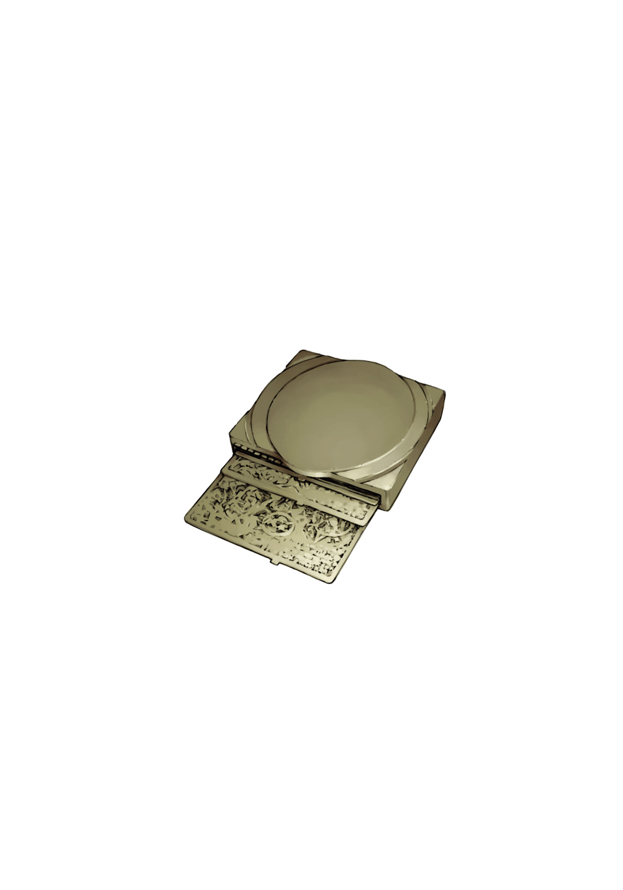

# 简介

**旧约·魔法禁书目录19**

作者：镰池和马

## 内容简介

**第15卷、SS系列之后继续描绘，「学园都市暗部篇」登场！拥有学园都市最高权力的统括理事会成员。其强大的势力向最强能力者·一方通行(Accelerator)露出獠牙。当科学与魔法交汇之时，故事就从此开始——！**

在学园都市的暗部中处理事件的「GROUP」。由最强能力者·一方通行(Accelerator)和同时也是魔法师的土御门元春等人组成的这个团队，正在探寻神秘关键词「龙」的真相。他们相信，这将是打破当前「糟糕透顶」局面的唯一线索。

与此同时，有人对他们未经上层批准进行的活动感到厌烦。此人正是学园都市最高权力机构——统括理事会的一员。他那强大的势力开始向「GROUP」露出獠牙。

同一时间，前「道具」成员滨面与绢旗来到医院探望泷壶。在那里突然爆发了关于滨面是否超级喜欢兔女郎装扮的疑云。尽管绢旗和泷壶对此表示极度无语，但滨面却拼命地辩解……？！ 第15卷、SS系列之后继续描绘，「学园都市暗部篇」登场！

## 制作信息

* 网译：澄空文学社
* 翻译：burningsnake
* 校对：右方のフィアン（百度贴吧）
* EPUB制作：祈者之路
* 翻译：黄瀞瑶
* 台版：SOSG小说组
* 录入：深珀の瞳 混沌声神 绚辻词 哦☆卖糕的
* 校对：深珀の瞳 混沌声神 绚辻词 哦☆卖糕的
* 二校：watashi101
* 扫图：watashi101
* 修图：zmg9174 绫桜旋律 Gsnoopy
* 排版：watashi101
* 整合：知一一（禁书目录X系列，[index-X](https://github.com/1204244136/index-X)）


**版权声明**

转载时请保留录入信息。

本站内容仅供试看、学习与交流使用，禁止用于商业用途；下载后请在24小时内删除。请支持官方正版。


## 封面与封底

