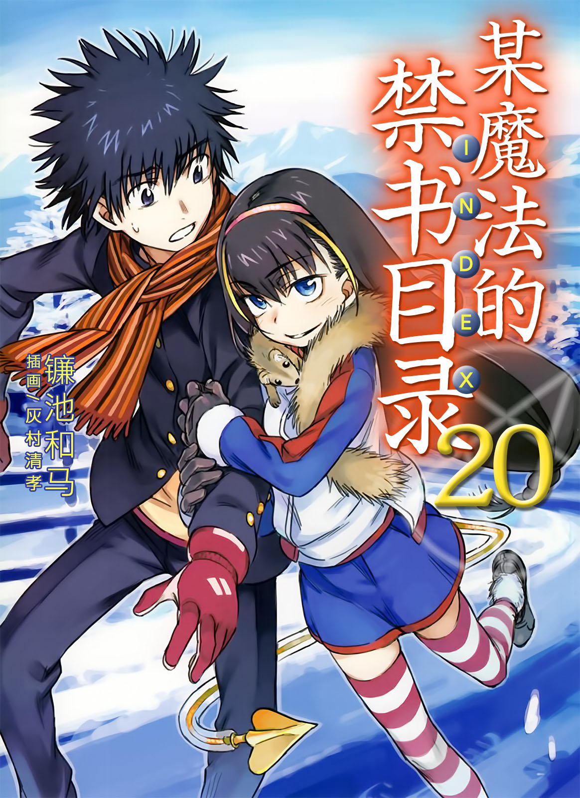
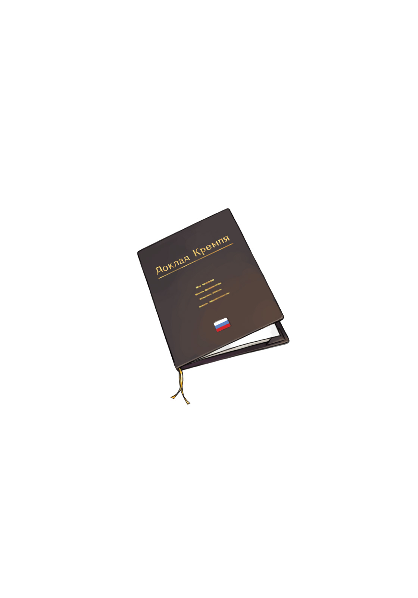

# 简介

**旧约·魔法禁书目录20**

作者：镰池和马

## 内容简介

**「神之右席」最终章，俄罗斯篇开始！！第三次世界大战的宣战布告已经发布。「神之右席」火的野心在俄罗斯涌动，上条当麻、一方通行(Accelerator)、滨面仕上奔赴前线——！当科学与魔法交汇之时，故事就从此开始——！**

10月18日。

俄罗斯发布了第三次世界大战的宣战布告。

学园都市与俄罗斯的冲突将演变成席卷全球的大规模战争。在这背后，是「神之右席」最后一人火在暗中进行政治活动。

在这场世界大战的硝烟中，有一些人在奔走着。

为了拯救因火夺取灵装而陷入昏迷状态的茵蒂克丝，学园都市高中生上条当麻踏上了旅程；为了拯救因神秘存在「爱华斯」的出现而承受高负荷的最后之作，最强能力者一方通行(Accelerator)也行动了起来；前暗部组织「道具」的杂兵滨面仕上则是为了治疗因滥用能力促进剂「体晶」而虚弱不堪的泷壶理后。他们怀揣各自不同的想法，向紧张局势中的俄罗斯进发！在那里等待他们的是……？

当科学与魔法交汇之时，故事就从此开始——！

## 制作信息

* 网翻：泉川生徒会
* 翻译：Coca003
* EPUB：祈者之路
* 翻译：黄瀞瑶
* 台版：SOSG小说组
* EPUB：gameking
* 录入：watashi101
* 校对：watashi101
* 二校：watashi101
* 扫图：watashi101
* 修图：zmg9174 watashi101
* 排版：watashi101
* 整合：知一一（禁书目录X系列，[index-X](https://github.com/1204244136/index-X)）


**版权声明**

转载时请保留录入信息。

本站内容仅供试看、学习与交流使用，禁止用于商业用途；下载后请在24小时内删除。请支持官方正版。


## 封面与封底

