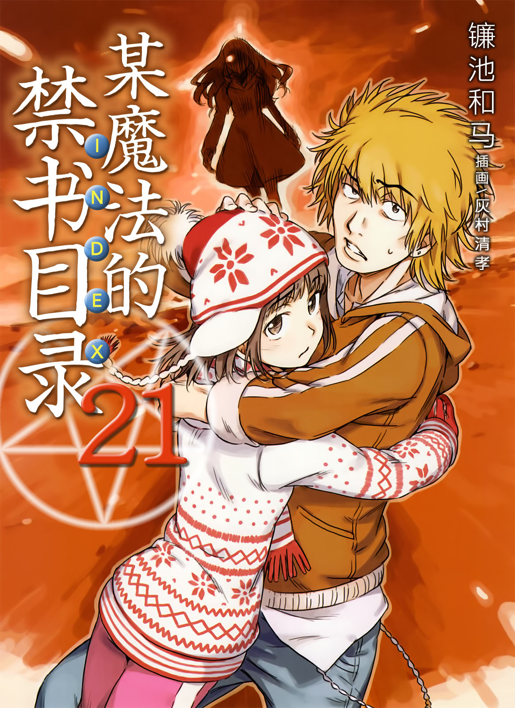
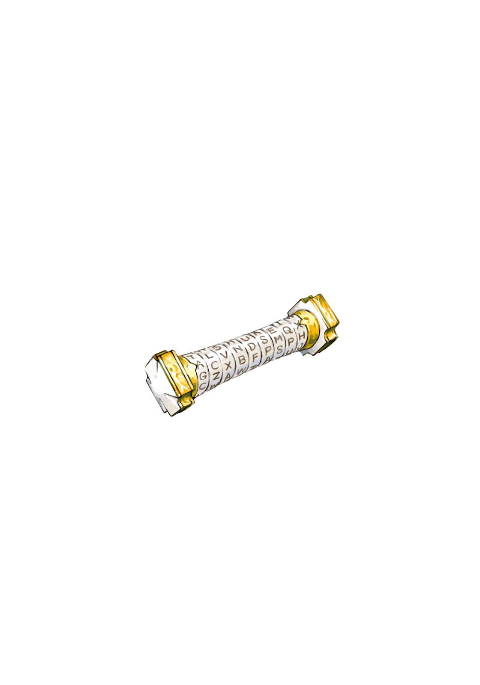

# 简介

**旧约·魔法禁书目录21**

作者：镰池和马

## 内容简介

**俄罗斯篇紧迫！三名少年寸步不让的战斗继续着！**

十月三十日。距离第三次世界大战开幕，已经过去了十一天。三个少年各怀心事，在燃烧的俄罗斯奔走。

前「道具」成员滨面仕上为了治疗泷壶理后而四处奔波，但仍未找到线索。关键在于与前「神之右席」的圣人水的相遇。

最强能力者一方通行(Accelerator)经过与最弱宿敌的交战，被转移到了艾丽莎莉娜独立国同盟。然而，拯救最后之作的方法依然不明朗。关键在于那张记载着魔法的神秘羊皮纸。

而上条当麻终于与火相遇，却因对方手下留情而让其逃脱。恢复茵蒂克丝原状的愿望尚未实现。契机在于被称为「天使」的异次元居民。

三人各自怀揣不同想法，当科学与魔法交汇之时，故事就从此开始——！

## 制作信息

* 网译：泉川生徒会
* 翻译/校对：ccaqq、Coca003
* EPUB制作：祈者之路
* 翻译：黄瀞瑶
* 台版：SOSG小说组
* EPUB：gameking
* 图源：蓝天
* 录入：zbszsr
* 整合：知一一（禁书目录X系列，[index-X](https://github.com/1204244136/index-X)）


**版权声明**

转载时请保留录入信息。

本站内容仅供试看、学习与交流使用，禁止用于商业用途；下载后请在24小时内删除。请支持官方正版。


## 封面与封底

