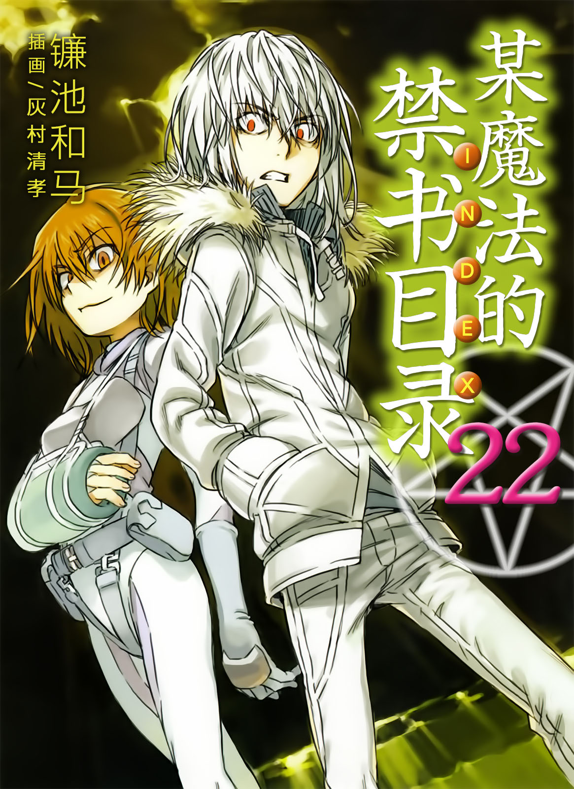
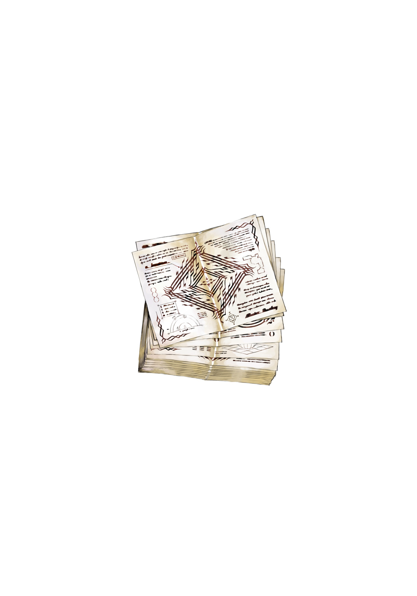

# 简介

**旧约·魔法禁书目录22**

作者：镰池和马

## 内容简介

**俄罗斯篇完结！然而上条当麻的下场是——！**

罗马正教的暗部「神之右席」最后一人，右方之火。他所策划的「计划」即将启动。

在第三次世界大战中的俄罗斯上空飘浮着巨大的要塞「伯利恒之星」。据说它能拯救全世界的人类，但这意味着前所未有的大灾难即将降临。在火称之「净化」的阴谋蠢动之时，三名少年继续战斗。

滨面仕上结束了对泷壶理后的治疗，并在阻止克里姆林报告之前，与宿敌麦野沉利相遇。一方通行(Accelerator)勉强击退了大天使米夏，终于找到了拯救最后之作的方法。然而，这却是禁忌的一步。而上条当麻则为了阻止「伯利恒之星」计划，为了解放茵蒂克丝，只身挑战火……！

## 制作信息

* 网译：泉川生徒会
* EPUB：黄昏的鸡蛋黄
* 译者：ccaqq、阿三
* 监督：Coca003
* 翻译：黄瀞瑶
* 台版：SOSG小说组
* 录入：千木咲音
* 校对：千木咲音
* 二校：watashi101
* 扫图：watashi101
* 修图：Gsnoopy watashi101
* 排版：watashi101
* 整合：知一一（禁书目录X系列，[index-X](https://github.com/1204244136/index-X)）


**版权声明**

转载时请保留录入信息。

本站内容仅供试看、学习与交流使用，禁止用于商业用途；下载后请在24小时内删除。请支持官方正版。


## 封面与封底

