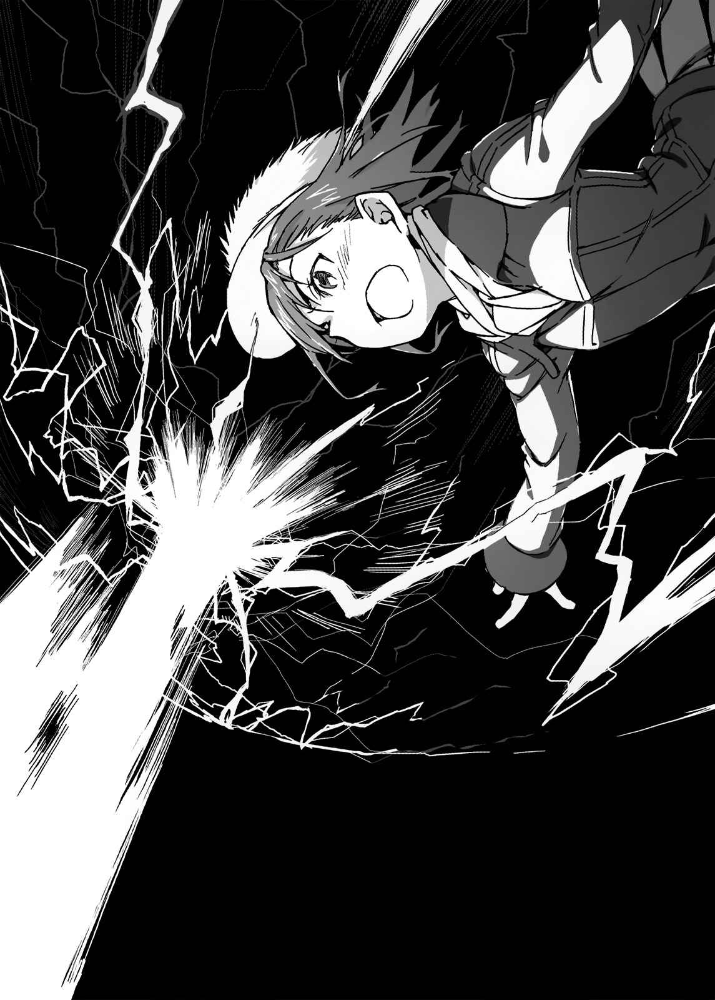

# 行间六

夺取学园都市的坦克非常简单。

美琴原本就是操控电流能力者中的佼佼者，虽然坦克是以柴油引擎为主要的动力，但是事实上大部分设备都已经电子化了。对于不需通过电缆就能直接骇进计算机的美琴而言，这些武器根本不是对手。

这世界上虽然存在着对抗电气系能力的装备，也就是借由彻底反弹所有电磁波的装甲板以保护自身安全，以及利用药物特别创造出收缩化学性弹簧的驱动铠(Powered Suit)；但这些车辆上似乎并未运用到这种对策。

她从远方停下引擎后，打开车顶的出入口，将里面的人员全赶了出去。

他们似乎想通知其他人自己遭遇到异状，但是美琴也对他们的无线通信进行了干扰。她同样也对俯瞰监控战场的雷达和UAV空中摄影动了一样的手脚。因此就算这辆坦克脱离战线，对方也不会发现。

「唔，没想到坦克的速度出乎意料地快啊。」

美琴坐在妹妹(Sisters)操作的坦克中，喃喃自语说出这句话。

「近代的坦克原本就拥有能在高速公路上畅行无阻的动力，但是在积雪深厚的道路上还能跑出一百五十千米时速，一定是拜学园都市的科技所赐。御坂随口提出报告。」

「毕竟是辆价值七十亿的铁块，如果这么点用处都没有，那就伤脑筋了。」

「姐姐大人(本体)，这是复合材质做的。御坂订正错误。最近的坦克，主炮能达到四点五马赫的功率。御坂小声地补充说明。功率可以超过姐姐大人的超电磁炮(Railgun)。」

「我又不是光靠速度来决胜的。」

正因为她可以自称电气系能力象征，所以代表着她的自尊心并不止浓缩在一种能力之上。倒不如说，可以同时以不同方式从四面八方攻击敌人，这种繁复的做法才是她真正的实力所在。

（……所以我才会特别在意那个不管用什么方法，都能一口气完全消除攻击的笨蛋就是了。）

「抱歉打扰您自言自语……」

「唔啊？」

「正在准备核弹头Nu-AD1967的独立部队，似乎已经以肉眼看到我们了。御坂报告。」

全力奔驰却适得其反了？对方似乎透过夜视镜或其他东西，看到了履带卷起的雪烟。

有东西从远方射来。

脑子里净想着核弹头的美琴，感到背后紧绷，但似乎并不是核弹头。因为导弹的体积较小，而数量也多得多。

「似乎是空中轰炸用的地对地导弹。御坂发出警告。数量大约三十到四十。」

「原来如此喵。」

「虽然您从刚刚就变得像只猫，但你决定怎么做？御坂催促您采取行动。」

「当然喽！」

美琴说着说着，打开了头顶的出入口。

美琴整个打开像小型井盖一样的圆形出入口闸门，从主炮的炮塔向外探出上半身。

「我就用我最擅长的领域收拾你们！」

她呐喊出这句话同时，从刘海迸出了火花。

释放出来的并不是雷击枪，而是向前方照射大范围的强力电磁波。借此直接干扰在空中以音速两倍速度飞行的地对地导弹，用来搜索敌人的雷达。

导弹顿时失去目标，朝其他方向坠落。

好几声爆炸声响起，虽然并未直接受到攻击，但美琴却也感受到一阵如同被人赏了一耳光的冲击。然而她却不去管这种感觉，直视前方。

「继续前进！就算退后，也只是给他们时间准备下一波弹幕攻击！干脆一口气全部收拾干净！」

「御、御坂……」

「？」

「御严重的坂御坂电磁波干扰，御坂断线御紧急坂御修复工作坂御坂噗咕噗咕……」

「哇哇哇！你怎么会突然出问题啊？啊？你现在才发现，自己无法承受来自同系统最大能力以高功率输出的电波干扰？」

眼见驾驶座上的妹妹(Sisters)全身发抖并开始失去意识，美琴连忙中断电磁波照射。

「呼……我们这些量产型的毕竟还是比不过姐姐大人(本体)。御坂带着自嘲的口气再次确认自己的立场。」

但是一旦中断电磁波的干扰，理所当然会落得遭对方全力轰炸的下场。

「总之冲过去就对了！」

美琴呐喊。

「只要接近到一定距离，那群人就会因为害怕自己也被卷进爆风之中，而停止大规模轰炸！」

铿！柴油引擎如同响应美琴般发出声响。距离地对地导弹发射的地点，只剩不到两千米。

独立部队似乎也放弃轰炸，但取而代之，他们开始调动隐藏在山丘后面的坦克。虽说美琴多少也有被击中的心理准备，但是被数十座主炮集中攻击，毫无疑问会被轰掉。

「御坂推测，我们前进不到五百米，就会遭到二十次轰炸……」

「既然如此，就趁那之前搞定他们！」

美琴的坦克周围，有黑影在蠢蠢欲动。

不，不对。

那是深埋在雪地底下的大量铁砂。美琴将周团两百米范围内的铁砂全部收集起来，并利用磁力让铁砂随着自己的想法移动。

这些铁砂在对方眼里看起来就像一道墙。

在袭击陆地之前出现的，一道如巨大海啸般令人绝望的铁壁。

这就是第三位的超能力者(Level 5)。

不只是炮击。

即使拥有这样的能力，但能让她到最后关头都完全束手无策的，美琴只认识两个人。正极与负极。只有那两个分别站在双方极点上的能力者。

「冲啊——————————————————————————————————！」

大量铁砂伴随着她的呐喊，从上方超越美琴，抢先一步冲进敌阵之中。俄罗斯军方的独立部队对于如同扭动卷起的海啸，又如同活生生的蛇，高速振动席卷据点的铁砂之山完全束手无策。

这是理所当然的。

毕竟铁砂漩涡不管承受如何猛烈的轰炸，也都不动如山。

妹妹(Sisters)操纵的坦克，不疾不徐地闯入混乱的敌阵中央。美琴整个身体都从出入口探了出去，她直视着正前方。

敌阵中央有辆类似大型卡车的车辆。轮胎超过二十个，比一节火车车厢还大的特殊车辆。只是在后车厢部分，搭载了一个又长又大的圆筒。使用油压汽缸使之垂直矗立的，恐怕就是放了Nu-AD1967的导弹。

就像要加速情况恶化般，圆筒后端开始冒出发射的火焰。

美琴纵身跃下在雪地上横向滑行的坦克。

（……不管是洲际弹道导弹，还是替换「外壳」的战略核弹头，基本上都是以电来控制的。只要一发雷击之枪就能让它报销。）

她不随意胡乱使用超电磁炮(Railgun)，是为了防止核子物质外漏。所以干脆只破坏控制用的电流回路，让导弹变成一堆破铜烂铁，才是更安全而确实的做法。

就在固定导弹的机械臂即将与导弹分开的瞬间，空中的美琴将意识集中在刘海上。

伴随着蓝白色的火花，美琴使出全身力气大声呐喊：

「——都给我吹走吧！」

