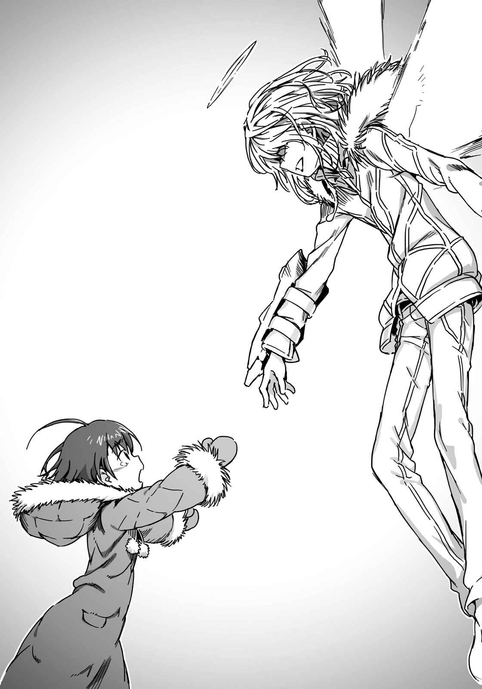
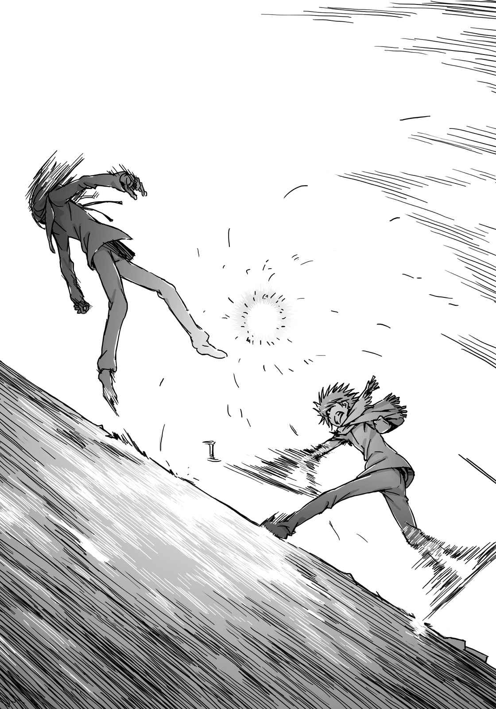
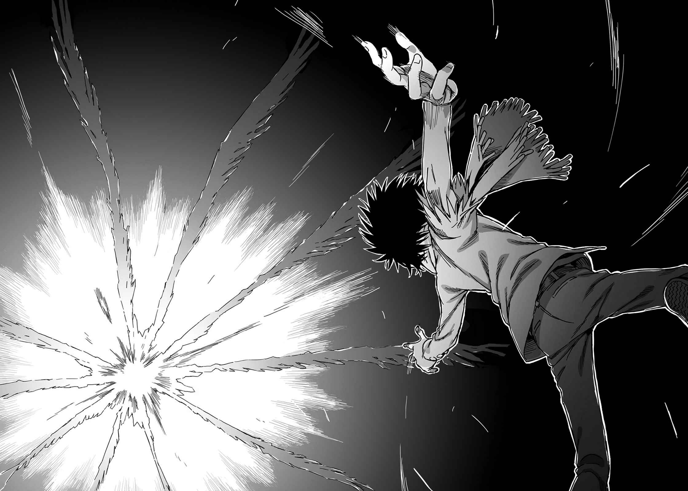

# 第十二章 在北冰洋的最终决战

> Last_Fight.

## 1

寂静笼罩着白色雪原。

一方通行(Accelerator)的歌声停了下来。立于地面支撑身体的拐杖前端滑开。双膝落地的一方通行(Accelerator)全身染上鲜红的血。在不允许染上其他颜色的纯白地狱中，只有他用伤痛在展现出自己的色彩。

超越界限的喉咙，吐出了仿佛被锉刀磨过的虚弱嘶哑气息。大概是体内也受了伤，红色液体混在呼吸中断续地溢出。

他无法继续唱下去了。

他觉得好像某种具有黏性的东西，堵住了体内所有管道。

但是，

一方通行(Accelerator)染成红黑的嘴唇不再紧绷，稍微放松了一下。没错，他心想没必要继续唱下去了。原因是——

&nbsp;

「……你……还好吗……？御坂御坂试着问问看。」

&nbsp;

模糊的视野中，传来微弱的声音。

那是他长久以来一直想听到的少女所说出的话。直到不久之前还无法保持意识，连是否能保住性命都不得而知的少女所说出的话。一方通行(Accelerator)确信她的音色虽然细微，但已经恢复元气了。

如烛火般摇曳不定，不知何时会消失无踪，虚弱得令人害怕的存在。现在她的中心，出现了一根绝对不会消失的支柱。

最后之作(Last Order)的状态已经稳定下来。

她再也不必受到那些无理的暴力折磨。

一方通行(Accelerator)不断咀嚼品尝事实。然后，等他回过神来，已经采取了行动。曾经被称为学园都市最强的怪物，超能力者(Level 5)伸出颤抖的双手，抱住最后之作(Last Order)现在还显得疲惫无力的娇小身躯。

紧紧地。

像是再也不愿放开似的。

「……太好了……」

他脱口而出。

他的声音在发抖。但并不是因为身体内外都被伤得千疮百孔的影响。

「可恶。太好了。真是太好了……！」

这些或许是原本的一方通行(Accelerator)绝不会说的话。

不过，是依据什么而用「原本」这个字眼来形容？或许这才是真正的他。在所有悲剧开始之前，在学园都市的「黑暗」吞没年幼的超能力者(Level 5)之前，「原本」他也是个会因为开心的事而欢笑，为了伤心事而痛哭的孩子吧？

即使他染上了压倒性的邪恶，「这点」还是恒久不变地，常存于一方通行(Accelerator)心中。

留下来了。

芳川桔梗和黄泉川爱穗所看到的东西，还有他想在「大人的社会」保护的东西，大概就是这个。

长时间以来意识断断续续的最后之作(Last Order)，应该无法理解事情详细的来龙去脉。

但是没有关系。

被紧紧拥在怀里的最后之作(Last Order)，用她小小的手，轻柔缓和地抚摸着一方通行(Accelerator)的背。

她想接受他的一切。

大概就和一开始发现残留在他内心的东西时一样。

「——」

一方通行(Accelerator)确认着千辛万苦终于找回的那份温暖，如此心想。

这世界的确冰冷、残酷，充满着无药可救的恶意。

但是，同时也存在着救赎。

只要自己愿意主动伸出双手。只要愿意咬紧牙关继续前进。不断挣扎、挣扎、再挣扎地前进，前方一定存在光芒。这世界还没有令人绝望到连那一丝希望之光都夺走的程度。

「抱歉在你们感动的重逢时浇冷水。」

就在此时。

一旁的番外个体(Misaka Worst)带着警戒的口气说道：

「我认为这场该死的战争，可不会就这样以快乐结局收尾哦。」

一方通行(Accelerator)转头，在确认四周情况前就感到气氛有异。

他感到一阵毛骨悚然！

仿佛感受到一股令人厌恶的寒意，穿透全身肌肤进入体内。不，正相反。是体内的颤抖溢出皮肤之外？不管是哪一种都无所谓。总之这感觉不是普通的五官感受。这就像是勉强接受不该接受的信息，结果身体的传感器和脑内的演算回路都出现异常运作。

他感到正上方传来莫大的压力。

海原光贵、水之天使、羊皮纸。比这三者发射出来的能量，更为强力浓缩的感觉……

一方通行(Accelerator)将最后之作(Last Order)拥在怀中，看着天空。

上头飘浮着巨大要塞。

满布整片天空的黄金之光，仿佛被吞入要塞中。凝聚在一点的庞大能源所产生的压力，让一方通行(Accelerator)的皮肤感受到刺痛的错觉。他感应到力量的矛头指向何方。那莫名的力量团块，正在瞄准地面。

他不知道那座要塞意味着什么。

他也无法理解指向地面的矛头会产生什么结果。

但是，

「……如果发射，一定不会有什么好结果啊。」

或许那股力量的目的，并不单纯只是破坏。或许会产生什么特别效果。但即使如此结果还是一样。一旦那种庞大的力量掉落地面，伤亡会扩大到什么程度？而且根据皮肤的感觉，假设那是和「单纯的科学之力」不同的能量，那么一方通行(Accelerator)的「反射」，对那股力量是起不了作用的。

一旦贯穿地面，所有人都会死。

不管是一方通行(Accelerator)、番外个体(Misaka Worst)，还是最后之作(Last Order)……没人能幸免于难。

「……开什么玩笑。」

语毕。

轰！一方通行(Accelerator)发出爆炸般的声音，背后出现如黑墨般的羽翼。黑翼象征着他的愤怒。这股强大的力量极其神秘，看起来并不像单纯借助御坂网络而产生的力量，也不知道最后之作(Last Order)是否能强行停止下来。事实上这对羽翼出现时，一方通行(Accelerator)本身，可以说是百分之百几乎一定会陷入精神失衡状态。就在他舍弃一切的立场和主张，也想杀掉眼前对手之际，胸中漫出的杀意就以黑翼外形出现，准备蹂躏世界。就是如此无与伦比的力量。

犹如受到空中要塞传来的重压，将力量从体内全部挤出。

就跟与爱华斯对峙当时一样。

但是，

「……番外个体(Misaka Worst)。」

一方通行(Accelerator)说出的话，如耳语般轻柔安静。

「我要去阻止那玩意，这小鬼可以交给你照顾吗？」

「是俄罗斯？还是学园都市？」

「全部。」

番外个体(Misaka Worst)面对这道莫名所以的命令，叹了口气。与双方阵营为敌，无异于要她和第三次世界大战的所有参战势力对战。

但是，她却露出充满恶意的笑容，取出口袋里的铁钉说道：

「……反正我早就决定要让那群人哭着离开了，既然如此，要做的事都一样。再说，只要分析最终信号(Last Order)和御坂网络中的『歌曲』情报，很可能会得到『学园都市没有的技术』。」

最后之作(Last Order)或许是对眼前发展得令人眼花缭乱的状况感到不安。她小小的手紧紧抓住一方通行(Accelerator)的衣服。

「你要去哪里？御坂御坂发出质问。」

拥在怀里，抬头看着自己的眼神摇摆不定。

她恐怕已经知道一方通行(Accelerator)接下来打算做的事了。正因为知道，所以才会试图阻止他。

「你哪里也不会去吧？御坂御坂试着确认。」

「不用担心。我会很快结束这一切。」

一方通行(Accelerator)完全没说自己会回来。

背后长出黑翼的怪物，温柔地一根根松开抓着自己衣服的少女手指。像是要摆脱将他留在地面上的最后枷锁。

「我不要。」

最后之作(Last Order)以极其细微的声音低语。

「我想永远和你在一起，御坂御坂试着恳求。」

「……是啊。」

一方通行(Accelerator)也承认了。

在最后一刻，他的脸上露出如孩童般的笑容，如此答道：

&nbsp;

「我也想，永远跟你在一起。」

&nbsp;

咔嚓咔嚓咔嚓咔嚓！怪物的翅膀伴随着冰面龟裂的声音改变颜色。从墨一般的漆黑，变成雪一般的纯白。仅仅一瞬间就从根部到末端，从外观的色彩到内心的本质全部改变。

他的头顶正上方，出现了同样颜色的小型光环。

那正是他的蜕变。

输出特异之力至现实世界的源头，精神上的蜕变。

一方通行(Accelerator)双手搭在最后之作(Last Order)肩上，轻轻一压，就像无重力空间中的航天员，他的身体因反作用力而飘浮腾空。

最后之作(Last Order)朝着空中的一方通行(Accelerator)伸出小手。

但是，她碰不到他。

一方通行(Accelerator)已经向上飘浮了好几米。

这样就好。

如此确信的一方通行(Accelerator)，振动白色羽翼。一百米长的巨大羽翼靠的不是风力，而是将某种未知能量转变为浮力。一方通行(Accelerator)并未向地面施加任何力量，然而却像炮弹般朝正上方冲去。

一瞬间，

一方通行(Accelerator)上升了三千米，吹散了满布整片天空的厚厚云层。

同时，天空的要塞也有了动作。

从上部吸收，累积到下部的黄金力量团块，毫不留情地向下发射。他感到脸颊有种刺痛麻痹的压力。那股力量果然和一方通行(Accelerator)的白翼相同，不是一般的力量。「反射」恐怕也起不了作用。应该会像被爱华斯打败那时一样，直接被贯穿身体。

但那又怎样？

一方通行(Accelerator)继续舞动白翼，提高攀升速度。没有任何小动作，笔直地朝着向下发射的黄金团块而去。他嘴边甚至露出了笑容。

原来如此。事到如今，一方通行(Accelerator)终于明白了。

原来，这就是为了去守护什么而战啊。

&nbsp;

紧接着，

两股巨大力量在八千米高的上空，激烈撞击。

## 2

莫大的冲击，激烈撼动了「伯利恒之星」。

黄金之光爆炸了。

「怎么回事……？」

但是，右方之火所设想的大灾害并未席卷地面。而且地表也没像天空一样染上黄金色彩。「伯利恒之星」投下的大规模天使之力(Telesma)，因为不明原因被挡住了。

「应该已经达到所需的力量了！地面上应该会发生满足战略条件的破坏，应该会为本大爷带来胜利！然而却变成这样，到底是……？！」

他所期望的悲剧并没有发生。

恶意没有因此增加，反而因为有人阻止悲剧，人们心中的黑暗逐渐被拭去。

这或许只是暂时性的，比如运动比赛时体会到和世界融为一体的感觉，不过只是近似于那种感觉的狂热。

但是，

就算只有一瞬间，地面上的人们应该也会这样想。

就算这世界上只有我们也没关系。

高高在上、自以为是的救赎去吃屎吧。

「够了吧？」

上条当麻握着拳头向前迈开脚步。

一步、两步、三步。

「到了这一步，你的幻想应该退场了。」

咚！上条一口气冲了出去。

他完全不需要多余的小动作。从正面以最短距离接近对方。另一方面，右方之火毫不犹豫地挥动象征力量的「第三只手」。就算是幻想杀手(Imagine Breaker)也无法消除其中蕴含的庞大力量。如果他无法挡开攻击轨道，就能完全消灭上条的右手。右方之火如此心想，或许是想靠着蛮力排除眼前的阻碍。

但上条没有停下脚步。

他的右拳从正面，狠狠打在来袭的「第三只手」上，紧接着右方之火最大的武器，那条异形之手就从正面飞出。

血肉横飞、鲜血四溅。

好不容易才得以维持形体的「第三只手」失去凭借，在半空中痛苦地抖动。

「什么？！」

或许是因为不明的剧痛如雪崩般侵袭而来，使得右方之火脸部表情扭曲，放声大喊。

这并不是因为上条的力量增加了。

幻想杀手(Imagine Breaker)永远只是幻想杀手(Imagine Breaker)。

而是因为，右方之火那条呼应恶意而生的「第三只手」，已经衰弱到幻想杀手(Imagine Breaker)也能破坏的程度。小小的善意像涟漪般扩散，最后覆盖整片大地的结果，造成支撑右方之火力量的主轴断裂崩塌。

使右方之火引以为傲的力量，已经不存在了。

别说是利用「第三只手」直接发动攻击，就连一口气水平移动几千米闪躲，以保持距离都办不到。

这么一来，已经没有任何事物能阻止上条。

「啧——！」

右方之火将茵蒂克丝的远距控制灵装推向前。他打算利用十万三千本魔道书的知识，迎击迎面而来的上条。或许是因为失去「特殊力量」，使得他的防御能力也随之减弱，剧烈的头痛袭来，但右方之火罔顾于疼痛，继续搜索所需的知识。他的目光诉说着，无论如何都要杀掉眼前的敌人。

但是就在此时，右方之火听到一个声音。

是通过魔法连接的魔道书图书馆所发出的声音。

（——警告，第八十八章第一节。搜索时「本体」出现异状。由于受到过多外在刺激影响，作业效率发生严重错误。）

「……？！」

禁书目录的本体，应该保管在圣乔治大教堂。由于外在刺激导致发生错误，也就表示英国清教的魔法师，应该动了什么手脚。

连最后的手段也没有了。

这就是他们两者之间的差异。

原本就站在顶点，不断磨炼自己力量的人，和借助大家的力量，不断努力想爬上顶点的人，两者之间决定性的差异。

区区一名微不足道的高中生，紧握住右拳，冲向操控世界的王者。

深不可测。

锐不可挡。

不容任何人接近的宝座之前。

就在此时。

上条脚边的地板突然开始下沉。

因为「伯利恒之星」越来越弱了。

来自右方之火的力量供给断绝，自然而然开始崩溃毁坏。

在最后一刻，挡住上条脚步的东西。

名曰——

（不幸）

右方之火露出阴森的笑容。

他再次将意识集中到手上的灵装。

（只要能争取到五秒、十秒的时间就够了。趁那段时间强行改变魔道书图书馆的设定！就算因为超高度负荷使十万三千本烧光也无所谓。现在必须先除掉眼前的「敌人」！）

「哦——」

但是，

上条当麻的行动，没有因此停止。

少年发出呐喊，继续冲向前方。

「哦哦哦哦哦哦哦哦哦哦哦哦哦哦哦哦哦哦哦哦哦哦哦哦哦哦哦哦哦哦哦哦哦哦哦哦哦哦哦哦哦哦哦哦哦哦哦哦哦哦哦哦哦哦哦哦哦哦哦哦哦哦哦哦哦哦哦哦哦哦哦哦哦哦！」

&nbsp;

咚！

上条发出了巨响，从即将崩塌的立足点一跃而起。

为了跨越隔开两人的裂缝。

他像支箭一样冲向前，冲向右方之火。

&nbsp;

然后右方之火明白了。

他终于明白眼前的敌人，是什么样的本质。

（开什么玩笑……）

用茵蒂克丝的远距控制灵装是来不及的。

那个「敌人」连这么一点空当都不会留给自己。

（本大爷在最大限度之内利用了「神子」的奇迹和恩惠，引发各种现象，而这小子却完全不在乎？无关乎幸或不幸，这小子拥有靠自己的双脚踏碎那些「暧昧不明之物」的力量——！）

「如果你以为，一定要用那种方法才能救得了人类……」

上条当麻说出了真心话。

他顺应激动的情绪，将所有力量注入右拳中。

&nbsp;

「那我就先杀了这个幻想！！」

&nbsp;

巨响迸出。

上条的拳头打在从未受过他人攻击的右方之火脸上，顺势撂倒这名强敌。

黏附在这个世界的「第三只手」残渣像是融化在空气中，完全消失无踪。

同时，

操控茵蒂克丝的远距控制灵装，也从他手中滚落。

## 3

右方之火失去了「第三只手」，对他的要塞「伯利恒之星」也造成极大的影响。上头频繁发生让人感到不安的剧烈晃动。直到先前为止不断上升的高度也骤然停止。因为能让质量如此庞大物体飘浮的力量来源，正在逐渐消失。再这样下去，要塞很快会开始下降。若不在此之前赶紧逃离，恐怕就没救了。

右方之火倒卧在地，看向自己的手中。

远距控制灵装不见了。

因为遭痛殴时的冲击，灵装从手中掉落。滚动的灵装就此从地上的裂缝不知所终。应该还留在要塞中，但完全无法得知掉到哪里去了。

如果有那个，或许还能以普通魔法进行反击。

右方之火心想，但他的四肢已经没有任何力量。失去了「第三只手」，右方之火其实与常人无异。就算只是轻微的脑震荡，都足以阻止他的行动。

他在意识朦胧中，听见了某种声音。

是从设置在「伯利恒之星」各处的喇叭中传来的。

『因为已经没时间了，所以我和……呃，你叫莎夏对吧……总之，我们已经先搭乘逃生集装箱离开要塞。请你也快点离开那里。「伯利恒之星」已经开始下降，要塞本身开始四处坍塌，所以能用的集装箱数量也很有限。』

从碎裂的地板另一边，可以看见要塞最底层的楼层。只用几面金属网叠成的地面，最下方连接着宽广的天空。逃生用集装箱就挂在那里，但是几乎都已经无法使用了。不是集装箱本身已经毁坏，就是丢下用的挂钩部分毁坏，无法放下集装箱。

能用的集装箱恐怕只剩一个。

而且看起来摇摇晃晃，一点都不可靠的集装箱，是跟公共电话亭一样的小型集装箱。不是能一次运载超过五十人的大型集装箱。应该只有一个人能坐得进去。失去「第三只手」，变成普通人的右方之火，是无法靠自己的力量从这种高度降落地面的。

上条当麻和右方之火。

谁可以坐上集装箱，谁必须和要塞同归于尽？

这种事想都不用想。

（……我就到此为止了吗？）

右方之火心里只有这个想法。

如果居住在这个世界上的所有人类都拒绝救赎，其实一切都无关紧要。自己只要顺着自己所选择的路步向灭亡就行。

右方之火全身慢慢失去力量，他闭上眼睛。

就在此时，有人用力抓住他的领口。

「喂，走了。」

是上条当麻。

他以全身染血的身体硬撑起右方之火，拖着全身无力的他迈开脚步。

「……你在做什么……？」

「没时间了。『伯利恒之星』马上就要开始下降。再不快点逃离这里会被卷入的。」

「你还搞不清楚状况？」

现在只能任人摆布的右方之火说道。

他用下巴指了指前方，说道：

「逃生用集装箱已经不能用了。个人用的也只剩下一个。本大爷和你之间，能获救的只有一个人。」

「好像是哦……」

上条叹了一口气。

然后他说道：

「既然如此就让给你吧。反正不管怎样都已经没时间了，你快走吧。」

「……」

这次，右方之火真的哑口无言地看着上条的侧脸。

就在此时，上条已经拖着右方之火走到最下面的楼层，朝着逃生用集装箱走去。

上条是认真的。

这种局面下没必要虚张声势。只要丢下造成一切的元凶右方之火，坐进逃生用集装箱，上条必定能生还，也能成为大家公认的英雄。一定不会有人责备他对右方之火见死不救。相反的，给予造成连串悲剧的主谋致命一击，一定会有更多人对他赞赏不已。

然而，

为什么在这种局面下，他还能说出那种话？

不管怎么想，右方之火也无从得知这问题的答案。他还想不出答案，但两人已经到了逃生用集装箱前。上条小心翼翼地向逃生用集装箱伸出手。逃生用集装箱并没有因为右手的力量而毁坏。

上条打开门，毫不犹豫地将右方之火的身体塞进去。

这家伙疯了。

右方之火想钻出来，但是受到严重伤害的身体已经无法动弹。

右方之火不禁摇了摇头。

他自己也不知道自己想否定什么。

「……这样好吗……？」

「什么？」

「本大爷可是个不知道『世界』有多广阔的人哦？」

「是吗。」

语毕，上条忍不住笑了。

右方之火直到最后都不知道，上条为何还能开口大笑。

&nbsp;

「既然如此，你以后可得好好确认一下。」

&nbsp;

逃生集装箱的门从外面锁住了。紧接着滑过很短的轨道，被抛向宽广的天空。

上条目送着不断下降，越变越小的集装箱。

最后，像是要抛开过去般，上条抬起视线。

最后的集装箱已经发射了。

已经没有能让他安全逃离要塞的方法。

就在此时。

轰！一声轰隆巨响传来。风向改变了。忍不住伸出双手护住脸的上条，看见一架战斗机。那是人称VTOL机，能像直升机一样垂直上升，并静止在空中的机型。

他看过驾驶舱里的人。

那是……

## 4

「再向右一点！再一点点！再向他靠近点！」

御坂美琴从后座探出身体，同时向握着操纵杆的妹妹(Sisters)大喊。

好不容易。

千辛万苦来到这里，好不容易。

终于可以和那个笨蛋处在同样的时间、空间之中。

「姐姐大人(本体)，你脸上露出不怀好意的笑容，让人很不舒服。御坂指正错误。」

「噗？才、才没那回事喵！再说比较的对象是你，所以全是因为你的判断有问题！」

美琴连忙拉着自己的脸颊确认。

「真是的！到底是怎样啊！不久之前不是还飘浮在空中？那座要塞为什么现在却突然开始下降了？」

「很抱歉在你兴奋的时候打断你，不过如果不打开驾驶舱的舱盖，他听不到姐姐大人(本体)的声音哦。御坂指正错误。」

「哪里？是哪个按钮？」

美琴问完问题之后，突然冒出了疑问。

这里是高度超过一万米的高空。外面气温低于零下五十度，气压非常低，而且氧气含量也非常少。直接打开舱盖不要紧吗？

不打开就够不到他。但是又不能打开。

就在美琴陷入进退两难时，妹妹(Sisters)面无表情地竖起耳朵说道：

「……引擎的声响有点奇怪。御坂报告。」

「？」

「那是在一个标准大气压下，零下七度时引擎的传导声音。御坂明确计算完毕。虽然原理不明，外面的高度虽然超过海拔一万米，但似乎和地表有同样的环境，御坂报告结论。」[^1]

「也就是说……」

「就算打开舱盖好像也没关系。御坂表示。」

紧接着，

外观像将橄榄球直向切成两半的舱盖从正上方打开了。似乎是妹妹(Sisters)按下了某个按钮。

如同妹妹(Sisters)所说的，呼吸没问题。虽然有点冷，但也没有零下几十度那么冷。

妹妹(Sisters)稍微倾斜机体，缓缓移动VTOL机。她并没将机首对着要塞，而是与要塞垂直……也就是以右边主翼前端对着要塞，缓缓靠近。

只剩几米。

一百厘米的数倍。

由于要塞不安定地晃动着，正确距离也不停变化。

但是，和在学园都市扭扭捏捏不敢靠近时相较，现在显得格外的近。

「这里就是极限了……着陆或许有点困难。御坂紧握住操纵杆。」

这时，妹妹(Sisters)说出了那句话。

战斗机的动作，突然在空中停下。

就在还差一点就能抵达要塞的地方。

「VTOL是为了缓缓降落在地表上所开发的机型。御坂说明。如果强行让机体降落在像这样剧烈上下晃动的要塞上，很可能发生机体下方与地面碰撞的风险。御坂说出隐忧。」

「如果找个更宽敞的地方降落呢？这么巨大的要塞呢。先往上面飞试试看，应该有比一般牧场还大的空间。」

「要塞本身的震动不会停止，所以不管降落在哪里，都无法避免坠落的风险。御坂以否定意见回答。而且就算能到达要塞，一旦战斗机失去飞行功能，我们就无法逃脱了。御坂皱起眉头。」

「好吧。」

御坂美琴开着舱盖，将手伸向安全带上的金属扣环。

「你尽量保持平衡！我直接走上主翼，把那个笨蛋拉上来！」

美琴从座位上起身，以爬行方式向主翼移动。

或许是因为她用磁力将脚粘在主翼上，所以并没想象中那么恐怖。

她慢慢前进。

不断缩短她和刺猬头少年之间的距离。

（一定要够到他……）

要塞强烈晃动了一下。

高度正在下降。

稳定感不如刚才。

仿佛像——

支撑着要塞的隐形绳索一根根断裂，这种晃动方式，让人越来越不安。

（一定要够到他！）

机体不断晃动，主翼上还黏着美琴的VTOL机逐渐向要塞靠近。

就在此时。

她和那个笨蛋四目相交。

那个刺猬头少年，看见突然出现的逃生手段，似乎感到非常疑惑。那个笨蛋原本打算怎么逃走啊？虽然她心里忍不住这么想，但现在没时间拘泥于那种事。等到逃脱之后，再对他说教说到死吧。

好不容易走到主翼尖端的美琴，将手伸到极限。

好像够得到，又好像够不到。

她的指尖接近到即将碰触到他的地方。

然而，

此时少年却做出了让她意想不到的举动。

他左右摇着头。

接着，少年原本已经伸出一半的手停了下来。

（什么……？）

美琴正感到吃惊时，少年的嘴唇微微地动了。

她听不到他的声音。

但是，她从嘴唇的动作理解了他的意思。

&nbsp;

我还有该做的事。

&nbsp;

轰隆！要塞剧烈晃动。然后比刚才更快、更不安定地朝地表坠落。就像从坡道滚落的大球，用无法阻挡的速度往下冲。现在必须救回那个笨蛋，否则情况再这样发展下去就无计可施了。美琴凭借直觉做出了这样的判断。

但是，

VTOL机突然产生一阵强烈摇晃。机体晃动着，离要塞越来越远。

「等一下！你打算做什么啊？」

「要塞的震动已经超过一定数值。御坂报告。再继续接近，机体恐怕会撞上要塞。」

「——！！」

美琴趴在晃动的主翼上，用手掌操控着磁力。

必须不择手段把他拉上来。

学生服的纽扣、腰带的金属扣环，总之用什么都好。用磁力将他拉上来，让那名少年脱离要塞。

美琴心想。

但实际上，联系着美琴和那名少年的磁力线却突然断了。

「咦……？」

因为不明就里而感到惊讶的美琴。

接着她终于明白发生了什么事。

那名少年拥有能使美琴所有能力失效的神秘力量。

那种力量，斩断了最后的生命线。

机会消失了。

即使有一举击败所有坦克的力量，即使有阻止核弹发射的力量都没用。

这些都不足以救出一名少年。

VTOL机逐渐远离开继续晃动下降的要塞而去。妹妹(Sisters)大幅度晃动机体，让呆坐在主翼上的美琴掉回机舱中，接着关上舱盖。要塞原有的神秘力场，所赐予她们的保护立刻跟着消失。

理由很简单。

因为她们已经拉开了这么远的距离。

说自己还有事情该做的少年，就这样留在要塞里。

之后，美琴的呐喊传遍了整片天空。

## 5

（……我还有该做的事。）

逐渐远去的VTOL机。

那架战斗机或许是逃离要塞的最后手段。

但是上条转过身背对着它。

这样还不算结束。

「伯利恒之星」。半径超过四十千米，如果让这么巨大的建筑物像自由落体般坠落，不知道会让地球这颗星球造成多严重的伤害。只要不解决这个问题，这次的战争就不算结束。

（还有……）

上条环视四周，寻找某个东西。可以从外部操控茵蒂克丝的远距控制灵装。在最后一击之后，灵装从地面的裂缝不知道滚落到哪里去了。他必须找到它并破坏掉。

脚边晃动了一下。

就像以一定速度移动的电梯突然停止，让人不安的摇晃方式。

这座要塞已经不行了。

再次感受到这件事的上条耳边，响起了少女的声音。

应该空无一人的要塞中。

『当麻。』

那是他一直想听到的声音。

远距控制灵装虽然已经离开了右方之火之手，但应该还在启动。不受任何人所控制的少女意识，就飘荡在灵装周围。

『当麻。』

缓缓地。

空气中浮现出少女透明的形体。无视重力，上下颠倒地看着上条的脸。

她说：

『为什么你不逃走？』

「因为一切都还没结束。」

上条回答，并穿过「伯利恒之星」内部。他并不是像无头苍蝇似的漫无头绪乱找。少女的存在本身，就是引导上条找到灵装的关键。

「你的灵装，还有这座要塞本身也得处理一下啊。」

语毕，上条的表情突然蒙上一层阴影。

他和右方之火的战斗中，有件让他耿耿于怀的事。

「……对不起。」

失忆的事。

虽然他到现在一直隐瞒这件事，但这么做是否正确？

他不想伤害茵蒂克丝。他希望自己永远都是深受她信赖的上条当麻。但其实他那么做，只是因为上条自己不想看见茵蒂克丝大受打击的表情吧？不正是因为他害怕，茵蒂克丝会就此离开自己吗？

结束与右方之火的战斗后，现在他终于明白。

如果真的是为她着想，就该克服这道难关。

克服难过、痛苦的事，克服一切。

不要担心自己的立场。

「我对你做出了很残忍的事。我一直都在欺骗你，接下来我会全部告诉你。我无法保证自己可以从『伯利恒之星』生还。所以趁还能说的时候，先把话说清楚。」

上条微微地低下头。

然后，再次以自己的想法抬起头来。

「我……」

必须坦白。

他正是为了这么做才开口。

让他必须如此提出勇气的事情。

这是第一次。

「我……」

他长久以来一直隐瞒的事。

失忆。

他将告诉她那个事实。

「——」

上条在动着嘴唇慢慢发出声音时，他如此心想：

时间太漫长了。

『没关系。』

他听见茵蒂克丝的声音，像是要打断他的话。

『那种事情……都……无所谓了。只要当麻能一如往常回到我身边，我什么都不在乎。』

「……」

上条陷入了短暂的沉默。

他强烈地告诉自己，不能利用她的体贴。

「我一定会回去。」

但是，严以律己和变得悲观是两回事。

绝对要活着回去。

为了这个目的，上条应该和她定下这样的约定。

「我不想隔着这种灵装告诉你。等我回去之后，我一定会郑重地向你低头认错。」

上条看着附近柱子上的仪表板。那是为了将声音传送到位于「伯利恒之星」各个角落的扩音器，包含麦克风的通信装置。虽然他看不懂俄文，但还看得懂写在一起的数字。

「请你帮我转告英国清教的人，把频率调到五十点九兆赫兹。这样就能连上这边的扩音器。如此巨大沉重的东西直接坠落，伤亡将会难以估计。所以只能分几个阶段来降低速度，让要塞坠落到安全的地方。而现在还能行动的只剩下我，所以我需要相关的建议。」

『我办不到。』

少女的口气变得很伤脑筋。

『我无法以自己的意志回到身体里面。』

「说得也是。」

上条干脆地答道。

他的视线前方，就在地上，躺着一个令人气愤的圆筒形灵装。

「所以，你就先回去吧。」

他伸出右手，抓起小小的圆筒形灵装。

仅止于此。

灵装裂成碎片，同时束缚住少女的力量也消失了。半透明的少女身体，像用橡皮擦拭去般消失无踪。

现在真的只剩下他一个人。

「伯利恒之星」现在还在持续下降。速度也越来越快。一旦速度超过一定界线，真的会落得像自由落体冲撞地面的下场。

质量超过半径四十千米的庞然大物直接撞击。

一旦演变成那种事态，因陨石撞击导致冰河期来临，就会在这颗二十一世纪的地球上获得证明。部分历史学家或许会很开心，但对大部分的人来说只是一场悲剧。

最后之战开始了。

赌注是这颗行星的命运。

## 6

『从罗马正教和俄罗斯成教所给的情报来看，「伯利恒之星」是通过二十架大型上升用灵装以飘浮在空中。由于右方之火失去了力量，连带导致「伯利恒之星」的输出功率也逐渐降低。再这样下去，一小时后应该就会完全丧失浮力，像自由落体般坠落地面。』

要塞中各处的扩音器里传出了史提尔·马格努斯的声音。上条拜托他护卫茵蒂克丝。破坏了远距控制灵装，就代表他的工作结束了。

『但是，只要任意破坏二十架大型上升用灵装中其中一些装置，我们就能操纵「伯利恒之星」的行动和前进方向。你的右手最适合做这件事。』

「具体的破坏点呢？」

『等等。现在图纸送过来了。因为这毕竟只是预想图，所以可能与实际装置有出入。如果你觉得有异样，随时向我报告。』

上条依照史提尔的指示，利用要塞内的单轨列车移动，到了列车无法前进的地方就靠双腿奔跑。没时间了。若是失败，将关系到六十亿的人命。

『我口头告诉你详细的位置，破坏南方的第三、第九和第十三号。这么一来「伯利恒之星」就会改变轨道，让它朝着北冰洋的尽头去。将速度降到极限，让它降落在水面以抵消冲击力。考虑到高度和质量问题，除此之外，没有其他减少对地球环境造成伤害的方法。』

「减少大型上升用灵装的数量，会不会反而提高坠落速度？」

『动力源是相同的。若是大型上升用灵装数量减少，其他灵装就会增加相当于一具灵装的输出功率。当然，每架灵装的最大输出功率是有极限的，但是动力本身已经变得很微弱的当下，根本不需要在意那种事。减少其中几架，说不定反而会使瞬间的功输出率提高啊。』

「掉落海里，是否有引发海啸的可能性？」

『我们已经向北冰洋沿岸各都市送出避难通知。多亏罗马正教和俄罗斯成教令人作呕的积极，真是帮了一个大忙。否则所有人就得做好蒙受最低限度伤害的心理准备。』

此时，上条已经到达目标的三号灵装前。

看似一座工厂。

好几个比学校校舍还大的设施，并列在规定的空间中，上头有好几十根粗大的管子。其中有不少交错的金属楼梯和通道。有时出现类似绿色的光粒子的东西，可能就是让这座巨大要塞飘浮起来的东西。

砰！

上条用手掌拍了拍身旁的管子。

如此而已。光这样做，就让管子上出现了无数裂痕，石造的四角建筑物产生严重倾斜，内部也发生了好几次气势惊人的爆炸。为了不让自己卷入其中，上条离得远远的，并跑向下一个目标九号灵装。

『……真没想到，在最后关头我必须与你并肩战斗啊。』

史提尔低声说道。

『就算不是我应该也无所谓。我听过好不容易终于清醒的那孩子，断断续续的报告了。当时那孩子的意识还停留在「伯利恒之星」上头。本来依靠着她的知识应该就能解决事态吧？』

「开什么玩笑。就算只有一分钟，我也不想让那种状态的茵蒂克丝继续受苦啊。」

『原来如此。欠你这种人的人情不是我的作风，但这次我就接受吧。』

「如果你真的这么想，能不能在预定的降落地点安排部队救我上岸？拜托饶了我，我一点都不想在冰冷的海水里等待救援啊。」

『关于这点，我会想办法。』

史提尔静静地回答。

『如果分段降落的作业进行顺利，你就算掉进海中也不会死的。』

在这段对话之间，上条在「伯利恒之星」之中拼命奔跑。

九号灵装就在不远处。

上条想着：一定会有转机。从和罗马正教的纠纷所开始的大规模战争，每一次都是惨不忍睹的结果，但最后总是会有转机。他一定会想办法的。上条相信着内心的想法，不断向前奔跑。

就在此时。

『这是什么啊……』

扩音器里传来了焦躁慌张的声音。

上条在奔跑中听着那个声音。

『太奇怪了。有某种巨大……天使之力(Telesma)？为什么会有这种东西？』

上条突然有种不祥的预感。

但是现在已经无法停止了。史提尔对冲向九号灵装的上条如此说道：

『为什么事到如今，米夏·克洛伊洁芙还会升上天空？』

## 7

此时。

协助右方之火的大天使，在冬季的俄罗斯雪原再次找回了身体。

四大属性的动摇已经通过右方之火之手获得修正。如今她已不是「似神者(米迦勒)」和「神之力(加百列)」混合而成的「米夏」，而是真正的大天使。从这点来看，可以说她的目的某种程度上算是达成了。

但还不够。

并不够完美。

她的目的是让自己的存在，回归原本应有的「位置」。曾经一度脱轨的她，已经看不到除此以外的任何目的，也不在乎为了达成目的，将会造成多少伤害。她只是想回去原有的位置。为了达成目的，大天使再次行动。

散落在四周的天使之力(Telesma)开始聚集到一点。

虽然天使一度被那群科学怪物的力量撕裂，但并未伤害到她的本质。就好比对着水击出拳头会使水花四溅，但水量本身并未减少一样。

然而不够。

并不完美。

由于行动一度遭到阻止，大天使现在更希望增强实际力量。大天使相当清楚什么样的材料可以达成目的。她掌管的元素是「水」。虽然冬季的俄罗斯覆盖着一整面白雪，但是光把这些冰雪融掉是不够的。

还不够。

并不够完美。

还不够。

并不够完美。

还hwsr不够。

并zwdf不够zdfb完美。

但ggggggggggggggggggggggggggggggaaaaaaaaaaaaaaaaaaaa。

&nbsp;

没错。

想要用压倒性的力量逆转局面，需要谨慎用心地准备。

含有特殊记号和象征意义的大量水分。

比方说，存在于行星两极的特殊冰雪。

&nbsp;

&nbsp;

「……现在是什么情况……」

伦敦圣乔治大教堂中，年纪约莫二十岁的修女发出惊呼。她是负责监视俄罗斯魔力流向的人。

「米夏·克洛伊洁芙，开始高速向北方移动！同时北极的冰开始急速融解！已确认两者之间连接着强大的天使之力(Telesma)！明显已经引起互相干扰！」

「她打算补充新的力量……不，补充肉体？」

史提尔神色严肃地低吟着。

单纯地思考，那名天使如果瞬间融化北冰洋的冰，面临北冰洋的地区必然会发生类似大规模海啸的现象。如果状况再变得更极端，说不定会卷起范围高达半径数千千米的强烈水蒸气爆炸。

再者，事态不会那么简单。原本就极其凶残的米夏·克洛伊洁芙，如果大量吸收了足以让北冰洋崩坏的水和冰，那么她的力量将会膨胀到什么程度？右方之火已经落败，事到如今那个大天使的目的又是什么？还是她根本没有目的？虽然不知道她这么做的理由为何，他清楚明白这种事态的结果，会带来什么样的末路。

他再也无法忍受。

他原本就不认为光用这个物质世界中存在的材料，可以完全承受得住神所创造的大天使全部容量。甚至「天使坠落(Angel Fall)」时的米夏·克洛伊洁芙，也不过是一种「不完全」的显现。一旦她想输出原本设定的量，或超越极限的力量，构成米夏的肉体就会爆炸，将会释放出大量的天使之力(Telesma)。

行星将以北极为中心爆炸。

至少也会造成北半球的生命全数灭亡。万一情况变得更糟，说不定地球本身的公转轨道将会发生严重偏离，而飞出太阳系。

（可是，该怎样才能阻止她？）

史提尔看着在白板上自行移动的磁铁，

（我们就算有系统组织地应战，都不知道能否阻止原本的米夏。现在若是和那种陷入疯狂状态的天使正面冲突，只会徒增我方伤亡。）

但就此默不吭声，毫无疑问将会迎来毁灭性的结局。

就在此时。

「……喂，怎么了？」

史提尔忍不住喃喃自语。

原本顺利朝着海面前进的「伯利恒之星」，轨道改变了。明显朝与史提尔他们的计划不同的方向前进。他原以为要塞可能出了状况，但他们一直在这边监视着，应该不可能发生那种问题。

显然是在要塞内部的上条当麻，对大型上升用灵装动了手脚，依自己的想法脱离安全航道。

仿佛是想阻止冲向北冰洋的米夏·克洛伊洁芙。

&nbsp;

&nbsp;

坠落的速度继续增加。

上条全力在这样的要塞中奔跑。

目的地是北冰洋沿岸，海面与陆地的交界处。强行破坏大型上升用灵装，扭转降落轨道的上条，为了对抗大天使不断疾奔。

地表上发生了变异。

有个小小的影子，正高速朝这里接近。

可以看见配合在低空高速奔驰的某种物体行动，前进路线上的积雪纷纷被挖出一个大洞。并不是单纯被吹散，而是以「她」为中心的数百米……不，数千米范围内的雪全部被吸收。

雪白的大地上，天使描绘出长长的痕迹，朝这里飞来。没有人能阻止她前进。中途虽然有一些人影放出魔法光线，但大天使根本不屑一顾。她只是经过，就将那些专业魔法师横扫在地。

大天使从沿岸到达北冰洋。

同时，

&nbsp;

正上方的「伯利恒之星」正在向下坠落。

&nbsp;

轰！伴随着震天巨响，大天使连同巨大要塞一同落海。在不断下沉的要塞中，上条全力朝更下方奔跑着。承受不了庞大的压力，要塞内部的墙壁和柱子接连崩塌。严寒的海水灌了进来，但上条一点也不在意。他一心奔往更下层，底部。要塞落入了低于海平面的地方。

连照明都没有了。

一片黑暗中，只有一个光点。

像月光般深沉寂静的蓝光。

上条当麻全力握紧右拳。对方也发现他了。黑暗中双方的视线正面交锋。强烈的杀意满溢而出，区区的人类少年一直到最后都没有停下脚步，继续向前冲刺。

&nbsp;

在走到这一步之前，发生了各种事情。

&nbsp;

回想起来，最早是从失忆的时候开始的。他为了不让某位少女感到悲伤而说谎，并且决心让自己继续前进。为了帮助身上流着特殊「血液」的少女，而与炼金术师对战。为了帮助排行第三位的超能力者(Level 5)和她的妹妹们(Sisters)，而与最强的怪物战斗。在海边民宿时则和班上的叛徒展开死斗。八月三十一日还发生了各种事。为了帮助身为AIM扩散力场集合体的「朋友」，他与真正的石巨人对峙。为了帮助能解读《法之书》的修女，他和十字教最大的宗派发生争执。还曾经扯进和常盘台中学学妹有关的事。大霸星祭时，运营委员和全班同学都被卷入事态中，而他保护了整个学园都市远离「使徒十字(Croce di Pietro)」的威胁。在意大利的基奥贾，他为了帮助过去曾与他为敌的少女，而对水之舰队展开突击。九月三十日为了帮助面目全非的「朋友」，与「神之右席」成员中的女子激烈冲突。和同学一起吃的寿喜烧很好吃，为了帮助常盘台中学的少女母亲，也和Skill-Out发生冲突。在法国阿维尼翁则和因为C文书和「神之右席」大打出手。在学园都市的地下街，跟天草式十字凄教一起迎战强大的「圣人」。在英国伦敦阻止了第二公主主导的军事政变。

然后是现在。

真漫长啊。他心想。

一路走来的所有事情，绝非全是快乐的事。

他好几次伤害别人，也被别人所伤害，这样的事不断反复上演。

但是，

上条当麻还在继续奔跑。

因为他知道，那些行动拯救了为数不少的人。

所以，才能继续迎面冲向最大的敌人大天使。

（……这世界的确总有一天会灭亡。他也知道行星有一定的寿命，在此之前也可能被膨胀的恒星吞噬。或许在变成那样之前，地球表面的生物早就已经先绝迹的几率还更高。）

但是，握紧拳头向前冲刺的上条心想。

&nbsp;

无论如何都比这种悲剧性的结局要好。

为了阻止那家伙，挺身而战应该是正确的。

&nbsp;

轰！两个人影以最短距离互相撞击。

同时，完全承受降落冲击的「伯利恒之星」巨体遭到严重破坏，开始崩塌。

接着——

&nbsp;

&nbsp;

十月三十日。

学园都市和英国清教。

罗马正教和俄罗斯成教。

由于双方势力之争而引发的第三次世界大战结束了。

就在战争结束前，确认要塞「伯利恒之星」坠入北冰洋。

虽然后来确认沿岸各都市多少都受到水灾影响，但是并无人员伤亡。

因为降落水面时的冲击，要塞「伯利恒之星」完全崩塌。

冲向北冰洋的大天使米夏·克洛伊洁芙反应消失。有人推测这是因为她失去支持自己存在的力量，变成纯粹的能量，而回归其他相位。另外也确认同一片海域的冰已经停止融解。

同一片海域中，没有生存者的反应。

十字教三大势力联合派出搜查队，却无法在水温两度的海水中发现生还者。

上条当麻。

他迎接了第二次的「死亡」。

[^1]: 译注：一个标准大气压，指海平面的大气气压，也是气压的单位基准。大气气压会随着高度的提升而下降。
