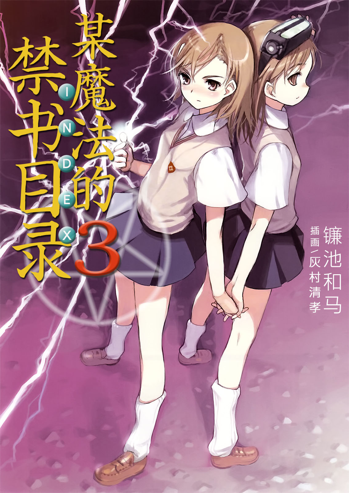

# 简介

**旧约·魔法禁书目录3**

作者：镰池和马

## 内容简介

**「超能力」，「一方通行(Accelerator)」，「茵蒂克丝」，以及上条当麻。当所有支线交汇之时，故事就从此开始——！**

「不幸啊……」

盛夏的黄昏，补习班回来上条当麻在吞钱的自动售货机前不禁感慨道。

「喂，你在干什么呢？」

御坂美琴敲着皮鞋，对上条说道。

「姐姐大人？」

一个与美琴长相一模一样的御坂妹妹在这之后出现了。

三个人的相遇。

那便是事件的开端。

被称为一方通行(Accelerator)的超能力者(Level 5)所引发的杀戮惨剧，就此拉开了序幕——

## 制作信息

* 翻译：李彦桦
* 台版：轻之国度EPUB制作组
* EPUB：江火如画
* 扫图：nirvanas
* 录入：zince99
* 初校：给你一半
* 二校：SwordGrave
* 三校：xxxholic
* 整合：知一一（禁书目录X系列，[index-X](https://github.com/1204244136/index-X)）


**版权声明**

转载时请保留录入信息。

本站内容仅供试看、学习与交流使用，禁止用于商业用途；下载后请在24小时内删除。请支持官方正版。


## 封面与封底

