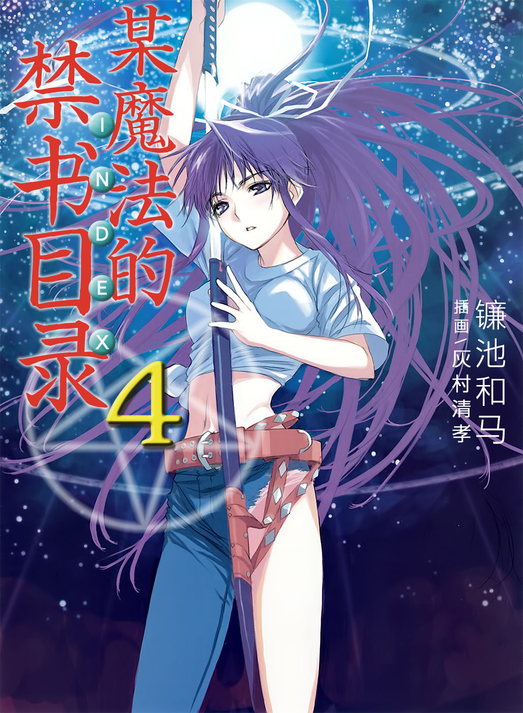

# 简介

**旧约·魔法禁书目录4**

作者：镰池和马

## 内容简介

**「外表」与「内在」互换了？当上条当麻被某种魔法袭击之时，故事就从此开始——！**

从学园城市获得外出许可的上条当麻，和家人一起到海边度假。

而在那里看到的是，变成了茵蒂克丝的母亲、变成了蓝发耳环的茵蒂克丝、变成了史提尔的神裂火织、变成了海边大叔的史提尔、变成了大叔儿子的御坂妹妹、变成了当麻妹妹的御坂美琴？！

这一切、都由「某个」魔法引起。

神秘魔法「天使坠落」似乎以上条当麻为中心展开了——？！

超人气学园动作系列第四弹登场！

## 制作信息

* 翻译：李彦桦
* 台版：轻之国度EPUB制作组
* EPUB：江火如画
* 扫图：Ozzie
* 录入：axel1007
* 初校：给你一半
* 二校：SwordGrave
* 三校：Exia
* 整合：知一一（禁书目录X系列，[index-X](https://github.com/1204244136/index-X)）


**版权声明**

转载时请保留录入信息。

本站内容仅供试看、学习与交流使用，禁止用于商业用途；下载后请在24小时内删除。请支持官方正版。


## 封面与封底

