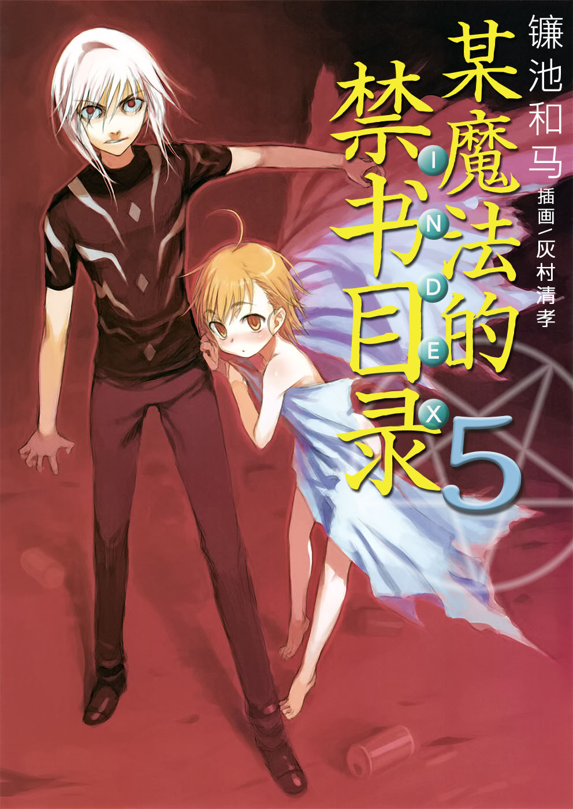
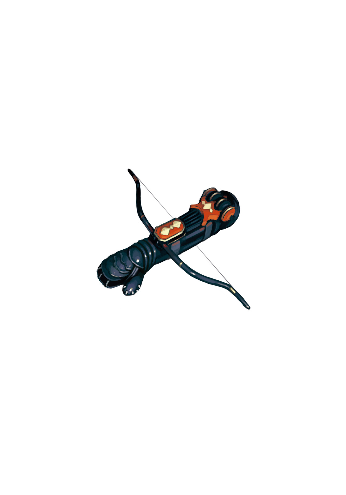

# 简介

**旧约·魔法禁书目录5**

作者：镰池和马

## 内容简介

**8月31日的学园都市。御坂美琴、一方通行(Accelerator)、上条当麻。三人各不相同的「暑假最后一天」开始了——！**

8月31日。

那天，一方通行(Accelerator)在小巷中遇见了一个神秘的少女。她的脸庞似曾相识——

御坂美琴那天在学生宿舍前被一个男生邀请约会。那个男生超帅气——

上条当麻那天在家中感受到不幸的一天即将开始。因为他意识到自己完全没做暑假作业——

8月31日，学园都市的暑假最后一天。他们各自的故事拉开了帷幕——！

镰池×灰村组合带来的超人气学园动作系列第五弹登场！

## 制作信息

* 翻译：李彦桦
* 台版：轻之国度EPUB制作组
* EPUB：江火如画
* 录入：寂若悠竹
* 扫图：Ozzie
* 初校：SwordGrave
* 二校：xxxholic
* 整合：知一一（禁书目录X系列，[index-X](https://github.com/1204244136/index-X)）


**版权声明**

转载时请保留录入信息。

本站内容仅供试看、学习与交流使用，禁止用于商业用途；下载后请在24小时内删除。请支持官方正版。


## 封面与封底

