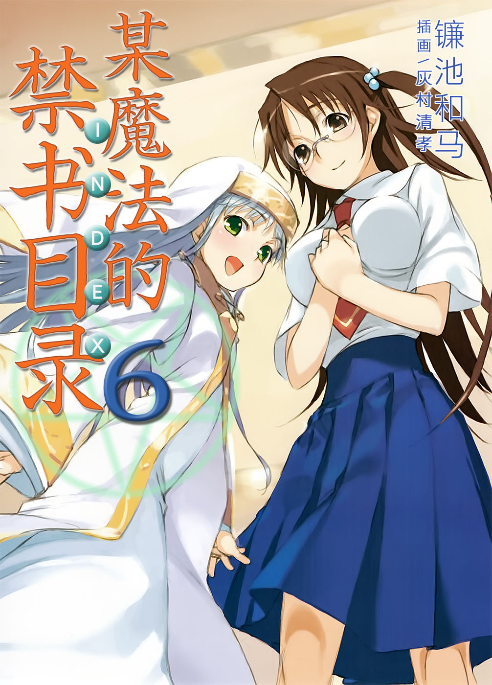

# 简介

**旧约·魔法禁书目录6**

作者：镰池和马

## 内容简介

**「谜之转校生」，「朋友」，以及某个魔法师。当科学与魔法交汇之时，上条当麻的故事就从此开始——！**

学园都市的新学期第一天。

这天，是上条当麻所在的高中出现「谜之转校生」的日子，是茵蒂克丝的第一次交到「朋友」的日子，是御坂美琴第一次与茵蒂克丝见面的日子，是依旧不幸的上条在两人之间左右为难的日子，是作壁上观的白井黑子感到嫉妒的日子……同时，也是一位魔法师袭击学园都市的日子！

「谜之转校生」，「朋友」，以及某个魔法师。

在特别警戒下的学园都市，当科学与魔法交汇之时，上条当麻的故事就从此开始——！

## 制作信息

* 翻译：李彦桦
* 台版：轻之国度EPUB制作组
* EPUB：江火如画
* 扫图：Ozzie
* 录入：rose.chang
* 初校：Exia
* 二校：SwordGrave
* 三校：xxxholic
* 整合：知一一（禁书目录X系列，[index-X](https://github.com/1204244136/index-X)）


**版权声明**

转载时请保留录入信息。

本站内容仅供试看、学习与交流使用，禁止用于商业用途；下载后请在24小时内删除。请支持官方正版。


## 封面与封底

