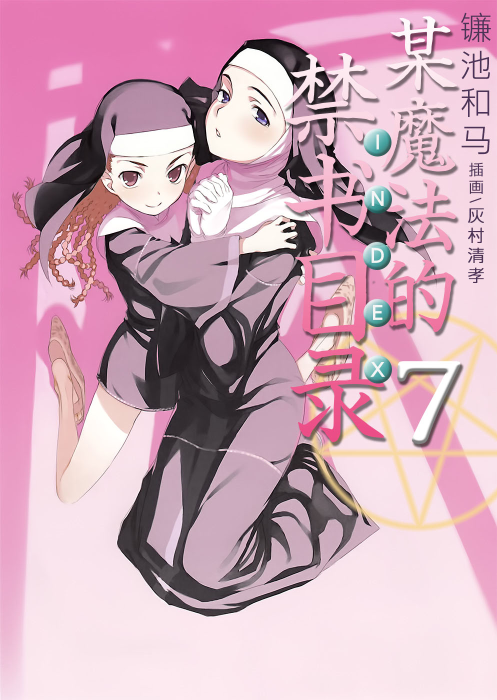
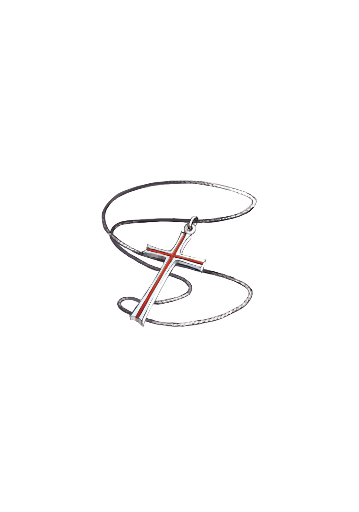

# 简介

**旧约·魔法禁书目录7**

作者：镰池和马

## 内容简介

**英国清教、罗马正教、天草式。某个少年被卷入了三方的修女争夺战……！当科学与魔法交汇之时，上条当麻的故事就从此开始——！**

传说中的魔法师所记述的，据说可以召唤天使的惊世魔道书《法之书》，连同掌握其解读方法的修女一起被掳走了。

在学园都市里过着悠闲日常的上条当麻，本来与这件事毫无关系——然而「不幸」的是，他却莫名其妙地参与了那场救援战……

而且，犯人竟然是「天草式十字凄教」，也就是神裂火织曾担任女教皇的那个宗派……！

茵蒂克丝所属的「英国清教」，这次的委托人「罗马正教」，以及神裂火织曾经担任首领的「天草式」。

当三个魔法组织与上条当麻交汇之时，故事就从此开始——！

## 制作信息

* 翻译：李彦桦
* 台版：轻之国度EPUB制作组
* EPUB：江火如画
* 扫图：Ozzie
* 录入：zhangfy21
* 初校：夏亚夜
* 二校：FateZZK
* 三校：xxxholic
* 整合：知一一（禁书目录X系列，[index-X](https://github.com/1204244136/index-X)）


**版权声明**

转载时请保留录入信息。

本站内容仅供试看、学习与交流使用，禁止用于商业用途；下载后请在24小时内删除。请支持官方正版。


## 封面与封底

