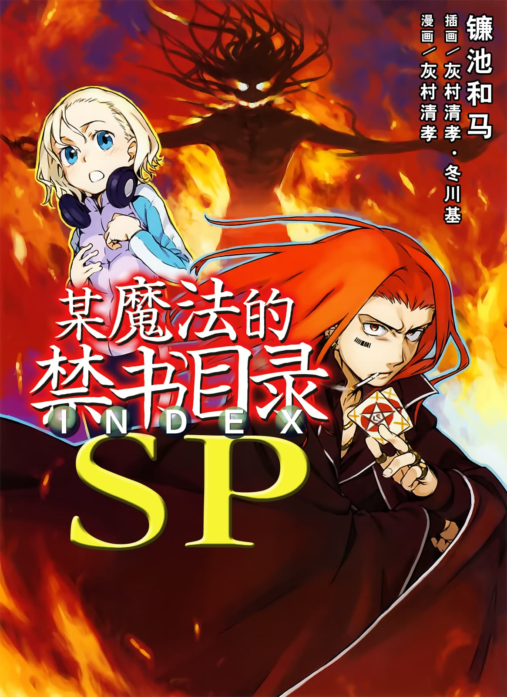

# 简介

**旧约·魔法禁书目录SP**

作者：镰池和马

## 内容简介

**补充本篇的短篇小说！**

《电击文库MAGAZINE》本刊及附录中刊登的《史提尔·马格努斯》篇、《马克·史佩斯》篇。电击文库MAGAZINE增刊《龙与虎！VS禁书目录》中刊登的《上条当麻》篇。漫画电击大王2008年10月号附录中刊登的《初春饰利》篇……至今为止只能在杂志上看到的《禁书目录》，一次性收录！

——「史提尔·马格努斯」——

英国清教「必要之恶教会(Necessarius)」下达了一道指令。于再度前往学园都市的史提尔面前，所出现的是同样隶属于必要之恶教会(Necessarius)的西奥多西娅·伊莱克特拉。她与史提尔交战的理由，是个名叫派翠西亚·柏德蔚的少女——为争夺北欧神话「黑侏儒」的技术，魔法师之间的战斗如今开始。

——「马克·史佩斯」——

隶属于英国魔法结社「黎明晨光」的魔法师马克，接获首领少女要求救出其妹的委托，马克虽然成功与在海洋资源调查船「蓝色搜查」上活动中的首领之妹接触，但却有看来是其他结社的魔法师来袭。马克运用以塔罗牌发挥的个性派魔法，试图将首领之妹救回。

——「上条当麻」——

学园都市第二十一学区。散步中的上条当麻与茵蒂克丝，遇见了魔法师芙蕾丝。由于上条的「不幸体质」，不知为何陷入了与被学园都市追击的芙蕾丝共同行动的状态，三人的逃亡戏码上演了。在此时，上条从芙蕾丝那里听到了关于火星未知生命体的意外情报——

——「初春饰利」——

学园都市发生了车辆劫案。「风纪委员(Judgment)」初春饰利也为了解决事件投入协助。劫车案的最终目的，与对学园都市发动的大规模恐怖活动有关。为了阻止以时速120km狂飙中的大型特殊车辆，初春与「警备员(Anti-Skill)」黄泉川爱穗共同在现场奋斗，然而——

## 制作信息

* 网译：toaruJamesbond@百度魔法禁书目录吧 马克·史佩斯篇
* KVTKVT@轻之国度 初春饰利篇：夜明の翼@百度魔法禁书目录吧 后记
* EPUB制作：黄昏的鸡蛋黄
* 翻译：黄瀞瑶
* 台版：轻之国度EPUB制作组
* 图源：seed
* 录入：zbszsr
* 修图：黑羽
* EPUB制作：鹘鹰⚡
* 整合：知一一（禁书目录X系列，[index-X](https://github.com/1204244136/index-X)）


**版权声明**

转载时请保留录入信息。

本站内容仅供试看、学习与交流使用，禁止用于商业用途；下载后请在24小时内删除。请支持官方正版。


## 封面与封底

