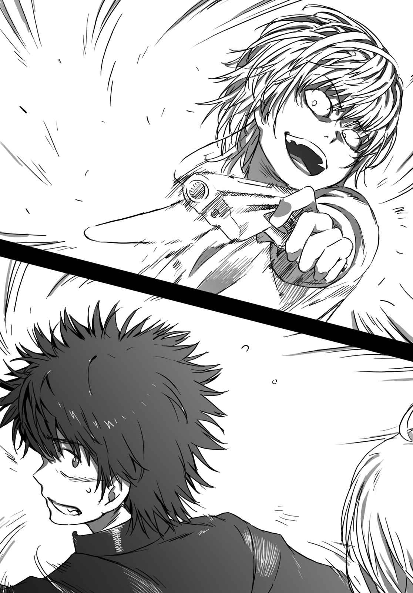
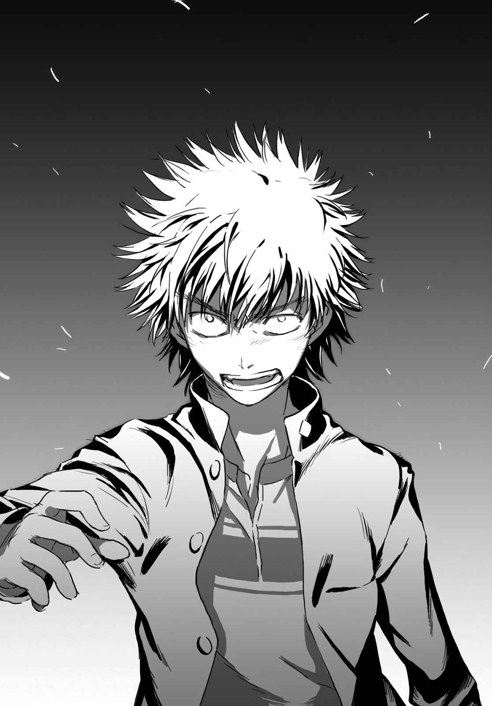

# 第四章 醉酒母亲的目前状况

> The_Two_Leading_Roles.

## 1

对学园都市而言，夜晚十点是比较晚的时间。

因为这城市的末班电车或公交车，都设定在学校的清校时间。依场所不同，有的店家会配合这个时间关店，感觉上气氛就像「只有适合大人的店开着」的状态。

由于街道上会有兼任教师与治安维持部队的警备员(Anti-Skill)巡逻，除非是已经觉悟会被辅导的家伙，一般学生都会乖乖地待在宿舍里。

反过来说，夜晚的学园都市就是凝聚了这些不良分子的时间带，普通的学生要是不小心在街上行走，就很容易被卷入「小麻烦」。

拄着拐杖的喀喀声响彻街道。

是一方通行(Accelerator)。

（啊——啊——……「加班」到太晚了……）

他要回去的地方并不是黄泉川爱穗的公寓。

资料上他虽然是长点上机学园的学生，却也不是回到那边的宿舍。

而是除此之外，「GROUP」成员间称之为「休息室」的建筑物。

话虽如此，这并非「GROUP」内的规则。土御门元春在普通高中上学住学校宿舍，结标淡希借住在某个爱管闲事的女教师的家。没听说过海原光贵的状况，但他应该也有属于自己的场所。只要不在「表面舞台」活动得太显眼，就可以确保基本的行动自由。上头那些人对「GROUP」的居所并不会管得太多。

其他成员无论在哪里做什么都无所谓，对方的想法应该也一样。老实说，只要不波及到自己，即使「GROUP」这个组织马上毁灭也没什么问题。

一方通行(Accelerator)心想这样反而比较方便。

跟对方打成一片，一切就会好转的事态已经结束了。

「……啧，去超市买杯咖啡好了……」

现在喝的罐装咖啡已经喝腻了，要不要换个牌子？心里这么想的一方通行(Accelerator)稍微改变行进的方向。仿佛被形成学园都市繁杂夜景的荧光灯吸引，他前往附近住商混合大楼一楼的超市。

「呜、呜呜——嗯……」

一旁突然传来梦呓般的声音。

但是那里应该不会有人。那里只有红色的邮筒。在电子邮件的全盛时代里，让人忍不住怀疑是否真的有用处的金属制邮筒，怎么看都不像是床。

不过，

「呜、呜啊——……好想吐啊……」

有个奇怪的酒醉女人睡倒在那里。她用双手将邮筒支柱如抱枕般抱住，还一边用脸颊摩擦着。

对方应该是个大学生吧。外表是简单的衬衫与黑色的细管裤……不过，那应该是昂贵的名牌货。稍远的地方还掉了一个除了钱包之外塞不下任何东西的手提包。她全身散发出一股「请袭击我吧，笨蛋」的气息。这副来者不拒的样子，反而让人提不起劲去袭击她。

还是赶快去超市吧，正当一方通行(Accelerator)想要置之不理通过时——

（嗯？那张脸，好像在哪里看过……？）

他突然停下脚步。

然后仔细盯着喝醉酒的大学生的脸。及肩的茶色头发、端正的五官。因为眼睛闭起来所以看不到，但还是可以轻易地猜想，她应该是一副精力过剩的样子。虽然身高与身材全然不同，他的脑海中却浮现**那个少女**的脸。

最后之作(Last Order)的家人？不可能。

量产型(Clone)能力者不可能有那样的东西存在。

（……这家伙是怎样？怎么那么像某人……）

因为太过在意，一方通行(Accelerator)走近女子身边直盯着她的脸看。

「呜啊啊……没错没错，我是御坂美铃啦……」

才发现对方的双眼突然睁开，喝醉酒的女子突然一把抱住自己。她的动作虽然缓慢，但是撑着拐杖行动不便的一方通行(Accelerator)还是无法躲开。

两人一起滚倒在肮脏的道路上。

抱住他腰附近的女子，完全没发现自己的身体紧贴着对方。

「兴趣是研究数论，擅长游泳，胸围是九十一厘米……啊，不行。我已经是有夫之妇了。这样太对不起爸爸了，不要这样随便紧抱着我啦！」

说完之后，对方一把推开一方通行(Accelerator)，一屁股坐在稍远的地方。在那一瞬间，他真的有股冲动想一枪打爆女子的头。

「咦……断崖大学的信息中心在哪里啊？那边的小白，你知道吗？」

这女人已经醉到天不怕地不怕的状态了。

现在不管对方是统括理事长还是美国总统，这名女子都会这样说个不停。

（太、太蠢了，跟她认真计较反而会降低我的格调……还是赶快去超市买咖啡回家算了，别管这个女人。）

一方通行(Accelerator)将体重靠在拐杖上缓缓起身，一只手简单地掸掉裤子上的灰尘，叹口气正要离开当场时。

「喂，怎么那么冷淡——不要不理我啦，小白……」

酒醉的女人突然一把抓住他的脚踝。

「哇？！」一方通行(Accelerator)再度跌倒。

奇怪的酒醉女人跨坐在他身上。

「我说小白啊，只要是年纪比我小的人，无论男女我都会亲对方哦——」

「干嘛从刚刚开始就一直说些莫名其妙的话啦！！」

一方通行(Accelerator)忍不住大叫，赫然发现状况不妙。

好不容易得到回应的寂寞酒醉女子，突然露出非常诡异的笑容。

「所以啊，我问你断崖大学的信息中心在哪里啊？我接下来还有些东西非读不可啦。因为我有一堆报告没写。噗哇——」

好臭的酒味！！这样的感想排山倒海地吞没了一方通行(Accelerator)。

「我怎么会知道啊，白痴！你不会拦那边的出租车哦！！」

「啊？出租车要怎么拦啦？」

就在这时，刚好有一辆出租车通过。被压倒在地的一方通行(Accelerator)挣扎着拼命举起手挥动着。

出租车缓缓停下，中年男子不知为何从驾驶座跑出来。

「没、没事吧！！发生什么事件吗？！」

「……你再啰嗦，我就把你们杀得一个不剩……」

一方通行(Accelerator)低声说道，他将跨坐在自己身上的酒醉女子往旁一推。「咦，那个小白啊。出租车要怎么——」他无视还在说话的奇怪女子，对着出租车司机大叫：「之后随你处置！！」这次总算真的迈开脚步离开。现在超市跟罐装咖啡都无所谓了。总之他只想尽快离开这个女醉鬼。

学园都市最强的能力者也是人，似乎还是会有一两样棘手的东西。

## 2

「所以啊，这么说来，可乐饼也算是火锅的一种。」

上条对着定在一旁的茵蒂克丝如此说明。

两人走出寿喜烧的店，与同班同学们道别后，现在正在回到宿舍的路上。途中两人还去了超市，以形成时间差避免被住在同一间宿舍的男孩子们看到。

「就像这样，将煤气灶放在桌子上，炉上放着装白油的锅子，再将事先沾有面包粉的料放进去油炸，听起来很好吃吧？虽然会花一些时间，在这段时间如果用来准备其他配菜，之后就可以吃到刚炸好的热腾腾可乐饼哦。」

「可是，无论什么料理刚做好都会很好吃吧。」

「你这么说是没错啦。」

「啊？！这样的话，当麻干脆在我面前现做料理，再让我直接吃掉不是最好吃吗？！这、这是大发现哦，当麻！！」

「开什么玩笑啊！！这样我不就一口都吃不到那个美味料理了！！」

上条进行身为人类理所当然会有的抗议，相反地，觉得这是好主意的茵蒂克丝与三色猫则露出不高兴的表情。

总觉得没什么做料理的精神，明天的早餐干脆用速冻食品解决吧。正当上条决意要进行自暴自弃的反击时，突然看到前方停了一辆出租车。黄色的方向灯闪闪烁烁，后门整个打开，一个女大学生不知为什么只露出上半身。

伏倒在路面上的女子，正在跟中年的男性司机争论。

「我不是说过，随意打开门就会无法开车？」

「你说什么，喂——这是对全日本半门联合的挑战吗，可恶——」

「好啦好啦，那个什么什么联合的成员就只有你一个吧。我已经听腻了，赶快回到座位上吧！」

「什么——被你这么说我更是不能乖乖回座位啦，嘿嘿。」

司机与女性乘客这番牛头不对马嘴的对话，传入上条耳中。

（呜哇，好讨厌的客人！！）

上条开始认真考虑要不要改道。

那名女子似乎不是乐在这番对话，而是觉得有人理她很有趣。万一被那种人缠上，直到明早她酒醒之前，自己一定会被卷入接二连三的麻烦。

对于原本就很不幸的上条而言，这是最不能理会的人种。

「咦？」

酒醉女子的头突然朝这里一转。

她的下半身还在车里，上半身则是趴在地面上。

「啊——啊——啊！你是上条同学没错吧，上条同学！！」

上条的肩头猛然一震。

为什么这家伙会知道我的名字？！上条重新盯着酒醉女子看，对方是大霸星祭中曾见过面的女子，御坂美铃。是那个哔哩哔哩御坂美琴的母亲。

「……这个嘛，如果她是那家伙的家人，倒是不奇怪啦。」

这番发言无论对谁来说都很失礼，但听到这句话的美铃，只是露出一个迟缓的笑容。

「地球的重力还真是伟大呢。」

「啊？」

「该怎么说，我什么都不需要啦。我要睡了，晚安。」

之后打呼声真的传来，当上条犹豫着该不该叫醒她时——

美铃的双眼突然睁开。

「啊，不行。我还没做肌肉舒展体操，而且也没涂乳液！混蛋，只要一偷懒就会出现在肌肤上。不管怎么说，我都已经是一个孩子的妈了！！呜呕……好想吐哦？！」

总之绝对不能让美琴喝酒精类饮料，上条暗暗发誓。

法律禁止未成年人喝酒。

另一方面，出租车的司机用「得、得救了！这个醉鬼认识的人终于出现了！！」的眼神盯着他看，那双闪闪发亮的眼睛，让上条快要招架不住。

美铃的目标似乎也从司机转移到上条身上，原本下半身在出租车后部座位的她，只探出上半身说：

「哦呜……哦呜。我……站不起来呢……」

看样子她似乎想起身，动作却很多余，看起来就像水族馆里的海狗。

虽然不想靠近，却也不能放她不管……当上条走近她身旁时，美铃突然一把抱住他。

「太好了！！年纪小的小弟弟！！」

「呜哦哦哦哦哦哦！！」

他的心脏剧烈地跳动起来，美铃平常似乎是勤于运动的人，脊柱似乎传来了奇怪的咔嚓声响。

「这个时间还在这里闲逛，美琴还好吧？噗哈——」

「哇！好刺激的酒臭？！」

「咦？你不觉得浑身酒味眼神迷蒙的人母很性感嘛？」

「其中有任何正面元素吗！！救、救命啊，茵蒂克丝！！」

上条马上求救，茵蒂克丝却以极为冷淡的眼神瞪着自己，不知为什么她似乎一点也不想帮忙。她手中的三色猫似乎也受不了酒臭味，在茵蒂克丝的手中吧嗒吧嗒地乱动。

美铃用迷蒙的眼神盯着茵蒂克丝：

「这女孩是谁啊？Please自我介绍。」

「哼、哼。我没必要对你这种人报上名字。」

「喂，你说什么！不赶快自我介绍，我就把手指插进这个男孩的鼻孔哦！！」

「哇哇！！茵蒂克丝！我叫茵蒂克丝啦！！」

就这样，就连平常使唤人无出其右的茵蒂克丝，也只能被现在的美铃玩弄。

「喂喂，断崖大学的信息中心到底在哪里啊？」

「啊？」

「就是那个啊，就是保管AI或是演算软件，收集程序相关情报群的阅览保管设施啦——」

「不，信息中心的解说就免了。嗯，断崖大学记得是——」

「对了，跟我交换手机号码还有电子邮件邮箱吧？」

「这么突然！！」

「反正你跟美琴也有交换吧。也让我加入你们嘛～对了，我的电子邮件邮箱是：……」

美铃滔滔不绝说出一串字母与数字。就这样，美琴借由血汗交织的机种大作战所得到的成果，她的母亲只花三分钟就入手。

「好的好的。把你的号码登记在『朋友』栏。」

「……我怎么觉得这一连串的会话，跟奥索拉的模式很像啊……」

累积太多疲劳的上条，将活像老虎钳般紧抱着他不放的美铃强行拉开。

「为什么御坂的妈妈会在这里？如果没有许可，应该无法进入学园都市吧？」

「是是，因为我是大学生，所以要交报告。可是那个资料只有学园都市这里有，所以我只好特地来到这里——」

「所以才要到信息中心吗……不过AI系的情报机关的确只有学园都市里有。」

上条惊讶地说道。

出租车司机一副想趁机溜走的样子，上条硬是瞪着他逼他留下。

「人家也想顺便看一下美琴，可是她说常盘台中学的女子宿舍检查严格，所以不行。竟然这样瞧不起老妈——」

「……这个嘛，浑身酒臭的醉鬼就算自称是『你们学校学生的家长』也没有人会相信吧？倒是你的外表看起来一点也不像母亲。」

「哦，这是不经意地在赞美我吗？不过才不是这样呢，我可是很努力的哦——每周我都在室内游泳池努力游泳，洗完澡后还要在全身涂满保湿乳液呢。稍有懈怠的话就会产生变化。呜哇，什么都不用做就青春无敌的十几岁还真令人羡慕呢！！」

美铃拼命地胡闹，可能是酒精发挥效力了，她的脚步相当不稳。幸好上条抓住了想趁机偷溜的出租车司机，在他的协助下将美铃塞进车子后座。

「等一下，喂！人家话还没说完呢！！」

「好啦好啦，剩下的下次再说，你先处理好循环全身的酒精吧。」

「混蛋，竟然被小孩子瞧不起。」

美铃仍旧喋喋不休，上条手一挥，出租车司机一脸「到底何时要付我钱啊」的表情不情愿地发动车子。听着远去的排气管声音，他微微地叹了口气。

「接下来，」

上条突然感觉到后方某人的杀气，忍不住打了个冷战。

不用想，那阵杀气来自抱着三色猫的修女。

「……之后的问题要怎么解决啊……」

## 3

脑袋被狠咬一顿的上条，抚摸着后脑勺打开宿舍房间的门。

「嗯……回来后觉得有点冷啊。」

上条边说边抓住与房间灯光控制合在一起的空调遥控器按下开关。眼角余光看着茵蒂克丝朝电视的方向跑去，上条前往浴室按下浴槽上的操纵面板打开自动供应热水模式。因为今天是洗猫的日子，所以他又多准备了一个洗脸盆。

（不用煮饭洗餐具真是太好了……真的很轻松——）

上条双手高举打着哈欠，走出浴室。肚子已经填饱了，接下来只要泡在浴缸刷牙睡觉就好，简直就像在极乐世界。像今天这样，真的会让人忍不住输给外食派的诱惑……但只要看过用手机的会计功能仔细记下的家计簿，就会知道要是真的这么做，每个月的中旬到下旬就一定「只能喝水配盐巴度日」

咦，今天的火锅影响如何？当谨慎的上条想用拇指操作手机时，电话突然传来来电铃声。

切换模式后，画面出现的是御坂美琴的号码。

上条按下通话按钮。

「？？？有何贵干啊，御坂？」

『为什么你到现在还没有回我电子邮件啊？！』

电子邮件？上条歪着头。

「一嗯，好像是有这么回事。」

『咦？！喂，你这家伙，未免也太不负责任了吧——』

美琴好像还在大叫些什么，才觉得她的声音越来越远，通话突然中断。上条看着手机画面，电波并没有信号不良。

（……是御坂那边断线了？）

胡乱这么想之后，上条又将手机切换到家计簿功能。

他一屁股坐在房间中央的玻璃桌前。

「茵蒂克丝——你离电视远一点啦。」

「虽、虽然你这样说，『提高思考力的SF健康猜谜』现在正是紧要关头啊！！」

「……感觉上，最近像这样跟科学或脑连接的猜谜很多呢。」

不过这跟学园都市的学业内容也有关联啦，上条胡乱想着，视线移到对猜谜毫无兴趣，正仰躺着沐浴在空调暖风中的三色猫。

「嗯。有空的话先把你洗干净好了。」

上条说着拿出动物用沐浴乳与猫头形状的海绵，三色猫似乎察觉到情况不妙，它一脸「我最讨厌泡泡与热水啦！！」的表情以高速躲向厨房。看样子现在应该躲在冰箱与柜子间发抖。

这样不就会浑身沾满灰尘吗，这下子非得把你洗个干净不可，当上条抬起沉重的腰时，

「嗯？」

手机微微震动。

这次不是美琴打来的。

小小的画面上出现的，是刚刚才登录的电话号码。

## 4

御坂。

刚才倒在道路上的酒醉女子的确这么说。

（……是碰巧吗？不。）

一方通行(Accelerator)拄着拐杖一个人走在黑暗的路上，茫然思考着。

她当然不是……最后之作(Last Order)的基因提供者御坂美琴。这么一来，会是她的姐姐。既然她在学园都市里，就表示她也有可能是能力者，但一方通行(Accelerator)不记得听过这样的情报。对别人不感兴趣的他，并不是很清楚其他能力者的详细情报。

但是，说到他在意的地方，

（服装，吧。Elmo、Az、Scale、香水是Zero Plus的新品……这好像不是青少年会穿的？看她从头到脚都是名牌货，而且全部是学园都市「外部」的企业。应该说连一件「内部」的商品都没有比较奇怪。）

如果是很喜欢的名牌，是有可能从「外部」买个一套啦……那个酒鬼的衣服，并非单一种类的名牌。衬衫长裤皮带鞋子手提包，都是各自选择喜欢的东西，看不出来特别执着于某个名牌。

就算这样，至少也该有一样是学园都市「内部」的东西吧。

在那种状况下，又完全没有「内部」的东西，

（那女人很有可能是从「外部」来的。）

一方通行(Accelerator)走在人迹稀少的夜晚的学园都市，故意选择没什么人通过的路走并思考着。

（那么，理由是什么？那女人的确说她有事到断崖大学的信息中心，在战争前的准备期间可能有这种事吗？别说是来自外部的宾客，就连物资的搬运业者也必须摸清他们的背景，还是那个女人有其他理由？）

理由。

御坂家系的人在这个时间点来到这里的理由。

也许跟基因提供者御坂美琴有关，或者是——

（……跟那小鬼有关？）

一方通行(Accelerator)咂嘴后，从口袋里拿出手机。

打开通信录，他将游标移到只写着「登录3」的项目按下通话按钮。

那是「GROUP」同事土御门元春的电话。

一将电话贴在耳边，拨号音响也不响电话就接通了。

『一方通行(Accelerator)。有何贵干？』

传来彬彬有礼的男声回应。听到这个声音的一方通行(Accelerator)眼睛微睁。这不是土御门元春的声音，语调完全不同。

**被监听了**。一方通行(Accelerator)心想。

「你这家伙的兴趣还真差劲。你是『GROUP』的『上层』吗？」

『有什么问题吗？』

「啧……我没事要找你。我的事自己会处理。别在那边不要脸地摆出一副监护人的高姿态想管人。小心我宰了你。」

『我的事？真是败给你了。如果你有空，我这里有个案子想请你处理一下。』

「啊？」

『有关御坂美铃的事。不过光说名字你不会懂吧。』

「……」

一方通行(Accelerator)忍不住环视周围。

看着没有什么异状的夜景。

（只是提供情报吗，还是从卫星监视这里……？）

「那个御坂美铃？是超电磁炮(Railgun)的关系人吗？」

『是的，没错。刚好这边现在才刚开始。』

什么？就在一方通行(Accelerator)皱眉时，

&nbsp;

轰！！

街道的一角突然被爆焰照得火红。

&nbsp;

由于距离很远，看到光亮数秒后声音才传来。

一方通行(Accelerator)将手机贴在耳朵，朝着声音方向转过头去。

快要被无数大楼掩盖的地平线附近，可以看到不自然的火光闪动。

『因为那个御坂美铃提出断崖大学信息中心的使用申请，所以我袭击了那里。使用者只有她一人，目前得知驻在的私设警备员(Anti-Skill)有数人，应该还在容许范围内吧。主要的信息都备份在网络上了，用不着担心损害。』

「你说袭击？」

『是的。』

（……那个御坂到底是谁？应该不是专业的工作人员吧？）

『正是如此，御坂美铃是御坂美琴的母亲。背景清白。这一点你可以放心。』

母亲？一方通行(Accelerator)想起美铃的脸，略微露出惊讶的表情。

但他有更在意的事。

「为什么要袭击那个母亲？你刚才不是说她背景清白吗？！」

『一般人也有一般人的危险性啊。接下来要进入刚才我所提到，希望你接下的案子。』

电话里的声音平淡地说道：

『你应该知道回收运动这个字眼吧？』

「最近在传的那个？因为学园都市有可能成为战场，所以监护人会将小鬼领回送到安全的地方？」

『这种想法是完全没有考虑到国土防卫状况的愚蠢策略，但是问题产生了。**如果很多学生离开学园都市**，**我们这边会很头痛**。』

「……」

为什么会头痛？

因为不想眼睁睁放走可以用来当作战力的学生们？

还是想避免被当作研究样品的超能力者泄露到外部？

不是，一方通行(Accelerator)心想。

电话的对象是「GROUP」的「上层」。这些家伙不可能说出那种一般论。如果说这些家伙会头痛，应该是跟更深入的计划有关。

比方说——

九月三十日看到的，木原数多、猎犬部队(Hound Dog)、有巨大翅膀的怪物、对最后之作(Last Order)进行的病毒灌入、对学园都市的攻击等——有关**幕后的各种片段**。

『御坂美琴是回收运动中的监护人代表。我们掌握到她有可能意图引起**我们的问题**，即使是偶然还是很令人头痛……所以决定要**提早排除**她。』

一瞬间，一方通行(Accelerator)的脑中浮现那个酒醉女人的脸。

她的确是个很烦的女人，但没必要将她拉进黑暗世界吧。

可是太晚了。

爆炸已经发生。也许御坂美铃已经被最初的一击炸成碎片。

但是，电话那端的对象说：

『你也要参加吗，一方通行(Accelerator)？』

「什么？」

『我是说可以赚一笔哦。这次是拿钱拜托Skill-Out去做，这个嘛……他们还真不会办事。虽说光凭这种程度的问题就派出「GROUP」，就曝光的层面来说有些风险，这样的顾虑反而会搞砸。如果你愿意帮忙，我可以帮你加分。这可以成为九月三十日的损失填补的第一步哦。大约八兆圆的借款，你也想早点还清吧？』

「……」

一方通行(Accelerator)思考片刻。

电话的声音**如果不是在开玩笑**，御坂美铃应该还活着。

「我拒绝。」

然后，他这么说：

「Skill-Out？我怎么可能跟无能力(Level 0)的家伙一起打杂？而且我根本没必要向你这样的家伙低头，要你帮我想办法。我会在这里可不是为了还钱，」

他边说边确认脖子上的项圈式电极。

白天虽然使用过，电池的电量应该还够用。

如果只是Skill-Out的一个集团，有这些应该没问题。

**帮助御坂美铃**。

一方通行(Accelerator)很自然地这么想。跟木原数多当时是同样的心情。脆弱的生命因为不合理的恶势力面临危机。他自己也觉得这么想很可笑，但他就是不喜欢这样。他想要吓吓制造出这样状况的那些家伙。他想起为了最后之作(Last Order)而战的当时。

即使自己是黑暗。

就算自己是黑暗。

「像你这样的人不会懂吧，我的人生是自己的，跟你有怎样的想法无关。一切由我自己判断。听好了，我可不是你的爪牙。」

『这样啊？不工作的话就赶快回家吧。』

电话那端的声音有些失望地说道。

&nbsp;

『在此之前，我这边先保管你的能力。』

&nbsp;

哔！！脖子上的电极突然发出奇怪的电子音。

（什……么！！）

一方通行(Accelerator)连忙伸手摸开关，没有任何反应。只传来咔嚓咔嚓的声音，无法由普通模式切换到能力使用模式。

「你这家伙，对电极动了什么手脚！！」

『咦？你有什么事非得使用能力吗？』

啧。他不禁咂嘴。

之前为了让「GROUP」的技术部改良电池，他曾经将项圈式电极交给他们一阵子，那时内部构造应该被动过手脚了。大概是被改造成让电话那端的人，可以利用远距离操作，自由开启安全装置(Security)。

别相信我们。

上午土御门说的这句话的意思，在此终于带有现实感。

『那么，如果没问题就容我先失礼了。晚安，一方通行(Accelerator)。』

通话切断。

一方通行(Accelerator)无趣地吐了一口气。

（好吧。变成这样，反而让我更带劲。）

他的眼中带着凶光。

一方通行(Accelerator)将手机收进口袋，暗自咬牙。

（……能够用的是一把手枪跟五十发子弹。不知道Skill-Out的人数、武装、战力，这样能救出那个醉鬼？）

虽然很困难，至少比当初对付木原数多率领的「猎犬部队(Hound Dog)」还简单。Skill-Out如果是普通的能力者应该可以靠武器解决，但他并没有接受过专门训练。

现在最大的问题反而是美铃。

袭击已经开始了。虽说是无能力(Level 0)集团，全身武装枪械或护身用具的不良分子，对一般人来说仍是很大的威胁。说不定还没到那里，美铃可能就被杀了。

「！！」

那一瞬间，驹场利德的脸在脑海里掠过，一方通行(Accelerator)决定忽视。

现在没必要想起那个试图做出不合乎身份的行动的恶棍。

由自己决定，旁若无人地前进。

这样就够了。

（啧，麻烦的问题就赶快结束吧。）

袭击地点是断崖大学的信息中心。

地点离这里数千米。与其拄着拐杖慢慢走，还不如拦辆车，当一方通行(Accelerator)正要朝着大马路走去时——

&nbsp;

哒！！

某个少年的背影倏然穿过一方通行(Accelerator)。

&nbsp;

「——」

那少年他曾经见过。

应该说他不可能忘记。

中等体型、黑色的刺猬头、紧握的右拳。拿着手机正在跟某人说话的他，前进的方向正是燃烧起火的断崖大学的袭击地点。他要去干什么很清楚。猜不出来反而比较难。

（那……个——混蛋！！）

不知道是因为自己在暗处，还是对方的心思完全都在信息中心，他完全没有注意到一方通行(Accelerator)。在平常的状况下碰面，两人可能会杀个你死我活。对方就是这样的对象。

一方通行(Accelerator)硬是甩了甩头，想要切换意识。

（啧，现在先不管那个。现在的敌人是Skill-Out。谁管「上层」的家伙怎样？没必要听那些家伙的话。只要想该怎么靠五十发子弹解决问题就好。）

他咬着臼齿，拄着拐杖迈出步伐。

御坂美琴的母亲。

他的确没有义务干涉她的人生，但她跟那小鬼之间也不算完全无关。虽说量产型能力者(Radio Noise)并不存在血亲，美铃甚至可能不知道有如此制造出来的小生命存在，即使如此，美铃跟那个小鬼还是有关。

也许两人一辈子都没有机会接触，应该说有机会反而麻烦，但他不能就此见死不救。也许，那不应该是在这里消失的存在。即使彼此都不知道这件事。

一方通行(Accelerator)是坏人。

但是，他对自己是坏人这件事并不设限。因为是坏人所以不去救善人，因为不是善人所以不走在正确的道路上，他完全舍去这些前提条件。

（接下来……）

走出大马路后，盯着徘徊在路上等着载酒醉客人的出租车车头灯，学园都市最强的能力者露出微笑。

（干嘛摆出这么认真的表情，去做不适合自己的事？我就用离救赎最远的方法，从鲜血中拯救这一切。）

## 5

这是稍早以前发生的事。

御坂美铃位于信息中心。

这是中心直径约五十米的圆顶状建筑物，周边有几个小小的方形建筑物。美铃起初在圆顶里利用电脑调查资料，现在移动到邻接的其他建筑物。

因为发生了异变。

起初是让人忍不住掩住耳朵的爆炸，接着设施的照明全部熄灭。也许有守护资料的辅助电源，只剩下演算机器类还在运作。

（什、什么？这是怎么回事啊，咦？）

美铃躲在圆顶设施旁约三个学校教室大的建筑物里，绷紧了神经。

原本因为酒精而放松的心情一扫而空。

爆炸产生同时，似乎还出现熊熊烈焰，但似乎很快就被扑灭了。墙壁的那端——在圆顶状主要设施中来来回回，引起这场异变的那些家伙，对他们而言这似乎也是出乎意料的事态。

『混蛋，是谁忘了切断安全系统？！真是的，本来想要一次解决就开溜的！！』

『时间呢？！那边如果进入自动通报，那就剩下不到五分钟了！』

『不会，启动的只有用来守护演算机器的独立配备。一般安全系统已经全部切断了。』

『也就是说只有火灾警报器了。不管怎样时间都不够……好吧，赶快去找那个女人。』

这些声音交错传来。

从音色跟语调可以知道，他们是群高中生年纪的少年。人数大约十到二十人。虽然看不清他们手上拿着的东西，光是听到咔嚓咔嚓的金属声就让人浑身发冷。光从刚才听到的爆炸声判断，他们似乎连枪弹跟炸弹都有。

（女人？找那个女人？除、除了我以外还有其他人吗？）

在这种时候会利用设施的人只有自己，警备员(Anti-Skill)全部都是男性……好像是。而且，从他们说话的方式来判断，目的似乎不是单纯的强盗或破坏活动，而是「那个女人」。

（糟了。一定是我。在这设施里的女人就只有我！真是的，到底是怎么回事啦！）

美铃将背靠在墙上，慢慢坐在地板上。

这里似乎是放置次要演算装置的房间，里头摆放许多图书室般的金属制书架。书架上收藏的不是厚厚的书本，而是被透明盒子覆盖的大量主机板。CPU的冷却方式并非空冷而是采取液冷方式，所以听不到风扇的电机声。取而代之的是血管般的管子纵横交错。

在荧光灯被切掉的黑暗房间里，只看到红绿色的灯光明灭闪烁。

（出、出口。逃生门呢……）

她观察四周，并未见到那样的门。

逃不了。被抓到就完了，接受了这样的事实之后，美铃不知为何有些兴奋。是酒醉转移到其他地方了？感觉有些奇怪。全身被一种马拉松开始之前，异样的高昂感包围。才刚觉得酒醉的感觉像被狠挨了一拳般飞散，似乎还留存着一些。在这样的事态下如果能完全清醒就好，但似乎不是这么容易就能切换。

（到底是怎么啦……）

美铃从口袋掏出手机。

最新的通话记录上有三位的电话。那是联系这城市的治安维持机关、警备员(Anti-Skill)的紧急通报号码。酒醉的脑袋还记得。自己的确在被袭击后马上就打电话，有个说话礼貌的男子应对。在圆顶状主要设施内阔步的少年们，很害怕警报装置的自动通报，即使不是这样美铃也一定会联络。之后已经过了数分钟，警备员(Anti-Skill)们差不多快赶来了吧。

&nbsp;

为什么完全没人来的样子？

&nbsp;

（……为什么？）

美铃不禁凝视着通话记录。

号码并没有错。联系应该有到达警备员(Anti-Skill)岗哨。却完全没有来。一抹不安掠过心头。刚刚接电话的人真的是警备员(Anti-Skill)吗？**那个语气异常礼貌的男人**到底是谁？

（为什么，为什么都没有人来！我的确是拨了电话啊。并没有弄错顺序啊！为什么我还要受罪啊！！）

指尖的颤抖增加。

因为酒醉而扩散的恐惧，终于侵蚀了美铃的中心。

在这样的状况下，明明只要发出一点声音就糟了，她却想忘记一切放声大叫。

一个人很危险。一个人很危险。一个人会被追赶到绝境。对话，什么都好。无论是谁都好，总之我需要一个对象，倾诉这种快爆发的情绪。

她打开手机的通信录。

在这个时间，不知为什么她没想起丈夫的脸。比方说联系学园都市外部的第三者，请对方通报警察。但是学园都市的内部几乎都治外法权化了，根本不允许警察介入（不是独自的「法律」而是「条例」，但依大众的意见，这不过是守护日本这个国家的尊严，而便宜行事的手段）。这么一来，如果要联系第三者，应该联系的是这城市内部的人。

但她不想打给自己的女儿。也许这是身为母亲的最后的自尊。在此被美琴看到自己软弱的一面的话，今后她恐怕无法自称为母亲。

位于学园都市，马上可以联系到的人。

而且是，女儿以外的人。

符合这个条件的只有一个人。

（哈哈……）

御坂美铃用拇指操作着手机。

为了缓和快要压扁自己的内心压力，她打电话给那个少年。

## 6

学园都市的电车与公交车，在清校时间会结束功能。

「混蛋！！」

因此，上条只能奔跑在黑暗的街道上。他认真地思考着要不要考摩托车的驾照，朝着断崖大学的信息中心奔去。

同时，他对着贴在耳朵的手机大叫道：

「御坂伯母，刚才你说那些家伙有带武器吧。目前在那边行动的人应该是Skill-Out。如果是普通能力者的集团，应该会利用他们的『力量』。」

『我、我不知道Skill-Out是什么呢。』

「简而言之就是武装流氓啦。只要想成是手持危险武器的不良集团就是了！」

总算看到设施了。

上条一路跑着，发现最初看到的火焰消失了。正如美铃的报告，信息中心那里应该有自动灭火设备。

『那些不良集团为什么会盯上我？』

「这个嘛……我不知道呢。」

会不会是跟美琴有关？上条心想……但他突然发现某件事。

「御坂伯母，你有打电话给你女儿吗？」

『咦？』

「她是学园都市仅有七个人的超能力者(Level 5)之一，比一般警备员(Anti-Skill)还要可靠！如果还没有联络她——」

『慢着！！』

美铃用不同以往的强力语调打断他。

『美琴不可以！那不是她能否成为战力的问题。如果将那孩子卷入我的问题当中，那我就没脸见她啦！！』

换作平时，上条会认为这是天真的意见。

就像念着新闻稿，只能说出冠冕堂皇的意见般。

但是，美铃现在性命有危险。

在这种状况下，她却一口拒绝让美琴参战。

「……我知道了。」

上条边跑边握紧手中的手机。

「那我去就好。我们在你藏身的『次要演算装置保管库』碰面。」

『咦，等一……我没拜托你过来——！！』

上条心想：吵死啦。

信息中心就在眼前。

那设施虽然邻接着断崖大学的领地，信息中心却比主要的大学还要大上两圈。圆顶状建筑物现在仍然传出枪声与破坏音。可能是最初的大爆炸所引起，聚集了很多旁观的好事者。相反地，警备员(Anti-Skill)的数量很少。也许是害怕狙击的可能性，他们以车子做盾牌使用无线电要求增援。但是到底是发生什么问题，警备员(Anti-Skill)们几乎要吵了起来。

上条跑过他们身边，一口气奔向建筑物。

后方传来警备员(Anti-Skill)制止的声音，他根本不理会。

（Skill-Out的那些家伙，以前曾经在暗巷跟他们交手过几次……）

不知是不是不幸中的万幸，他们忙着搜索设施内部，似乎疏忽了对外部的注意。即使奔跑在没有遮蔽物的广场上，也没有遭到狙击。

（基本上只有逃跑，或者是躲在道路角落反击的二选一选项。像这样自己送上门，还是头一遭啊！！）

事情感觉越来越麻烦了，他心中想着，并冲进玻璃完全碎裂的正面入口。

## 7

滨面仕上相当焦躁。

依照当初的计划，只要趁着黑夜开着赃车接近设施，朝里面射八发手工制火箭炮再逃跑。事前他已经拿到了设施草图，知道在哪里点火之后塞住出口，就能有效率地让内部充满烟雾。

最初的失败，是原本准备的八发当中，有三发因为成了哑弹，所以无法引爆。

接下来其他五发也在着火后，被信息中心的自动灭火设备扑灭。建筑物的构造虽然因爆炸而扭曲，但部分外墙被肥皂泡沫般物质包裹的建筑物，并没有全部倒塌。主要的火焰与烟雾如果无法使用，目标就还能存活。

因此滨面他们无法离开，只能亲手解决目标。

而且，

「还没找到……那个女人吗？」

光凭委托人交给他们的大头照，别说是对方具体的身份，就连名字都不知道。假设对方从设施逃跑，又戴着墨镜或毛线帽等隐藏脸部特征混入人群，那就无法搜索。不管如何都必须在这里解决她……

「我在问你还没找到她吗！混蛋！！」

他用粗犷的声音大喊，同是Skill-Out的伙伴只是瞄了他一眼，没多说什么就再次展开搜索。

没错，他们**都是**Skill-Out。

数小时前管理他们的，是名叫驹场利德的男人。因为驹场消失所以换滨面坐上了首领之位，但这种新的权力关系无法马上浸透。应该说周围的空气中以不满的成分居多。只要组织整体发生什么失态，所有责任都会推到他身上。

驹场利德与滨面仕上的差别非常明显，相对于驹场很自然地就能站在众人中心，滨面只是硬被委托连自己也不想做的差事。无论完成了多少工作，还是无法消除自己内心的那种异样感。就算从别人的角度来看，这种异样感也无法除去。

正因为知道这一点，滨面才会如此焦躁。

无论是遍寻不着的目标、失去方寸的搜索方法、他认为这全部是拖自己后腿的背叛行为。

滨面一脸焦躁，用指尖拨弄鼻子上的鼻环。虽然是上个月穿的洞，状况并不是很好。光是些轻微的碰触就会扰乱集中力，最糟的是还会累积汗水。

「……没有后路，我们没有后路。混蛋，驹场那个笨蛋。搞出这么大的计划，结果却自己干脆地挂了。被丢下来的我们该怎么办啊，混蛋……」

此时，数名少年集中在门前。

似乎发现到还没有调查的房间。设施内的门基本上都没有上锁。少年们轻易进入房间后，女性短促的悲鸣从里面传来。

看样子是找到了。

因为没人打算使用无线电，滨面无奈之余，只好自己对搜查其他地方的伙伴下达指示。这样与其说是首领，更像是打杂的吧？滨面这么想着，晚一步前往那个房间。

「这里是中央圆顶。在次要演算装置保管库发现目标。我这边会处理，你们就准备撤退。把车子开过来。」

「知道了。」才刚想对方应该会丝毫不带劲地这么回答时，

『啊？！你这家伙，等一下——沙沙沙沙沙沙沙沙！！』

不明就里的声音与杂音震动鼓膜。

而且在同一个设施的某处，传来了两声枪响。

（警备员(Anti-Skill)？啧，花太多时间了吗！）

看着颈后被一把抓住，从房间被拖出来的目标，滨面思考该怎么用无线电下达指示。

『嗨——混蛋们。』

滨面的肩头颤动。

即使通过音质不好的无线电也可以知道，这显然不是自己人的声音。平常很难听到像这样异质、仿佛金属互相摩擦般的声音。而且对方居然完全不遮掩地清楚传达自己的音色。

『我告诉你们所有人。我要送你们Skill-Out天国一日游。这真的非常划算哦。你们可能会因为太舒服而舍不得回家啊。所以，准备受死吧！！』

说完后，无线电单方面被切断。

之后，

让人忍不住掩耳的枪声连续响起。

## 8

上条当麻背部靠在通道的角落。

他的双手握着从窗框拆下来的方形防弹玻璃。坚固的窗户重量大约七到十千克。边长约一米前后。

这是在设施里发现的东西，防弹性应该没那么高。再怎么说，最坚固的玄关正面大门玻璃，在袭击时已经全部被打碎了。

不过还是比手上空无一物好。

Skill-Out会持有手枪并不稀奇。

与其将漫画杂志藏在衬衫下方防身，感觉上这么做还是安全一点。

（……）

有个手拿电击枪的男子昏倒在脚边。那是他埋伏在角落，一碰头时马上用力挥动防弹玻璃，将窗框部分的不锈钢用力朝对方鼻梁挥出所达到的成果。男子犹如踩到香蕉皮般往后猛然滑倒，就这样倒地不动。

上条已经用这样的方法打倒四名Skill-Out。

跟手持武器的对手对战时，最重要的就是别让对方有机会使用武器。万一演变成双方正面对峙的事态，就算是输了。反之，不管是任何武器，只要在对方使用之前先下手为强就没什么好怕。不论是刀或手枪都一样。

（如果对方采取两人或三人一组行动，就无法使用这种战法……幸好这群人都是笨蛋。刚好每个人都是单独行动，他们还真该学学利用人数优势。）

他捡起电击枪。

他从被打倒的敌人那里没收武器，与其说利用，更该说是为了不再让武器落在敌人手上。

现在他双手都用来拿防弹玻璃，也无法跟其他武器并用。

「接下来……次要演算装置保管库在哪里？」

上条重新拿好大大的玻璃嘀咕道。

这个信息中心的构造以圆顶状主要设施为中心，连接着两层或三层楼的小建筑物。

不管怎么想，Skill-Out的人应该集合在中心的主要设施吧，上条使用连系圆顶周围小建筑物的联系通道，故意绕远路走。

依场所而异，有的建筑物只能从圆顶进入，目前上条还算是畅行无阻。总之先使用联系通道绕个一圈吧，正当他要前往下一个建筑物时，

嚏！砰！！枪声传来。

「……？！」

自己来得太迟了吗……一瞬间他感到背脊发寒，不过光听声音，感觉上只是捅到蜂窝般的骚动。当然，美铃手上没有枪。这么一来，是其他人在应战。

（是警备员(Anti-Skill)？还是Skill-Out起内讧？算了，不管怎样这还算是个机会！！）

上条只要走到通道角落，就会慎重地观察另一边的样子，等确认过没有人后再前往其他的建筑物。

但是，没多久他就走到了尽头。

正确地说，只剩下前往圆顶状主要设施的通道。

（咦，结果是这样吗！不过我也不能一直站在这里不动！）

他在通道上奔跑，靠近连接中央圆顶的门。

屏住呼吸伸出手，犹豫一下后缓缓接触门把。

他用处理炸弹般谨慎轻柔的动作，慢慢转动门把。门的金属零件「喀啦」打开的声音传来。原本紧闭的门，打开了一条细缝。

他朝内部望去。

里头的办公桌犹如树木的年轮般呈同心圆状摆放，上头摆了很多台电脑。设施的照明被切断，只有荧幕幸免于难，整个房间内部被微微的光包围着。

四五名少年聚集在圆顶状建筑物的一角。

他们的中央，则是被迫坐在地上的御坂美铃。

距离约十米，这群少年在Skill-Out里应该算是高阶吧，他们手中全都有枪械武装。随便接近可能会被打成蜂窝。

（……这么糟糕的状况，真是让人忍不住要笑出来。到底要怎么救她啊！！）

那些少年似乎正在争吵。对于设施内发生的枪战，应该干脆杀掉美铃离开这里，还是要把她当成人质，彼此的意见分歧。

杀害派将枪口抵在美铃头上，人质派则是把枪推开，双方重复这样的动作僵持不下。再这样下去，就算没有要杀她的意思，还是很有可能不小心扣下扳机。

「混蛋……」

上条忍不住嘀咕，先从门那边退开。

（对方有四五个人，全都拿着枪。这样不适合大喊冲进去攻坚。）

他确认从之前打倒的Skill-Out那边夺来的武器。

电击枪跟警棍，还有长射程杀虫剂，大概是用来代替催泪瓦斯的。但无论是哪个都不太可靠。

（现在手上拿着防弹玻璃所以没有空位，武器或防具，无论如何都得选择一个吗……）

上条重新望向大块的防弹玻璃。

（不行，这块玻璃不能丢。电击枪或杀虫剂并没有办法一举让对方无力化，做不到那样的话就会被对方反击。）

这么一来，还是得拿着防弹玻璃进入圆顶。

上条用被汗水浸湿的手掌，重新抓好防弹玻璃。然后接近圆顶的铁门，重新将门打开一道小缝。

状况没变。

正在争吵的四五名少年，与被他们包围的美铃。

距离大约是十米，中间隔着上面放有电脑的桌子。

无法直接前进。

（好远啊。）

此时，上条在自己所在的出入口附近，发现一个微脏的包包。包包随意被放在办公桌旁的地板上。那应该是Skill-Out的东西吧。拉链被打开来，露出了喷雾罐般的东西与手枪。

（……）

上条吞下一口唾沫。

包包位于距离这里三米左右的地板上，就算伸长手也够不到。如果要抓到里面的枪，还是得将门打开到一定的程度潜入圆顶内。

（行得通吗？）

设施内的电源被切断。

现有的光亮，来自被紧急电源守护的电脑相关机械，只有这样朦胧的光线照亮了中空。脚边部分几乎是漆黑一片。

圆顶的地板铺着短毛的地毯。

不管怎么做，也没办法偷偷接近美铃，将她偷偷带出去。

但是，如果是三米的距离。

不论实际上是否开枪，只要先将手枪弄到手就好。

并不是到达众人环视下的美铃身边。

如果只是在没人注意的状况下，前进三米。

（……只能去做了。）

上条双手抓紧防弹玻璃的窗框。

（虽然我不清楚枪支的使用方法，只要握有跟对方对等的武器应该可以达到威吓作用。我这边还有防弹玻璃。就算真的出问题，我还是比较有利。）

上条硬是找出乐观的理由，朝颤抖的双脚注入力量，将手掌贴在微微打开的钢铁门表面。

他将门缓缓往前推。

Skill-Out的人们似乎没注意到门上的些许动静。上条屈身慎重地走进圆顶内部，距离装有手枪的包包为止的三米，感觉竟是如此地漫长。

此时，上条的眼睛跟十米前方的美铃对上。

&nbsp;

「咦？」

&nbsp;

美铃忍不住发出声音的瞬间，Skill-Out的成员一齐往这边望去。

上条躲进附近的桌子阴暗处。

（那女人是笨蛋吗！！）

他浑身颤抖，连自己也无法控制。隐藏的地方也许没被发现，但是门不自然地打开这件事的确是露馅了。

他知道有人靠近。

但是躲在桌子暗处的上条却完全看不到对方的脸跟武器。

只听到脚步声响起。

脚步声的间隔并不一定。地板是短毛的地毯。也许对方正确定有没有留下足迹而接近中。在这样的黑暗中不知对方是否能够正确地确认，万一被看破上条就完蛋了。

（手枪呢？！）

上条维持仆倒的姿势观察四周，放在地上的包包，刚好位于桌子之间的狭窄通道另一端。把手伸长应该够得到，但这么做应该马上就会被发现。

幻想杀手(Imagine Breaker)对他们的手枪并不适用。

感觉冷汗在背部一整面喷出。

心跳声几乎要支配了整个耳朵。

（混蛋……）

上下排牙齿感觉上快要格格作响。

也许是因为过度紧张，越想屏住呼吸气息反而越是粗重。

他只听到有脚步声，从看不到的位置传来。

（只能动手了。像这样一直缩着铁定会被发现。所以只能放手一搏！一击搞定。只要把对方一次击退就没问题。在对方姿态恢复之前，只要捡到装有手枪的包包就能逆转！！）

就在这时，

&nbsp;

喀。

有个大大的鞋子，出现在蜷缩躲藏的上条身旁。

&nbsp;

不能再等了。

再等下去只会让对方取得先机。

「！！」

上条深呼吸之后，从屈身状态一口气突然跃起，奔出办公桌的暗处。配合突然跃起的动作，他将手上的防弹玻璃朝身旁用力挥去。

戴着鼻环的高大男子惊讶地张开嘴。

之后，对方的脸从上条的视野中消失。钝重的声响传出，Skill-Out的身体被敲打在地板上。不知是不是肉被扯断了，金属鼻环在空中飘浮着。

击倒一人。

但上条的脸上没有喜悦。

一旁明明就是装有手枪的包包，他甚至忘了伸手去拿。

就在仅有一米的极短距离，站着一个脸色异常苍白的少年。

（竟然有两个人过来巡逻？！）

上条忍不住全身僵硬，不过对方似乎也是如此。除去手上拿着枪这一点，对方只是没经过任何训练与经验的学生。看到同僚突然被打昏的他，无法掩饰内心的动摇。

细微的「锵」声响起。

那是在空中飞舞的鼻环，掉在地板上的声响。

「……！」

上条与脸色苍白的少年同时行动，此时出现了新的动静。

在美铃身旁待命的其他男人将枪口指向上条。锐利的金属声响起，应该是对方用拇指打开了手枪的保险。美铃附近有两个少年，其中一名……手脚缠着细链的男子用发抖的手握住手枪。他附近的另一人——衬衫与长裤有无数切痕的少年试图阻止他，但在此之前扳机却先动了。

「喂，开玩笑吧——？！」

发出声音的不是上条，而是上条附近脸色苍白的少年。

枪声连续响起。

砰砰！！不知是轰响还是冲击波的声音传开。

马上用防弹玻璃挡住自己的上条，突然感到手腕传来一阵痛楚。并不是被子弹打中，而是防弹玻璃受到的冲击传到骨头。

另一方面，上条附近脸色苍白的少年，仿佛被锤子击中般被打飞到地板上。发现他的侧腹流出红黑色的液体时，上条不禁咬牙，但这状况他也无能为力。

有一瞬间，上条在犹豫是否要躲在阴暗处。

（混蛋！非阻止他不可——！！）

他将防弹玻璃挡在身前，一口气跑到美铃身边——正确地说，是站在她身边的两名Skill-Out身边。

距离约十米。

上条穿过并排的桌子之间。

下一发枪击来袭。

子弹打中防弹玻璃表面，但上条的上半身还是差点仰翻过去。当他试着取回平衡时，子弹再度打上防弹玻璃，震得窗框脱手。

「咔嚓」的金属声响起，大型的窗玻璃掉落在地。

没时间捡了。

当他因疼痛与紧张而汗湿的手而抬起头时，发现两道枪口正对着他。这次不仅是锁链男，就连裤子有裂痕的男子也不再犹豫。

只有五米。

虽然荧光灯的光亮消失，上条还是看得到Skill-Out少年们的表情。他确实看到其中一人的汗水从鼻梁滴到嘴角。微微抖动的瞄准、犹如生锈娃娃般动作不流畅的食指，在完全无声的一瞬间，这样的场景异常鲜明地烙印在视网膜上。

之后，上条在视野的一端，突然看到美铃的脸。

坐在地上的她呆然地喊叫着什么。

虽然看到她的嘴唇在动，声音并没有传进上条的脑袋。

连一根手指也动弹不得，时间仿佛停止，在这样的状况下——

&nbsp;

砰！！尖锐的枪声炸裂开来。

所有的声音恢复。

&nbsp;

在这一瞬间，上条的心脏真的停止了。

但是上条的身体并没有被打出九毫米的通风口。可以看到枪口指着自己的两人中，那个手脚缠有铁链的男子，以不自然的姿势被打飞到一旁。红黑色的血拉出长长的尾巴，敌人毫无抵抗地滚倒在地板上。

美铃毫无意义的尖叫声传来。

剩下的那个裤子有切痕的少年将视野往旁边一转。

他望向的不是上条刚刚进来的出入口，而是另一个。

有人从那边对Skill-Out开枪。

「你、你这家伙！！」

手拿枪支，身穿有切痕裤子的少年大叫。

上条总算从活像鬼压床的状态中解脱了。

就像用手指弯折被胶水固定的绳子，使其恢复柔软度，重获自由之后的上条突然躲到办公桌下方。

他维持这样的姿势，对着数米前呆坐在地的美铃叫道：

「趴下！！」

但美铃仍旧发着呆，一点也没有移动身体。

「御坂伯母，快趴下！！」

砰！！好几个巨大声响遮住上条的叫声。

不知是谁开启了枪战，这样下去美铃可能会被流弹打中。

（混蛋！！）

躲在办公桌阴暗处的上条短促地吸了口气后，

（办得到吗……混蛋，只好硬穿过这里了！！）

他维持蹲低姿势奔出。

穿过五米的距离，他像是要覆盖住呆坐在地的美铃般撞上她，将她压倒在地板上。

枪声持续响起。

「快逃……」

没有必要硬是阻止这场战斗。

「快点！！」

上条抓住美铃的手臂，为了尽早离开这个房间而开始奔跑。

## 9

当一方通行(Accelerator)踏入圆顶状主要设施时，他决定对所有持枪者开枪。一开始是站在美铃附近的两人其中之一，他将枪口指向手脚缠绕着锁链的男子，就这样扣下扳机。

砰！！干燥的声音响起。

看到身体喷出血被打飞的男子，坐在附近的美铃发出短促的惊呼。

人类还真是不方便。

身体虽然长这么大，才开了一个九毫米的通风口就轻易倒下。

「你、你这家伙！！」

另一个Skill-Out喊着，将枪指向他，一方通行(Accelerator)躲在铁门后面避开好几发子弹，然后反击发射出子弹。

上衣与长裤有切痕的男子躲在桌子暗处，毫不理会，连桌子一起打穿他们的身体让他们安静。

（接下来……剩下的Skill-Out呢——）

「是那个？」

一方通行(Accelerator)将枪口对准拉着美铃的手臂，试图前往出口的黑色人影随意开火。

「哦哇哇哇哇哇哇啊？！」

尖锐的叫声传来，子弹从人影稍稍偏移。可能是因为他意识到目标身旁的美铃，他的准头略有失误。

为了逃离枪口，人影带着美铃继续奔跑。对方的脑袋里似乎没有举双手停止的选择。

啧，一方通行(Accelerator)咂嘴：

「真有趣……都这样了还不放弃委托，真是有骨气啊。」

一方通行(Accelerator)咧开嘴角露出笑容，重新握好手枪瞄准。

「像你这种没用的笨蛋！我就在这里把你打成一堆废渣！！」

「闭嘴，混蛋！美铃她到底做错了什么？！袭击无罪的人，而且还跟自己Skill-Out的伙伴起了内讧！！你就给我去死吧！！」

嘈杂的声音进入耳朵，一方通行(Accelerator)仍旧毫不在意地将意识集中在食指上。但是，美铃的背影还是阻碍了他开枪。

就这样，两人跑到其他出入口。

一方通行(Accelerator)用手枪枪口挠着太阳穴，

（……咦？跟自己Skill-Out的伙伴起了内讧？）

他将对方刚才说的这句话稍作思索。

（我也被当成Skill-Out的一员了？也就是说，那家伙是Skill-Out以外的人？这个设施的利用预定者应该只有御坂美铃一个人啊……他是风纪委员(Judgment)吗？）

对方不用枪反击也很令人在意。他的动作看起来不像是警备员(Anti-Skill)或风纪委员(Judgment)。

（会知道御坂美铃的名字也很令人在意……不过，就算不是熟人，Skill-Out应该也知道袭击目标的名字吧。）

朝对方开了数枪追击后，一方通行(Accelerator)前往圆顶设施深处。

「接下来……」

他决定先去追赶美铃，以及将她带走的人影。

不知那个人影的真实身份是谁，从他没有在此杀了美铃，也没有一个人脱逃这一点看来，就算那家伙真的很不巧是Skill-Out，在逃到安全的场所之前应该不会杀了美铃。从一方通行(Accelerator)踏入圆顶时对方没反击这点看来，他应该没有持枪。

这么一来，

（只要在那家伙逃出领地前解决他就好。）

当这么想的时候，一方通行(Accelerator)的耳中突然传出来自不同方向的许多脚步声。

可能是听到刚才的枪击战赶来的。

看样子没办法轻易前进了。

（只好先退一步解决这些人。光靠圆顶内的遮蔽物(商务座椅)，应该无法成为子弹的防护盾。）

一方通行(Accelerator)环视四周寻找作战的场所，突然停止动作。

倒在地上的混蛋有三个。

但是掉落在地上的枪却有四把。

## 10

上条与美铃跑过圆顶状主要设施延伸出来的联系通道，进入其他小型方形建筑，好不容易从那边的逃生门逃到外头。

正面出入口聚集了许多看热闹的人，也许因为这里是后门，完全看不到人影。

上条拉着美铃的手，

「总之，先到人多的地方去吧，正门那边有看热闹的人跟警备员(Anti-Skill)，稍微绕一下路比较安全。」

「啊，男孩子还真是可靠呢。从头到尾我都一直依赖你。真是的，亏我还是家长啊。」

美铃异常消沉，不过在那种状况下，要表现得坚强反而很困难吧。老实说，上条自己也不想再来一次。

所以，他并没特别责备对方，而是催她进行下一步。

「快点。虽然好不容易到外面，并不代表那些家伙都消灭了。如果在这里又被袭击，就等于回到原点。」

「好啦好啦，那请你牵着我的手带路吧。」

被她这么一说，上条突然觉得害羞起来。上条想要放开抓住的手，反而被美铃抓得紧紧的。

对方看来似乎在挑逗他，实际上应该是真的很害怕。

上条两人就这样走在领地内。

圆顶的直径约五十米，就算加上周围的建筑物，也不算太大。从这里走到正面玄关大约只花了几分钟。已经脱离了最危险的状况，应该比上条嘴里说的还要安全。只要对方不是打算连围观的好事之徒一起杀了自己，到了正面玄关的话，Skill-Out应该就会自行撤退。

**但是**，

&nbsp;

「别动。」

&nbsp;

一个人影出现，仿佛要挡住前往正面玄关的路。

是上条刚才在圆顶内用防弹玻璃打倒的家伙。他应该是马上就醒过来了。由于鼻子上的鼻环被强行扯掉，上面黏着红黑色的血。虽说当时状况紧急，对方晕倒后还是应该把他的手脚绑起来。

「别动……你这家伙是谁？为什么在这个时候来到这里？那个委托莫非是陷阱，我们被骗了……？」

听到这句话，上条皱起眉头。

「你说的委托是？」

「确认这件事又能怎样？你明明就很清楚吧。驹场那笨蛋被杀了，所以只能由我指挥，收拾那家伙的残局。我还以为如果要回避对暗巷的压制作战，就只能讨『他们』欢心……混蛋。你们果然一开始就打算抛弃我们！！」

「我听不懂你在说什么啦。」

上条在脑中整理这些只字片语，并对男子说道：

「我只是接到了这个人打来的电话。我不知道你在想象些什么，我才没有那么复杂的问题。」

说完后，男子惊讶地张大了嘴。

然后他露出微笑。

「哈哈。」

那笑容看起来一点也不愉快。

「也就是……那个？即使我们在此全部下台，就算真的被警备员(Anti-Skill)抓住，在问题中心的你却丝毫没有任何想法？我滨面仕上的人生即将就此完结，都已经是最后一幕了……难道你就不能假装我被卷入极大的阴谋，而内幕后还有了不起的军师，像这样骗骗我吗？哈哈哈、哈哈哈哈哈哈哈哈！！」

自称滨面的男子，说着将右手伸到身后。

他想拿的东西应该插在长裤的皮带间。

他取出伸缩式的警棍后，用力挥动使其伸长。

&nbsp;

「我受够了，不打死你我不甘心！」

&nbsp;

滨面一口气朝这里冲来。

上条将美铃往旁边一推。

因此动作慢了一拍的他，耳边传来了咻咻的风声，犹如挥动网球拍的声音，当然来自警棍。

「啧！！」

他抬起左手臂护住脸。

瞄准太阳穴的一击，发出钝响直击上条的手腕下方。

讨厌的震动传到骨头。

当他的脸部因为痛楚而扭曲时，滨面又朝着他的腹部以膝盖用力一顶。

咚！！敲打太鼓般的声音响起。

「呕……啊！！」

空气从上条的口中漏出。

原本插在长裤皮带上的东西，因冲击而四散落下。那是电击枪或警棍等，他从先前打倒的Skill-Out成员身上夺来的护身用具。

（混蛋，幻想杀手(Imagine Breaker)并不适用于无能力者(Level 0)！！）

暗暗咬牙的上条为了从潮湿的地面捡起电击枪，迅速弯下身子。

「你以为我会让你这么做？」

滨面的鞋底用力踩住上条抓住武器的手。

根本没时间感觉那股钝痛。

「我最清楚怎么处理这种东西！！」

轰！！讨厌的声响传来。

滨面踩着上条的手，抬起另一只脚踹向上条的下巴。

「噗……嘎？！」

意识混乱。

没咬到舌头已经是万幸了。

上条的身体朝正后方画出一道弧形，就这样仰躺在地。美铃发出小小的尖叫声，但现在无暇顾及到她。上条抓住地面上的泥土，朝着滨面的脸上丢去。

「！！」

用单只手护住脸面的滨面视线并没有受到妨碍，但他仍害怕地往后退。

上条迅速起身，以半蹲姿势瞄准滨面的腹部中心，使出一记擒抱摔倒。就像撞到门板一般，咚的轰响从肩膀响起。

滨面的脚在泥上地面上滑动。

即使如此，他的身体并没有往后倒。

（这家伙……？！）

「抱歉，我可是无能力者(Level 0)。」

耳边传来低语般的声音。

滨面从近距离，对着抱住他身体的上条说道：

「在暗巷里跟能力者们交手，肉体需要一定程度的锻炼。还真是蠢，明明做的是跟运动员一样的事，却没有半个人夸奖我！！」

伴随着这句话，上条的后脑被警棍的尾端用力一敲。

超乎以往的锐利疼痛，穿过整个脊柱。

警棍朝着发出呻吟声的上条再次挥下两三次。滨面用没有拿警棍的左手抓住摇摇晃晃快要倒地的上条的胸口。

他在极近的距离笑着。

「啊——啊——就是那回事吧，只要你跟『他们』无关，我跟『他们』的交易就还有效。只要带着那个目标的尸体，也许他们就会庇护我们。哈哈哈！！」

但是，这些话却造成了反效果：

唰。

上条原本浑浊无力的眼神，突然充满明确的力量。

「你这家伙——给我再说一遍！！」

上条发自腹部深处大叫，瞄准滨面的下颚到下唇间，用力地敲上自己的头。伴随着盆栽从高处落下般的声响，滨面整张脸猛然往后仰。

此时，上条将握紧的拳头用力挥向他的鼻子。

滨面的身体在空中画着弧形，被一口气打倒在地。

「啊嘎啊啊啊！！」

上条对压着鼻子打滚的滨面又放出一踢。不过，身体受到的损伤似乎比想象还严重，他的脚步相当不稳。

「混蛋……这么粗糙的战法。」

就在这时，滨面慢慢起身。

不知刚才那记撞头是不是折断了门牙，他的嘴唇被染成了鲜红色。

「别做无谓的挣扎，赶快把那个女人交出来。就是这样的交易。因为驹场失败，我们已经没有退路了。我必须完成委托……」

明明进行了那么多的攻势，他的语调却异常微弱。

上条忍不住皱眉，之后马上发现一件事。

他们本来就是害怕被强者单方面攻击，才组织起来的无能力者(Level 0)集团。

正因如此，不管培养了多大的力量，就本质而言还是不习惯被他人攻击。

心中虽然想着这件事，上条却破口大骂：

「开什么玩笑，笨蛋！」

在这么说的同时，他也觉得自己的话太刺耳。

「说什么委托，怎么可以像做作业一样杀害无辜的人？你把人命当什么了！你真的相信可以把人命跟物品或金钱放在一起衡量？把人当傻瓜也要有个分寸吧！！」

「我也没办法啊。不这么做，我们无能力者(Level 0)根本就活不下去！无论走到哪里都被当成笨蛋。好不容易有自己的容身之处，又会在景观美化的名目下全部被破坏……在这种状况下，除了把他人当成食粮，无能力者(Level 0)又有什么活路？！你说啊？！」

Skill-Out。

无能力者(Level 0)结成的自卫集团。

组成自卫集团有他们迫不得已的理由。

那是无法公开，充满暴力与不合理的事件。

但是，

「……别混为一谈。」

「什么？」

「不要把所有无能力者(Level 0)，跟你这种家伙混为一谈。」

「你这家伙……对了，你的能力是什么……？从刚才就一直没……」

滨面擦拭嘴角的鲜血，转动眼珠嘀咕道。

上条无视他，自顾自地说着自己的话：

「无能力者(Level 0)是否有容身之处？当然有啊。除了把他人当成食粮是否还有其他生路？那当然是有啊！！无能力者(Level 0)在学园都市里多得是。这些人上学、交友，过着普通的生活！什么叫做去哪里都被当成笨蛋？有这样想法的你才是最把无能力(Level 0)都当笨蛋的人吧！！」

「是吗？原来你跟我们一样……！！」

「谁跟你们一样了？至少我不会做出那种事。我才不会用没有力量这种理由，试图去攻击拥有力量的人。我的确是无能力(Level 0)的没错，但绝对不是那种会拖人后腿，还会沾沾自喜的负面家伙！！」

「负面？」

滨面皱着眉头重复。

「你说我们负面？蠢毙了。我们才是正面的人！我们才不会用对方没力量这种理由排斥他人，跟空有能力却不愿付出的那些家伙相比，我们Skill-Out好上一百倍！！」

「那么，说出这种大话的你，会对求助的人伸出援手吗？」

「……？！」

「如果无法回答，你也是那些人的同类。真是无聊。不愿伸手帮助他人的家伙，又有谁愿意帮你？认为自己理当获得幸福，却完全没考虑到他人幸福的人，谁又会去理会！结果这全都是你们自己的问题！！」

因为实在太愚蠢了，上条忍不住大喊。

这个无能力者(Level 0)未免也太软弱了。

不仅是软弱，还要为这样的无力找理由，所以才一直无法成长。

「如果拿集结成Skill-Out的力量，去帮助更弱小的人，光是这样你们的立场就会改变！！用反击强大的能力者的力量去帮助弱者，向有困难的人伸出援手，这么一来学园都市的人们也会肯定你们！！像这种事还需要我来说明吗！！」

「闭嘴！！」

滨面表情扭曲地大叫道：

「像这样活着的驹场利德，也就是无能力者(Level 0)的首领，在半天前被杀了。而且还是为了守护弱者！结果我们这种人根本就无法做出什么漂亮的事。就算暗巷里的小混混想做这种事，也只会受到他人的冷笑！！」

「是吗？但是他应该拥有你们所没有的东西。我不知道他是怎样的人，但是驹场的世界一定比你们宽阔多了！所以他才没有逃走，而奋战到最后关头不是吗？这样的他根本就不是『弱者』，而是守护『伙伴』的人！周围的人真的会对这样的驹场投以冷笑？你又没有实际战死过，怀着这种心情想要守护伙伴的驹场一定跟你不同，他一定会受到伙伴们的仰慕吧！！」

「开什么玩……」

从滨面口中漏出这样肮脏的一句话。

仿佛累积已久的脏污，全部满溢而出。

「竟然把别人当成笨蛋，明明是无能力(Level 0)的，明明没有什么力量，竟敢把我们当成傻瓜——————！」

重新握好警棍，滨面动着颤抖的双脚朝这里扑来。

上条握紧拳头。

这种家伙根本没什么好怕的。

身上那张狼皮剥下来后，也只是「这种」程度的男人。

「你之所以会被当成傻瓜，并非拥有力量与否，现在我就告诉你原因是什么。」

不顾美铃的阻止，上条往前跨出一步。

他不管袭来的警棍，只是将自己的拳头握得更紧。

&nbsp;

「这就是我跟你的不同！这种无聊的幻想给我自己去解决啦，你这混蛋！！」

&nbsp;

钝响传出。

警棍跟拳头各自招呼在对方脸上，破裂的脸溢出了鲜血，两人同时失去平衡。

但是，倒下的只有一个人。

另一个人绝不会倒下。

## 11

上条实在很想直接回宿舍睡觉，但美铃说流这么多血非同小可，最后还是叫了救护车。这么说虽然很丢脸，不想去医院的原因，是这笔治疗费与住院费用对上条的家计来说，实在是不小的负担。

因此，他现在躺在担架上准备送进救护车。不知为什么，美铃突然跟戴着白色安全帽的急救队员一起盯着他看。

「学园都市果然也不安全。不，走到哪里应该都一样。这个国家已经没有能够让人安心寄放孩子的地方了。」

担架的车轮声太过嘈杂，美铃的声音听不太清楚。

「……老实说，我是来带美琴回去的。」

即使如此，这句话却异常地鲜明。

美铃眯着眼睛说：

「因为战争一旦开始，会变得很危险。新闻虽然说学园都市比国内的其他都市还要安全，反正只要躲到国外去就没事了。嗯，我在大学的学业虽然很可惜，总之就先长期休学吧。就算留级也不是什么大问题，我还不想休学，写报告也很认真。」

说到这里，她笑了。

仿佛是看到上条的脸自然笑了出来。

「不过啊，我放心了。」

什么？上条还来不及询问时——

「结果，这问题也跟刚才那孩子一样。无论逃到哪里都没有真正安全的地方。光凭这里的人的一个想法，就能够改变现状。那么与其随便带走那孩子，让你这样的孩子留在她身边，反而比较安全吧？」

就在这时，他们来到了救护车。支撑担架的脚似乎被折叠起来，从背部附近传来了细微的震动。

救护车应该马上就会开动了。

美铃心里也这么想，所以她快速地做出结论：

「也就是说，只要有你们这样的孩子保护美琴，那就没什么问题。」

载着上条的担架被放上救护车。

一开始茫然听着美铃说话的上条，突然间眉头一皱。

（你「**们**」……？）

他还来不及提出这个疑问，救护车的后门被用力关上，嘈杂的警笛声响起，车子就此出发。
