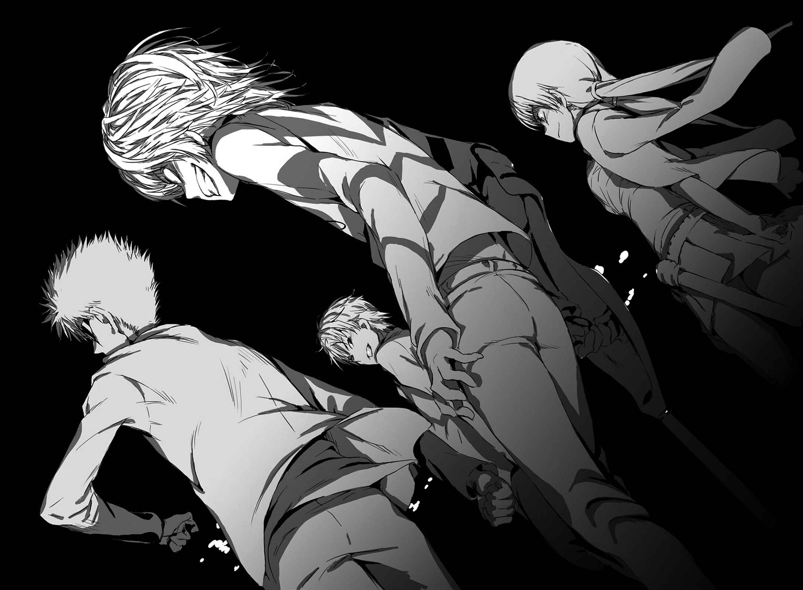

# 终章 某个意志与微小钥匙

> The_Present_Target.

「哼。」

躲在暗处的一方通行(Accelerator)，瞥了一眼断崖大学信息中心正门，一看到美铃的脸便将视线转开。

残留在设施内的Skill-Out比想象中还多，他花了不少时间才解决那些家伙。

但是，想到美铃那样还平安无事，在圆顶里遇到的那个人似乎不是美铃的敌人。从美铃目送救护车离去这点看来，那家伙似乎在途中受了伤。

这种事怎样都无所谓，一方通行(Accelerator)下结论后，从信息中心的后门走出领地外。

此时有人叫住了他。

「我听说你在这里。看你的样子，应该进行得很顺利吧。」

「海原？」

一方通行(Accelerator)厌烦地说道，朝声音的方向望去。

对方咖啡色的清爽头发与优良青年般的五官，跟这样的黑暗一点也不搭。每当他一靠近，**胸口就会感到一股重压传来**。

一方通行(Accelerator)不形于色，不着痕迹地与海原保持距离。

在这样的景色中显得有些醒目的海原，对将黑暗完全纳为己物的一方通行(Accelerator)这么说道：

「不过你又加班了？明明没有薪水，这么过劳不太好吧。」

「吵死了。」一方通行(Accelerator)骂道。

仔细一看，海原附近还站着土御门元春与结标淡希。这么一来，「GROUP」的成员全都到齐了。

「……有何贵干？你们是受『上面』的命令前来处罚我？」

「怎么会，我们是要确认今后的事。」

土御门从墨镜下直盯着一方通行(Accelerator)的脸：

「首先，有关御坂美铃的事，根据我们从**远距离听到的内容**，她已经放弃将女儿带离学园都市。所以就此中止杀她的计划。这算是不幸中的万幸，这件事算是告一段落。」

「『上面』竟然认同这么暧昧的结论？嘴巴上是这么说，不知何时又会改变心意。」

「应该会认同吧……主要都是海原一个人在奔走啦。」

土御门几近哑然般地低语说道。

一方通行(Accelerator)惊讶地看着海原，他在黑暗中微笑道：

「没有啦，**那个少年**似乎遵守了要守护我的心上人，与她周围世界的『约定』。所以我想我也得加油。看样子我似乎有些加油过头了。」

「……你这好好先生，从刚才开始就一直这样避重就轻。应该是用了什么肮脏招数吧？」

结标将手贴在额头上摇着头。

土御门放松肩膀的力量说：

「总之。御坂美铃现在算平安无事。第一次上战场还加班，真是辛苦你了，一方通行(Accelerator)。『GROUP』的工作如何？基本上就是处理某人吃剩的剩饭残渣，不过还是有值得一做的意义吧？」

「混蛋。这一整天不都是暴力的背叛与自相残杀吗？」

一方通行(Accelerator)骂道，土御门也点头。

「没错，就算这样我们还是得守护自己的弱点。虽然舍弃掉可能会比较轻松，我还是无法舍弃……那个没有用处的宝物。」

「……」

「我有妹妹，海原有心上人。结标是过去曾协助过自己的伙伴，你则是量产型(Clone)能力者。」

土御门嘲讽地扭曲着嘴：

「为了守护这么重要的人，用普通方法是行不通的。『上面』的家伙只会说好听话告诉你胜利条件。老实说那全都是假的。这就跟在赌场赌博，结局最终都对赌场的主办人有利。如果只是乖乖遵守规定，根本就无法骗过那些人。那么该怎么做才能胜利？寻找规定的漏洞，还是打翻棋盘狂飙？只能用这样的想法行动。」

「为什么要跟我说这些话？应该不是想要讨好我吧？」

「因为你也许能成为一张好牌。」

土御门轻松地说道：

「我不知道他们在企划什么。对『上面』来说你似乎是很重要的存在。他们现在手上有电极的操纵方式所以很放心，但这反而是个好机会。跟我们联手吧，一方通行(Accelerator)，我们会教你如何在这里生存，你可不能轻易死掉。」

「……」

一方通行(Accelerator)看着「GROUP」的成员。

土御门元春、海原光贵、结标淡希。

无论哪一个都很古怪，不知道这些家伙脑子里在想什么。但是，有关这点自己也是一样。如果要守护最后之作(Last Order)，把他们当成棋子来利用也不错。

「有意思。」

他说道：

「不过，敢拖我后腿，我绝不会饶过你们。我们的联系是利益的联系。贪得无厌只会导致自我毁灭。」

「哼，还真是嚣张的小鬼。」

土御门笑着转过身去。

他轻轻挥了挥手催促大家跟上，仿佛邀请其他人一起去唱卡拉OK。

&nbsp;

「跟上来吧。该反击『上面』了。」

&nbsp;

对一方通行(Accelerator)而言，最大的枷锁就是被「上面」的家伙，从远距离操纵的电极安全装置(Security)。

在电波无法到达的地方无法使用妹妹们(Sisters)的代理演算，光是遮断来自「上面」的远距离操作信号，并没办法解决问题。这么做甚至会断绝跟妹妹们(Sisters)的联系。

乍看之下似乎是完美的操纵装置，反过来说，只要解决这个问题也许就可以脱离「上面」的那些家伙。

首先是设计图，一方通行(Accelerator)心想。

先到青蛙脸医生那里拿到项圈式电极的设计图，再从设计图反推算安全装置(Security)的构造就可以，有时间的话说不定还可以做第二个。

（真有意思。）

他自然地露出笑容。

从远方看来，他们一行人就像同年纪的朋友们闲聊，在夜晚的街道上散步。

但是一方通行(Accelerator)的体内，却有某种火热的东西在蠢蠢欲动。

——电极被远距离操纵前，他通过电话对话过的那个「男人」。

那家伙也许正躺在哪里的沙发里放松休息，也有可能正跟自己走在同一个场所。如果是通过电话的声音，也有可能利用机械骗人，就连对方的性别也不能相信。

在那个混蛋的延长线上，存在着幕后黑手。

所有不幸元凶的幕后黑手。

（有目的还真是件愉快的事。）

夜晚的医院，结束最后之作(Last Order)身体调整的青蛙脸医师接到紧急联络。看样子那个少年似乎又硬撑而被送来这里了。带着苦笑从急救队员那边接受紧急病患的报告似乎不太恰当。

九月三十日那天，最后之作(Last Order)被木原数多强行灌进的病毒，已经完全清除干净了。之后只要让她做些轻松的复健，就能回到原本的生活。

（病毒吗……？）

破坏这个可以妨碍亚雷斯塔的部分计划……当然不可能。果真如此，对方不会这么轻易地放过最后之作(Last Order)。就像往常一样，重要部分全都被隐藏住，外观上则是显得平稳无事。

但计划无疑是利用了最后之作(Last Order)的特殊体质。循这点去追踪，也许可以知道他正在做的事。

青蛙脸的医生看着躺在病床上的少女。

体格约十岁。娇小的她令人忍不住怀疑病床的尺寸是不是搞错了。

「今天的调整到此为止。我得去照顾其他病人。不要做无谓的事，早些休息吧？」

听到这句话，少女轻轻点头。

之后，最后之作(Last Order)动着小小的嘴唇说道：

「那个人……」

青蛙脸医生静静地听着她的话。

「……那个人在哪里？御坂御坂试着向你打听。」

这个问题，无论是谁都无法回答吧。青蛙脸医生当然不能，就连暂定的监护人黄泉川爱穗，还有制作出量产型(Clone)能力者的芳川桔梗，也不知道一方通行(Accelerator)目前在哪里。

即使如此，青蛙脸医生还是这么回答道：

「他很快就会回来的。很快。」

「嗯……御坂好想早点看到他，御坂御坂点头。」

「晚安。」说完后青蛙脸医生走出病房。

为了前往被送来的上条当麻那里，他走在黑暗的长廊上。

他一路走着，并将最后之作(Last Order)的话刻印在心里。

只要患者需要，无论是什么他都会帮忙准备，他就是这样的人。
