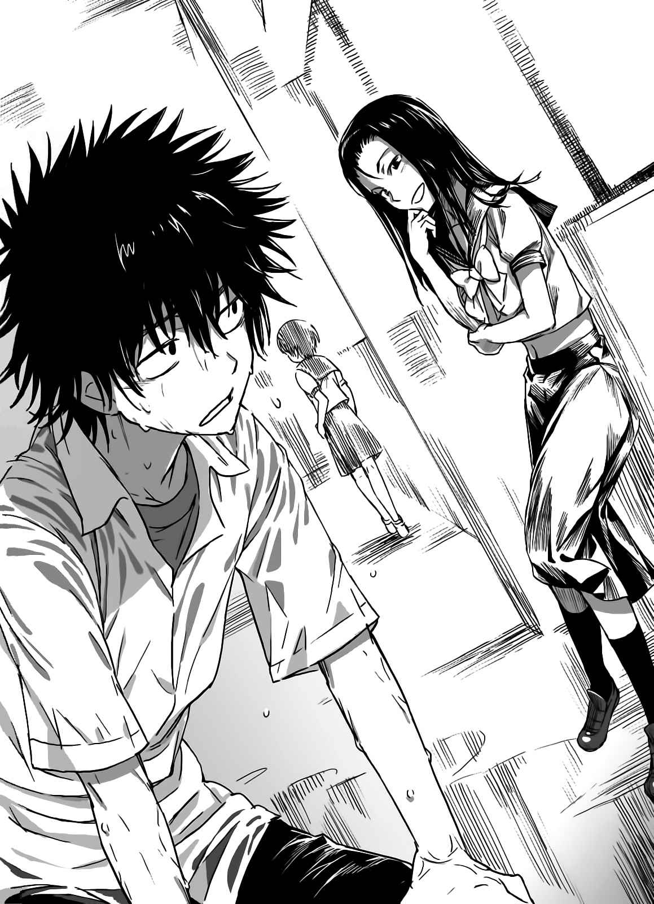

# 第十一章 每个领域都可能有例外

> 七月、第二个星期五

午休结束后空无一人的餐厅里，有个女孩正在午睡。

「喂，你这样未免太明目张胆了吧？」

偶然经过的男教师忍不住这么说，穿着白色短袖水手服的少女没有回答。她将三四把餐厅的椅子排成一列，躺在上面睡大觉。

确定不管过了多久教师都不会离开后，少女总算一脸困意，睡眼惺忪地盯着他。

「……保健室的床铺虽然很棒，可是很快就会被赶走啊。」

「你这家伙这是在瞧不起学校生活吗？」

「不是啦。其实我很爱现在的生活。」

「看起来是很愉快啦，但你享受的根本就不是学校生活。你到底是几年几班啊。现在我马上去叫你的班主任来——」

说到一半，手机来电铃突然响起。男教师一脸厌烦地按下通话按钮，听到对方的出声之后，马上将背脊伸得直挺挺的。

「是，是的，我马上过去。」突然改成敬语的男教师挂断电话，一脸睡意的少女用百无聊赖的语气问道：

「你似乎有急事。」

「混蛋。我马上去叫其他老师过来。马上！」

男教师不甘心地说撂下狠话后走出餐厅。当少女提醒他不可以在走廊跑步时，对方罕见地大声怒骂。

似乎把他逼得太紧了，少女胡乱思考着，等确认过餐厅里没其他人后，她维持躺着的姿势将手伸向桌上的手机。

电话马上就接通了。

呵啊……少女打着小小的哈欠，对话筒说道：

「要开始喽。老人家。」

『什么？』

「气氛险恶的对话。」

&nbsp;

&nbsp;

少女的名字是云川芹亚。

手机那一端的老人，名叫贝积继敏。

「最近，『外面』似乎很乱。」

『你的情报到底是从哪来的……你是说「原石」的事？』

「能拥有像我这样优秀的脑袋，你应该自觉到自己有多幸福了。」

『美中不足的是说话有些脱线啦。』

贝积以平时不会在秘书或部下面前形于外的动作叹了口气，催促她继续说下去。

『你觉得如何？』

「不必理会，那些家伙什么都搞不定。」

『……把这句话写在报告上，你认为有会接受的笨蛋吗？』

「啊。你还真是个小市民呢。」

云川维持躺着的姿势，用纤细的食指戳着自己的太阳穴：

「如果是学园都市的首脑，也就是仅有十二人的统括理事会正式成员所写的报告呢？这样应该就没问题吧。你们不是一个瞪眼，就能封杀周遭的民怨？」

『公家的工作才没那么轻松。』

「竟然把这样的地位称之为公家的工作，你还真是个大人物嘛。」

云川说着将手伸向桌上的超市塑料袋。里面装的是夹满了鲜奶油与水果，像是甜点的三明治。

「真拿你没办法。我会认真思考一下啦。」

『说话之前，先把嘴里的东西吞下去。』

「有关之前提到的『原石』。」

云川维持躺着的姿势嚼着三明治，随意地继续说道：

「清单制作确实是稍晚了点。美国或俄罗斯的那些家伙，应该察觉到我们学园都市在制作清单了。他们拒绝协助，独自开始制作自己本国的清单。照这样下去，很可能会影响到『作业』。」

『……不管怎样，最后你的结论都是「不必理会，那些家伙什么都搞不定」吧。』

「我话还没说完。」

云川冷淡地说道：

「这次我们的问题在于要如何有效率地，『解决』散布在世界各地的『原石』对吧？」

『没错。』

「你们所担心的，是『原石』被其他机关解析，结果有可能产生学园都市以外的超能力开发机关。」

『没错。』

「这样就没问题啦。目前采取行动的是美国或俄罗斯吧。哼哼，冷战当时虽然失败了，到现在都还没舍弃这种梦想？但是他们的研究无法成功。就算有再多的样本，他们也无法理解那个数据的意义。」

『你为何能如此断定？』

贝积有些惊讶。

「这是俄罗斯研究所的状况。说到那个国家最尖端技术结晶的『实用化超能力者』，听说只要呼叫玛利亚的圣名热心祈祷，就能够发动特殊力量……我是无意去否定宗教啦，如果说那是种精神集中法倒也算了……你懂我的意思吗？那些家伙是为了什么，建造了『科学的』研究设施？何谓不可思议、非不可思议，自己所追求的不可思议，又是哪一种不可思议？如果不妥善区别这个部分，将这些当成『整个问题』来处理，是不可能赶上我们的。」

『……』

「人类的技术这种东西，总有一天一定会有人赶上。但是，该往哪条路走，连这种轨道都看不到的家伙，根本什么都做不成。」

云川芹亚一脸无趣的表情。

少女看起来就像喝了难喝的茶，睡意似乎清醒了些。

「你还是无法接受？」

『当然，你的意见没有确切的证据。』

「既然这样，你不会自己准备确切的证据？」

云川的语调跟平常一样冷淡。

「反正，自称开发机关不时都会冒出来，但『原石』的数量在这世界上相当稀少。总数应该只有五十左右吧……『原石』并不同于奇怪的学者，不可能会一直出现。人数不到两个班级的特殊人才，跟活像一大堆虫子似的不断涌现的怪人，你应该知道重点要摆在哪儿吧？」

『……还是这种结论？』

「我不认为那是必要之举，如果你说无法接受我也没办法。文件量爆增我会忍耐啦，身为头脑的我，能说的就是这些了。」

一阵沉默。

贝积总算开口说道：

『所谓「原石」……到底是什么？』

「这是着了学园都市科学的道的人才会说的话。你们一开始就认定只有自己才能制造超能力者。」

『那可不，理论上虽然是能理解。』

贝积似乎在慎重地选择措词。但是，这点在被云川发觉时就已经失败了。既然雇用她担任头脑的工作，就没必要在她面前装出头脑好的样子。

『学园都市所制造的是人工钻石，**如果将自然界调整成完全相同的环境**，就能产生天然的钻石……接下来我考考你。所谓「原石」是什么？』

「……」

『学园都市里也有几个素体。例如「吸血杀手(Deep Blood)」或「幻想杀手(Imagine Breaker)」……我不是要完全否定啦，不过那似乎算不上是什么能力。跟引火或发电这些「容易发现的能力」，感觉上方向完全不同。』

「笨蛋似乎也有笨蛋的烦恼。」

云川哼出了鼻息，然后答道：

「包括你忙着解析原理的学园都市第七位在内，这应该是那些家伙的特性。力量虽然不强，却很稀有。就这层意义来说，对我们而言也有某种程度的价值。」

「仅是稀有，但实际上能真正使用的能力者却很少，这就是问题所在。」云川在心中加了这么一句独白。

「还有，身为头脑的我，要给算是个学者的你一个建议。」

『什么？』

「有关幻想杀手(Imagine Breaker)，最好不要将之单纯归纳为『原石』范畴……详细情形我虽然不清楚，但一定……会比我们想象中更有趣。」

『——』

贝积继敏有些语塞。

这个头脑竟然会说「不清楚」。她考虑过这句话的意义吗？

『……你似乎是乐在其中啊。』

「当然，因为思考是我的工作啊。」

&nbsp;

&nbsp;

下课了，故事的舞台也转移到放学后。黑色刺猬头少年，夹杂在从学校不断涌出，要前去参加社团活动或逛街的学生群中。

但这名少年似乎很不幸，不知什么原因，他头顶上方的防灾喷水器突然出现错误操作。就像戏剧的众光灯般，一个人被淋成落汤鸡的少年，发出了「噗哇哈？」的奇怪叫声。

此时，一名身穿白色短袖水手服的少女走来。

她走到浑身淋湿的刺猬头少年身边，并没有借他毛巾或是手帕，只是单纯地当场捧腹大笑：

「你老是会发生这种不明就里的事呢。」

「……吵死了。反正我就是不幸啦。」

「这种不幸到底是怎么回事？要是详细调查，说不定会发现有趣的法则哦。」

「学姐，你看起来好像很愉快。」

「是很愉快啊。我可是非常热爱现在的生活。」

少女格格笑着继续说道：

「这所学校真是充满了许多刺激。」

