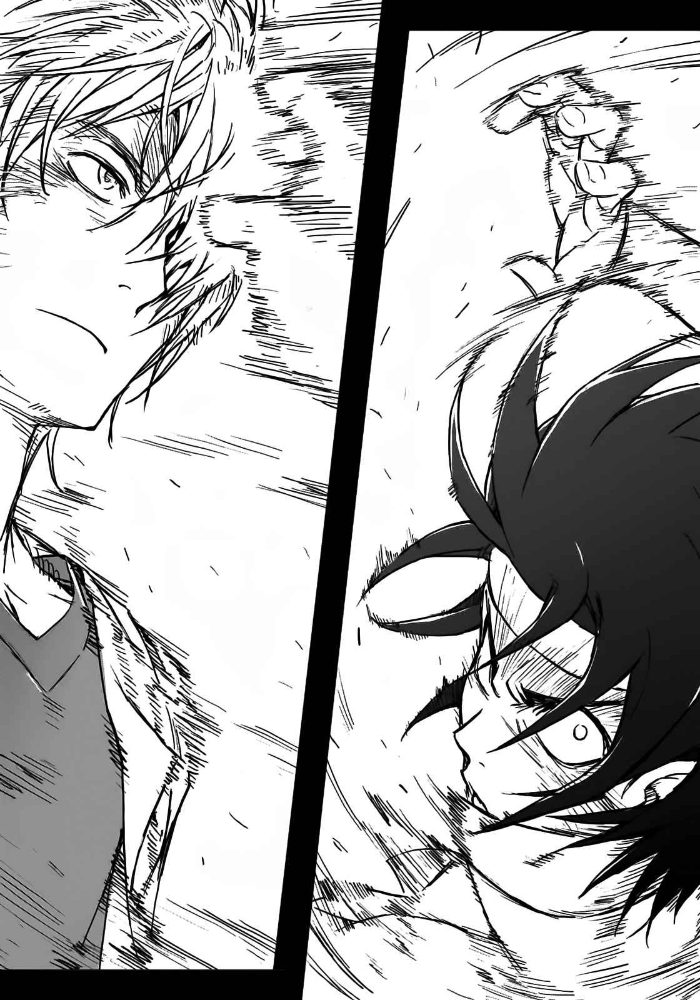

# 第二十一章 无法判断真实身份的人

> 十月、第二个星期五

这可以说是异样的景象。

第十一学区的集装箱集中地带。铁制大集装箱排列的一角，倒着九名少女。从服装到发型、身高、体格、连五官都完全一样的少女们。她们是利用某个超能力者(Level 5)的体细胞生产的妹妹们(Sisters)。

散落在地的步枪、弹匣、以及完全失去意识的少女们。一名男子站在她们的中心点。

毫发无伤。

原本应该成为魔神的男人欧雷尔斯，在夜风中微微眯起眼睛。

因为力量太过强大，所以遭到整个魔法阵营追杀，却将这些追兵全部打倒的这个男人，即使身处科学阵营的大本营学园都市里，依旧没有败北。

「你真厉害啊，还真是了不起。」

这样的声音突然传来。

距离地上的少女们形成的包围网稍远处，站着另一个少年。第七位的削板军霸。学园都市第七位的超能力者(Level 5)，重视爱与骨气的男人。

看到眼前的光景，他露出厌恶的表情。

并非针对有九名样貌相同的少女存在。

削板不会在意这种小事。

「……这么娇小的九胞胎……应该是吧？总之，毫不留情地把这些女孩打倒，你还这么高兴？真厉害，我头一次看到这么没骨气的人。」

「我会这么做其实是有苦衷的。」

欧雷尔斯笑了出来。

他缓缓转头看着第七位。

「如果学园都市要回收世界各地共五十人左右的『原石』，我是不会阻止啦。不过，很难排除他们在这城市里，将『原石』当成不明研究素体的风险。」

既然被这种不寻常的手法招来，「原石」对学园都市的研究者而言，想必也是被定位成稀有之物。这么一来，被某处的变态科学家盯上，关在黑暗的研究所里也并非不可能。

「因此，我才想要确认一下。要说牵制……是没有暧昧到这地步啦。算是用武力交涉吧。只要打败学园都市第七位，而且是世界最佳『原石』的你就够了吧？这样一来，那些**家伙**就会知道，将学园都市保管的『原石』都用完会怎样，我的意图应该就能正确传达。」

「嘿。」

第七位露出微笑。

「你给我听好了，这番话很有骨气。为了仅有五十人左右的孩子们向学园都市最黑暗之处挑战直接交涉？因此要与超能力者(Level 5)其中之一，进行物理性的对决？很好很好，这种胆识还真有骨气。」

「不过，」削板先顿了一下，

「我不知道这些孩子是哪里的什么人。但是，她们还是很有骨气地拼死奋战。说不定，就是为了守护素昧平生的第七位，甚至连话也没有说过的我。」

「……」

「我跟她们之间并没有什么过命的交情，不过这里还是要稍微表现一下骨气。总之，就是这样啦……我要认真打败你。」

之后，第七位所采取的行动很简单。

他只是猛然冲向欧雷尔斯身边，一把抓住他的脸，朝附近的集装箱墙撞去。

然而，

如果这一连串的行动，是以两倍音速的速度来进行呢？

&nbsp;

吱喀！可怕的轰响传来。

钢铁集装箱轻易地破碎，从削板手中脱离的欧雷尔斯，身体穿过集装箱堆成的小山前进了数十米，集装箱群犹如扑克牌金字塔般倒塌，眼看就要降落在削板以及倒地的少女身上，但他一将双手举至头上，空中的集装箱就犹如火山爆发般被吹散。

灰蒙蒙的粉尘扬起。

只有不规则的金属声不断持续响起。

第七位眯起眼睛。

「啧。个性明明就很烂，却表现出这种别扭的骨气。」

「不，我是个没骨气的人。」

粉尘中传来这样的声音。

音源形成了人影，欧雷尔斯缓缓走近。

他身上完全没有变化，感觉上连一根头发都没吹乱。

「不过呢，要找理由，我有。我跟你不同，至少还有奋战的理由。」

「————」

第七位并没有回应。

削板试着接近欧雷尔斯，想让眼前这个没骨气的家伙振作起来。

就在此时，

&nbsp;

这次，换欧雷尔斯展现他力量的真正价值。

&nbsp;

一言以蔽之，就是「无法解释的现象」。

就连直接受到攻击的削板，也完全无法理解自己身上发生了什么事。

但是，待第七位一回神，发现身体早已飞得老远。从肉体的表面到中心，全都受到均等的伤害。并不是先在某处出现打击点，然后冲击再由那一点开始扩张。而是像布浸在水里一样，不自然的伤害浸透全身。

「……？」

即使受到对方的一记安打，使双脚无力就此倒地，在削板军霸脑海里的，并非恐惧而是疑问。

欧雷尔斯的攻击，甚至不容对方感受到生命的危机。

「这世界最恐怖的攻击，就是『无法解释的力量』。」

原本应该成为魔神的男子嘴唇动着。

「无论出现任何不可思议的力量之源，只要当它像剑一般挥下，就以跟剑一般的方式挡下就行。如果像枪一般射过来，就像枪一样防制。能够解释的『未知攻击』……大概就像这种程度。」

伏倒在地的第七位试图起身。

欧雷尔斯纹丝不动。

他并没有采取任何可以说明或理解的动作。

单纯只是发生了某种现象，然后削板的身体又再度往后飞出。

「但是，『无法解释的力量』并没有如此的应对方法。」

欧雷尔斯的语调沉静缓慢。

「这世界最可怕的，就是在无从理解之处运作无法解释的力量，在还没想出对策时就被打倒了。因为暧昧不明，所以连条件都无法定义，在不知该往哪个方向移动几米才能回避的情况下战斗，你现在应该体会到那是多难缠的力量了。」

削板并没有发出惊讶的声音。

虽说并不完全，但欧雷尔斯的「北欧王座(Hildskjalf)」直接命中他两次。传说中的王座原本不存在这样的攻击机能，正因如此，将之强行利用的欧雷尔斯术式，更进化为「无法解释之物」。受到攻击范围与威力定义都很暧昧的「北欧王座(Hildskjalf)」攻击，第七位恐怕已经失去意识了。

「我跟你没有太大差别。」

欧雷尔斯放松力道说道：

「所不同的，就在于是否有自觉地运用『无法解释的力量』，这就是我们之间的差异。学园都市研究员也无法出手，纤细且复杂的第七位……不，你原本就是无法确认，是否能归类为超能力者(Level 5)的特殊能力者。如果你自己能理解这点，或许就能打赢我。」

原本应该成为魔神的男人，目的是与第七位战斗，用压倒性的力量制服他。

这是对搜集大量「原石」的学园都市，所进行的小小牵制。

做到这种地步应该够了吧。欧雷尔斯如此想道，然后转过身去。

「我也有绝不能输的理由。对你来说虽然是场灾难，你就乖乖地倒下吧。这不是有没有骨气的问题。」

就在此时，

&nbsp;

「……这真是让人无法坐视的台词啊，喂。」

&nbsp;

感觉上对方似乎起身了。

欧雷尔斯缓缓转身。眼前站着满身是伤的少年。受到两次「北欧王座(Hildskjalf)」的不明攻击，明明应该昏迷的他却站了起来。这样的结果出乎欧雷尔斯意料，但这才是欧雷尔斯他们生存的世界。

「别人还没放弃，就少随便把我当成没骨气的人啦，你这混蛋。」

他的额头流下鲜血。

呼吸也紊乱了。

但第七位却毫不在意剧痛，盯着欧雷尔斯的脸。

「别以为我会那么简单就被打倒。我要让你知道，表现出一副了不起的样子并不是真正的坚强……！所谓的骨气，不会因为优劣的问题而丧失啦！」

轰！某种不明的力量包围了削板军霸。

「我会让你见识什么叫真正的骨气！根本就不需要理由。堂堂正正的男子汉，不管对方是陌生人或是谁，都会为了受伤害的女孩挺身而出！」

第七位并不抵抗源源不绝涌出的力量，直接往前奔去。

不同于使用「无法解释的力量」的欧雷尔斯，他以任谁看来都一目了然的方式往前冲。

相对地，欧雷尔斯笑了。

他只是笑着，并没有进行任何能说明与理解的动作。

第三发的「北欧王座(Hildskjalf)」，与第七位的超能力(Level 5)。

无法表现、说明、理解的怪物之间，对峙开始了。

然后——
